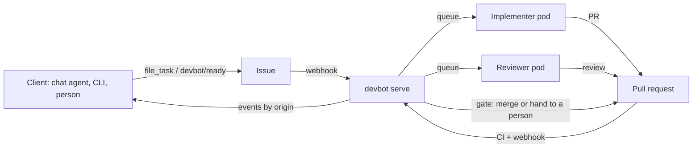

# devbot

Coding agents that work from your issue tracker. A task goes in as an issue,
and a reviewed pull request comes out.

https://github.com/user-attachments/assets/8871c7bc-fb24-4560-ac02-50f84f4d19b0

*Real runs on a devbot install, sped up: a task filed from a chat agent, then a half-finished PR handed over, each carried to a reviewed merge in under three minutes.*

**Getting started:** [docs/quickstart.md](docs/quickstart.md) takes you from an
empty cluster to a first task, step by step.

- **File** work from anywhere: a chat agent through the MCP connector, the CLI or HTTP API, or a person adding `devbot/ready` to an issue, or to an existing pull request (theirs, a dependency bot's, or a fork's) for devbot to carry to merge. Connector callers can sign in through the forge (OAuth), and then act on it as themselves, under its permissions.
- An **implementer** pod sets up the repo's runtime, makes the change, runs the repo's checks and opens a PR.
- A **reviewer** pod, with a different identity, reviews it against the issue's acceptance criteria and the repo's conventions.
- A **deterministic gate** merges it (green CI, an approval pinned to the head commit, no protected paths touched but CI changes a person approved, or devbot did on a clean risk read where the repo allows it) or hands it to a person.
- Every state change lands on the issue and on an **event feed** the filing client follows by its own `origin`.
- An optional, read-only **web UI** on serve shows what's running, queued and stuck, task by task, with links to the issues and PRs ([docs/operating.md](docs/operating.md#web-ui)).

The forge is the system of record: Gitea, GitHub.com or GitHub Enterprise
Server, where the bots are GitHub Apps. Pods scale from zero with the queue
(KEDA), with no concurrency cap. The model never holds a forge or model
credential, and job pods reach only what the egress policy allows.



## Using it from the forge

You can drive devbot entirely from the issue tracker. Each task carries exactly one of these `devbot/*` state labels, and that label is its state:

| Label | Means | You |
|---|---|---|
| `devbot/ready` | queued for an implementer | **add it** to an issue to start a task, to a pull request to have devbot carry it ([how](docs/forge.md#handing-devbot-an-existing-pr)), or to retry a stopped one |
| `devbot/working` | an implementer is on it | wait, or remove the label to cancel |
| `devbot/needs-info` | it asked a question | answer with a comment |
| `devbot/needs-approval` | its work changes CI files, so it holds the change unpushed and shows you the diff (unless the repo sets `approval: auto_clean` and the risk read finds nothing) | read it, **add `devbot/approve`** to have it pushed ([how](docs/forge.md#approving-a-held-change)) |
| `devbot/in-review` | PR open, going through CI and review | wait, or review it yourself ("Request changes" sends it back) |
| `devbot/changes-requested` | PR sent back for a fix (review, CI, rebase) | wait |
| `devbot/approved` | approved and green, automerge off (or waiting its turn to be rebased and merged) | **merge it** |
| `devbot/needs-human` | stopped, and the last comment says why | fix the cause, add `devbot/ready` |

Three labels are flags rather than states, and sit beside them:

| Label | Means | You |
|---|---|---|
| `devbot/automerge` | merge this task once the merge gate passes, even with the repo's `automerge` off (unless it sets `task_automerge: false`) | **add it** to skip the final merge click, remove it to cancel |
| `devbot/rebase` | rebase this task's approved PR onto its base now. devbot doesn't rebase approved PRs just because the base moved | **add it** (or comment `/rebase`) when you want it brought up to date; devbot takes it off |
| `devbot/approve` | push the held change devbot last showed, as it is | **add it** to a task in `devbot/needs-approval` once you've read the diff; devbot takes it off |

Comments direct a task too, from someone who can direct devbot: `/rebase`,
`/wait #N` to have it wait for another task to merge first, and
`/base <branch>` to have its work go into a branch other than the default
(before or after it starts).

Write the issue with an **Acceptance criteria** section; the implementer
builds to it and the reviewer checks against it. Details, including what
devbot posts, how reviews and merges work, and cancelling and retrying:
[docs/forge.md](docs/forge.md).

## Docs

| | |
|---|---|
| [docs/quickstart.md](docs/quickstart.md) | **a first install**, step by step: prerequisites, bots, Secrets, values, `helm install`, the webhook, a first task |
| [docs/forge.md](docs/forge.md) | **using devbot from the forge UI**: the labels and what they do, starting a task, what devbot posts, answering, reviewing, merging, cancelling, retrying |
| [docs/devbot-yaml.md](docs/devbot-yaml.md) | **`.devbot.yaml`**: every key, default and rule, the merge gate, examples. JSON Schema: [docs/devbot.schema.json](docs/devbot.schema.json) |
| [docs/architecture.md](docs/architecture.md) | how it works: components, the two-container job pod, the state machine, a task end to end, usage limits, Redis keys, code map |
| [docs/operating.md](docs/operating.md) | for operators: prerequisites, installing, tested environments, upgrading, uninstalling, troubleshooting, the deployment config, Helm values, secrets, env vars, forge setup, the web UI, metrics and alerts, runbook |
| [docs/reference-architecture.md](docs/reference-architecture.md) | for organizations: topology and data flow, EKS, GKE and on-prem deployments, identity, the security and threat model, sizing, operations, data handling |
| [docs/connectors.md](docs/connectors.md) | for clients: auth (open on a trusted network, or OAuth with the forge as identity provider), signing in, who does what, the MCP tools and HTTP API, event types, answering questions |
| [AGENTS.md](AGENTS.md) | working on devbot's own code |

## Working in a repo

Give the implementer and reviewer bots (for example `devbot` and `devbot-review`)
**write** access: on GitHub, install both Apps on the repo. That's all it takes: without a `.devbot.yaml`, devbot works
like an outside contributor. It follows the project's CONTRIBUTING and
conventions, finds and replays the project's own checks, leaves CI
configuration alone, and leaves merging to people. This is how it works on
projects that aren't yours.

To set a repo's own policy (automerge, checks, protected paths), also:

1. Commit `.devbot.yaml` to the default branch:

   ```yaml
   version: 1
   enabled: true
   automerge: false
   checks:
     - go test ./...
   ```

2. Make sure CI reports a status on pull requests, or set `require_checks: false`.

Then file a task (the `devbot` client runs from the release image too; see
[The client CLI](#the-client-cli)):

```bash
devbot file -repo gitea:acme/webapp -title "Add a Goodbye function" \
  -ac "- Goodbye(name) returns 'goodbye, <name>'
- covered by a test"
```

Or call `file_task` from any MCP client pointed at your install's `/mcp` endpoint.
With `auth.mode: oauth`, the client signs you in through the forge on first
use, and the issue is filed as you ([connectors.md](docs/connectors.md#authentication)).

## Modes

```
devbot serve                  webhooks, MCP + HTTP connectors, reconcile loop, metrics
devbot run implement|review   one job (the harness container of a job pod)
devbot agent implement|review   the agent sidecar (Unix socket at $DEVBOT_AGENT_SOCKET)
devbot model-proxy implement|review   a job pod's model proxy, which holds the model credential
devbot reconcile              one reconcile pass
devbot file|status|list|answer|events|cancel|retry|rebase|retarget|wait|edit   client, against $DEVBOT_URL
devbot login|logout|token     sign the client in (OAuth device flow), for auth.mode oauth with auth.dynamic_device_grant on
devbot coord list|show|note|notes   inside an implement job: the repo's other tasks, and notes to them
devbot version                the version
```

Every command and flag: [the CLI reference](docs/connectors.md#cli).

## Installing a release

Each `vX.Y.Z` release is public multi-arch (`linux/amd64`, `linux/arm64`)
images on Docker Hub, tagged `vX.Y.Z`, `X.Y.Z`, `X.Y`, `X` and `latest`, and a
Helm chart, `oci://registry-1.docker.io/robertlestak/devbot-chart`, whose default
images are those:

| Image | What it has | Runs |
|---|---|---|
| `docker.io/robertlestak/devbot` | devbot, git, mise; no agent CLI | serve, the job harness, the model proxy, the client CLI |
| `docker.io/robertlestak/devbot-codex` | the base image + the Codex CLI | the agent sidecar of a role on `codex` |
| `devbot-claude`: **build your own** | the base image + Claude Code | the agent sidecar of a role on `claude` |

Claude Code is under Anthropic's Commercial Terms, so no public image has it.
To run a role on `claude` (the default harness), build the claude image from
the published base image, push it to your own registry and set
`image.agents.claude.repository` to it: [Agent
images](docs/operating.md#agent-images) has the commands. Without it the chart
refuses to render.

```bash
helm install devbot oci://registry-1.docker.io/robertlestak/devbot-chart \
  --version X.Y.Z -n devbot -f my-values.yaml --wait=legacy
```

[docs/quickstart.md](docs/quickstart.md) has the whole install, and
[Prerequisites](docs/operating.md#prerequisites) what the cluster needs.
How a release is published and cut: [Releasing](docs/operating.md#releasing).

## The client CLI

`devbot file`, `status`, `list` and the other client commands talk to serve
at `DEVBOT_URL`. They are in the release image, so they run with Docker
alone:

```bash
docker run --rm -e DEVBOT_URL=https://devbot.example.com \
  docker.io/robertlestak/devbot:X.Y.Z list -repo gitea:acme/webapp
```

Signing in, and an alias that makes it read like a local `devbot`: [The
client CLI](docs/operating.md#the-client-cli).

## Development

Without a local Go toolchain, `hack/go` runs one in a container:

```
hack/go go test ./...
hack/go gofmt -l .
```

The tests include the engine against an in-memory forge, the harness against
a real git remote with a stub Claude (including the symlink and env-scrub
security cases), each forge adapter against a fake of its API, and a check
that the docs cover every config key. The in-memory forge passes the same
conformance suite as the adapters, and the engine and harness lifecycle tests
run twice: as it names things, and as GitHub does (`slug[bot]` App logins,
provider `github`, a `devbot/attachments` branch). `DEVBOT_TEST_FORGE=github
go test ./internal/core/ ./internal/harness/` runs those two suites
GitHub-shaped throughout. An opt-in live test runs a task end to
end against real GitHub (`go test -tags github_live`; see
[docs/operating.md](docs/operating.md#running-the-live-github-test)); CI never
runs it. `hack/held-ref-check` checks a live Gitea for what [held
changes](docs/operating.md#held-changes-run-no-ci) rely on: that a push to a
ref that is neither a branch nor a tag starts no Actions run.

CI (`.gitea/workflows/ci.yaml`) runs gofmt, vet, the tests and `helm lint`
on every push and pull request. Every commit on `main` that passes also
publishes an image and a Helm chart (`<version>-<sha8>`); installs deploy a
published version. See [docs/operating.md](docs/operating.md#installing).

## License

MIT. See [LICENSE](LICENSE).
