# Architecture

devbot takes a coding task filed as an issue and turns it into a reviewed pull
request. Clients file work and follow it. KEDA-scaled job pods implement and
review it. A deterministic gate merges it, or hands it to a person.

How to deploy it in an organization (topology, cloud deployments, identity,
the threat model, sizing, data handling) is in
[reference-architecture.md](reference-architecture.md).

## Principles

1. **The forge is the system of record.** A task's state is a `devbot/*` label
   on its issue. Attempts, fix rounds and pending questions are hidden markers
   on devbot's own comments. People steer devbot from the forge UI they already
   use.
2. **Level-triggered, not event-driven.** Every entry point does the same
   thing: a webhook, the reconcile loop, a finished job, a connector call. It
   re-reads the issue and its PR from the forge and moves the task one step.
   The order and duplication of events don't matter, so webhooks can be lossy.
3. **Redis is disposable.** It holds queues, leases, the rate-limit hold, the
   event feed and counters. `FLUSHDB` plus one reconcile pass restores
   everything that matters. Connector sign-ins are lost with it, which
   only means clients sign in again, unless Redis persists them. It isn't
   trusted with sign-ins either: each of its clients is its own ACL user,
   and a sign-in record serve didn't sign is ignored.
4. **The model never holds a credential.** A job pod's model harness, its
   forge token and its model credential live in different containers. Nothing
   the model writes is executed by the side holding the forge token, and the
   model reaches its API through a proxy that adds the credential. The forge
   token is its own role's bot's alone: only serve holds both bots'
   credentials. Job pods reach only what the egress policy allows.
5. **The agent provisions its own runtime.** The image is thin, and each run
   installs what its repo needs.
6. **No repo changes required.** A `.devbot.yaml` sets a repo's policy if it
   has one. Without one, devbot works like any outside contributor, under the
   install's default policy, with the checks the project itself uses.
7. **Lowest-common-denominator forge interface.** Core code only uses issues,
   comments, labels, PRs, reviews, commit status and merge, through
   `forge.Provider`.
8. **The forge is also the identity provider.** With `auth.mode: oauth`, every
   connector caller is a person signed in through the forge, and what they
   start is done on the forge with their own token, so its permissions apply
   and it records them as the actor. The bots only do devbot's own work. See
   [Identities](#identities).

## Components

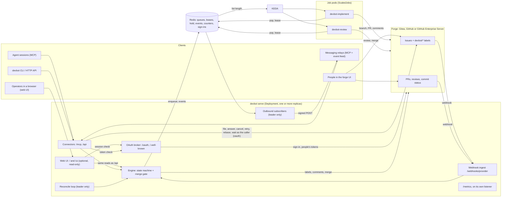

One binary, `devbot`, in several modes:

| Mode | Runs as | Does |
|---|---|---|
| `serve` | Deployment, one or more replicas | on every replica: webhooks, connectors and their OAuth broker, the optional web UI, engine evaluations (including those job pods ask for), metrics. On the [leader](#high-availability) only: the reconcile loop (every `reconcile_interval`), releasing delayed jobs (every 10 s), labelling running job pods with their job (every 10 s, `pod_labels`), starting and deleting job pods' service pods (every 2 s, `services`), outbound subscribers |
| `run implement` / `run review` | the `harness` container of a job pod | pop one job, hold its lease, prepare the workspace, drive the agent, verify, publish, as its role's bot alone; then ask serve to evaluate. An implement pod with no implement job runs a parent's [integration check](#integration-checks) instead |
| `agent implement` / `agent review` | the `agent` sidecar of a job pod | run the role's agent harness (`claude -p` or `codex exec`) and shell commands for the harness over a Unix socket |
| `model-proxy implement` / `model-proxy review` | the `model-proxy` sidecar of a job pod | hold the role's model credential and forward the agent's model API calls with it (see [operating.md](operating.md#model-proxy)) |
| `reconcile` | ad hoc | one reconcile pass, then exit |
| `file`, `status`, `list`, `answer`, `events`, `cancel`, `retry`, `rebase`, `retarget`, `wait`, `edit` | anywhere | HTTP API client (see the [CLI reference](connectors.md#cli)) |
| `login`, `logout`, `token` | anywhere | signs the CLI in to an oauth-mode serve with the device flow |
| `coord` | the agent container of an implement job | the implementer's questions about the repo's other tasks, and its notes to them, answered by the harness (see [Coordination between tasks](#coordination-between-tasks)) |
| `version` | anywhere | prints the version |

## Identities

Three kinds of identity act on the forge, and each does only its own part:

| Identity | Does |
|---|---|
| a person, in the forge UI or (with `auth.mode: oauth`) through a connector | starts, answers, cancels and retries tasks: issues, comments and labels made with their own account or token |
| the implementer bot (on GitHub, the implementer App) | branches, commits and PRs; every devbot comment; state-label transitions; creating the `devbot/*` labels; reading people's permissions. With `auth.mode: none`, also connector calls, for the anonymous principal. |
| the reviewer bot (on GitHub, the reviewer App) | reviews, and merges. A review pod holds no other credential, so the reviewer also reads the task, its PR and CI there, people's permissions for the reviewing model's context, and comments on the issue when a review keeps failing. |

With `auth.mode: oauth`, serve is also an OAuth broker (`internal/auth`): the
authorization server that MCP and API clients sign in to, and itself one
OAuth client of the forge, the identity provider. Clients only hold devbot's
own tokens, bound to its resource URL. The person's forge token stays in
Redis, sealed with the deployment's key, and is used only for that person's own
connector calls. Whatever a person does, through the UI or a connector, comes
back to the engine through the same webhook and evaluation path, and the
same rules decide whether it counts. See
[connectors.md](connectors.md#authentication).

## High availability

serve runs as any number of replicas behind one Service, all on one Redis.
Request handling is stateless across them: a task's state is on the forge,
and everything else serve keeps (queues, leases, locks, sign-ins, the event
feed, counters) is in Redis, so any replica can take any webhook or
connector call.

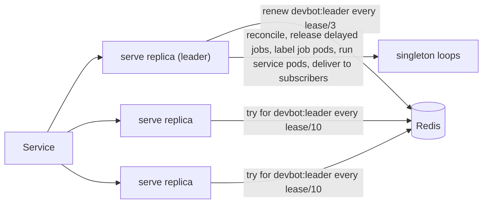

**Leader election.** The loops that must run once per install (reconcile,
releasing delayed jobs, labelling job pods, running service pods, outbound
delivery) run on the
replica holding
`devbot:leader`, a Redis key with a `leader_lease` TTL taken with `SET NX`
semantics in a script. Its value is the leader's **fencing token**,
`<term>/<owner>`: `devbot:leader-term` counts up with every new leader and
the owner is unique per process, so no two leaders ever hold the same
token. The leader renews every `leader_lease / 3` only while the key still
holds its token, and stops its loops if renewing fails for long enough that
the lease might expire; followers try every `leader_lease / 10`. A leader
shutting down cancels its loops, waits for them, and deletes the key, so a
follower takes over at its next try.

**Fencing and handover.** A deposed leader that hasn't noticed yet (paused,
or cut off from Redis) can't do harm:

- Each subscriber's cursor (`devbot:sub:<name>`) is written by a script
  that checks the leader key holds the writer's token, and a delivery loop
  that is refused stops. The new leader carries on from the cursor, so no
  event is skipped; at worst the one in flight at the handover is
  delivered again, which receivers dedupe on its ID. A new subscriber's
  starting point is saved before its first delivery, so a handover can't
  move "now" past an event.
- Reconcile only evaluates, and every evaluation takes the task's lock
  (`devbot:eval:<ref>`), so an old leader's last pass and the new leader's
  first can't both act on one task. A transition, a comment or a queued job
  happens once, and an interrupted pass is simply run again.
- An evaluation holds the lock no longer than `eval_lock_ttl`: each pass
  runs under a deadline of four fifths of it, so one stuck on a slow forge
  (a rate-limit wait, say) is cancelled before its lock lapses, and a
  second evaluation of the task never runs beside it.
- Releasing a delayed job removes it from the delayed set in the same script
  that queues it, so two releasers move it once.

**Reconcile's cost.** A pass makes a fixed number of searches per forge:
one per state label, open and closed (open alone for `devbot/needs-human`),
and one for PRs labelled `devbot/ready`, then re-reads each item found. On
Gitea each search is one paged list from its issue search. On GitHub each is one
search API query (`GET /search/issues`) per installation of the implementer
App, in the account it is installed on (`org:` or `user:`), so the
requests grow with installations and results, not with repos: a query
with more than the search API's 1,000 results is split by `created:`
range until each part fits. The hits are kept to the repos of the
adapter's inventory (the App's installations and every repo of each,
listed in full and kept for an hour or until an installation webhook) that
`repos.allow` / `repos.deny` allow and have issues on. A refresh that fails
keeps the last inventory. GitHub's search index lags writes by up to a
minute or so, so a label set just before a pass may wait for the next one;
webhooks are what devbot acts on at once.

**Per-repo merges** are serialised by `devbot:merge:<repo>` in Redis, taken
by whichever replica or job merges. The gate reads the PR before taking it,
so once held, the PR is read again: one whose base moved meanwhile (another
PR of the repo merged) goes back for a rebase instead of merging a
combination nobody tested, and one whose head moved or that closed is left
to the evaluation that change triggers.

**In-process state.** Nothing kept in one process decides what devbot does:

| State | Where | Across replicas |
|---|---|---|
| per-task evaluation lock, merge mutex, merge retry backoff, enqueue dedupe, job leases | Redis | shared by every replica and job pod |
| `.devbot.yaml` cache (`config.RepoCache`) | each process, 5 min TTL | a push that changes the file bumps `devbot:repo-config:<repo>`; every process reloads on its next read, whichever replica got the push |
| labels known to exist (`Engine.ensured`) | each process | creating labels is idempotent; each replica ensures them once |
| tasks' routing blocks (`Engine.metas`) | each process, least recently used dropped | devbot posts a task's block once, and again only to move a carried fork PR onto `devbot/pr-<N>`; an evaluation that has read the task's comments takes the block from them, so a replica that cached the old one follows |
| PR change sets for the gate (`Engine.changes`) | each process, an arbitrary one dropped past 1,000 | keyed by head and base, so an entry never goes stale |
| evaluations job pods ask for | Redis (`devbot:eval-requests`) | every replica pops them with `SPOP`, so each is taken once, and evaluates under the task's lock |
| OAuth endpoint rate-limit buckets | each process | an address reaching N replicas gets up to N times each limit; the registrations-per-address count is in Redis and holds across them |
| who can read a repo (`CanRead`), task details and issue titles for the UI | each process, 1 min | read-only views, as stale on any replica as on one |
| webhook counters, forge rate-limit waits | each process | per-pod metrics; Prometheus sums them |
| last reconcile time | Redis (`devbot:last-reconcile`) | written by the leader, read by every replica's `/api/status` and metrics |
| event feed trimming | every append (`XADD` with `MINID`) | idempotent: whichever process emits trims, and trimming twice trims once |
| webhook events accepted but not yet evaluated | each process's buffer | lost if the replica dies, and repaired by the next reconcile pass, like a lost webhook |
| job pods already labelled (`Server.labelled`) | the leader | only saves reads: a pod that already carries its labels isn't patched, so a new leader checks each running pod once and patches none twice |
| forge rate-limit backoff, GitHub installation tokens, Gitea label IDs (each read by name when first needed) | each forge client | caches of what the forge says; each replica learns its own |
| GitHub repo inventory: the implementer App's installations and their repos | each forge client, 1 h TTL | an `installation` or `installation_repositories` webhook bumps `devbot:inventory:<provider>`, and the leader lists them again on its next search, whichever replica got the webhook |
| OAuth sign-ins, codes, refresh rotation and their locks | Redis (`devbot:auth:*`) | shared; a refresh holds the person's lock, across replicas too |

**Readiness.** `/readyz` pings Redis, so a replica that can't reach it
leaves the Service until it can; `/healthz` only says the process answers,
so a Redis outage doesn't restart every replica.

## A job pod

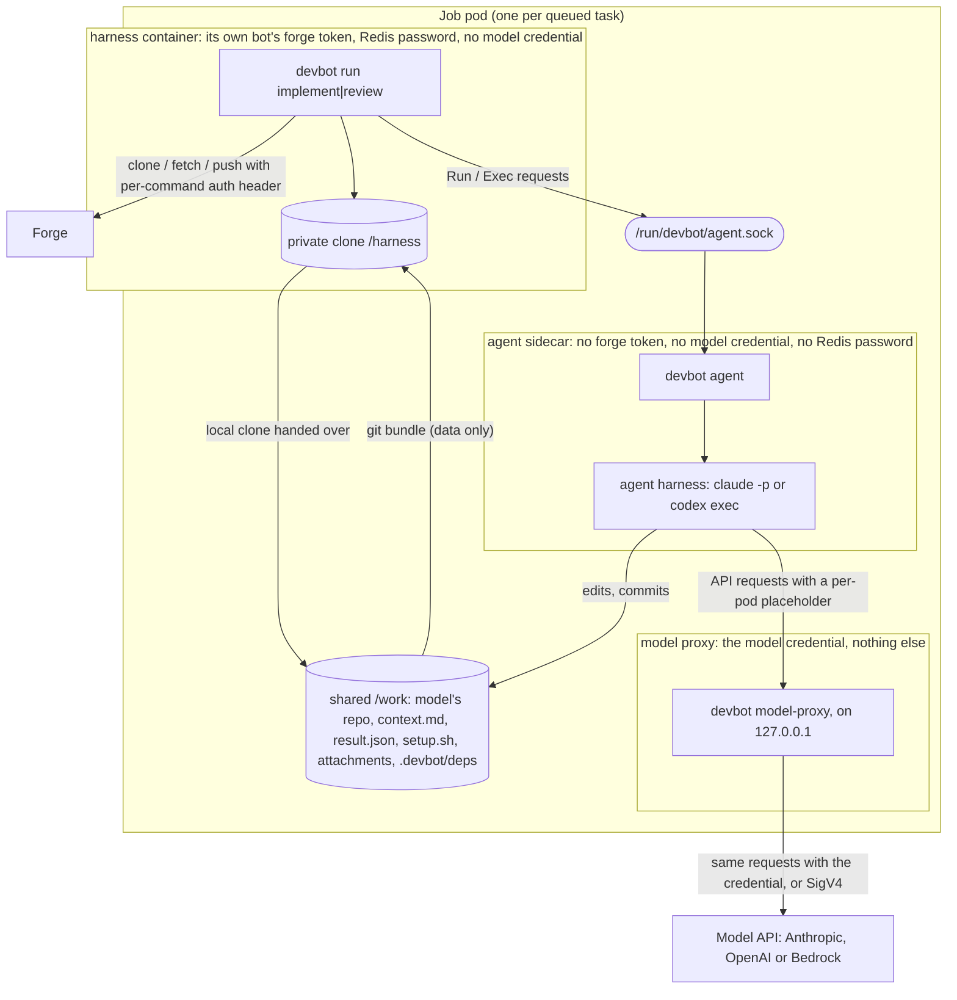

Why separate containers: the agent runs as root so it can `apt-get install`
whatever a repo needs, and the model drives it, so anything in its container
is the model's, and through a prompt injection (an issue body, a repo file, a
fetched page) anyone's. Root in the harness's container could read the forge
token from `/proc/<pid>/environ`, or plant a git hook, `core.fsmonitor` or a
filter driver that the harness's own git commands would run. Across a
container boundary, the model can only leave files in the shared volume, which
the harness treats as data:

- The harness keeps its git clone in its own filesystem and never runs git in
  the model's repo after handing it over.
- The model's commits come back as a `git bundle`, opened with `O_NOFOLLOW`,
  copied privately, then fetched. A bundle is objects and refs, and fetching it
  executes nothing.
- Before pushing, the harness lists what the commits change against their
  merge base with the base branch, with `git diff --raw` in its own clone, and
  pushes nothing that touches a protected path, adds or retargets a symlink or
  changes a submodule: CI would run it, with the repo's secrets, on the push.
  A change to protected files a person may approve (`approvable_paths`) is
  held instead, at `refs/devbot/held/<issue>`, which runs no CI, until a
  person approves exactly the content it shows them, or, under `approval:
  auto_clean`, pushed at once when its risk read finds nothing (see [Held
  changes](#held-changes)). The merge gate repeats the check on the PR's head
  from a fresh fetch.
- Nor does it push work that shares no commit with the base branch, whose
  merge would bring a second history into it. On a PR whose base was
  [rewritten](#a-rewritten-base) under it, the work must also have the new
  base in its history and no longer have the old base commit it was cut
  from; anything else fails the attempt unpushed.
- A task that [builds against another's unmerged
  work](#building-against-an-unmerged-dependency) has that work's PR head
  fetched into a private repo of the harness's, with its credential, and
  written into the model's repo at `.devbot/deps/<provider>/<owner>/<name>/`
  as plain files, through `os.Root`: no `.git`, no remote, no credential.
  Work whose diff names `.devbot/deps` isn't pushed.
- `result.json`, `setup.sh` and other shared files are read through `os.Root`,
  so a symlink to `/proc/self/environ` fails instead of leaking.
- The harness's git always runs with `core.hooksPath=/dev/null` and
  `core.fsmonitor=false`, and passes credentials as a per-command
  `http.extraHeader` that is never written into a config file.
- The agent's environment is scrubbed of anything resembling a forge or model
  credential, as a second line of defence.

The pod shares one network namespace, so the agent can reach Redis too.
Redis has no anonymous user: the harness connects as `devbot-harness` with a
password only its container has, and that user reaches a job's keys and not
the sign-ins under `devbot:auth:*`. Those carry a MAC under a key derived
from the auth key, which only serve has, so a record nobody but serve could
have written is ignored. See [operating.md](operating.md#redis).

The harness itself runs as an unprivileged user with no capabilities and a
read-only root filesystem, holding only its own role's bot credential (on
GitHub, an App key whose tokens are minted for the task's repo alone). The
agent's root is root only in the pod's user namespace. What the chart sets,
and the further hardening it offers (a gVisor or Kata runtime, dedicated
nodes), is in [operating.md](operating.md#security).
### The model credential

The model credential (an Anthropic or OpenAI key, a Claude subscription
token, or the AWS credential Bedrock takes) is in the **model proxy**
container alone: `secrets.agents.<harness>` is mounted there, and EKS's
webhook, told to skip the harness and the agent, puts an IRSA or Pod Identity
credential there only. The proxy shares nothing with the agent but the pod's
network namespace and a read-only file:

1. At start, the proxy listens on `127.0.0.1:8462`, mints a random
   placeholder token, and writes both to `/run/devbot-model/proxy.json`, which
   the agent mounts read-only. The pod's sidecars start in order, so the agent
   only starts once the file is there.
2. For each run, the agent points the CLI at the proxy and gives it the
   placeholder where it would take the real credential: for Claude Code,
   `ANTHROPIC_BASE_URL` and `ANTHROPIC_API_KEY` or `CLAUDE_CODE_OAUTH_TOKEN`
   (whichever kind the proxy holds), or on Bedrock
   `ANTHROPIC_BEDROCK_BASE_URL` and `AWS_BEARER_TOKEN_BEDROCK`; for Codex,
   `-c openai_base_url=...` and `CODEX_API_KEY`, or on Bedrock the
   `amazon-bedrock` provider's `base_url` and `AWS_BEARER_TOKEN_BEDROCK`.
3. The proxy refuses a request without the placeholder, drops it, adds the
   credential (or signs the request with SigV4, from static keys, IRSA's web
   identity or Pod Identity's endpoint) and forwards it to the role's one
   API, streaming the answer back, if it is one of the few routes the CLI
   calls there ([Model proxy](operating.md#model-proxy)); anything else is a
   403. Codex's WebSocket upgrade passes through.

The placeholder is worth nothing outside the pod: the proxy listens on its
loopback only. Inside, the model can use the credential through the proxy
while the job runs, for those routes of that one API, but it can't take the
credential away. The checks and setup scripts get neither the placeholder
nor the credential.

### Egress

Job pods run under a NetworkPolicy per role, on by default, that allows DNS,
Redis, the model API the role's proxy calls and the deployment's allowlist
(CIDRs, namespaces, or an HTTP(S) egress proxy the job containers are
pointed at), and denies everything else: the cluster, the LAN and the rest
of the internet. Kubernetes applies it per pod, not per container, so the
agent can reach the model API too, without a credential. See
[operating.md](operating.md#egress) for the allowlist and its trade-off with
self-provisioning.

The agent is a **native sidecar** (`initContainers` with `restartPolicy:
Always`), as is the model proxy, so the pod completes when the harness exits.

### Attachments

The implementer can put files a reviewer needs to see (screenshots of a UI
change, a rendered image, a short recording, a log) on the PR without ever
holding a forge token. The harness carries them:

1. The model writes them into `.devbot/attachments/`, and may caption them in
   `result.json`: `"attachments": [{"path": "board.png", "caption": "..."}]`.
   Unlisted files are captioned with their name.
2. After the checks pass, the harness reads the directory through `os.Root`.
   Symlinks, non-regular files and listed paths outside the directory are
   refused. Limits per run: **10 files, 5 MB each, 20 MB in all**, and only
   PNG, JPEG, GIF, WebP, MP4, WebM or plain text, by sniffing the content
   (`http.DetectContentType`), not trusting the extension. A name whose
   extension doesn't match its type gets the right one added.
3. It uploads each file with `Provider.AttachToPR` as the implementer (Gitea:
   `POST /repos/{owner}/{repo}/issues/{index}/assets`; GitHub, which has no
   upload API: a commit to `pr-<n>/` on the never-merged `devbot/attachments`
   branch, see [forge.md](forge.md#attachments-on-github)), and the PR body gets an
   `## Attachments` section: images inline with their captions, other files as
   links. A file that was skipped or whose upload failed is listed there with
   the reason; neither fails the job.
4. The `devbot:pr` marker records every attachment, so a fix or rebase round
   appends its new files and keeps the earlier ones when it rewrites the body.
   A file identical to one already attached (same SHA-256) isn't uploaded
   again.
5. A review job downloads the PR's attachments with `Provider.GetAttachment`
   as the reviewer, into the reviewer's `.devbot/attachments/` via
   `writeShared`, before the model starts, and lists them in its
   `context.md`. Because the marker lives in an editable PR body, the adapter
   only fetches an attachment of that same PR (Gitea: the UUID of
   `/attachments/<uuid>`, which must be in the PR's
   `GET /repos/{owner}/{repo}/issues/{index}/assets`, requested from the
   configured server; GitHub: a `blob` URL on `devbot/attachments` under
   the PR's own `pr-<n>/`, read through the contents API), so an edited URL
   can't make it send a token elsewhere or fetch another repo's files. At
   most the newest 30 are fetched.
6. When the engine records a PR merged, finds it closed without merging, or
   ends the task of a closed issue whose PR is no longer open, it calls
   `Provider.ReleaseAttachments` first, best effort: a failure is
   logged and the transition goes ahead. Gitea keeps attachments with the
   PR and does nothing; GitHub deletes the PR's `pr-<n>/` directory from
   `devbot/attachments` in one commit.

The model's own text (summary, notes, check commands and output) goes into
the PR body above the marker, so devbot strips markers and HTML comment
openers from it, and reads the *last* `devbot:pr` marker, the one it wrote at
the end. A prompt-injected implementer can't forge the attachment list.

### Service containers

A repo's `services` ([devbot-yaml.md](devbot-yaml.md#services)) can't be
containers of the job pod: KEDA's pod template is the same for every job of
a role. They run in a **service pod** of their own, one per run, that serve
creates beside the job pod and owns to the run's Job:

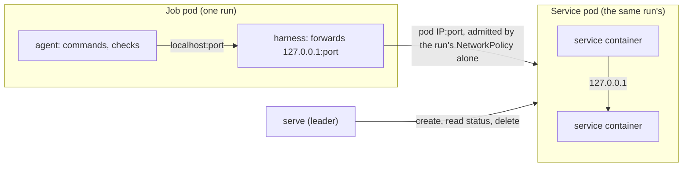

The harness asks for them on its lease and listens on its pod's loopback at
their ports; serve's leader checks the lease against the job pod and the
install's limits, creates the service pod and a NetworkPolicy that admits
only the run's own job pod, and records their status in Redis; the harness
waits for them to be ready before the model starts, and relays each
connection. Because both roles do this, the reviewer runs the tests against
services of its own, too. When no live lease wants the pod any more, serve
deletes it; its deadline and its Job's garbage collection bound it if serve
can't. Job pods still hold no API access. How it is locked down is in
[operating.md](operating.md#service-containers).

### The reviewer

The reviewer works in a checkout of the PR's head, which the implementer
wrote, so nothing in it may steer the review:

- **Its agent CLI ignores the checkout's agent config.** The harness asks for
  the run with `IgnoreRepoConfig`. Claude Code runs with
  `--setting-sources user`: no project or local
  `.claude/settings.json` (hooks, `env`, `apiKeyHelper`), no `CLAUDE.md`,
  commands, agents or skills from the repo. Like every run, it loads no
  MCP servers but devbot's own ([MCP servers](operating.md#mcp-servers)). Codex
  runs with `--ignore-rules`, the checkout marked untrusted (so no `.codex/`
  config, hooks or exec policies), `project_doc_max_bytes=0` (no `AGENTS.md`)
  and `skills.include_instructions=false` (no repo skills). The reviewer
  reads the base branch's `AGENTS.md` for the repo's conventions, and sees
  changes to any of these files in the diff.
- **`.devbot/` starts empty.** The harness deletes whatever `.devbot/` the
  head carries before writing `context.md`, the diff and the
  attachments, so a committed `result.json` is never read as a verdict.
- **Only a finished run gives a verdict.** A run that errored, timed out or
  hit a usage limit is a failed review (retried, then `needs-human`), even
  when it left a `result.json`.
- **The implementer's words are untrusted.** The PR's title and description
  and the commit messages go into `context.md` in the same untrusted fence as
  comments from people who can't direct the work. So do devbot's own comments
  that relay a model's text (the "Opened PR" summary and a question), in
  every agent's context.
- **The reviewer sees every change, or gives no verdict.** The harness
  writes an index of every changed file (`review/index.md`, never cut short)
  and a whole patch for each file that isn't generated (`review/patches/`).
  What counts as generated comes from the base branch's `.gitattributes`
  (`linguist-generated`, or binary) and `generated_paths` in `.devbot.yaml`,
  never from the head, and git reads attributes from the base for the whole
  diff, so a PR can't mark its own changes generated or binary to hide them.
  When the patches that aren't generated come to more than
  `review_budget_kib`, no model runs: the task stops at `needs-human` with
  the sizes, and no request for changes is recorded (see
  [What the reviewer is given](devbot-yaml.md#what-the-reviewer-is-given)).
- **Agent config is always protected.** `.devbot/`, `.claude/` and `.codex/`
  at any depth, `.mcp.json`, `CLAUDE.md`, `CLAUDE.local.md` and `AGENTS.md` are
  in every repo's `protected_paths` (see [devbot-yaml.md](devbot-yaml.md#how-devbot-reads-it)),
  so a PR that changes one stops at `needs-human` instead of merging on
  devbot's approval.

## The state machine

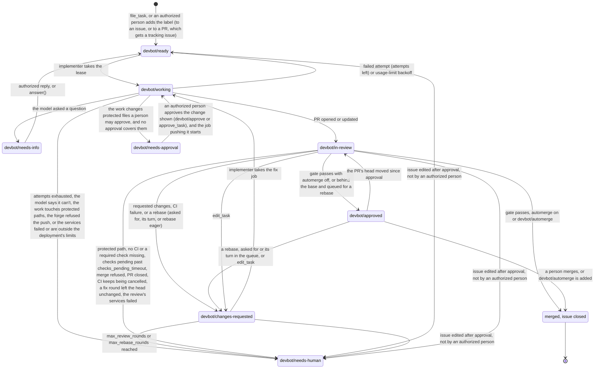

- **Cancel:** remove the state label, call `cancel`, or close the issue. A running job notices on its next heartbeat (about 60 s) and stops. A job that finishes before then can't undo the cancel: every terminal step a job takes (a PR announced and put in review, a verdict, a failed attempt, a question, a wait, a stop at `needs-human`, a usage-limit park) happens under the task's lock, after re-reading the issue, and only while it is open and still at the state the job started from (`working` for an implement, `in-review` for a review). Anything else counts as a cancel: no comment, no transition, no re-queue, no delayed job. A PR the job already pushed stays open, but nothing reviews or merges it. The fleet-wide usage-limit hold is still set, since it's about the model, not the task.
- **Lost lease:** the heartbeat renews the job's lease every 30 s, and so does every terminal step before it acts. When another worker holds the lease (Redis was wiped and the task's job queued again, say), or a renewal keeps failing until the lease could have lapsed (its TTL, 2 minutes, after the last one that worked), the job stops as quietly as for a cancel and leaves the task to whoever holds it: no comment, no transition, no attempt spent. It logs a warning and counts `devbot_jobs_total{outcome="lease_lost"}`. A renewal that fails is retried every quarter of the heartbeat until then. A lease that vanished with Redis, held by nobody, is re-taken.
- **Retry:** add `devbot/ready` to a `needs-human` task, or call `retry`. Attempts and review rounds start over. See [forge.md](forge.md) for the whole label lifecycle from the UI's side.
- **Redirect:** call `edit_task` to change the issue's title, body or acceptance criteria. devbot edits the issue as the implementer and pins the new text to the caller in a `pinned` status, under the task's lock, so the next job carries on from it. A task with an open PR goes back to the implementer (`changes-requested`) with a diff of the change, and reviewer verdicts from before the edit don't count towards the gate.
- **Pod death:** a `working` task with no live lease and no `started` comment in the last 4 minutes counts as a failed attempt and goes back to `ready` (or `changes-requested` when it has a PR, or `needs-approval` when it was the job pushing an approved held change). One whose run posted a hold before its label landed goes to `needs-approval`, with no attempt counted. A `failed` status already posted since the run started (by the run, or by an evaluation whose label write then failed) is that attempt's, so it counts once.
- **Comments before labels:** a stop (`needs-human`, `cancelled`) is commented on before its label is set, and an evaluation that finds the same comment as the task's latest status only sets the label: a label write that failed doesn't post it twice. A merge closes the issue before taking its label off, so an issue whose close failed still carries the label reconcile looks for.
- **Fix requests half made:** a fix round is asked for in a `fix-requested` comment, then the label moves to `changes-requested`, then its job is queued. A task still `in-review` or `approved` whose latest round status is that request, for the PR's current head (any head, for an `edit_task`'s), with nothing since (no `started`, `failed`, `question`, `held` or `pr` from a run, no `needs-human`, `cancelled` or `reset`) and no implement job queued or running, had its label write fail: the next evaluation moves it to `changes-requested` and queues the round, from that comment's reason, without posting it again. One already in `changes-requested` with no job gets it queued the same way.
- **Wait:** a task can wait on another, of its repo or any other, to merge first (`wait_task`, a `/wait #N` or `/wait REF` comment, or the implementer asking), and on another repo's task, also until a tag contains the merge (`/wait REF until tagged`). It keeps its label meanwhile, but nothing is queued for it and its PR doesn't merge; see [Coordination between tasks](#coordination-between-tasks).
- **Parent task:** an issue labelled `devbot/parent` groups child tasks across repos. It has no state label and no implement or review job is ever queued for it: its state is rolled up from its children's, and its repo may run an integration check over them; see [Parent tasks](#parent-tasks).

### Skipped webhooks

An org-wide install gets every issue, PR, comment and check event of every
repo, and most are about nothing devbot works on. serve drops those before
it asks the forge anything, the repo's `.devbot.yaml` included, from what
the delivery itself says and what Redis has of devbot's work:

- **An issue, PR or comment event** is handled when the issue or PR carries
  a `devbot/*` label (a person adding `devbot/ready` to a new one included),
  is a PR on a `devbot/*` branch, is a PR a task has (its own, or one it
  carries), or is a comment with a line starting `/base`, `/model`, `/rebase` or
  `/wait`, or mentioning a bot. Only a state label makes an issue a task and
  only `devbot/ready` or a task's link makes a PR devbot's, so the rest
  would change nothing. A check event that names its PRs is handled for a
  task's PR or one on a `devbot/*` branch.
- **A status**, or a check event that names no PR (a head on a fork), is
  handled only when the SHA is the head of a task's PR, and evaluates that
  PR without listing the repo's open PRs.

The PRs tasks have, with their heads, are in `devbot:tracked:pr:*` and
`devbot:tracked:head:*`. Each evaluation that finds a task's PR records it
there, for 24 hours, and a reconcile pass evaluates every task, so the
index comes back with the first pass after a Redis wipe. Until then, and
for anything dropped wrongly, reconcile is the safety net, as for a lost
webhook. A delivery whose adapter couldn't say what it is about (a Gitea
event that names a PR by number alone) is never dropped. Dropped events
are counted in `devbot_webhook_events_skipped_total`.

### Rate-limited events

An event whose handling a forge's rate limit stops (GitHub's primary or
secondary limit, past the two minutes a call waits one out, or a
low-priority event deferred while the quota is low; see
[GitHub rate limits](operating.md#github-rate-limits)) isn't lost. serve
keeps it in Redis (`devbot:later:*`) until the limit resets, its delivery
still marked so the forge's redeliveries are duplicates of it, and every
replica looks every 5 seconds for kept events that are due, each taken by
one. Events about the same issue, PR or head are kept as one, the newest,
since an evaluation reads everything again; a comment is kept on its own,
as it may be a command. One put off five times is dropped, its delivery
unmarked, and left to reconcile. Each outcome is counted in
`devbot_webhook_requeue_total`.

### Markers

Hidden HTML comments, invisible in both forges' rendering:

| Marker | Where | Carries |
|---|---|---|
| `<!-- devbot:v1 {...} -->` | the bot's comment on the issue, posted by `file_task` or `file_project`, or when devbot opens a tracking issue to carry a PR | `origin`, `requester`, `requester_handle`, `base`, `carry`: the PR a tracking issue carries, `kind`: `parent` on a [parent task](#parent-tasks), `parent`: on a child task, its parent task's full ref, and `model` and `review_model`: the task's [own models](forge.md#choosing-the-model) as filed (on a parent, its children's), until a `model` status overrides them |
| `<!-- devbot:status {...} -->` | every devbot comment | `kind` (`started`, `pinned`, `failed`, `question`, `answer`, `pr`, `fix-requested`, `approved`, `queued`, `head-moved`, `needs-human`, `reset`, `cancelled`, `ignored`, `rebase-requested`, `rebase-skipped`, `rerun`, `wait`, `wait-refused`, `released`, `note`, `base-refused`, `model`, `model-refused`, `model-ignored`, `model-fallback`, `held`, `approval`, `child`, `completed`, `building`, `integration`, `automerge`) plus `job` (on `started`, the job pod that took it), `attempt` (on a `rerun`, which re-run of the head's cancelled checks it is), `mode`, `pr`, `sha` (on a `pr` status, the head the push made: a fix round asked for a head is over, with the head unchanged, only once the PR shows that head again), `principal`, `unchanged` on a `pr` status when a fix round's push left the PR's changes as they were, `pin` on `started` and `pinned`: hashes of the issue's title and body as approved, `mode: edit` on the `pinned` status and the `fix-requested` round an `edit_task` posts (the latest such pin marks when the task was redirected, and the reviewer bot's verdicts from before it don't count towards the gate), and `base`: on a retarget's `reset` (`mode: retarget`), the task's base branch from then on; on `started`, the base the run started on, which a task without a base of its own was accepted onto (its job's, from the repo's `base_branch` or default branch), so a later edit to `base_branch` doesn't move it; on a `pr` status, the branch the pushed head was built on; `base_sha`: on a `pr` status, the commit of that branch it was built on (its merge base), where a replay of the PR's own commits cuts once the branch's history is [rewritten](#a-rewritten-base); `task`: on a `wait`, the task it waits on (0 ends the wait), with `role: implement` when the implementer proposed it, and `until: tagged` (and `pattern`, a tag glob) for a [release gate](#release-gates), and `build: true` when it [builds against](#building-against-an-unmerged-dependency) that task meanwhile; on a `released`, the task it waited on, with `mode` saying how that one ended (`merged`, with `pr` and `base` the merged PR and its base; `merged-elsewhere`, into a branch other than this task's base; `merged-other-repo`, a task of another repo into its own base; `tagged`, that merge in a tag, with `tag` the tag and `sha` the merged commit, and `build: true` when the wait built against it; `cancelled`, `failed`, `gone`, `cycle`); on a `note`, the task that sent it, with `role` its agent's; `repo` beside `task` when that task is of another repo than the issue's, which a marker without it is (see [Coordination between tasks](#coordination-between-tasks)); `building`, with `pr`, a PR held while its task builds against another's unmerged work; on a `queued`, the PR and head waiting their turn in the base's [rebase queue](operating.md#rebasing-approved-prs); `rebase-requested`, with `principal`, a `rebase` call or `/rebase`; `rebase-skipped`, with `pr` and `sha`, the answer to one when the PR was already up to date; `base-refused`, with `principal`, the answer to a `/base` comment naming a branch devbot can't use; `model`, with `role` and `model` (`""` for none), the task's own model for that role from then on, set by `principal`; `model-refused`, with `role` and `principal`, the answer to a `/model` comment naming no model devbot takes; `model-ignored`, with `since` the `/model` comment from someone who can't direct devbot it answers; `model-fallback`, with `role` and `model`, a task model `repos.limits.models` refused, said once; `held`, the work a run [held](#held-changes) for approval: `sha` the held commit, `pr` the PR it is for (0 before one), `base`, `branch` where it goes, and `files`, each protected file it changes as it leaves it (`path`, `mode`, `blob`); `approval`, a person's approval of one: its `sha` and `files`, and `principal`; on a [parent task](#parent-tasks), `child`, with `task` (and `repo`) a child filed under it, `needs-human`, with `task` the child that stopped and `since` the child's own `needs-human` comment, and `completed`, its summary once every child merged, and `integration`, its [integration check](#integration-checks) of `heads` (each child's PR head, `<task>@<sha>`, sorted) with `mode` `started`, `passed`, `failed`, `error` or `retry`, and `approved` with `mode: integration` on a child waiting for it, and `automerge`, its `devbot/automerge` label as devbot last carried it to its children, `mode` `on` or `off`, with `children` the children (full refs) whose label that changed. A `held`, `approval`, `integration`, `plan` or `model` in a comment edited since it was posted counts for nothing |
| `<!-- devbot:checklist {} -->` | the bot's comment on a parent task | marks the checklist of its children, which devbot edits in place; what it lists is read from the children, never from the comment |
| `<!-- devbot:pr {"issue":N,"attachments":[...]} -->` | PR body | the issue the PR belongs to, and the files attached to it (name, caption, URL, sniffed type, SHA-256) |
| `<!-- devbot:carry {"issue":N} -->` | the bot's comment on a PR it carries | the tracking issue that carries the PR, as `devbot:pr` names a devbot PR's issue |

Only markers on comments **by the bot users** count, so a person can't forge one.
The routing block is one of those comments rather than part of the issue body,
which its author can edit. devbot writes its own marker at the very end of what
it posts, and reads the *last* marker of a kind, in a comment as in a PR body.
Every piece of untrusted text devbot posts as a bot above a marker (model and
check output, the reviewer's verdict, review bodies, CI descriptions and forge
merge errors it quotes, relayed answers, the caller's principal, the `file_task`
body) has its markers removed and HTML comment openers escaped first.

A task's PR is the one its routing block's `carry` names, for a
[carried PR](#carried-prs), else the one its latest `pr` status names.
Without either, devbot adopts an open PR on `devbot/<issue number>-*` only if
the implementer bot opened it from the repo itself: a fork's PR from a branch
of that name is not the task's, and devbot would push to and retitle
whatever it adopted.

### Carried PRs

A person can hand devbot a PR it didn't open by adding `devbot/ready` to the
PR ([forge.md](forge.md#handing-devbot-an-existing-pr)). devbot's model stays
one issue per task: the PR gets a **tracking issue**, which holds the state
label, the status comments, the routing and the events, and the PR is that
task's PR from the start.

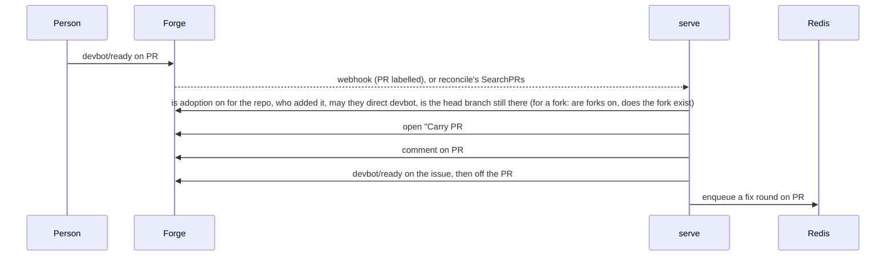

- **Adopting** runs under an evaluation lock on the PR's own ref (PR and
  issue numbers share a sequence, so it is never a task's), and is
  level-triggered like everything else: each step is looked for before it is
  taken. The PR's carry link finds an open tracking issue that exists
  already, and the issue gets its state label only after the link is posted,
  so a webhook redelivered or a reconcile pass after a failure part way
  finishes the job rather than opening a second issue. A failure between
  filing the issue and linking it leaves an issue with no state label, which
  devbot ignores. A repo with adoption off (its `pull_requests.enabled`,
  capped by `repos.limits.pull_requests.enabled`), a fork's PR
  where forks are off (`pull_requests.forks`, capped the same way), an
  unauthorized label, a head branch or fork that's gone, or one of devbot's
  own PRs is refused with a comment on the PR, and the label taken off; a repo the implementer can't push to isn't opted in
  at all. Reconcile lists open PRs carrying `devbot/ready` with
  `Provider.SearchPRs` each pass, for a webhook that was lost.
- **Routing back:** a PR event finds its task by the PR body's `devbot:pr`
  marker, else by the latest carry link among the bots' comments on the PR.
- **The task** goes through the usual states, with a few differences. Its
  first job is a fix round on the PR (mode `fix`), told it is carrying the
  PR; a PR that touches protected paths stops at `needs-human` before that,
  rather than at the gate. The harness checks out the PR's head branch, gives
  the implementer the PR's reviews and conversation (fenced as untrusted when
  their author can't direct devbot), and pushes without `--force` unless the
  work no longer contains the head it started from, when it pushes with
  `--force-with-lease` on that head and says so on the PR. It leaves the
  PR's title and body alone, comments on the PR after each push, and never
  pushes the partial work of a run that stopped part way. A carried PR that
  merges or closes while the task is in any state is the gate's to record:
  there is no starting over on a new branch. The PR's branch is the
  author's, so branch cleanup never deletes it.
- **Events and status** show the PR's URL from the moment the task is filed
  (`task.filed` included), since the routing block names it.
- **Forks:** a fork's PR is always read from `refs/pull/<N>/head` on
  origin, never from the fork: the harness fetches it into a ref of its
  own, since a fork's branch may share a name with one of the repo's. One
  that allows maintainers' edits (`forge.PR.MaintainerCanModify`), from a
  fork the implementer's git credential reaches, is carried on its own
  branch as above, and the harness pushes back to the fork (`HeadRepo`, the
  fork's owner and name, at a URL built from origin's configured one by
  `core.ForkURL`, never the forge's advertised clone URL). Reaching it is
  checked with git, not the forge's API, since a GitHub App's installation
  on the repo, not on the fork, is what pushes: adoption runs `git
  ls-remote` on the fork's branch (`Engine.ForkReachable` in tests), and
  `prepare` a `git push --dry-run` there before the agent starts. A fork
  that answers either with not found or forbidden (`core.ForkRefused`), or
  refuses the run's real push, moves the task onto `devbot/pr-<N>`:
  `Engine.SupersedeCarry` comments why on the PR and posts the routing
  block again with `supersedes` N in place of `carry`, and the run goes on
  as the superseding run below, opening devbot's PR without a failed
  attempt. The latest routing block wins, and `meta` reads it from the
  comments whenever an evaluation has them, so a process that cached the
  old one follows; `findPR` skips a `pr` status for #N itself.
  `prepare` refuses a push with no fork to push to rather than fall back to
  origin's branch of that name, and a carried fork PR whose fork was
  deleted (`core.ForkGone`: `Fork` with no `HeadRepo`) stops at
  `needs-human`, both when `ready` queues its run and when the harness
  starts one. The reviewer checks a fork PR out from `refs/pull/<N>/head`
  on origin. One that doesn't allow edits is carried on `devbot/pr-<N>`
  from adoption: the routing block has `supersedes` N rather than `carry`,
  the first job is a new run that starts the branch from
  `refs/pull/<N>/head` and opens devbot's own PR, crediting #N, and
  comments on #N; `findPR` finds that PR by its status or its branch. A
  fork's PR that closes before that run, or touches protected paths, stops
  at `needs-human`. Recording the merge of devbot's PR thanks #N's author
  and closes #N (`CloseItem` takes a PR's number), once, by a `superseded`
  status on #N. The merge gate reads a fork PR's change set from
  `refs/pull/<N>/head`.

### A rewritten base

A base branch force-pushed to a history the PR doesn't share (a re-squash
of `main` at a release, say) leaves the PR with no common ancestor. Each
adapter reports it as `Behind` and `Unrelated`: Gitea answers an empty
`merge_base` for an open PR whose base branch is there, and GitHub's compare
answers 404 "No common ancestor"; any other failed compare says nothing. The
merge gate never merges such a PR, automerge or not, whatever the forge says
of `mergeable`, and doesn't wait for the forge to work out whether it
conflicts: it goes to a rebase like any stale PR, and a `/rebase` is never
answered "up to date". Merging it would bring the old history back into the
base as a second root.

A plain `git rebase origin/<base>` would replay the old history too, so the
rebase round says the base was rewritten and gives the implementer the cut
point: the base commit the PR was last built on, which every push records
as `base_sha` on its `pr` status, on the forge. The implementer replays only
the PR's own commits, `git rebase --onto origin/<base> <base_sha>`. The
harness finds the rewrite from git itself, so a round asked for before it
(or one that isn't a rebase) is told too, and the push is held to the new
base (see [A job pod](#a-job-pod)).

## Held changes

Work that changes protected files a person may approve (`approvable_paths`,
by default the CI configuration) never reaches a branch before a person has
read it, since CI runs a branch's workflows with the repo's secrets on push:

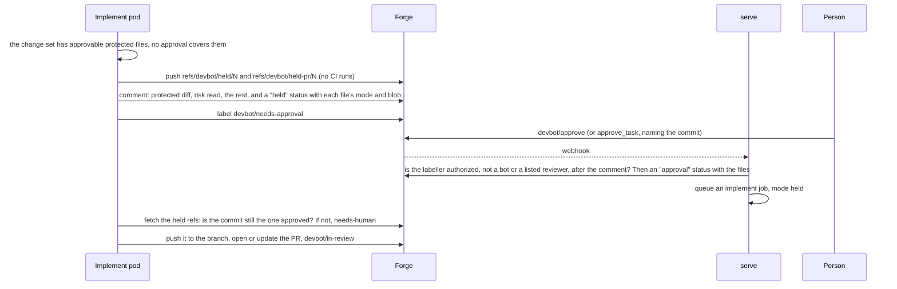

- **Storage.** The held commit goes to `refs/devbot/held/<issue>`, and a
  commit of devbot's own holding the run's `result.json`, `setup.sh`, checks'
  output and attachments to `refs/devbot/held-pr/<issue>`, so the job that
  pushes after the approval opens the PR the run would have. Neither is a
  branch or a tag, which forges run CI for; that was checked live on Gitea
  (see [operating.md](operating.md#held-changes-run-no-ci)). Both are deleted
  once the change is on its branch.
- **State.** The task is at `devbot/needs-approval`, which nothing times out
  and nothing re-queues: the `held` status on the issue, and the refs, are the
  record, so it survives the pod, a restart and a Redis wipe. A hold isn't a
  failed attempt. A run whose hold comment landed but not its label is put at
  `devbot/needs-approval` by the stale-`working` check rather than counted as
  dead, and a held job that dies goes back there.
- **Approval.** `devbot/approve` added by someone who may direct devbot, not
  one of the bots nor a login listed in `trusted_reviewers` or
  `required_reviewers`, strictly after the hold's comment, is recorded as an
  `approval` status carrying the hold's commit and files. `approve_task`
  takes a signed-in caller only: it checks the commit named against the
  latest hold under the task's lock, then adds the label as the caller. The
  held job pushes only if the ref still holds the approved commit, and
  otherwise stops at `needs-human`.
- **Content, not the task.** Every later push compares the protected files it
  changes, by path, mode and blob, with the approval of the latest hold since
  the last `reset` (a retry or a retarget): exactly those files, as approved,
  let it through, anything else holds it again. The merge gate does the same
  on the PR's head, so a protected file someone changed after the approval
  stops the merge.
- **Edited comments.** Anyone with write access can edit a bot's comment, so
  a `held` or `approval` status in a comment whose updated time is after its
  created time is ignored.
- **What the person reads.** The diff is run with `--text`, with
  `core.attributesFile` and `--attr-source` pointing at nothing, so no
  `.gitattributes` can show a workflow as binary or through a driver, and a
  protected file that is binary or not UTF-8 stops at `needs-human` rather
  than being held.
- **Always protected stays protected.** `.devbot.yaml`, agent config,
  `CODEOWNERS` and `.gitattributes` at any depth, symlinks and submodule
  pointers never are approvable: a change to one beside an approvable one
  still stops at `needs-human`.
- **Approval without a person.** Under `approval: auto_clean`, a run whose
  risk read finds nothing posts the hold comment (its `held` status marked
  `auto`) and an `approval` status of its own, then pushes from the same run:
  nothing goes to the held refs and the task never reaches
  `devbot/needs-approval`. Later pushes and the merge gate read that approval
  as they read a person's. A run that dies after an `auto` hold is a failed
  attempt, not a hold to go back to, since nothing was kept to push; the
  next run's push goes straight through if its protected files are still
  the approved content.

## Coordination between tasks

Tasks run side by side, and each agent works in a pod that reaches no
other (see [Egress](#egress)). Two agents changing the same code would each
build against the base alone and meet only at merge. devbot coordinates
them through itself and the forge instead of a channel between pods: every
run stays isolated and retryable, and everything one task tells another is
on the forge, attributed and durable.

The in-flight listing is of the task's own repo, and of a child task's
siblings in other repos (see [Parent tasks](#parent-tasks)). Notes and
waits also reach a task of another repo, on any provider the install has (a
library and its consumer, an API and its client), named by its full ref,
`gitea:acme/lib#12`; `#12` always means the task's own repo. Whoever sets
such a wait or sends such a note must be able to direct devbot on both
repos (see [Across repos](#across-repos)).

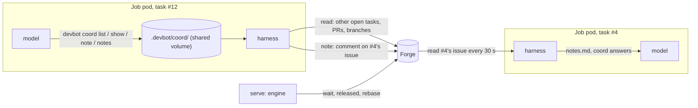

### In flight

When an implement or review run starts, the harness lists the repo's other
open tasks (by their state labels) and open PRs (`core.InFlight`), each with
its state, base, PR, description, what it waits on, and the files its PR
changes. The files come from git, in the harness's private clone, which
already has the repo's branches (a fork's PR head is fetched from
`refs/pull/<n>/head`). Ones that overlap this task come first, with their
diffs in `.devbot/inflight/<n>.patch` (64 KB each, 512 KB in all): a path
this task's branch already changes, or one its issue names (a file or
directory the base has, or a new file's name). It goes into `context.md` as
"Other work in flight", all of it fenced as untrusted: other agents' and
people's words. A task without a PR yet shows its issue; what it changes
isn't known until it opens one, which is what notes are for. An open PR
that isn't a devbot task's, from an author who can't direct devbot (a
fork's, say), shows only its number, title and changed files, enough to see
an overlap: its description and diff aren't passed on.

A child task's [siblings](#parent-tasks), the other children of its parent
task, come first and are marked as such, those of other repos by their full
ref, without a diff.

The reviewer gets the same view of the work around the PR it reviews, and
its prompt has it check the PR against overlapping work for semantic
conflicts (a format one changes that the other still reads the old way, a
snapshot the other's new columns don't match) and name them in its review.

### `devbot coord`

The model has no forge credential, so the tool it uses mid-run is a file
exchange with its own harness. `devbot` is in the agent's image, and
`devbot coord <op>` writes a request to `.devbot/coord/<id>.req` in the
shared repo and waits for `<id>.resp`. While a model run is in progress, the
harness looks for requests every second, reads each through `os.Root`
(16 KB at most, regular files only), answers it, and removes it:

| Command | Answer |
|---|---|
| `devbot coord list` | the in-flight listing again, after a fetch of the repo's branches |
| `devbot coord show N` | task #N (or PR #N that isn't a task's) in full, with its current diff |
| `devbot coord show REF` | a task of another repo, by its full ref, as the listing would show it there; without a diff, as the private clone is of this repo alone |
| `devbot coord note N TEXT`, `note REF TEXT` | sends task #N, or a task of another repo, a note (below) |
| `devbot coord notes` | the notes other tasks left this one since the run started |

The harness's git work (the fetch, the diffs) is in its private clone, never
in the model's repo, and the answer is data the harness wrote. Requests are
only answered while a model run is in progress, so they never overlap the
harness collecting or pushing the model's work.

### Notes

A note is a comment devbot posts on the receiving task's issue, as the bot
of the receiving repo's provider, attributed to the sending task and agent
("Note from #12 (title), left by its implementer agent through devbot", or
"Note from gitea:acme/app#12" from another repo), with a `note` status
marker naming the sender. The text is quoted and defanged like any
untrusted text devbot posts. Notes are bounded: 2,000 bytes each, 5 per run
(counted by the harness), and 5 a day from one task to another, counted from
the receiving issue's markers, so the bound holds across runs, pods and a
Redis wipe. Only open devbot tasks receive them.

The receiving agent gets a note:

- **at its next step, if it is running.** Its harness reads the issue every
  30 seconds, writes new notes to `.devbot/notes.md`, and puts them first in
  the answer to the model's next `devbot coord` request. A note that came in
  after the model last looked is handed over before the run's result is
  taken: the harness resumes the model once with it (and with any check
  failure it is resumed for anyway).
- **at the start of its next run, if it isn't.** Notes are in the issue's
  discussion in `context.md`.

Either way it is fenced as another automated task's words, information
only, to be weighed against the task's own issue and acceptance criteria. A
note is just a comment to the engine: no marker or command in it counts,
and nothing a note says changes a task's criteria, base, labels or
permissions. Each note also emits `task.note` on the receiving task.

### Waits

A task can wait on another, to be built on (or rebased onto) that one's
merged result instead of conflicting with it, or, for a task of another
repo, to go on only once that one's work has landed:

- a person who can direct devbot comments `/wait #N` (or `/wait REF`) on
  the issue (`/wait none` ends it), or calls `wait_task`;
- the implementer finishes with `status: wait` and `wait_on: N` (or a full
  ref), saying why. devbot pushes the work so far to the branch and applies
  the same rules.

A wait on a task of another repo can carry a [release gate](#release-gates),
`until tagged`, to go on only once that work is published. With `build
against` after the gate, it [builds against that work while it is
unmerged](#building-against-an-unmerged-dependency) instead of waiting for it.

The rules: #N is another open devbot task; in the same repo, it goes into
the same base branch (so its merge lands where this task builds; a
release-branch batch waits within the release branch); and the wait doesn't
close a cycle, followed through each task's own wait, across repos and
providers. A wait they refuse is a `wait-refused` comment saying why, or
the connector's error, and for the implementer a failed attempt.

The record is the `wait` status on the waiting task's issue, so a wait
survives pod death and a Redis wipe. Each evaluation of a waiting task
settles it first:

- **#N still to merge:** the task is held. Its label stays, but no implement
  job is queued (a job queued before the wait doesn't start; one already
  running finishes, and its PR is held), and an
  approved, green PR neither merges nor takes an automerge turn in its base's
  rebase queue; it waits at `devbot/approved`, saying so. `task_status` shows
  `waiting_on`, with `waiting_for: merge`, and setting the wait emitted
  `task.waiting`.
- **#N merged into this task's base:** devbot posts `released` (with the
  merged PR and its base) and emits `task.released`. A task without a PR is
  queued and branches from the base, which has #N's work; a PR in review or
  approved is sent back to be rebased onto it (a rebase round), then
  reviewed again and merged as usual. A PR in changes-requested (a fix
  round that ended with the implementer's wait) has its round taken up
  again, its reason now also asking for the rebase. The rebase owed is
  read from the forge, not done once: while the latest wait status is a
  `released` with `mode: merged` and no `fix-requested`, `pr`, `reset` or
  `needs-human` has come after it, each evaluation of a PR in review or
  approved asks for it, so a request that failed is made by the next, and
  every fix round that starts is told to rebase (the harness adds it to a
  job queued without it), so the push that ends one is the rebase.
- **a task of another repo merged into its own base:** `released` with
  `mode: merged-other-repo`, naming it by its full ref, and
  `task.released`. Its work is in its own repo, so nothing here is rebased:
  a task without a PR is queued, and its PR is free to merge, or take its
  automerge turn, as it is.
- **a task of another repo merged, with a release gate:** held, as before
  its merge, until a tag contains the merged commit, then `released` with
  `mode: tagged` (see [Release gates](#release-gates)).
- **a task of another repo still to merge or tag, with `build against`:**
  held only while it has no PR; once it has one, the task runs against
  its head and its own PR is held instead, until the release sends it back
  to depend on the tag (see [Building against an unmerged
  dependency](#building-against-an-unmerged-dependency)).
- **#N merged into another branch** (one of the two was retargeted after
  the wait was set): `released` with `mode: merged-elsewhere` and a comment
  saying so. #N's work isn't in this task's base, so the task goes on from
  its base as it is, and its PR isn't sent back.
- **#N cancelled, closed without merging, stopped at `needs-human`, or
  gone:** `released`, with a comment saying so, and the task goes on from
  its base as it is.
- **a cycle** (two waits set at once, each passing the check): the first
  task evaluated is released with a comment naming the cycle, and the rest
  wait on it as before.

When a task merges or its issue closes, devbot evaluates the tasks waiting
on it there and then, so they are released at once rather than at the next
reconcile pass, which still catches any that evaluation missed. Those of
its own repo it finds on the forge. Those of other repos it finds in Redis,
in `devbot:waiters:<ref>`, a set every evaluation of a task held by a wait
on another repo's task adds it to (48 hours, refreshed by each pass): after
a Redis wipe, one reconcile pass puts the index back, and the forge's
`wait` statuses stay the record.

A task at `needs-human` is left alone, wait and all, until a person picks
it up.

### Release gates

A consumer repo usually can't use a producer's change the moment it merges,
only once it is published: a Go module needs a tag, a package a release. A
wait on a task of another repo can say so: `/wait gitea:acme/lib#12 until
tagged`, `wait_task` with `on` (or `until`) the same, or the implementer's
`wait_until: tagged`. A tag pattern narrows it to the tags that are
releases: `until tagged v*` (a glob, as Go's `path.Match` reads one). The
`wait` status records it as `until: tagged` and `pattern`. A wait in the
task's own repo refuses a gate: the waiting task builds on the merge as it
is, with nothing to publish.

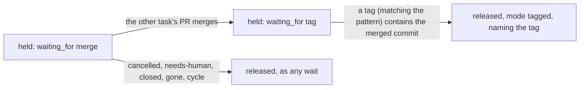

Until the other task's PR merges, the wait is any other: the task is held,
and a cancel, a stop at `needs-human`, a close, the task's disappearance or
a cycle release it as above. Once it has merged, the task stays held, with
`waiting_for: tag` in `task_status`, until a tag of the other repo, matching
the pattern if there is one, contains the commit the merge left on its base
(`merge_commit_sha`: the merge commit, or the squash's or the rebase's
last commit). Each evaluation asks the forge: it lists the repo's 100 newest
tags (`forge.Provider.ListTags`) and, for up to 10 that match, asks whether
the tag's commit has the merged one in its history (`Contains`, the
forge's compare API; a tag on the merged commit itself needs no call).
Then devbot posts `released` with `mode: tagged`, `tag` and `sha`, and a
comment that names the tag as the version to depend on, which the
implementer reads in the issue's discussion. Of the newest tags that have
the merge, it names the oldest, the first release with the work. Nothing is
rebased: the work is in another repo, so a task without a PR is queued, and
a held PR merges, or takes its automerge turn, as it is.

Tags are made outside devbot, by a person or the producer's release
workflow, and a forge doesn't always send a webhook devbot sees for one,
so the forge is read on every evaluation, reconcile's included: a gated
wait is released at the next reconcile pass at the latest, after a Redis
wipe as before one. A tag's push webhook (`forge.EventTag`, from a push of
`refs/tags/*`, or Gitea's `create` of a tag) releases it at once: an
evaluation that finds a task waiting only for a tag indexes it under the
other repo, in `devbot:waiters:tags:<repo>` (48 hours, refreshed by each
pass), and the tag's event evaluates the tasks there.

### Building against an unmerged dependency

A release gate serialises a chain of repos: each consumer sits idle until
its producer is merged and tagged. A gated wait can say `build against`
after the gate (`/wait gitea:acme/lib#12 until tagged, build against`,
`wait_task` with `build_against`, the implementer's `wait_until: "tagged,
build against"`), and the `wait` status records `build: true`. It is
refused without the gate, so on a task of the same repo too, and needs no
config in either repo. devbot stays out of every ecosystem: it supplies the
producer's source and the rules, and the implementer, which provisions its
own runtime per repo anyway, wires the source into the build the way that
project does (a Go workspace, an npm `file:` dependency, `pip install -e`,
a cargo `[patch]`, a Gradle composite build).

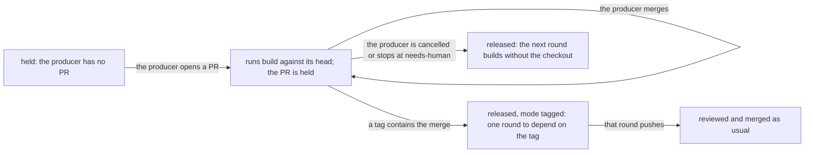

- **While the producer has a PR** (open, or merged with no tag containing
  it yet), the consumer isn't held: its implement jobs are queued and run.
  Before then it is held like any wait. Each run, the harness fetches the
  PR's `refs/pull/<n>/head` into a private repo of its own, with the
  implementer's credential for the producer's repo, and writes its files,
  without `.git`, at `.devbot/deps/<provider>/<owner>/<name>/` in the
  model's repo, through `os.Root`, so no symlink leads a write out of it
  (`core.BuildAgainst`, `harness.checkoutDep`). Each run fetches afresh, so
  one after the producer's head moved builds against the new head.
  `context.md` names the path and the commit, and says to use it the way
  the project uses a local checkout of a dependency, to write the change
  against the new interface, and to keep the wiring out of the commits
  (in `.devbot/setup.sh` or files listed in `.git/info/exclude`), since
  the dependency's version is set at the release.
- **The push guard:** a task that has ever built against another's work
  (any `wait` with `build: true` on its issue) has every push checked: the
  harness reads the diff against the base in its own clone, and work with a
  path under `.devbot/deps`, or an added line naming it, isn't pushed. The
  attempt fails with that reason, which the next attempt reads. That
  catches committed wiring in any ecosystem without knowing any.
- **The consumer's PR is held** while the wait stands: it opens, or stays
  open, but devbot neither reviews nor merges it, nor sends it back for a
  CI failure (its CI builds against the published dependency, which lacks
  the change). A person's or the reviewer's earlier change request still
  sends it back, and that round runs with the checkout too. The issue says
  so once (a `building` status), and `task_status` shows `build_against`
  and a `note`.
- **On release** (a tag contains the merge, as for any [release
  gate](#release-gates)), devbot posts `released` with `mode: tagged` and
  `build: true`, and sends the PR back for one `release` round, which
  doesn't use a review round, without the checkout: depend on the
  producer's repo at that tag the way the project declares the dependency,
  and remove any local override. It is owed, read from the forge on each
  evaluation, until a `pr` status from a run that started after the
  release, a `reset` or a `needs-human`; a push from a run already going at
  the release was built against the checkout, so it doesn't count. Every
  fix round meanwhile is told too. After it, the PR is reviewed and merged
  as usual, and [the reviewer](#the-reviewer) refuses a PR that points a
  dependency on the producer's repo at `.devbot/deps` or any other local or
  unreleased copy of it, in whatever form its ecosystem takes. Only a task
  that built against another is held to this, and only for that repo.
- **The producer cancelled, closed, stopped at `needs-human` or gone:**
  released as any wait, the comment saying the next round builds without
  the checkout. No round is owed: the PR goes to review as it is.

### Across repos

A note or a wait names a task of another repo by its full ref, and its
marker records that repo beside the number (`"repo": "gitea:acme/lib"`); a
marker with only a number, as every one before cross-repo refs had, is of
the issue's own repo. devbot must be enabled on the other repo, and whoever
stands behind the note or the wait must be able to direct devbot there as
well as on the task's own repo, by the rule the engine applies to whoever
adds `devbot/ready`:

- **a person:** the `/wait` comment's author, or a signed-in connector
  caller (`mayDirect` on both repos). A login is a person on its own forge
  only, so a person's wait on a task of another provider is refused; a
  connector caller in auth mode none may direct devbot on every repo.
- **the implementer** (a proposed wait, a note, `devbot coord show REF`):
  the task's requester, the signed-in caller who filed it or the person who
  handed devbot a PR, else the issue's author; for a task filed through a
  connector in auth mode none, that caller. A handle the caller only named
  doesn't count. A note or a look the rule refuses is answered with why.

## Parent tasks

A change across several repos is several tasks, one per repo, each with its
own pod, PR, `.devbot.yaml` policy and retries. A **parent task** groups
them, so a client files the change as one unit, follows it with one ref,
cancels it as one, and is told when it's done or stuck. The code is in
`internal/core/parent.go`.

- **A parent is an issue** in any repo devbot is enabled on, filed by
  `file_project`. It carries `devbot/parent`, which is not a state label,
  and its routing block (`devbot:v1`) says `"kind": "parent"`: the label
  alone is anyone's to add, so an issue with it but without the block is
  whatever its other labels make it. A parent has no work of its own:
  no implement or review job is ever queued for it (only its
  [integration check](#integration-checks), where its repo defines one,
  and, for one filed with `plan`, its [plan job](#plan-jobs)), it has no
  branch or PR, and a state label someone puts on it is taken off.
- **A child is an ordinary task**, filed with `file_task` and `parent` (or
  by devbot, from an approved [plan](#plan-jobs)), in
  any repo on any provider of the install. Its routing block names the
  parent, by its full ref, and devbot posts a `child` status on the parent's
  issue naming the child: a child is the parent's only when both say so. The
  caller must be able to direct devbot on the parent's repo and on the
  child's, a repo that opted out can't hold a child, and the parent must be
  an open parent task, not itself a child: a refused child writes nothing.
  Children order themselves with [waits](#waits) and talk with
  [notes](#notes), across repos, as any tasks may.

Each evaluation of a parent rolls it up from its children, read afresh from
their issues, so nothing about it lives in Redis:

- **the checklist:** one bot comment, marked `devbot:checklist`, lists every
  child with its state and PR, ticked once merged. devbot posts it when the
  parent is filed and edits it whenever what it would say changes; after a
  Redis wipe, or with the comment deleted, the next evaluation writes it
  again from the forge.
- **a child at `needs-human`:** the parent is `needs-human`. devbot posts,
  once per stop, a comment naming the child and linking its issue (a
  `needs-human` status naming the child, with `since` the child's own stop),
  and emits `parent.needs_human`. It doesn't quote the child's reason: that
  can hold what only the child's repo should show, and the parent's repo may
  have a wider audience.
- **a child at `needs-info` or `needs-approval`:** the parent's status says
  which child waits on what.
- **every child merged** (its PR merged, its issue closed): devbot posts a
  summary listing each child and its PR (a `completed` status), closes the
  parent and emits `parent.completed`. A closed parent has nothing left to
  do.
- **automerge:** `devbot/automerge` on the parent (filed with it by
  `file_project automerge`, or added by hand) is carried to its children;
  it changes only which children carry the label, never the merge gate,
  so each still merges only once its own gate passes, after any task it
  waits on (until tagged too) and the parent's integration check. A child
  filed under the parent while it has the label, by `file_task` or by an
  approved plan, is filed with it. When the parent's label changes, the
  evaluation applies the change once to each open child (merged and
  cancelled ones are left alone): adding it labels each child that lacks
  it, and removing it unlabels each that has it, which cancels its
  automerge as on any task. An `automerge` status on the parent, of mode
  `on` or `off` with `children` the children whose label it changed,
  records the label as carried, and devbot acts only when the label
  differs from it: a second evaluation, or one after a Redis wipe, changes
  nothing, and someone who changes the label on one child afterwards keeps
  that choice. The label counts only from someone who may direct devbot
  on the parent's repo (whoever added it last, or, when a bot filed the
  parent with it, the parent's requester), and is carried, at filing or on
  a change, only to the children in repos they may direct devbot on, by
  the rule of a [wait](#waits) across repos; the parent's comments name
  each child left out, and why; a permission lookup that fails decides
  nothing, and the next evaluation asks again. Removing it is anyone's who can, as on a
  task. The checklist marks each child that has the label.
- **a child cancelled, or closed without merging:** shown as such, and the
  parent stays open for a person to decide: retry the child, file a
  replacement, or cancel the parent.

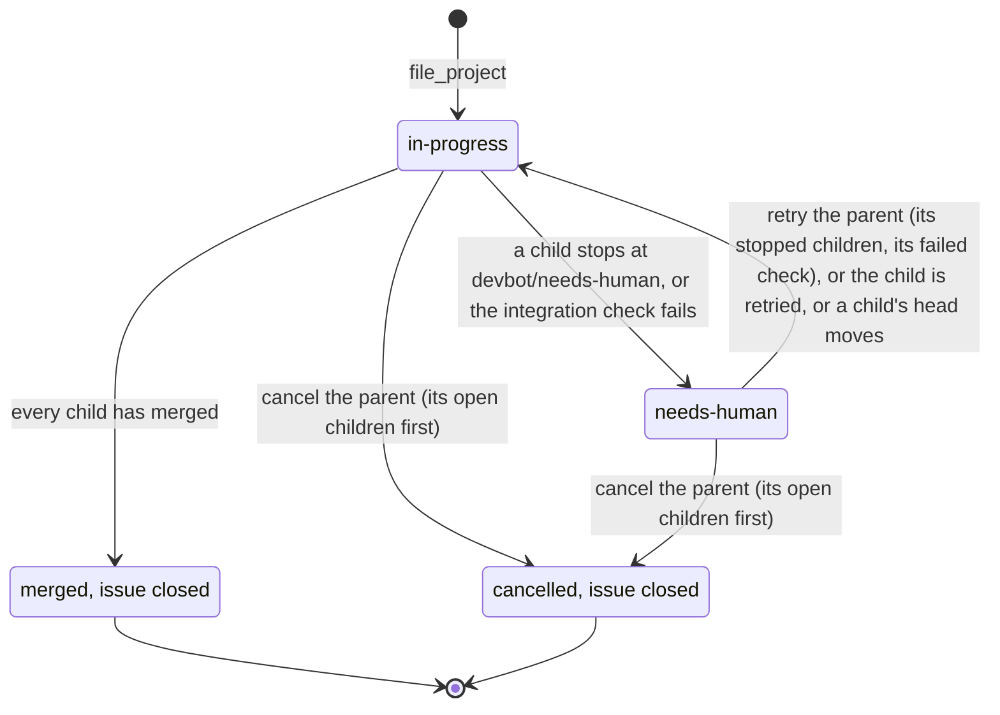

A child that moves evaluates its parent at once: an evaluation that moved
it rolls the parent up in the same pass, and every event of a child, from
serve or a job pod, also asks serve to evaluate the parent
(`devbot:eval-requests`). Reconcile evaluates every open parent besides.

- **Cancel** a parent and devbot cancels each of its open children, as the
  caller, then closes the parent with a `cancelled` status and emits
  `parent.cancelled`. A child it can't cancel leaves the parent open, and
  the call fails, for the caller to try again.
- **Retry** a parent and devbot retries each of its children at
  `needs-human`, and runs an [integration check](#integration-checks) that
  failed, or couldn't run, on the children's current heads again.
- **Siblings see each other.** A child's in-flight listing, in `context.md`
  and `devbot coord list`, has its siblings first: those of its repo marked
  as siblings, and those of other repos by their full ref, with their
  state, base, PR and the files their PR changes, which the harness fetches
  with its role's git credential apart from the shared workspace. Their
  diffs aren't shown, since the private clone is of the task's own repo,
  and a sibling's description only when the child's requester may direct
  devbot on its repo, as for a note to it.

`task_status` on a parent returns `kind: parent`, its `automerge`, its rolled-up `state`
(`in-progress`, `needs-human`, `merged` or `cancelled`), a `note` on any
child that needs a person or an answer and on its integration check, and
`children`, each child's own status, where a closed child is `merged` or
`cancelled`. A child's status
shows its `parent`, and so do its events. `list_tasks` with `parent` lists
that parent's children, open or closed; with `state: parent`, the open
parents.

### Integration checks

Each child passes its own repo's CI, against the other repos as they are,
not as its siblings' PRs leave them. A parent whose repo's `.devbot.yaml`
defines `integration` ([devbot-yaml.md](devbot-yaml.md#integration-checks))
checks its children together before any of them merges. The code is in
`internal/core/integration.go` and `internal/harness/integrate.go`.

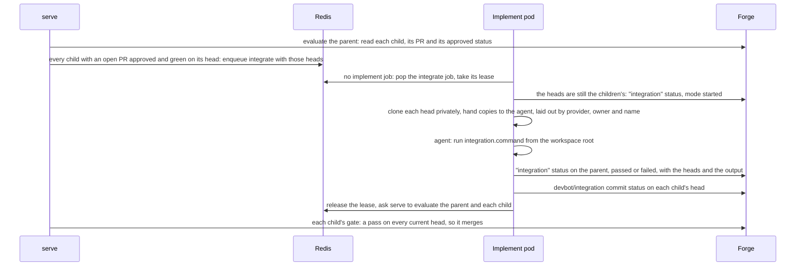

- **A job kind of its own, `integrate`**, on `devbot:q:integrate` (and its
  Docker list), next to implement and review. It runs no model, and needs no
  pod, credential or scaler of its own: an implement pod takes one when no
  implement job waits for it, and KEDA scales the implement ScaledJob on
  both lists. Its workspace is laid out like an implement run's, with the
  same guarantees: the harness clones each head with the implementer's
  credential into its own filesystem and hands the agent container plain
  copies, never runs git in them after that, reads nothing back from them,
  and puts no forge credential in them or in the command's environment.
  The command gets the parent repo's `services`, `env` and Docker daemon,
  and the egress any job pod has.
- **When it runs:** an evaluation of the parent queues it when every child
  with an open PR is at `devbot/approved` with its `approved` status on the
  PR's current head (devbot's reviewer approved it and its checks are green)
  and nothing is recorded for exactly these heads. The heads are every
  child's PR head, open or merged, sorted; a child without a PR has none,
  and its repo is checked out at its default branch. A
  head that moves makes a new set, which runs again once it is ready. A job
  queued for heads that moved since does nothing, and the evaluation its end
  asks for queues the current ones.
- **The result** is an `integration` status on the parent, with `heads`
  and `mode` (`started`, `passed`, `failed`, `error`, or `retry` from a
  retry of the parent), and the `devbot/integration` commit status on each
  open child's head, linking the parent. A result counts for exactly the
  heads it names, and one edited since devbot posted it counts for nothing.
  The children's gates leave the commit status out of their CI.
- **The merge gate:** a child of such a parent merges (automerge or
  `devbot/automerge`) only once the parent's last result for every child's
  current head passed. Until then it waits at `devbot/approved`, with an
  `approved` status of `mode: integration`, which `task_status` notes.
- **A failure** puts the parent at `needs-human`, with the heads and the end
  of the command's output, and emits `parent.needs_human`. It isn't run
  again on those heads; which child goes back is a person's call
  (`edit_task`, a review on its PR), or a retry of the parent runs it again.
- **A run that couldn't finish** records `error`, and one that left only a
  `started` behind, with no lease, counts as one once it is 4 minutes old.
  Up to `integration.retries` are run again; past that the parent is at
  `needs-human` until it is retried or a head moves.

Nothing about it is in Redis but the queued job and its lease: after a
`FLUSHDB`, the next evaluation of the parent reads the results from its
comments and queues what is due, and each child's gate reads the same.

### Plan jobs

A parent filed with `plan` ([connectors.md](connectors.md#planning-a-parent-task))
has devbot decompose the change: a model reads the repos and proposes the
children, their order and the contract between them; a person approves;
devbot files them. The model never holds a credential and never files
anything. The code is in `internal/core/plan.go` and
`internal/harness/plan.go`, and the prompt in `internal/prompts/plan.md`.

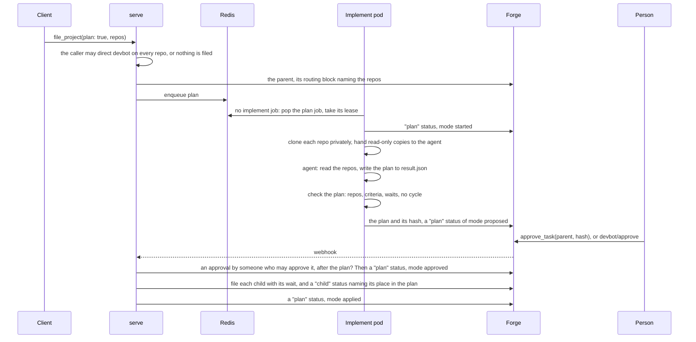

- **A job kind of its own, `plan`**, on `devbot:q:plan`, which an implement
  pod takes when no implement job waits for it, before an integration
  check: it needs no pod, credential or scaler of its own, and never a
  Docker daemon. It runs the implementer's agent (`agents.implement` of the
  parent's repo) under `timeouts.implement`. Its workspace holds each
  candidate repo at its default branch under `<provider>/<owner>/<name>/`,
  cloned by the harness with the implementer's credential into its own
  filesystem and copied for the agent, read-only, with
  `.devbot/context.md` beside them; as for an integration check, the
  harness runs no git there after, reads back only `.devbot/result.json`,
  and puts no forge credential in it or in the agent's environment.
- **The result** is checked by the harness: every child in one of the
  candidate repos, with a title and acceptance criteria; `depends_on`
  naming one other child of the plan (a task waits on at most one, as any
  devbot task does), with no cycle; a release gate only across repos, and
  `build_against` only with one; a base the repo has; a contract; and
  within its bounds (20 children, 24 KiB). A plan that fails is a failed
  attempt, with every reason on the parent, where the next attempt's
  context has it. `max_attempts` of the parent's repo bounds them, and a
  usage limit isn't one; past it, or when the planner says it can't plan
  the change, the parent is `needs-human`. A run's result, whatever it is,
  is posted only while the round of planning it started in is still open
  and the run still its own: an edit of the parent or a child's request
  to change the contract while it ran starts another round, so the result
  is dropped without a word and the evaluation at the job's end queues a
  plan for the new round.
- **The proposal** is a `plan` status of mode `proposed` on the parent,
  carrying the plan and its hash (sha-256 of the plan), recomputed whenever
  it is read: a proposal, or any `plan` status, edited since devbot posted
  it counts for nothing. The parent's state is `needs-approval`, and
  `task_status` shows the plan under `held` as model-written text.
- **Approval** follows the rules of [held changes](#held-changes):
  `devbot/approve` added by someone who may direct devbot on the parent's
  repo, not one of the bots nor a listed reviewer, strictly after the
  proposal, is recorded as an approval of that plan's hash;
  `approve_task(parent, hash)` takes a signed-in person, checks the hash
  against the current proposal under the parent's lock, and adds the label
  as them. Anything else is ignored with a comment, and the label comes
  off. `edit_task` on the parent posts a `reset`, after which the proposal
  counts for nothing and devbot plans again; `cancel` closes it.
- **Filing** is serve's, in the evaluation that recorded the approval and
  every one after until it is done: each child, in the order of its waits,
  as `file_task` with `parent` (so with `devbot/automerge` when the parent
  has it), for the parent's requester, its wait set
  before anything is queued for it, and a `child` status on the parent
  carrying the plan's hash and the child's place in it. A step done
  already is skipped, and a `plan` status of mode `applied` ends it, so a
  second evaluation files nothing more.
- **The contract** of the plan last applied is in each child's
  `.devbot/context.md`, for its implementer and its reviewer, read from
  the parent at each run, as the authority on the interfaces between the
  repos, above notes from siblings. The reviewer checks the PR against it,
  and that it keeps working with its siblings' repos as they are until
  their own PRs merge.
- **Replans.** An implementer that finds the contract can't work finishes
  with `status: contract-change` and a `reason`: its commits are kept, and a
  `contract` status of mode `change` on its issue holds it, as a wait does:
  no implement job is queued for it. The parent's next evaluation (the
  child asks for it) takes the request up with a `replan` status naming
  it, and queues a plan job with the same inputs, the children as they
  stand and the reasons. Its result is a whole plan again, whose children
  name the existing tasks they keep (`task`); approved like any plan, it
  edits the kept children whose text changed, through `edit_task`, sets
  their waits, files the new ones, cancels the open ones it leaves out,
  and posts a `contract` status of mode `resolved` on each child that
  asked, which goes on. `max_replans` of the parent's repo bounds the
  replans; a request past it stops the parent at `needs-human`, and
  `retry` on the parent counts them afresh. A retry of the child itself
  also ends its request.

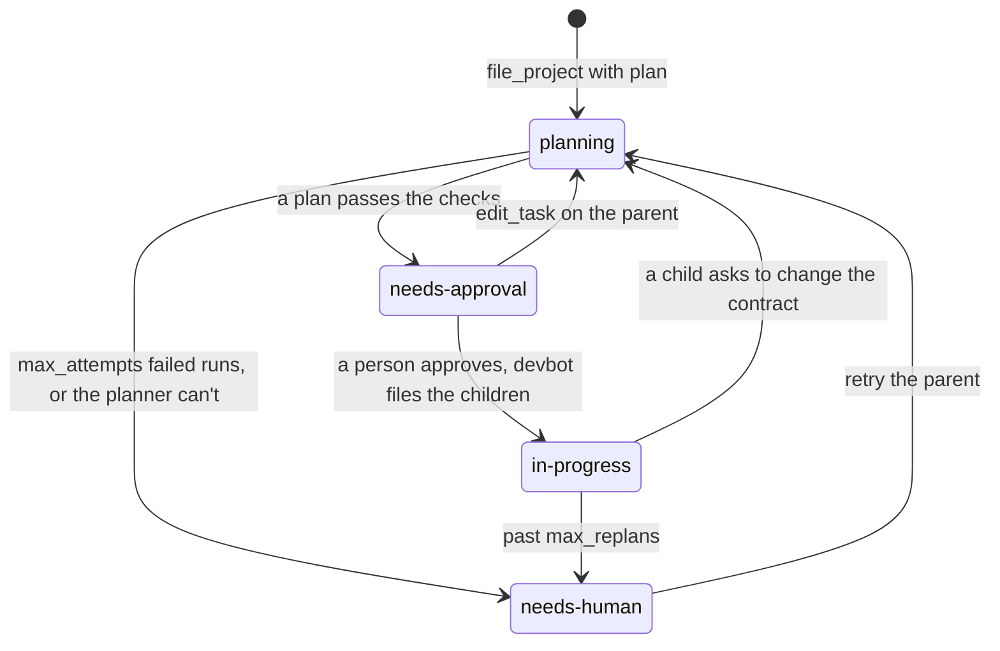

Nothing about it is in Redis but the queued job and its lease: after a
`FLUSHDB`, the next evaluation of the parent reads where its plan stands
from its comments, still waiting for approval with the same plan, or
applied, and queues a plan job only when one is due.

## One task, end to end

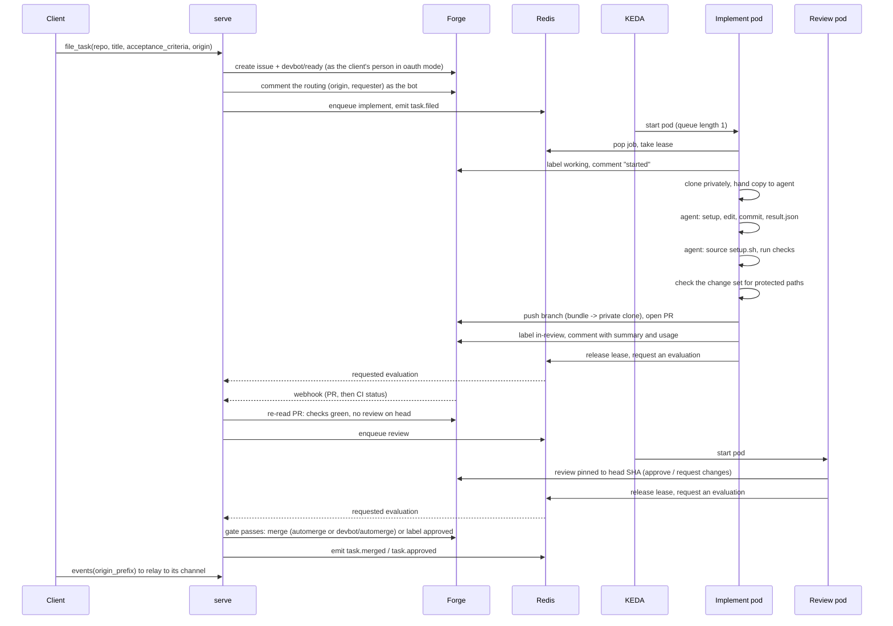

## Usage limits

The harness reacts only when a model run actually hits a limit (the agent
harness reports `rate_limited`, with a reset time when it knows one); Claude Code
and Codex retry transient 429s themselves:

1. Any work done so far is committed and pushed to the branch (no PR yet).
2. The job is parked in `devbot:q:delayed` for `min(base * 2^n, cap)`, half fixed and half jitter, and never earlier than a reset time the error reported, up to `backoff.max_hold` ahead. Only the agent CLI's own error output is read for a limit, never the model's answer.
3. A fleet-wide hold (`devbot:ratelimit:until`) makes every pod that starts in the meantime park its job without starting the model. Parked jobs leave the list KEDA watches, so KEDA stops scaling too.
4. The task's label goes back to where it was, with no comment, and it doesn't count as an attempt. After `backoff.max_retries` in a row, it stops at `needs-human`. A review that fails for another reason is counted apart from these: it stops after 3 such failures, however many limits it hit besides.

## Redis keys

| Key | Type | Purpose |
|---|---|---|
| `devbot:q:implement`, `devbot:q:review`, `devbot:q:integrate`, `devbot:q:plan` | list | work queues (KEDA scales on their length; implement pods take `integrate` and `plan` jobs too) |
| `devbot:q:implement-docker`, `devbot:q:review-docker`, `devbot:q:integrate-docker` | list | the same for repos that get a Docker daemon (`docker: true`, or detected), which only job pods with a [daemon](operating.md#docker) take |
| `devbot:queued` | set | enqueue dedupe, including delayed jobs. A job pod takes a job and its lease in one script, which removes its entry, so an evaluation always finds one or the other; a job put back to wait (a usage limit, a failed review) is dropped when another of its kind is queued or delayed for the task, or another pod holds its lease; reconcile drops any entry with no job and no lease behind it |
| `devbot:q:delayed` | zset, scored by due time | backoff |
| `devbot:lease:<kind>:<ref>` | string, 2 min TTL, renewed every 30 s | which pod holds a task |
| `devbot:lease-info:<kind>:<ref>` | hash, the lease's TTL | for the web UI: when the lease was taken, its last heartbeat, and the job (attempt or round, PR, mode); and for serve, the job's pod, the labels and annotations to put on it, and whether its agent stopped answering |
| `devbot:merge:<repo>` | string, 2 min TTL | per-repo merge mutex, across replicas and jobs |
| `devbot:merge-retry:<ref>` | string, a day past the next try | merges of the task's head that failed in a row for a reason that may pass, and when to try the next |
| `devbot:checks-pending:<ref>\|<pr>\|<sha>` | string, a day past `checks_pending_timeout` | when devbot first saw that PR head's checks pending, which `checks_pending_timeout` is measured from; lost, the wait starts over |
| `devbot:leader` | string, `leader_lease` TTL | which serve replica runs the singleton loops: its fencing token, `<term>/<owner>` |
| `devbot:leader-term` | counter | the last leader's term, for the next token |
| `devbot:last-reconcile` | string | when the last reconcile pass finished (Unix seconds) |
| `devbot:repo-config:<repo>` | counter | bumped when a push changes the repo's `.devbot.yaml`, so every process drops its cached copy |
| `devbot:inventory:<provider>` | counter | bumped by a GitHub installation webhook, so the reconciler lists the App's installations and their repos again |
| `devbot:rebaseq:<repo>\|<branch>` | zset, scored by approval time | approved PRs behind the base branch waiting for a rebase and automerge, in turn order |
| `devbot:rebaseq-turn:<repo>\|<branch>` | string, no TTL | the task whose turn it is to be rebased and merged; given up when it leaves the queue: it merges, stops (its checks pending past `checks_pending_timeout`, say), loses automerge, or is retargeted to another base, whose queue it then joins. A task found ahead that has stopped, closed or been cancelled is dropped by the next task in line |
| `devbot:behind:<repo>` | zset, scored by when last seen | approved PRs waiting behind their base, for `devbot_prs_behind_base` |
| `devbot:waiters:<ref>` | set, 48 h TTL | the tasks of other repos waiting on task `<ref>`, by ref, added by each evaluation of one held by that wait and taken when `<ref>` merges or closes, so it wakes them at once (see [Waits](#waits)) |
| `devbot:eval:<ref>` | string, `eval_lock_ttl` | per-task evaluation lock |
| `devbot:eval-dirty:<ref>` | string, `eval_lock_ttl` | a trigger arrived while the task was locked; the holder evaluates again |
| `devbot:eval-requests` | set | tasks job pods asked serve to evaluate, which each pod can't do with its one bot's credential |
| `devbot:eval-retries` | zset, scored by when to try again | requested evaluations that failed, put back in `devbot:eval-requests` 30 s later, or when the forge rate limit that stopped one resets, rather than left to reconcile |
| `devbot:bots:<provider>` | string | both bots' logins, recorded by serve each reconcile pass, for job pods that can't read the other bot's (a GitHub App's takes its key) |
| `devbot:ratelimit:until` | string | fleet-wide usage-limit hold |
| `devbot:services:<pod>` | string, 2 min TTL, rewritten every 2 s | how a job pod's [service containers](#service-containers) are doing (`starting`, `ready` with the service pod's IP, or `failed` with why), written by serve's leader for the job's harness to wait on |
| `devbot:agent-exit:<pod>` | string, 10 min TTL | how a job pod's agent container last ended (reason, exit code, message, when), written by serve's leader once the job's harness says its agent stopped answering (`agent_lost` on its lease), for its attempt-failed comment |
| `devbot:delivery:<id>` | string, 24 h TTL | webhook dedupe |
| `devbot:later:due`, `devbot:later:data` | zset scored by when, and hash | webhook events a forge rate limit put off, by what they are about, kept until the limit resets (see [Rate-limited events](#rate-limited-events)) |
| `devbot:quota:<provider>` | hash, 2 h TTL | what the forge last said of each credential bucket's rate limits, by bucket and resource: calls left, the limit and its reset. Written after every GitHub call by serve and the job pods alike |
| `devbot:tracked:pr:<repo>#<n>` | string, 24 h TTL | a PR a task has, with its head, written by each evaluation that finds it (see [Skipped webhooks](#skipped-webhooks)) |
| `devbot:tracked:head:<repo>@<sha>` | string, 24 h TTL | the tracked PR whose head is `<sha>`, for status and check events |
| `devbot:branch-sweep:<provider>` | string, 15 min TTL | the provider's branches were swept by reconcile (see [Branch cleanup](forge.md#branch-cleanup)) |
| `devbot:events` | stream, trimmed to `event_retention` | the event feed |
| `devbot:once:<...>` | string | once-only events (`task.merged`, and `task.approved` per PR and head) |
| `devbot:sub:<name>` | string | an outbound subscriber's cursor, written only under the leader's token |
| `devbot:stats` | hash | counters exported on `/metrics` |
| `devbot:auth:client:<id>` | string, `refresh_token_ttl` from last use | a registered OAuth client (secret as a hash) |
| `devbot:auth:grant:<id>` | string, `refresh_token_ttl` | a sign-in: forge login, client, hashes of its current devbot tokens |
| `devbot:auth:forge:<provider>:<login>` | string, `refresh_token_ttl` (at least 12 h) from the last sign-in or refresh | the person's forge token, sealed with the auth key and bound to this key, shared by all of their grants |
| `devbot:auth:person-grants:<provider>:<login>` | set, as the forge token | the person's grants, so the forge token is deleted with the last |
| `devbot:auth:at:<hash>`, `devbot:auth:rt:<hash>` | string, the token's lifetime | devbot access and refresh tokens, by SHA-256, pointing at their grant |
| `devbot:auth:session:<hash>` | string, 12 h | a web UI session cookie, by SHA-256, pointing at its grant |
| `devbot:auth:rt-used:<hash>` | string, `refresh_token_ttl` | rotated refresh tokens, so a reused one ends its grant |
| `devbot:auth:rt-grace:<hash>` | string, `refresh_reuse_grace` | a refresh token just rotated: its grant, and the tokens it was rotated into, sealed with the auth key, to give the same client again |
| `devbot:auth:code-used:<hash>` | string, 10 min | redeemed authorization codes, so a reused one ends its grant |
| `devbot:auth:device-tries:<code>`, `:device-fails:<ip>` | counter, 10 min | device-code entry limits: submissions per code, wrong codes per client address (see `trusted_proxies`) |
| `devbot:auth:clients:<ip>` | counter, 24 h | clients one address registered, for `auth.rate_limits.clients_per_address` (an IPv6 address by its /64) |
| `devbot:auth:pending:<state>`, `:consent:<hash>`, `:code:<hash>`, `:device:<hash>`, `:device-claim:<hash>`, `:usercode:<code>`, `:lock:<grant>`, `:lock:person:<provider>:<login>` | string, minutes | sign-ins in progress |

Every JSON record under `devbot:auth:*` is stored with an HMAC-SHA256 over
its key and its content, under a key derived from the auth key, and one
whose MAC fails reads as absent. The job harness's Redis user reaches every
key here but `devbot:delivery:*`, `devbot:later:*`, `devbot:tracked:*`,
`devbot:sub:*` and `devbot:auth:*`.

## Code map

| Package | |
|---|---|
| `cmd/devbot` | the one binary: its modes and client commands (see [the CLI](connectors.md#cli)), and wiring config, forges, Redis and the agent together |
| `internal/forge` | the `Provider` interface and the shared types |
| `internal/forge/gitea` | the Gitea adapter: REST over `net/http`, webhook signatures |
| `internal/forge/github` | the GitHub adapter (GitHub.com and GitHub Enterprise Server): GitHub Apps and their repo-scoped installation tokens, REST over `net/http`, webhooks, attachments on a branch, sign-in with App user tokens, and the opt-in live test |
| `internal/forge/forgetest` | the conformance suite every adapter runs against its fake |
| `internal/forge/fake` | an in-memory forge for tests |
| `internal/core` | the engine: state machine, merge gate, markers, connector operations, reconcile, waits and notes between tasks, parent tasks (`parent.go`), their integration checks (`integration.go`) and plans (`plan.go`), carrying PRs devbot didn't open (`carry.go`), and whether a task's runs get a Docker daemon (`docker.go`) |
| `internal/queue` | Redis: queues, leases, the leader lease, hold, events, counters |
| `internal/harness` | the job harness: workspace, context, checks, publish, attachments, backoff, the work in flight and the `devbot coord` exchange, and parents' integration checks (`integrate.go`) and plan jobs (`plan.go`) |
| `internal/agent` | the agent sidecar: the harness-neutral `Harness` interface, Exec, the socket server and client, the env scrub |
| `internal/modelproxy` | the model proxy: holds the model credential, adds it to the CLI's requests or signs them with SigV4, and gets AWS credentials from static keys, IRSA or Pod Identity |
| `internal/agent/claude` | the Claude Code harness: `claude -p` flags, result parsing, usage-limit detection |
| `internal/agent/codex` | the Codex CLI harness: `codex exec --json` flags, the JSONL event stream, per-session `CODEX_HOME`, error classification |
| `internal/agent/agenttest` | a fake agent CLI for testing harness adapters |
| `internal/server` | serve: webhooks, HTTP API, MCP, leader election, the web UI (templates and assets embedded from `internal/server/ui`), metrics, subscribers |
| `internal/auth` | the OAuth broker for connectors: authorization server endpoints, token checks, the web UI's session cookie, people's sealed forge tokens |
| `internal/prompts` | the implementer, reviewer and planner prompts, embedded |
| `internal/config` | deployment config, `.devbot.yaml`, glob matching, service containers and their limits (`services.go`), Docker detection from a base branch (`docker.go`) |
| `internal/audit` | audit records: one JSON line per auditable action on stdout, and the forge wrapper that records each write |
| `internal/audit/audittest` | captures audit records in tests |
| `internal/changeset` | what a branch changes, every path with its modes, from git itself: read by the push guard and the merge gate |
| `internal/kube` | the little of the Kubernetes API serve needs to label job pods and run their service pods, as its ServiceAccount |
