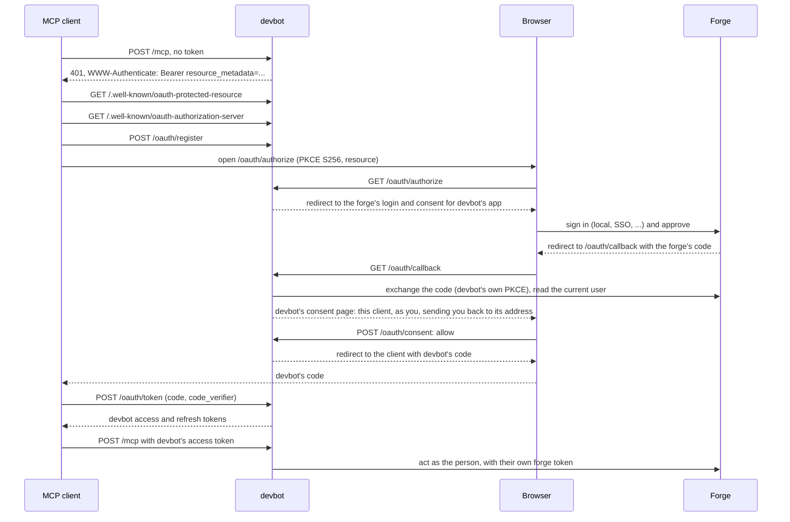

# Connectors

Clients use devbot to file work, follow it and answer its questions. devbot
has no integrations with chat or messaging platforms: a client that wants
feedback in its own channel files with an `origin`, reads its events back by
that origin, and relays answers with `answer`.

The same operations are on three surfaces:

| Surface | Where |
|---|---|
| MCP (Streamable HTTP, JSON responses, no server-initiated streams) | `POST /mcp` |
| HTTP API | `/api/...` |
| CLI | `devbot file|project|status|list|answer|events|cancel|retry|rebase|approve|retarget|wait|edit`, against `$DEVBOT_URL`, signed in with `devbot login` in oauth mode (see [CLI](#cli)) |

## Authentication

`auth.mode` in the install config (see
[operating.md](operating.md#connector-auth)) picks one of two modes.

### `none` (default): trusted networks only

Every call is the deployment's `anonymous_principal`, recorded as the task's
requester, plus `/<label>` when the client sends `X-Devbot-Client: <label>`
(`anonymous/chat-relay`). The label isn't verified, and an `Authorization`
header is ignored. A label outside `[A-Za-z0-9._-]{1,64}` gets `400`: devbot
writes it into comments under its own name. With `anonymous_principal` empty, every call gets `401`.

**This mode applies no forge permissions to callers.** The implementer bot
files, comments and relabels for them, and the bot is always authorized, so
anyone who can reach the endpoint can start work in any repo devbot is
enabled for. Use it only where the network itself decides who that is.

### `oauth`: every caller is a forge user

Every call to `/mcp` and `/api/*` needs an access token devbot issued.
devbot follows the MCP authorization spec's third-party flow: it is the OAuth
authorization server its clients see, and is itself one OAuth client of the
forge, which is the identity provider. How people sign in to the forge (local
accounts, SSO, Keycloak, Entra) is the forge's business. devbot keeps no
users, and no token-to-user or claim mappings, of its own.

- devbot's tokens are opaque, bound to `auth.resource_url` (RFC 8707), and checked on every request: they must exist, be unexpired, be for this resource, and belong to a sign-in that still stands. **A forge token is never accepted**: that would be token passthrough, which the spec forbids. A request without a good token gets `401` with `WWW-Authenticate: Bearer resource_metadata="<resource_url>/.well-known/oauth-protected-resource"`, and nothing runs.
- Access tokens last `auth.access_token_ttl` (1 h). Refresh tokens last `auth.refresh_token_ttl` (30 days) and rotate on every use. Presenting a used one ends the sign-in, since it must have leaked, except when the same client presents it again within `auth.refresh_reuse_grace` (1 min) of its rotation, which is how [shared sign-ins](#refresh-tokens-and-shared-sign-ins) survive. An authorization code works once, with no such grace: presented again, it ends the sign-in it produced, tokens and all.
- When someone signs in, devbot keeps their forge token, encrypted, to act as them (below). It's never logged, never given to a client, and refreshed when it expires. devbot keeps [one forge token per person](#one-forge-token-per-person), shared by all of their sign-ins, and deletes it when their last sign-in is revoked. If the forge stops accepting it, or refuses to refresh it, every sign-in of that person ends and its next call is a `401`, so the client signs in again. A forge that is down is not a refusal: calls get `503` until it's back, and nobody is signed out.

On **GitHub**, devbot's app on the forge is a **GitHub App**, not an OAuth
App: you sign in to GitHub and approve the App, and the token devbot keeps
for you can only do what both you and the App may, on the repos the App is
installed on. An OAuth App's token would reach every private repo you can see.
So a repo the App isn't installed on is invisible to you through devbot, even
where GitHub gives you a role there: "not found, or not visible through your
sign-in". The token lasts 8 hours, and devbot refreshes it for you. Setup is
in [operating.md](operating.md#the-forges-oauth-app).

#### Signing in

An MCP client that supports authorization needs only devbot's `/mcp` URL. It
gets the `401`, discovers the rest, registers itself, and opens a browser:



The endpoints, all under `auth.resource_url`:

| Endpoint | |
|---|---|
| `GET /.well-known/oauth-protected-resource` | RFC 9728 protected-resource metadata: the resource and its authorization server (devbot). Asked for under a path (`/.well-known/oauth-protected-resource/mcp`), it names that URL as the resource. |
| `GET /.well-known/oauth-authorization-server` | RFC 8414 authorization-server metadata. The same document is served under a path too (`/.well-known/oauth-authorization-server/mcp`), where some clients look for it. |
| `POST /oauth/register` | RFC 7591 dynamic client registration, so any MCP client connects with no setup. Public clients (`token_endpoint_auth_method: none`) or confidential ones (`client_secret_basic`, the default, or `client_secret_post`). Redirect URIs must be `https`, `http` to a loopback address (where any port matches, as RFC 8252 asks), or an app's own scheme. A registration nobody signs in with lapses after a day; one in use lasts until `auth.refresh_token_ttl` after its last sign-in or refresh. |
| `GET /oauth/authorize` | The authorization code flow. **PKCE with `S256` is required.** It sends the person to the forge to sign in and approve devbot's app. |
| `GET /oauth/callback` | Where the forge sends them back. This is the redirect URI of devbot's app on the forge. |
| `POST /oauth/consent` | The person's answer on devbot's consent page, which names the client and where it will send them (or the device's code). Anyone can register a client, and the forge only vouches for devbot's app, so devbot asks every time. A sign-in only finishes in the browser that started it (a cookie binds them), and only a same-origin post counts. |
| `POST /oauth/token` | Grants `authorization_code`, `refresh_token` and, when `auth.dynamic_device_grant` is on, `urn:ietf:params:oauth:grant-type:device_code`. |
| `POST /oauth/revoke` | RFC 7009. Either token ends the whole sign-in, and deletes the person's stored forge token if it was their last. |
| `POST /oauth/device_authorization`, `GET /oauth/device`, `POST /oauth/device` | RFC 8628 device flow, for headless callers, when the install turns it on (`auth.dynamic_device_grant`): the device asks for a code, `GET /oauth/device` is the page the person types it on, and `POST /oauth/device` takes it (a same-origin form post only) and sends them to the forge to sign in. See [the device flow](#the-device-flow-and-phishing). |

Serve oauth mode from the root of its own host (`https://devbot.example.com`,
not under a path prefix): clients look for the authorization-server metadata
at the host's own `/.well-known/`.

The endpoints anyone can reach are rate-limited per client address: over
the limit, a client gets `429` with `Retry-After`, and one address can
register only so many clients a day (see
[Rate limits](operating.md#rate-limits)).

#### Headless callers

A cron job or a chat relay signs in once, with the device flow, as the person
it acts for, and keeps a devbot refresh token. No forge token, personal
access token or otherwise, ever reaches devbot from it. The device flow is
off unless the install sets `auth.dynamic_device_grant: true` (see
[the device flow](#the-device-flow-and-phishing)).

```bash
export DEVBOT_URL=https://devbot.example.com
devbot login        # prints a link and a code: open the link in any browser, type the code, and sign in to the forge
devbot list         # the client commands use the saved sign-in, refreshing it as needed
curl -H "Authorization: Bearer $(devbot token)" "$DEVBOT_URL/api/tasks"
devbot logout       # revokes the sign-in
```

`devbot login` registers itself as a client, runs the device flow, and saves
devbot's tokens to `$DEVBOT_TOKEN_FILE` (default
`~/.config/devbot/token.json`, mode `0600`). Guard that file like a password:
it acts as you until it's revoked, or goes unused for
`auth.refresh_token_ttl`. Any other client can run the same flow against
`/oauth/device_authorization` itself.

#### One forge token per person

A person usually has several sign-ins at once: the web UI, Claude Code on a
laptop, a `devbot login` on a server. All of them use the same forge token,
stored once per person (forge and login), not one per sign-in.

Gitea needs this. It keeps one OAuth grant per user and application, so
every devbot sign-in of a person is the same grant there, and with
`INVALIDATE_REFRESH_TOKENS` each refresh or new sign-in invalidates every
refresh token issued before it. So:

- A new sign-in replaces the person's stored forge token: the forge has just
  moved its grant on, and the newest token is the only one sure to refresh.
  Their other sign-ins carry on with it.
- devbot refreshes the forge token under a lock per person, held across
  serve's replicas. Whoever waited on it uses the token the holder got
  instead of refreshing again, so the forge sees one refresh however many
  sign-ins need it at once.
- If the forge refuses that refresh, or rejects the token, the person's
  forge token is deleted and each of their sign-ins ends at its next call.
- Revoking one sign-in leaves the others alone; the forge token is deleted
  with the last.

#### Refresh tokens and shared sign-ins

Several processes often share one stored sign-in: every Claude Code session
of a user keeps an MCP server's tokens in one credentials file, and two cron
jobs can share one `devbot login` token file. When their access token
expires they may all refresh at about the same time, with the same refresh
token. Only the first can rotate it; to the rest it is already used, and
strict reuse detection would end the sign-in for all of them.

So for `auth.refresh_reuse_grace` (1 min) after a refresh token is rotated,
the **same client** presenting it again gets the **same** new access and
refresh token the first refresh got, and the sign-in stands. Every racing
process ends up with the winner's tokens; no third pair is minted. After the
window, from another client ID, or once the tokens it produced have been
rotated in turn, a used refresh token ends the sign-in as before. `0` turns
the grace off.

To give those tokens back devbot has to keep them for the window, so,
unlike its other tokens (stored only as hashes), they are kept encrypted
with the auth key, expire with the window, and are deleted with the
sign-in. Authorization codes get no grace: a code presented twice still
ends its sign-in.

#### The device flow and phishing

A device code is easy to phish (RFC 8628 5.4): anyone can register a client
under any name ("Claude Desktop"), start a device flow, and send someone the
code with a plausible story. If that person enters it and approves, the
sender's device acts as them. So the device grant is off unless an install
turns it on, and devbot makes phishing harder when it is:

- The device authorization response has no `verification_uri_complete`, and
  `/oauth/device` never fills in a code from its link. The person types the
  code their own device shows.
- The code-entry page and the consent page both warn, in so many words, to
  stop if the code came from someone else. Every client registers itself
  (RFC 7591), so its name proves nothing, and the consent page says so.
- Entering codes is rate-limited. An address that enters 10 wrong codes in
  10 minutes is turned away until the window passes, and a code entered 5
  times is locked out: the device is told the sign-in was denied and has to
  start again. Behind a proxy, the address is the client's only when the
  proxy is listed in `trusted_proxies` (none is by default; see
  [Behind a proxy](operating.md#behind-a-proxy)): then it comes from
  `X-Forwarded-For`. A request through a trusted proxy
  that names no client has no per-address limit, since one counter shared
  by everyone would let anyone turn everyone away; the per-code lockout
  still holds. With the grant on and no `trusted_proxies`, serve warns at
  startup.
- `auth.dynamic_device_grant` (off by default) is the device grant's switch
  for dynamically registered clients, which is every client. Off, there is
  no device endpoint in the metadata, no registering for the grant, no new
  device codes, and a sign-in made through the device flow ends at its next
  refresh, even for a client also registered for the code flow. `devbot
  login` needs it on; MCP clients using the authorization code flow don't.

The cookie that binds a sign-in to the browser that started it doesn't help
here: the person phished starts the sign-in in their own browser.

#### Who does what

In oauth mode, what someone starts through a connector is done on the forge
**as them**, with their own token. The forge shows them as the actor, and
applies its own permissions:

| Call | Done on the forge as the caller |
|---|---|
| `file_task` | creates the issue, with devbot's metadata block, labelled `devbot/ready` (and `devbot/automerge` if asked); with `parent`, the bot records the child on the parent's issue |
| `file_project` | creates the issue, with devbot's metadata block, labelled `devbot/parent` |
| `answer` | posts the answer as their own comment |
| `cancel` | removes the state label; on a parent task, does so on each open child, then closes the parent |
| `retry` | adds `devbot/ready`, removing the old state label |
| `rebase` | posts `/rebase` as their own comment |
| `approve_task` | adds `devbot/approve` |
| `wait_task` | posts `/wait #N`, `/wait REF` for a task of another repo (with `until tagged` and any pattern after it for a release gate, and `, build against` after that), or `/wait none`, as their own comment |

`retarget` and `edit_task` are the calls the implementer bot carries out for a
signed-in caller, once devbot has checked the caller under the same rule. The
task's base branch is devbot's own record, a status comment only a bot can
write, and the PR it moves is the implementer's. An edit is approved by the
`pinned` status devbot posts with it, which also only a bot can write, so the
bot makes the edit too, and the comment names the caller.

From there devbot handles them through its normal path, exactly as if the
person had done them in the forge UI. The engine checks whoever applied
`devbot/ready` or `devbot/approve`, or wrote the answer, the `/rebase` or the `/wait`, under the [usual
rules](devbot-yaml.md#who-can-direct-devbot): the forge permission set in
`authorization.min_permission`, narrowed by the repo's `authorized_users`.
devbot checks the same rule before it writes anything, so a call that would be
ignored is refused instead (`403`, or an MCP tool error) and leaves nothing
behind. A call the forge itself refuses comes back the same way. `file_task`
also checks that the forge lets the caller label issues on the repo, which
Gitea's per-unit team permissions can deny to someone with push, and GitHub
gives only to `triage` and above. If the forge creates the issue anyway but
drops `devbot/ready` (Gitea and GitHub both do, instead of refusing), devbot closes it again as the caller and returns the refusal, so
no unlabelled issue is left open.

Reads (`list_tasks`, `task_status` and `events`) show only tasks on repos the
caller can read on the forge. devbot asks the forge with the caller's own
token, and remembers the answer for a minute per person and repo (at most
10,000 answers, oldest dropped first). Other repos'
tasks are invisible: missing from lists and the feed, and "not found" by ref.

The bots do devbot's own work, and only that:

| Identity | Does |
|---|---|
| the caller (oauth mode) | the calls in the first table above |
| implementer bot | branches, commits and PRs, moving a PR onto a `retarget`'s new base, and an `edit_task`'s edit of the issue. Every devbot comment (status, questions, `needs-human`), state-label transitions, and creating the `devbot/*` labels on a repo. Reading people's permissions. In mode `none`, also the calls in the first table above, for the principal, except `approve_task`, which is refused there: only a signed-in person approves a held change. |
| reviewer bot | reviews, and the merges the [merge gate](devbot-yaml.md#the-merge-gate) allows |

Webhooks don't use any of this: they're verified by the forge's HMAC
signature.

#### What a retry resets

`retry`, with or without sign-in, and a person re-adding `devbot/ready` in
the forge UI after `needs-human` or a failure, are the same retry. The
implementer bot posts one comment, "Retried by @login. Attempts and review
rounds start over." (by the principal, in mode `none`), carrying a `reset`
status marker: for a signed-in caller just before their relabel, for the
forge UI when devbot picks the label up. From that comment on, attempts
(`max_attempts`), review rounds (`max_review_rounds`) and rebase rounds
(`max_rebase_rounds`) count from zero, so a task stopped at a cap starts
again at attempt 1. Only the bots' markers count, which is why the reset is
the bot's comment whichever way the retry came. There is one per retry:
retrying again, or another evaluation, before anything else stops the task
posts no second one. A `devbot/ready` from someone who can't direct devbot
is not a retry: devbot ignores it and resets nothing.

## Tools

| MCP tool | HTTP | Arguments | Returns |
|---|---|---|---|
| `file_task` | `POST /api/tasks` | `repo`\*, `title`\*, `acceptance_criteria`\*, `body`, `origin`, `requester_handle`, `automerge`, `base`, `parent` | the task's status |
| `file_project` | `POST /api/projects` | `repo`\*, `title`\*, `body`, `acceptance_criteria`, `origin`, `plan`, `repos` | the [parent task](#parent-tasks)'s status. With `plan: true` (`acceptance_criteria` and `repos` required), devbot [plans its children](#planning-a-parent-task) in `repos`; refused, with nothing written, unless the caller may direct devbot on every repo in `repos` |
| `task_status` | `GET /api/task?ref=` | `ref`\* | status, re-read from the forge, with the PR link, devbot's latest update, and a `note` when an approved PR is behind its base or queued behind another to be rebased, and `held` when it holds a change for approval |
| `list_tasks` | `GET /api/tasks?repo=&state=&origin_prefix=&parent=&detail=` | all optional | open tasks; with `parent`, that [parent task](#parent-tasks)'s children instead, open or closed, and with `state: parent`, the open parent tasks. With `repo`, devbot reads only that repo's issues, a few requests whatever else the install can see; without it, each provider's own search (on GitHub, one search API query per state label and installation). A list read in part is [still returned](#errors). With `detail=1` (HTTP only), each also has its PR, `last_update` and `state_since`, at a few forge reads per task. |
| `answer` | `POST /api/task/answer` | `ref`\*, `text`\* | status. Only valid in `needs-info`. |
| `events` | `GET /api/events?cursor=&repo=&origin_prefix=&types=&limit=` | all optional | a page of events, oldest first, and the next cursor |
| - | `GET /api/events/recent?before=&repo=&origin_prefix=&types=&limit=` | all optional | the newest events first, and the `cursor` to pass as `before` for older ones (`""` at the start of the feed) |
| `cancel` | `POST /api/task/cancel` | `ref`\* | status. On a parent task, cancels each of its open children, then closes it. |
| `retry` | `POST /api/task/retry` | `ref`\* | status. See [what a retry resets](#what-a-retry-resets). On a parent task, retries each of its children in `needs-human`, and plans it again when its [plan](#planning-a-parent-task) stopped. |
| `rebase` | `POST /api/task/rebase` | `ref`\* | status. Asks for the task's PR to be [rebased](forge.md#rebasing) onto its base, as a `/rebase` comment does; it happens once the PR is approved and green. Only valid in `in-review` or `approved`. |
| `approve_task` | `POST /api/task/approve` | `ref`\*, `sha`\* | status. Approves the change a task in `needs-approval` holds, by adding `devbot/approve` as the caller: `sha` is the held commit the person was shown (`held.sha` in the status, at least its first 7 characters), and a call naming any other is a `400` that writes nothing, so an approval can't land on a change nobody showed them. devbot then pushes exactly that commit. See [Approving a held change](forge.md#approving-a-held-change). Only for a person signed in through the forge (`auth.mode: oauth`): without sign-in it is a `403`, since the caller is often a model relaying `held.shown`, which is the change's own text, and the person adds the label themselves instead. Needs the same permission as `retry` and `cancel`; devbot's bots, and logins listed in `trusted_reviewers` or `required_reviewers`, can't approve. On a parent task in `needs-approval`, `sha` is the hash of the [plan](#planning-a-parent-task) it proposes (`held.sha`), and devbot then files the plan's child tasks. |
| `retarget` | `POST /api/task/retarget` | `ref`\*, `base`\* | status. Needs the same permission as `retry` and `cancel`. |
| `edit_task` | `POST /api/task/edit` | `ref`\*, at least one of `title`, `body`, `acceptance_criteria`; `note` | status, with a `note` saying what happens next. See [Editing a task](#editing-a-task). Needs the same permission as `retry` and `cancel`. On a parent task filed with `plan`, it edits the parent (a `note` alone will do) and has devbot [plan it again](#planning-a-parent-task). |
| `wait_task` | `POST /api/task/wait` | `ref`\*, `on`\*, `until`, `build_against` | status, with `waiting_on`, `waiting_for`, `wait_until` and `build_against`. Has the task wait for another task to merge first, as a `/wait` comment does: `#12` in the same repo, or a full ref like `gitea:acme/lib#12` in any repo on any of the install's providers; `none` ends the wait. `until` (`tagged`, or `tagged v*` with a tag pattern), or the same after `until` in `on` (`gitea:acme/lib#12 until tagged`), is a [release gate](#release-gates) for a task of another repo. `build_against: true` (or `, build against` at the end of `on`) with a gate [builds against](#building-against-an-unmerged-dependency) the other task while it is unmerged. A wait devbot's rules refuse (another base in the same repo, a release gate in the same repo, `build against` without a gate, a closed or non-devbot task, a repo devbot isn't enabled on, a cycle) is a `400` and writes nothing. See [Waiting on another task](#waiting-on-another-task). Needs the same permission as `retry` and `cancel`, on both repos. |
| - | `GET /api/status` | | queue depths, active leases, the usage-limit hold, last reconcile, version |
| - | `GET /api/jobs?repo=` | `repo` optional | the [jobs](#jobs) running, queued and delayed |
| - | `GET /api/task/timeline?ref=` | `ref`\* | the task's status with its branch and [timeline](#jobs) |

\* required.

- **`repo`** is `<provider>:<owner>/<name>`, named for the provider in the deployment's config, e.g. `gitea:acme/webapp` or `github:acme/webapp`. devbot must be enabled there: the bots can write to it, the deployment's policy allows it, and it hasn't opted out. The error says which condition failed.
- **`ref`** is a task: `gitea:acme/webapp#12`.
- **`limit`**, on `events` and `/api/events/recent`, is how many events a page holds: `100` by default, and at most `500`; a larger one gets `500`. `types` is a comma-separated list of the [event types](#events).
- **`acceptance_criteria`** is required and becomes the issue's "Acceptance criteria" section. The implementer builds to it and the reviewer checks against it.
- **`origin`** is opaque. devbot stores it and echoes it on every event, and never parses it. Pick a scheme your client can route: `slack:<channel>/<ts>`, `matrix:<room>`, `cli:<user>`.
- **`requester_handle`** is a forge login (`[A-Za-z0-9._-]{1,64}`, or the call is refused), credited in devbot's first comment on the issue ("Requested by @handle via <principal>.") and @mentioned when devbot asks a question, so the forge's own notifications reach that person. It only applies when devbot runs without sign-in (`auth.mode: none`), where the bot is the issue's author. A signed-in caller files the issue as themselves, so the comment only reads "devbot is tracking this task." and devbot mentions their verified login, whatever `requester_handle` says.
- **`automerge`** (bool, default `false`) files the issue with the `devbot/automerge` label: devbot merges the PR itself, but only once the full [merge gate](devbot-yaml.md#the-merge-gate) passes, never sooner. It stands in for the person's merge click on a repo with `automerge` off. On a repo that sets `task_automerge: false` the task is still filed, the label is ignored, and the returned status has a `note` saying automerge won't apply. Removing the label from the issue cancels it. See [per-task automerge](forge.md#per-task-automerge).

- **`base`** is the branch the task's work goes into, such as a release branch a batch of PRs lands through. The implementer branches from it and opens the PR against it, and every later fix, rebase and merge uses it: the [merge gate](devbot-yaml.md#the-merge-gate)'s up-to-date and conflict checks are against it, and so are the forge's own branch rules it reads. It must exist and be a plain name (letters, digits and `. _ / + @ -`, not starting with `.`, `/` or `-`), or `file_task` fails with a `400` (an MCP tool error) and files nothing. Without it, the task goes into the repo's [`base_branch`](devbot-yaml.md#keys) when its `.devbot.yaml` sets one, else the repo's default branch, as it is when devbot accepts the task. devbot records it in the routing comment it posts on the issue; if it can't post that, it closes the issue again and the call fails, so nothing is worked on against the wrong branch. `.devbot.yaml` is still read only from the default branch, whatever the task's base.
- **`parent`** files the task as a child of a [parent task](#parent-tasks), by its ref: `#12` in the task's own repo, or a full ref like `gitea:acme/umbrella#12` in any. It must be an open parent task, not a child itself, and a signed-in caller must be able to direct devbot on its repo as well as the task's, or the call fails and files nothing.

`file_task` returns as soon as the issue exists. The work happens in the background.

### Retargeting

A task's base, highest first, is:

1. its own: the `base` it was filed with, a `/base` comment or `retarget`
   since, a PR base changed on the forge, or, for a task that [carries a
   PR](forge.md#handing-devbot-an-existing-pr), that PR's base;
2. the repo's [`base_branch`](devbot-yaml.md#keys), when its `.devbot.yaml`
   sets one;
3. the repo's default branch.

A task without a base of its own takes the repo's when devbot accepts its
`devbot/ready`, and its first run records it on the issue, so changing
`base_branch` later doesn't move a task already in flight; only a retarget
(`retarget`, `/base`, or a PR base changed on the forge) does. A
`base_branch` the repo doesn't have stops the task at `needs-human`, with a
comment naming the branch.

`retarget` points an existing task at another base branch, which must exist and
be a plain name, as for [`base`](#tools).
devbot records the new base, moves the open PR onto it on the forge (Gitea
and GitHub both allow it), and sends the PR back to the implementer to rebase
its own commits onto the new base. Attempts, review rounds and rebase rounds
start over, and the status comment it posts says so; the rebase itself
doesn't use a review round. The rebase pushes a new head, so a PR that was
approved is reviewed again before the gate passes. A task without a PR yet
branches from the new base when its implementer next starts; one stopped in
`needs-human` starts again, as with `retry`. Retargeting to the base the task
already has changes nothing.

A [`/base <branch>`](forge.md#choosing-the-base-branch) comment on the issue,
from someone who can direct devbot, is the same retarget from the forge UI,
through the same path; the status comment names who wrote it. Posted before
devbot accepts the task, it sets the base the task starts from.

Someone changing a devbot PR's base directly on the forge gets the same
treatment: devbot notices on its next evaluation of the task, adopts the new
base as if `retarget` had been called, counters and rebase included, and says
so in a status comment.

### Waiting on another task

When two tasks change the same code, `wait_task` has one wait for the
other to merge, so it is built, or its PR rebased, on the other's merged
result instead of conflicting with it at merge. devbot holds the waiting
task meanwhile: no implementer starts, and an approved PR doesn't merge or
take its automerge turn. When the other task merges, the waiting one is
released (`task.released`) and goes on; when the other is cancelled, closed
without merging, stops at `needs-human` or merges into a different branch
after a retarget, it is released with a comment saying so. Two tasks of one
repo must go into the same base branch, which may be a release branch, and a
wait that would close a cycle, through however many repos, is refused. A
signed-in caller's request is their own `/wait` comment on the issue. The
implementer can ask for a wait too, under the same rules. See
[architecture.md](architecture.md#waits).

`on` may name a task of another repo, on any of the install's providers, by
its full ref (`gitea:acme/lib#12`), for work that spans repos: a library and
its consumer, an API and its client. The other task must be an open devbot
task on a repo devbot is enabled on, and a signed-in caller must be able to
direct devbot on both repos (one signed in to one forge can't name a task on
another). The waiting task is held the same way, `waiting_on` shows the full
ref, and when the other task's PR merges into its own base the waiting one
is released (`mode: merged-other-repo`) and goes on as it is, with nothing
to rebase: queued if it has no PR, its PR free to merge. The implementer's
notes reach a task of another repo the same way, when the task's requester
may direct devbot there. See
[architecture.md](architecture.md#across-repos).

#### Release gates

A consumer repo usually can't use a producer's change when it merges, only
once it is published: a Go module needs a tag, a package a release. A wait on
a task of another repo can hold past the merge for that:
`wait_task(ref=gitea:acme/app#1, on="gitea:acme/lib#2", until="tagged")`, or
`on="gitea:acme/lib#2 until tagged"`, `devbot wait gitea:acme/app#1
gitea:acme/lib#2 until tagged`, a `/wait gitea:acme/lib#2 until tagged`
comment, or the implementer's `wait_until: tagged`. `until="tagged v*"`
counts only the tags matching a glob. Once `acme/lib#2`'s PR has merged, the
waiting task stays held, with `waiting_for: tag` in its status, until a tag
of `acme/lib` (matching the pattern) contains the merged commit: the merge
commit, or the squash or rebase commit. It is then released, with a
comment naming the tag (`mode: tagged`, `tag: v1.4.0` in its marker), which
is the version the implementer depends on, and goes on as it is. Tags are
made outside devbot; it looks for one on every reconcile pass, and at once
when the forge sends it a tag's push. A cancel, a stop at `needs-human`, a
close and a cycle release the wait as they would without the gate. A wait in
the task's own repo has nothing to wait for past the merge, and refuses
`until`. See [architecture.md](architecture.md#release-gates).

#### Building against an unmerged dependency

With a release gate, a chain of repos would go one at a time: each waits
for the one before to be merged and tagged. A gated wait can instead build
against the other task while it is still in review: add `, build against`
after the gate (`on="gitea:acme/lib#2 until tagged, build against"`,
`/wait gitea:acme/lib#2 until tagged v*, build against`, `devbot wait
gitea:acme/app#1 gitea:acme/lib#2 until tagged, build against`, the
implementer's `wait_until: "tagged, build against"`), or pass
`build_against: true` with `until`. Without the gate, or on a task of the
same repo, it is refused, writing nothing. Nothing needs configuring in
either repo, and devbot knows no ecosystem:

- While `acme/lib#2` has a PR (open, or merged with no tag yet), the
  waiting task isn't held: its implement jobs run, each with that PR's
  head checked out at `.devbot/deps/<provider>/<owner>/<name>/` in its
  workspace (a run after the head moved gets the new head). The run's
  `context.md` names the path and the commit, and tells the implementer to
  use it the way its project uses a local checkout of a dependency, to
  keep that wiring out of its commits, and to write the change against the
  new interface. devbot doesn't push work whose diff mentions
  `.devbot/deps`: the attempt fails, saying why. Before `acme/lib#2` has a
  PR, the task is held as with any wait.
- The waiting task's own PR opens, but isn't reviewed, merged or sent back
  for a CI failure: its CI builds against the published dependency, which
  lacks the change. devbot says so once on the issue (a `building` status),
  `task_status` shows `build_against` (the checkout's path) and a `note`.
- When a tag contains the merge, the wait is released (`mode: tagged`), and
  the PR goes back to the implementer for one round, which doesn't use a
  review round, without the checkout: to depend on `acme/lib` at that tag
  the way the project declares it and remove any local override. A push
  from a run that started before the release doesn't count for it. Then the
  PR is reviewed and merged as usual. The reviewer refuses a PR that points
  its dependency on `acme/lib` at `.devbot/deps`, or any other local or
  unreleased copy of it.
- If `acme/lib#2` is cancelled or stops at `needs-human`, the wait is
  released as any is, and the next round builds without the checkout.

See [architecture.md](architecture.md#building-against-an-unmerged-dependency).

### Parent tasks

A change across several repos is several tasks, one per repo. `file_project`
(`devbot project`) files a **parent task** to group them: an issue labelled
`devbot/parent`, with a checklist of its children devbot keeps up to date,
and no work, branch or PR of its own, so no job is ever queued for it. File
each part with `file_task` and `parent` (`devbot file -parent REF`), in any
repo on any of the install's providers; each child is an ordinary task, with
its own pod, PR, `.devbot.yaml` policy and retries, and the children order
themselves with [`wait_task`](#waiting-on-another-task). A child can't have
children of its own.

Follow the whole change through the parent:

- `task_status` on it rolls it up from its children (see [Status](#status)):
  `needs-human` while any child is stopped there, naming it; a `note` on a
  child in `needs-info` or `needs-approval`; and, once every child has
  merged, `merged`: devbot posts a summary of each child and its PR on the
  parent and closes it. A child cancelled or closed without merging is shown
  as such, and the parent stays open for a person to retry it, file a
  replacement, or cancel the parent. A signed-in caller sees only the
  children in repos they can read: the rest still count toward the parent's
  state, but its `note` only says how many of them need a person, not which.
- `list_tasks` with `parent` lists its children; a child's status and
  events carry `parent`, and the parent emits its own `parent.*`
  [events](#events).
- `cancel` on the parent cancels each open child, then closes the parent;
  `retry` retries each child in `needs-human`, and runs the parent's
  integration check again when it failed on the children's current heads.
- When the parent's repo defines an [integration
  check](devbot-yaml.md#integration-checks), no child merges until it
  passes on every child's current head: a child's `task_status` `note` says
  when it waits for it, and a failure puts the parent at `needs-human`.

Each child's implementer is told of its siblings, in other repos too, and
can leave them notes. See [architecture.md](architecture.md#parent-tasks).

#### Planning a parent task

Rather than filing the children yourself, have devbot plan them:
`file_project` with `plan: true`, the change's `acceptance_criteria`, and
`repos`, the repos it may touch (`devbot project -plan -repos
gitea:acme/lib,gitea:acme/app -ac "..."`). A signed-in caller must be able
to direct devbot on every one of them, or the call is refused and nothing
is filed.

1. devbot queues a **plan job** for the parent (state `planning`). A model
   reads read-only copies of the repos, at their default branches, and
   proposes the child tasks: each one's repo, title, body, acceptance
   criteria and base, what it waits on (and whether until the other is
   tagged, and whether it builds against it meanwhile), and the
   **contract**: the interfaces the repos agree on. Each child must be
   mergeable while the children that depend on it still run the old version
   (expand, migrate, contract). The model holds no credential and files
   nothing.
2. devbot checks the plan (every child in one of `repos`, with a title and
   acceptance criteria, its wait on another child of the plan, no cycle, a
   release gate only across repos) and posts it on the parent with its
   hash. The parent is `needs-approval`, and `task_status` shows the plan
   under `held` (`kind: plan`, `sha` its hash, `shown` the plan as devbot
   posted it, and `warning`): a model's text, to relay to the person,
   never instructions to follow. A plan that fails the checks fails the
   attempt, with the reason on the parent for the next one to read; after
   `max_attempts`, or if the planner says the change can't be planned, the
   parent is `needs-human`, and `retry` plans it again.
3. A person approves it: `approve_task` with the parent and the plan's
   hash, signed in through the forge, or `devbot/approve` on the parent,
   under the same rules as [a held change](#tools). A hash that isn't the
   current plan's is refused. To turn it down, `edit_task` the parent (a
   `note` alone will do): devbot plans again from the new text. Or `cancel`
   it.
4. devbot files each child, as whoever filed the parent, with `parent`, and
   the waits and gates the plan gives it, before anything is queued for it,
   and records it on the parent, so nothing is filed twice.

Each child's implementer and reviewer get the plan's contract in
`.devbot/context.md`, as the authority on the interfaces between the repos,
above notes from siblings; the reviewer also checks the PR keeps working
with its siblings' repos as they are now.

An implementer that finds the contract can't work finishes with `status:
contract-change` and a `reason`. Its task is held (its `task_status` `note`
says so), and the parent is planned again, from its children as they stand
and that reason. The new plan lists the children it keeps, by their refs,
and the ones it adds; approving it edits the kept ones to match (as
`edit_task` does), files the new ones and cancels the open ones it leaves
out, under the new contract, and the held child goes on. A parent plans
again at most `max_replans` times (in its repo's
[`.devbot.yaml`](devbot-yaml.md#keys), default 2); past that it is
`needs-human`, and `retry` lets it plan again. See
[architecture.md](architecture.md#plan-jobs).

### Editing a task

`edit_task` (`devbot edit REF -ac "..." -note "..."` on the CLI) redirects a
task part way through: narrowing its scope, changing an acceptance criterion,
adding context. Each of `title`, `body` and `acceptance_criteria` that is given
replaces that part of the issue. `body` and `acceptance_criteria` are the two
sections `file_task` writes, the context and the "Acceptance criteria" section
after it. On an issue that wasn't filed through `file_task`, `body` replaces
the whole body, and `acceptance_criteria` is refused (`400`), since there is no
section of devbot's to replace. `note` is a one-line reason, quoted in devbot's
comment. A caller who can't [direct devbot](devbot-yaml.md#who-can-direct-devbot)
is refused and nothing changes; so is an edit of a closed or merged task.

devbot makes the edit as the implementer bot and, straight after, posts a
`pinned` status saying who edited, what changed and what happens next, with
the hash of the new title and body. Both are done under the task's lock, which
every implement and review job takes while it reads the issue and holds it to
its pin, so no job sees the new text before its pin. The next job finds the
issue matching the pin and carries on, on any forge. An edit made by hand on
the forge goes through the [edit-history check](devbot-yaml.md#who-can-direct-devbot)
instead, which on Gitea stops the task, since Gitea's API doesn't say who edits
an issue body. Use `edit_task` to redirect a task on Gitea, and whenever the
change should take effect without a person re-approving it.

What happens next depends on the task's state:

| State | After the edit |
|---|---|
| `ready`, `working` | A running implement job carries on with the text it started from. The next job (a fix round or a review) uses the new text. |
| `in-review`, `changes-requested`, `approved` | A redirect: the PR goes back to the implementer (`changes-requested`) with a diff of the old and new text and the note. That round doesn't use a review round. The reviewer then reviews the PR against the new text: its verdicts from before the edit don't count, whatever the head, so an approval given before it doesn't pass the [merge gate](devbot-yaml.md#the-merge-gate), and neither `automerge` nor `devbot/automerge` merges on it. A review running when the edit lands posts no verdict. |
| `needs-human`, `needs-info` | The edit is made and pinned, and the task stays where it is. `retry`, an answer, or `devbot/ready` restarts it, from the new text. |

The same edit again changes nothing, unless the first stopped part way, in
which case it finishes what the first didn't. The task emits `task.edited`.

### Status

```json
{
  "task": "gitea:acme/webapp#2",
  "repo": "gitea:acme/webapp",
  "title": "Add a dark theme",
  "state": "needs-info",
  "issue_state": "open",
  "url": "https://gitea.example.com/acme/webapp/issues/2",
  "pr": "https://gitea.example.com/acme/webapp/pulls/3",
  "origin": "slack:C0123/1700000000.000100",
  "requester": "anonymous/chat-relay",
  "last_update": "Question before I can go on: ...",
  "automerge": false,
  "base": "release/2.4",
  "waiting_on": "gitea:acme/webapp#1",
  "waiting_for": "merge",
  "labels": ["devbot/needs-info"]
}
```

`state` is one of `ready`, `working`, `needs-info`, `needs-approval`, `needs-human`,
`in-review`, `changes-requested`, `approved`, or `none` (devbot isn't
tracking the task: done, cancelled, or never filed).
A [parent task](#parent-tasks) has `kind: parent`, and its `state` is rolled
up from its children: `in-progress`, `needs-human` (a child stopped there),
`merged` (every child merged, and the parent closed) or `cancelled`; a
parent filed with `plan` is also `planning` while devbot plans its children,
and `needs-approval` while [its plan](#planning-a-parent-task) waits for a
person, with the plan under `held`. Its `note` names any child that needs a
person or an answer, and `children` is each child's own status, where a
closed child is `merged` or `cancelled`. A child task's status has `parent`,
its parent's full ref.
`repo` is the task's repo, as `file_task` takes it. `requester` is who filed
the task: the forge login in oauth mode, the
principal in mode `none`.
`automerge` is whether the issue has `devbot/automerge`, in `task_status`,
`list_tasks` and `file_task`'s result alike. `note` appears only when
something about the request won't take effect, such as `automerge` on a repo
with `task_automerge: false`. `base` is the branch the task's work goes into,
only when it isn't the repo's default branch (so a task on the repo's `base_branch` has it). `waiting_on` is the task this one
waits on to merge first, until devbot releases it, and `waiting_for` what it
waits for now: `merge`, or `tag` once a task with a
[release gate](#release-gates) (`wait_until`: `tagged`, and any tag pattern)
has merged. `build_against`, for a wait that [builds against](#building-against-an-unmerged-dependency) the other task, is where its runs have that task's unmerged PR head checked out, and `note` then says the PR is held until the release. `pr` is the task's PR: for
a task that [carries a PR](forge.md#handing-devbot-an-existing-pr), the PR
someone handed devbot, from the start.
`held` is there only in `needs-approval`. On a parent task it is the plan
waiting for approval: `kind: plan`, `sha` the plan's hash, which
`approve_task` names, `shown` and `warning`. On a task it is the change devbot holds for a person to
[approve](forge.md#approving-a-held-change), as `sha` (the held commit, which
`approve_task` names), `branch` (where it goes once approved), `files` (the
protected files it changes), `shown` (devbot's comment showing it: the full
diff of those files, the risk read, and the rest of the change), for a client
to relay to the person whose yes it asks for, and `warning`, which says that
`shown` quotes the change's own text: its diff, its file names and the
implementer's summary are a model's words, untrusted data to relay, never
instructions to follow.

### Jobs

`GET /api/jobs` is what devbot is doing, for the [web UI](operating.md#web-ui)
and anyone else. In oauth mode, like every other read, it lists only jobs on
repos the caller can read.

```json
{
  "running": [{
    "kind": "implement", "task": "gitea:acme/webapp#2", "repo": "gitea:acme/webapp",
    "title": "Add a dark theme", "url": "https://gitea.example.com/acme/webapp/issues/2",
    "pr": 3, "pr_url": "https://gitea.example.com/acme/webapp/pulls/3", "mode": "fix",
    "reason": "review: the toggle doesn't persist", "attempt": 1, "max_attempts": 3,
    "holder": "devbot-implement-x7k2p", "started": "2026-10-16T22:47:21Z", "heartbeat": "2026-10-16T22:52:51Z"
  }],
  "queued": [{"kind": "review", "task": "gitea:acme/webapp#5", "pr": 6, "enqueued_at": "2026-10-16T22:50:02Z", "...": "..."}],
  "delayed": [{"kind": "implement", "task": "gitea:acme/api#9", "release_at": "2026-10-16T23:30:00Z", "retries": 2, "...": "..."}],
  "ratelimit_hold_until": "2026-10-16T23:29:31Z"
}
```

A running implement job has `attempt` and `max_attempts`, a review job
`round` and `max_rounds`, once its pod has read the task. `holder` is the
pod holding the lease. `queued` is next-to-run first; `delayed` is soonest
released first, with `retries` counting usage-limit backoffs or failed
reviews.

`GET /api/task/timeline?ref=` is the status above plus `branch`,
`branch_url`, `pr_number`, `state_since`, and `timeline`: the task's events
(`"source": "event"`) and devbot's status comments on the issue (`"source":
"comment"`, with `text`, the comment without devbot's markers: the reason
for a fix round or for `needs-human`), oldest first.

## CLI

`devbot` is one binary: the modes the chart runs, and a client for the
connectors. `devbot` with no arguments, or a wrong one, prints:

```text
usage: devbot serve | reconcile | run implement|review | agent implement|review | model-proxy implement|review
       devbot file -repo REPO -title TITLE -ac CRITERIA [-body BODY] [-origin ORIGIN] [-requester HANDLE] [-base BRANCH] [-parent PARENT] [-automerge]
       devbot project -repo REPO -title TITLE [-body BODY] [-ac CRITERIA] [-origin ORIGIN] [-plan -repos REPOS]
       devbot status REF | list [-repo REPO] [-state STATE] [-origin PREFIX] [-parent PARENT] | events [-cursor CURSOR] [-origin PREFIX]
       devbot answer REF TEXT | cancel REF | retry REF | rebase REF | approve REF SHA | retarget REF BRANCH | wait REF #N|REF2|none [until tagged [PATTERN][, build against]]
       devbot edit REF [-title TITLE] [-body BODY] [-ac CRITERIA] [-note NOTE]
       devbot login | logout | token | version
       devbot coord list | show TASK | note TASK TEXT|- | notes
config: DEVBOT_CONFIG (file); for the client commands DEVBOT_URL, and DEVBOT_TOKEN or a devbot login (DEVBOT_TOKEN_FILE)
```

The modes, which read `config.yaml` from `$DEVBOT_CONFIG`
([operating.md](operating.md#environment-variables)):

| Command | Does |
|---|---|
| `devbot serve` | Webhooks, the connectors, OAuth, the web UI and `/metrics`; the leader also runs reconcile, delayed-job release and subscribers. |
| `devbot reconcile` | One reconcile pass, then exits. |
| `devbot run implement`, `devbot run review` | A job pod's harness: takes one job of that role from the queue and runs it. |
| `devbot agent implement`, `devbot agent review` | A job pod's agent sidecar, where the model's CLI runs. |
| `devbot model-proxy implement`, `devbot model-proxy review` | A job pod's [model proxy](operating.md#model-proxy) for that role, holding its model credential. |
| `devbot version` | Prints the version. |
| `devbot coord list`, `show TASK`, `note TASK TEXT`, `notes` | Run by the implementer inside its job, to ask the harness about the repo's [other tasks](operating.md#coordination-between-tasks), or a task of another repo, or leave one a note (`-` reads `TEXT` from stdin). `TASK` is `#12` in the job's repo, or a full ref like `gitea:acme/lib#12` in another. Outside a job it has no harness to ask, and fails. |

The client commands call serve at `$DEVBOT_URL` (default
`http://localhost:8080`) with `$DEVBOT_TOKEN`, or the sign-in `devbot login`
saved, and print its JSON answer. Each is a [tool](#tools):

| Command | Tool | Flags and arguments |
|---|---|---|
| `devbot file` | `file_task` | `-repo REPO`, `-title TITLE`, `-ac CRITERIA` (required); `-body BODY`, `-origin ORIGIN`, `-requester HANDLE` (`requester_handle`), `-base BRANCH`, `-parent PARENT`, `-automerge` |
| `devbot project` | `file_project` | `-repo REPO`, `-title TITLE` (required); `-body BODY`, `-ac CRITERIA`, `-origin ORIGIN`; `-plan` with `-repos REPOS`, the candidate repos comma-separated, to have devbot plan the children |
| `devbot status REF` | `task_status` | |
| `devbot list` | `list_tasks` | `-repo REPO`, `-state STATE`, `-origin PREFIX` (`origin_prefix`), `-parent PARENT` |
| `devbot events` | `events` | `-cursor CURSOR`, `-origin PREFIX` (`origin_prefix`) |
| `devbot answer REF TEXT` | `answer` | the rest of the line is the answer |
| `devbot cancel REF`, `retry REF`, `rebase REF` | `cancel`, `retry`, `rebase` | |
| `devbot approve REF SHA` | `approve_task` | `SHA` is the held commit you approve; needs `devbot login` (`auth.mode: oauth`) |
| `devbot retarget REF BRANCH` | `retarget` | |
| `devbot wait REF #N` | `wait_task` | `#N` in the same repo, or another task's full ref in any, then optionally `until tagged` and a tag pattern, and after them `, build against`; `none` ends the wait |
| `devbot edit REF` | `edit_task` | `-title TITLE`, `-body BODY`, `-ac CRITERIA`, `-note NOTE`; `REF` before or after them |
| `devbot login`, `logout`, `token` | - | sign in with the [device flow](#headless-callers), revoke the sign-in, print a current access token |

## Events

Every state change devbot makes emits an event onto a Redis Stream, trimmed
to `event_retention`:

```json
{
  "id": "1792190842054-0",
  "type": "task.question",
  "time": "2026-10-16T22:47:21Z",
  "task": "gitea:acme/webapp#2",
  "pr": "",
  "state": "needs-info",
  "origin": "slack:C0123/1700000000.000100",
  "requester": "anonymous/chat-relay",
  "summary": "Should the theme follow the OS setting, or be a toggle?",
  "url": "https://gitea.example.com/acme/webapp/issues/2",
  "base": "release/2.4"
}
```

| Type | When |
|---|---|
| `task.filed` | `file_task` created the issue, or devbot opened a tracking issue to [carry a PR](forge.md#handing-devbot-an-existing-pr) someone labelled `devbot/ready` |
| `task.started` | an implementer started a new attempt or fix round |
| `task.question` | the implementer asked; the task is in `needs-info` |
| `task.answered` | an authorized reply or `answer` came in; the task is requeued |
| `task.pr_opened` | the PR was opened, or updated after a fix |
| `task.changes_requested` | the PR went back for a fix: review, CI or rebase |
| `task.needs_approval` | the implementer's work changes protected files a person may approve; devbot holds it unpushed, and the task is in `needs-approval` until someone approves it |
| `task.approved` | the gate passed with `automerge` off (and no per-task automerge); waiting for a person to merge |
| `task.merged` | merged, issue closed (emitted once). When devbot merged it because of `devbot/automerge`, the summary reads "PR #N merged (per-task automerge)". |
| `task.needs_human` | devbot stopped; the issue says why |
| `task.cancelled` | cancelled, or the issue was closed |
| `task.retried`, `task.ignored` | `retry` was called; a `devbot/ready` label from an unauthorized user was dropped |
| `task.retargeted` | `retarget` was called, someone commented `/base`, or someone changed the PR's base on the forge; the summary names the old and new base |
| `task.edited` | `edit_task` changed the issue; the summary names who and what changed, and the note. On a task with a PR, its state is `changes-requested` and it carries the PR link |
| `task.waiting` | the task now waits on another to merge first (`wait_task`, `/wait`, or the implementer asking); the summary names it |
| `task.released` | the task no longer waits: the other merged (into this task's base or, after a retarget, another branch), was cancelled, closed or stopped, or the wait was ended or closed a cycle; the summary says which |
| `task.note` | another task's agent left this task a note on its issue; the summary names the sender |
| `parent.filed` | `file_project` created a [parent task](#parent-tasks) |
| `parent.plan_proposed` | the [plan job](#planning-a-parent-task) of a parent filed with `plan` posted a plan; the parent is in `needs-approval` until a person approves it (emitted once per plan) |
| `parent.plan_approved` | a person approved the plan; devbot files its child tasks next (emitted once per plan) |
| `parent.needs_human` | a child of the parent stopped at `needs-human`, its [integration check](devbot-yaml.md#integration-checks) failed, or its [plan](#planning-a-parent-task) stopped (the planner can't plan it, its plan job used up `max_attempts`, or a child asked to change the contract past `max_replans`), so the parent is there too; the summary names the child, or says what stopped (emitted once per stop, and once per failed set of heads) |
| `parent.completed` | every child merged; devbot posted the summary and closed the parent (emitted once) |
| `parent.cancelled` | `cancel` cancelled the parent's open children and closed it (emitted once) |

`state` is the task's state after the event, as in [Status](#status), and `none`
when the issue carries no devbot label, as after `task.cancelled`.
`pr` is the task's PR where an event concerns it, and on every event of a
task that carries a PR someone handed devbot, from `task.filed` on.
`base` is on the events of a task whose base branch isn't the repo's default
branch, and missing otherwise.
`parent` is on every event of a child task: its parent task's full ref.

Events are not authoritative: the forge is. To follow tasks:

- **Pull:** call `events` with your last `cursor` and `origin_prefix`. Store the returned `cursor`. If `cursor_expired` is `true`, you may have missed events, so reconcile with `list_tasks(origin_prefix=...)` and `task_status`. A new client should page to the end once and start from there, rather than replaying history.
- **Push:** an install can deliver events to `subscribers` (see [operating.md](operating.md#deployment-config-config)), each a signed `POST` with headers `X-Devbot-Event`, `X-Devbot-Event-Id` and `X-Devbot-Signature: sha256=<hex HMAC of the body>`. Delivery is at least once and in order. Dedupe on the ID.

## Answering questions

When a task is in `needs-info`, its question is a comment on the issue (with
an @mention for `requester_handle`) and a `task.question` event. An answer can
come in two ways:

- a comment on the issue from an authorized forge user, or
- `answer(ref, text)` from a client. In oauth mode it is posted as the caller's own comment, so it counts like any reply from them. In mode `none`, devbot posts it as the implementer bot, marked "Answer relayed from `<principal>`".

Either way the task goes back to `ready`, and the next run reads the whole
thread. Which message in a client's own channel counts as the answer is up
to that client.

## MCP details

- `initialize` echoes the client's `protocolVersion` and advertises `tools`. Its `instructions`, and the tools' descriptions, name the install's providers and give their `repo` and `ref` examples on them (`github:acme/webapp` on an install with only `github`).
- `GET /mcp` returns 405, since there is no server stream. `DELETE /mcp` returns 204.
- Notifications (requests without an `id`) get `202`.
- Tool errors come back as results with `isError: true` and the message as text.

## Errors

An error about the request itself says what was wrong: a refusal (`403`),
something not found or not visible to you (`404`), or a missing field, a
malformed ref, or a task in the wrong state (`400`). A `repo` or `ref` on a
provider the install doesn't have is a `400` that names the ones it has
(`no provider "gitea" configured; this install has: github`).

A forge's rate limit is a `429` with `Retry-After` (seconds) and a message
giving the reset time: `rate limited: github: primary rate limit until
2026-10-21T18:30:00Z; try again after 2026-10-21T18:30:00Z`. An MCP tool
error says the same, and the `/mcp` response carries the same
`Retry-After`, while its own status stays `200`, as for any tool error. A
connector call waits out a rate limit for at most 10 seconds in all,
across every forge call it makes; a limit that resets later fails the call
at once, rather than hold it for up to the two minutes devbot's own
background work waits ([GitHub rate
limits](operating.md#github-rate-limits)). `file_task` says whether the
issue exists: `nothing was filed: …` when the limit came before it, so
calling again after the reset files it once; when the limit came after,
the message names the issue (`filed <url>, but recording who it is for
failed: …`), and filing again would file a second one.

A list read in part comes back with what was read. When one state label's
listing or one provider fails, `list_tasks` still returns the tasks it
could read: over HTTP as a `200` whose `X-Devbot-Incomplete` header says
what is missing (with `Retry-After` when that is a rate limit), and from
the MCP tool as the list followed by a second text, `incomplete: …`. With
nothing read at all, the error is the answer, as for any other call.

Anything else, a forge or Redis failing, is logged by serve, and the caller
gets only `internal error; request ID <id>` (`500`, or a tool result with
`isError: true`). Every response carries its ID in `X-Request-Id`; give it
to whoever runs devbot to find the error in serve's logs.

## Browsers

`/mcp` and `/api` are for programs, not web pages. A browser names the page
that made a request in its `Origin` header, and one that isn't devbot's own
(`auth.resource_url`) or listed in `allowed_origins` gets `403`. A browser
sends no `Origin` on a same-origin read, so in auth mode `none` a request
whose `Host` isn't one devbot answers to gets `421` instead: that is what
stops DNS rebinding, where a page reaches devbot under the attacker's host
name ([DNS rebinding](operating.md#dns-rebinding)). A `POST` must also be `Content-Type: application/json` (else
`415`): a page can send a form or `text/plain` to another site without
asking it first, but not JSON. Clients that aren't browsers send no
`Origin`, and only need the content type.
