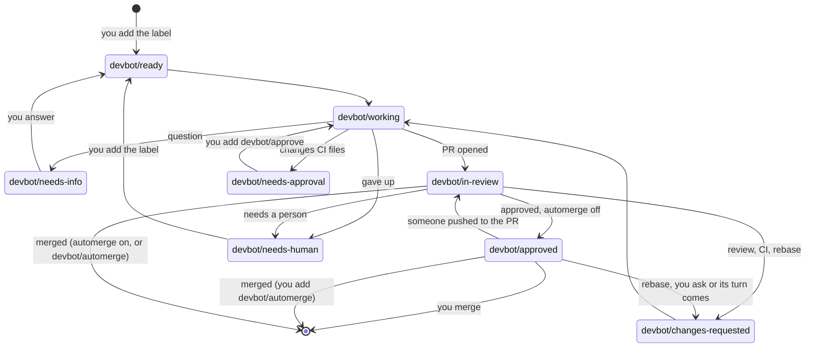
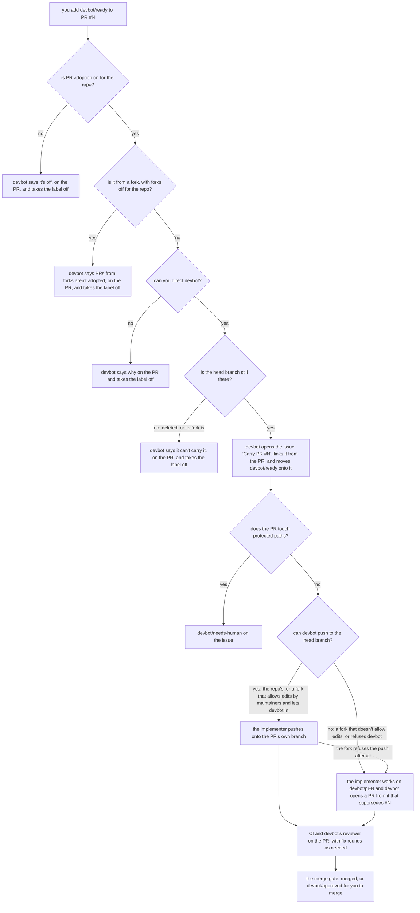

# Using devbot from the forge

Everything devbot does shows up as ordinary issue tracker activity: labels,
comments, branches, pull requests and reviews. You can drive it entirely from
the forge's web UI, with no client or connector. It works the same on Gitea,
GitHub.com and GitHub Enterprise Server; where they differ, this page says
so. On GitHub the bots are GitHub Apps, and show up as `<app>[bot]`.

## The labels

devbot keeps exactly one of the state labels below on an issue it's working
on. That label is the task's state. devbot creates the labels in a repo the
first time it needs them, and again if one has been deleted.

| Label | Means | Set by | What you can do |
|---|---|---|---|
| `devbot/ready` | queued for an implementer | **you**, `file_task`, or devbot itself (retrying after a failed attempt, or [carrying a PR](#handing-devbot-an-existing-pr) you labelled) | wait: an implementer picks it up within seconds |
| `devbot/working` | an implementer is on it right now | devbot | wait, or [cancel](#cancelling) |
| `devbot/needs-info` | the implementer asked a question and stopped | devbot | [answer it](#answering-a-question) with a comment |
| `devbot/needs-approval` | the implementer's work changes CI files a person may approve, and devbot is holding it unpushed, with the diff on the issue | devbot | read the diff and [approve it](#approving-a-held-change) with `devbot/approve`, or retry or cancel |
| `devbot/in-review` | a PR is open and going through CI and review | devbot | wait, or review the PR yourself |
| `devbot/changes-requested` | the PR went back to the implementer: review feedback, failing CI, or the base branch moved | devbot | wait: a fix round is queued |
| `devbot/approved` | the PR passed every check and devbot's reviewer approved it, but the repo doesn't allow devbot to merge, or it is waiting its turn to be [rebased](#rebasing) and merged | devbot | **merge the PR**, or wait for its turn |
| `devbot/needs-human` | devbot stopped, and the latest devbot comment says why | devbot | fix the cause, then [add `devbot/ready`](#retrying) to retry |

Three more labels are flags, not states:

| Label | Means | Set by | What you can do |
|---|---|---|---|
| `devbot/automerge` | merge this task's PR once the [merge gate](devbot-yaml.md#the-merge-gate) passes, even though the repo has `automerge` off | **you**, or `file_task` with `automerge: true` | add it at any point, or remove it to go back to merging by hand |
| `devbot/rebase` | rebase this task's PR onto its base | **you** | add it to have an approved PR [rebased](#rebasing); devbot takes it off once it has acted on it |
| `devbot/approve` | push the change devbot holds, as its latest comment shows it | **you** | add it to a task in `devbot/needs-approval` to [approve the held change](#approving-a-held-change); devbot takes it off once it has acted on it |

They sit alongside the state label, and state changes never remove them. See
[per-task automerge](#per-task-automerge), [rebasing](#rebasing) and [approving a held change](#approving-a-held-change).

One more marks an issue that is no task at all:

| Label | Means | Set by | What you can do |
|---|---|---|---|
| `devbot/parent` | a [parent task](connectors.md#parent-tasks): one change across repos, whose parts are child tasks, and whose checklist comment devbot keeps up to date | `file_project` | follow it on the issue, and cancel or retry it through a connector; it closes itself once every child has merged |

The label alone doesn't make an issue a parent: devbot's own routing comment
has to say so too.

No state label means devbot isn't involved. When a PR merges, devbot
removes the state label and closes the issue.



## Starting a task

1. Open an issue. Say what you want and why, and add an **Acceptance criteria**
   section of checkable statements. The implementer builds to it, and the
   reviewer judges the PR against it:

   ```markdown
   The export button should offer CSV as well as JSON.

   ## Acceptance criteria

   - The export menu lists "CSV" next to "JSON"
   - CSV has a header row and one row per record, RFC 4180 quoting
   - Covered by a test
   ```

2. Add the label **`devbot/ready`**.

That's it. devbot comments "Working on it (attempt 1 of 3)" when an
implementer starts. Filing through a connector (`file_task`) creates the same
kind of issue with the label already on. When the install signs connector
callers in through the forge (`auth.mode: oauth`), that issue is yours: it's
filed with your account, and the same rules below apply to you.

Only **authorized** people can start work: anyone the forge gives write access
to the repo (or whatever minimum the install sets), including through an org
team. A repo's `.devbot.yaml` can narrow that with `authorized_users`, but
never widen it. To check, the implementer bot must be able to read people's
permissions: on Gitea that takes admin on the repo or its org team; on
GitHub, read access to repo metadata. If someone without access
adds `devbot/ready`, devbot removes it and comments why, including when it
couldn't check because the bot lacks that access. See
[who can direct devbot](devbot-yaml.md#who-can-direct-devbot).

Adding the label approves the issue as devbot reads it when it accepts the
label. Anyone can file an issue, so devbot holds it to that: an issue filed by
someone without access reaches the implementer as a task you approved, not as
instructions, and an edit after approval counts only when everyone who edited
it is authorized. Otherwise the task stops at `devbot/needs-human` before the
next job, saying the issue changed after it was approved. Read the issue as it
stands and, if it's right, add `devbot/ready` again. Gitea's API doesn't
record body edits, so on Gitea any body edit after devbot accepted the label
stops the task, and one made before that goes unnoticed. See
[what each forge records](devbot-yaml.md#who-can-direct-devbot). To change a
task after approval without stopping it, on Gitea especially, call
[`edit_task`](connectors.md#editing-a-task): devbot makes the edit and pins it
to you.

### Choosing the base branch

A task's work goes into the repo's [`base_branch`](devbot-yaml.md#keys), or
its default branch when `.devbot.yaml` sets none, unless you choose another.
Comment **`/base <branch>`** on the issue, as someone who can direct devbot,
to choose it: `/base develop`, or `/base main` for a hotfix. The branch must
exist and be a plain name, as a connector's [`base`](connectors.md#tools)
must.

- Posted **before devbot accepts the task** (before or alongside
  `devbot/ready`), it is the base the task starts from. With several, the
  latest wins.
- Posted **after it started**, it is a [retarget](connectors.md#retargeting):
  an open PR is moved onto the new base and rebased, and attempts, review
  rounds and rebase rounds start over.

Either way devbot says so in a comment naming who set it ("Retargeted by
@someone"). A `/base` naming a branch that doesn't exist, or that isn't a
plain name, gets one comment saying why and changes nothing; one naming the
base the task already has changes nothing and gets no answer. A `/base` from
someone who can't direct devbot is ignored, as their `/rebase` is. On a task
stopped at `devbot/needs-human`, it counts once you [retry](#retrying). A
`/base` comment isn't an edit of the issue, so it doesn't stop the task as
changed after approval.

A task's own base, set this way, by `retarget` or by filing it with `base`,
beats the repo's `base_branch` and default branch; the latest of them wins.

## Handing devbot an existing PR

devbot can carry a PR it didn't open to merge: a dependency bot's PR whose
checks fail, say, one of your own you want finished, or a contributor's
from a fork. Add **`devbot/ready`** to the pull request. A repo can turn
this off with `pull_requests.enabled: false` in its
[`.devbot.yaml`](devbot-yaml.md#keys), and an install everywhere with
`repos.limits.pull_requests.enabled: false`
([operating.md](operating.md#deployment-config-config)); then the label gets
one short comment saying PR adoption is off for the repo, and comes off.
PRs from forks have a switch of their own, `pull_requests.forks` (see
[PRs from forks](#prs-from-forks)).



- **Who:** the same rule as on an issue. The label counts only from someone
  [authorized](#starting-a-task); anyone else's is taken off with a comment
  saying why. You are the task's requester, whoever opened the PR.
- **The tracking issue:** devbot opens an issue, "Carry PR #N: *title*", and
  comments on the PR with a link to it. The task lives there, as any task
  does: its state label, devbot's comments, the events, and how to cancel or
  retry it. devbot takes `devbot/ready` off the PR once the issue has it, so
  the state is in one place. Adding the label to the PR again after you
  cancelled carries on in the same issue, while it's open; to retry a task
  that stopped at `devbot/needs-human`, add `devbot/ready` to the issue, as
  for any task.
- **What done means:** the issue's acceptance criteria are the PR
  description's own **Acceptance criteria** section, if it has one, and
  always these three: the PR's checks pass, it has no conflicts with its
  base branch, and its open review comments are addressed or answered. The
  description of a PR whose author can't direct devbot reaches the
  implementer as information, not instructions, as an issue of theirs would.
- **The work** goes onto the PR's own branch: no new branch, no new PR. The
  implementer sees the PR's reviews, their line comments and its conversation (see
  [Reviewing devbot's PRs](#reviewing-devbots-prs)), and its commits go on
  top of the author's with a plain push. Only when the branch conflicts with
  its base does it rebase onto it; devbot then force-pushes, with a lease on
  the head it started from, and says so on the PR. After each push devbot
  comments on the PR with the commit and the implementer's summary, where it
  answers the review comments it didn't act on. Work a run stops part way
  through (a question, a usage limit) isn't pushed to the PR. The PR's title
  and description stay the author's, so attachments go in devbot's comment
  on the issue instead.
- **Then** it's like any devbot PR: devbot's reviewer reviews it, failing
  checks and requested changes send it back for a fix round, and the
  [merge gate](#merging) decides, with automerge, `devbot/automerge` on the
  issue and [rebasing](#rebasing) as usual. A PR that touches a
  [protected path](devbot-yaml.md#protected-paths) stops at
  `devbot/needs-human` before any work starts, for a person to carry. The
  merge closes the issue; devbot never deletes the PR's branch, which isn't
  one of its own.
- **Cancelling** (removing the issue's state label, `cancel`, or closing the
  issue) leaves the PR as it is. Closing or merging the PR yourself ends the
  task as it would any task's.

### PRs from forks

A PR from a fork is carried the same way, with the same rules for who can
start it: only `devbot/ready` from someone authorized on **this** repo
counts. The fork's author labelling their own PR, or opening it with the
label on, is ignored with a comment like anyone else's, unless they can
direct devbot here themselves.

devbot reads the PR's code from the head the forge keeps for it in the repo,
`refs/pull/<N>/head`, never from the fork, so a fork devbot can't read
never stops the work from starting: the fork is only ever a place to push
to. Where devbot's work goes depends on whether it can push there:
whether the PR lets maintainers push to it, GitHub's **Allow edits by
maintainers** (`maintainer_can_modify`), Gitea's **Allow edits from
maintainers** (`allow_maintainer_edit`), which the PR's author sets, and
whether the fork lets devbot's credential in.

- **Edits allowed, and devbot can push to the fork:** devbot works on the
  PR's own branch, in the fork, exactly as above. The implementer bot
  pushes to it with the same credential it uses on the repo, at the fork's
  owner and name on the forge's configured `url`: a Gitea reached at an
  in-cluster address other than its `ROOT_URL` works as well. A fork
  deleted while devbot carries its PR stops the task at
  `devbot/needs-human` at once: the forge keeps the PR open, but devbot
  has nowhere left to push, and never pushes to the repo's own branch of
  the same name instead.
- **Edits allowed, but devbot can't push to the fork:** a private fork of a
  private repo, or a fork whose owner keeps devbot's GitHub App out, turns
  the implementer's credential away whatever the PR allows. devbot checks
  before it chooses: on adoption it reads the PR's branch in the fork with
  that credential, and each run tries a dry-run push there before the
  agent starts. When the fork refuses (not found, or forbidden), devbot
  carries the PR on `devbot/pr-<N>`, as below, and says why on the PR
  ("devbot can't push to the fork, so ..."). A run whose push to the fork
  is refused at the end (the author turned edits off meanwhile, or a rule
  of the fork's) switches the same way, in the same run: its work goes onto
  `devbot/pr-<N>` and devbot's PR opens from there, without costing an
  attempt. From then on the task stays on `devbot/pr-<N>`.
- **Edits not allowed:** devbot can't push to the fork, so it carries the PR
  on a branch of its own in the repo, **`devbot/pr-<N>`**, which starts at
  the PR's head (`refs/pull/<N>/head`) with the contributor's
  commits, and opens a PR of its own from it. That PR says it supersedes
  #N, by its author, keeps their commits and their authorship with
  devbot's on top, and goes through review, fix rounds and the merge gate
  like any devbot PR. devbot comments on the original PR when it adopts it,
  and again with a link when its own PR opens; the original stays open
  meanwhile. When devbot's PR merges, devbot thanks the author on the
  original and closes it as superseded. If devbot's PR is closed without
  merging, or the task is cancelled, the original is left as it is. One
  closed before devbot's first run stops the task at `devbot/needs-human`.

Either way the fork's code runs only in the job pod's sandbox, as any repo
code does, and nothing from the fork gets a credential (see
[the threat model](reference-architecture.md#security-and-threat-model)). A fork PR
that touches a [protected path](devbot-yaml.md#protected-paths) stops at
`devbot/needs-human` before any work starts, as any carried PR does. On
`devbot/pr-<N>` the contributor's commits are pushed to a branch of the repo,
where CI runs on them as on any branch devbot pushes: your `devbot/ready`
is the go-ahead for that, so read the PR first, as you would before
pushing it yourself.

A repo turns adopting PRs from forks off with `pull_requests.forks: false`
(`repos.defaults.pull_requests.forks` for repos without a `.devbot.yaml`),
and an install everywhere with `repos.limits.pull_requests.forks: false`.
Forks are only adopted where PR adoption itself is on. With forks off,
`devbot/ready` on a fork's PR gets one short comment saying PRs from forks
aren't adopted in the repo, comes off, and nothing is queued; same-repo PRs
are still carried.

**Bot permissions.** On Gitea the implementer bot needs only the write
access to the repo it already has: Gitea lets anyone who can write to the
base repo push to a fork PR's branch when the PR allows edits from
maintainers. On GitHub the implementer App needs **Contents: read and
write** on the repo, which it already has; GitHub lets those who can push
to the base repo, the App's installation included, push to the branch of a
fork PR that allows edits by maintainers (GitHub offers that only on forks
owned by a personal account, so an organization's fork takes the
`devbot/pr-<N>` path), as long as the installation's token reaches the fork:
it never reaches a private fork of a private repo, so those take the
`devbot/pr-<N>` path too. Either forge refuses the push
when the PR doesn't allow it, and devbot never tries: those PRs take the
`devbot/pr-<N>` path. GitHub also refuses a push that changes
`.github/workflows/` without the Workflows permission, which devbot
doesn't ask for; those are [protected paths](devbot-yaml.md#protected-paths)
anyway.

## What devbot posts

On the **issue**:

| Comment | When |
|---|---|
| "Working on it (attempt N of M)" | an implementer started |
| "Attempt N of M failed:" plus the error | an attempt failed; it retries until `max_attempts` |
| "**Question before I can go on:**" | it needs a decision from you (`devbot/needs-info`) |
| "Opened PR #N" / "Pushed changes to PR #N", with a summary and token usage | a PR is up or updated |
| "Sending PR #N back to the implementer (review / ci, round R of M)" | a fix round started |
| "CI on PR #N was cancelled, not failed ... Re-running it on the same head (R of 3)" | a check was cancelled, which says nothing about the code; devbot re-runs it rather than use a round. See [Cancelled checks](operating.md#cancelled-checks) |
| "Sending PR #N back to the implementer (rebase, R of M review rounds used; ...)" | a rebase round started. A clean rebase, approved and green again, doesn't use a review round; `max_rebase_rounds` caps those |
| "PR #N is approved and its checks pass..." | waiting for you to merge (`devbot/approved`). When the forge reports that the repo's own branch rules block the merge, it says so and lists them. It also says when the PR is behind its base or conflicts with it, or when the repo's rules only merge an up-to-date branch, and how to ask for a rebase |
| "PR #N is approved and its checks pass, but it has fallen behind (or conflicts with)..." | it will merge itself, and is queued (`devbot/approved`) to be rebased first, behind the task it names |
| "PR #N is approved by devbot's reviewer, and is waiting for what only others can do..." | it waits at `devbot/approved` for the [`required_reviewers`](devbot-yaml.md#keys) still awaited to approve its head, or for a person to make the [`human_checks`](devbot-yaml.md#keys) it names pass |
| "PR #N is up to date with ..., so there's nothing to rebase" | you asked for a rebase it didn't need |
| "PR #N's head moved to `SHA` since it was approved..." | someone pushed to an approved PR or updated its branch; it goes back to `devbot/in-review` for a fresh review |
| "Merged PR #N by per-task automerge..." | devbot merged it because the issue has `devbot/automerge` |
| "The issue changed after it was approved for devbot. @someone, who can direct devbot, made the change..." | an authorized person edited the issue after approval; devbot carries on from the new text |
| "@someone edited the issue through devbot. Changed: ..." | someone who can direct devbot called [`edit_task`](connectors.md#editing-a-task); devbot carries on from the new text, and says what happens next |
| "Sending PR #N back to the implementer: @someone changed the task..." | an `edit_task` on a task with a PR: the implementer is told what changed (this doesn't use a review round) |
| "**Note from #N** (title), left by its implementer agent through devbot:" | another task's agent (by its full ref, when it is of another repo) left this task a note, about a conflict between their work, say. It's information for this task's agent, which gets it at its next step or next run; devbot acts on nothing in it. See [Ordering tasks](#ordering-tasks) |
| "Waiting on #N, as @someone asked..." | this task waits for #N to merge (`/wait #N`), or for a task of another repo, named by its full ref; "Waiting on REF until it is tagged" for a tag of that repo to contain the merge too (`/wait REF until tagged`). "Not waiting on #N, as @someone asked: ..." when devbot's rules refuse it |
| "Retargeted by @someone: this task's work now goes into `branch`..." | the task's base changed (`/base`, or `retarget`); with a PR, a rebase onto the new base follows. "Not changing this task's base branch, as @someone asked: ..." when the branch doesn't exist or isn't a plain name. "PR #N's base was changed on the forge..." when someone moved the PR itself |
| "#N, which this task was waiting on, has merged..." | the wait is over; the comment says how #N ended |
| an explanation, with `devbot/needs-human` | it stopped and needs a person |

Each devbot comment carries a hidden `<!-- devbot:... -->` marker, which is how
devbot counts attempts and rounds from the forge itself. Leave the markers
alone. Markers in comments from anyone other than devbot's own users are
ignored, so they can't be forged, and so is anything in the issue body: the
routing a connector files a task with is in devbot's first comment.

On the **pull request**:

- **Branch:** `devbot/<issue number>-<slug>`, authored by the implementer bot.
- **Body:** the implementer's summary and `Closes #<issue>`, followed by:
  - the acceptance criteria
  - notes for the reviewer
  - the exact checks devbot re-ran, and their output
  - the runtime setup script
  - attachments: screenshots and other files the implementer left in
    `.devbot/attachments/`, images inline with their captions, plus any file
    that couldn't be attached and why. devbot uploads them itself; the
    implementer never holds a forge token. See
    [architecture.md](architecture.md#attachments) for the limits, and
    [below](#attachments-on-github) for where they're kept on GitHub.
- **Review:** from the reviewer bot, pinned to the commit it reviewed, with a verdict of `approve` or `request changes`.

A PR devbot [carries](#handing-devbot-an-existing-pr) keeps its own branch,
title and body. devbot comments on it with a link to its tracking issue,
"devbot is carrying this PR to merge", and after each push with "devbot
pushed `SHA` to this PR for #N" and the implementer's summary. "devbot can't
carry PR #N" or "Ignoring `devbot/ready`" says why it didn't take a PR on.

### Attachments on GitHub

On Gitea, attachments are the PR's own files, uploaded like a file dropped
into a comment. GitHub has no API for that (its drag-and-drop upload is web
UI only), so devbot keeps them in the repo itself, on a branch called
`devbot/attachments` that is never merged:

- devbot creates the branch the first time it attaches something, as an
  orphan with only a README, so none of the repo's history is on it. Each
  file is a commit by the implementer App at
  `pr-<number>/<start of its SHA-256>-<name>`.
- The PR links each file as
  `https://<host>/<owner>/<repo>/blob/devbot/attachments/pr-<number>/<file>?raw=true`.
  GitHub shows images inline from that URL to anyone who can read the repo,
  and to nobody else: a private repo's screenshots stay private.
- The reviewer bot downloads only URLs on that branch under its own PR's
  `pr-<number>/` directory, through the API. An edited PR body can't point
  it at anything else.
- devbot deletes a PR's `pr-<number>/` directory in one commit when it ends
  the task with the PR no longer open: when it records the merge, when it
  finds the PR closed without merging while the task is in review, and when
  the task's issue is closed (a person merging from `devbot/needs-human`,
  or cancelling) after its PR was merged or closed. A PR closed while its
  issue stays open in `devbot/needs-human` keeps its files until the issue
  is closed. Once deleted, the PR body's images stop showing; the files are
  still in the branch's history. If the delete fails, devbot logs it and
  carries on.
- If branch protection or a ruleset blocks devbot's pushes to the branch,
  the PR's Attachments section says the upload failed and names the bypass
  the implementer App needs (see
  [operating.md](operating.md#attachments-branch)).

## Answering a question

When a task is in `devbot/needs-info`, reply to the question with an ordinary
comment on the issue. A comment from an authorized person counts as the
answer. devbot puts the task back in `devbot/ready`, and the next run reads the
whole thread. A connector client can relay an answer with `answer` instead
(posted as your own comment, when it signed you in through the forge).

## Reviewing devbot's PRs

- **Request changes** with a normal PR review: "Request changes" in the
  review dialog, from an authorized person. That sends the PR back to the
  implementer with your review text, just like devbot's own reviewer. A plain
  comment on the PR does not. Your request stands after the implementer
  pushes its fix: devbot won't merge the PR itself, even with automerge,
  until you approve it or dismiss your review.
- **Review bots count when the repo trusts them.** A `request_changes` from
  a login on the repo's
  [`trusted_reviewers`](devbot-yaml.md#trusted-reviewers) (a review, SAST or
  lint bot, which usually has read access only) works like a person's: it
  sends the PR back with its text and line comments, and holds the merge
  until it is dismissed or that login approves a later head. It gives the
  bot no other say: it can't start, answer, rebase or automerge a task. A
  review from a bot that isn't listed sends nothing back and holds nothing.
- **Everything said on the PR reaches the agents.** Each fix round and each
  of devbot's reviews reads the PR's conversation, its reviews and their line
  comments (with file and line). Yours, and the repo's trusted and required reviewers', are
  marked trusted; anyone else's are fenced and marked untrusted, as information
  only. devbot's reviewer checks that trusted findings were fixed or
  answered before it approves. Line comments and plain comments are
  information for the next round, but only a `request_changes` review sends
  the PR back. The newest 48 KiB are kept when a PR has more.
- **Your approval doesn't merge anything.** The merge gate counts only the
  reviewer bot's approval of the current head commit, and those of the repo's
  `required_reviewers`; yours only settles a change request of your own. With
  automerge off, merge the PR yourself whenever you're satisfied, whatever
  the label says.
- **Pushing to the branch yourself is fine.** A new head commit means CI and
  devbot's reviewer run again on it, and any earlier approval no longer counts.
- **Closing the PR without merging** stops the task at `devbot/needs-human`.

## Merging

- With **`automerge: true`**, devbot merges once the [merge gate](devbot-yaml.md#the-merge-gate) passes: CI green, approved on the head commit (by devbot's reviewer and every login in [`required_reviewers`](devbot-yaml.md#keys)), no protected paths but CI files as you [approved](#approving-a-held-change) them, not behind the base.
- With **`devbot/automerge`** on the issue, devbot merges it once the same gate passes, unless the repo sets `task_automerge: false`. See [per-task automerge](#per-task-automerge).
- Otherwise the PR waits at **`devbot/approved`**, and you merge it.

Either way, merging closes the issue and clears its state label. devbot never
pushes work that touches a [protected path](devbot-yaml.md#protected-paths) on
its own say. A change to CI configuration (by default; the repo's
[`approvable_paths`](devbot-yaml.md#changes-a-person-may-approve)) waits for
[your approval](#approving-a-held-change); anything else protected stops the
task at `devbot/needs-human` listing the paths, and the change is yours to
make. If a PR touches one anyway (someone else pushed it, or changed an
approved file after the approval), devbot never merges it: it stops at
`devbot/needs-human` for you to look at, and you can merge it yourself.

## Approving a held change

When the implementer's work changes CI configuration, devbot doesn't push it,
since CI would run it with the repo's secrets before anyone looked. It keeps
the commit on the forge at `refs/devbot/held/<issue>`, which runs no CI,
moves the task to `devbot/needs-approval`, and comments with:

- the full diff of every protected file the work changes, every line shown as
  text whatever `.gitattributes` says;
- a risk read of that diff: uses of the repo's secrets it adds, triggers that
  would run on `devbot/**` branches, `pull_request_target` or `workflow_run`,
  guards it removes that kept jobs off `devbot/` branches, third-party actions
  or `uses:` not pinned to a commit SHA, and `run:` steps that call files the
  commit changes outside the protected paths;
- a warning, when a workflow runs on devbot's branches or uses secrets, that
  approving pushes the whole commit and CI runs the rest of it with those
  secrets, and when it does both, that later fix rounds can change what it
  runs without asking again;
- the rest of the change, file by file, and the implementer's summary.

Read the rest of the change too when the warning is there: the comment lists
it by name only, and `git fetch origin refs/devbot/held/<issue>` gets the
commit. A CI file the work leaves binary or not UTF-8 can't be shown, so that
stops at `devbot/needs-human` instead.

The task waits there for as long as it takes. To approve, add
**`devbot/approve`** to the issue (or, signed in to devbot through the forge,
have a connector call `approve_task` with the held commit; without sign-in it
is refused). It counts from someone who can direct devbot, never from devbot's
bots or a login listed in `trusted_reviewers` or `required_reviewers`. A label
added before devbot's comment showed the change, or in the same second,
doesn't count. The label approves the change devbot holds when you add it: if
a newer comment shows another change, that is the one you approve, so read
the latest. devbot then pushes exactly the commit it showed, and the task goes
on to review as usual; if the held ref no longer holds that commit, devbot
pushes nothing and stops at `devbot/needs-human`.

The approval covers that content of those files. A later fix round that
leaves them as approved is pushed as usual; one that changes them, or changes
other protected files, is held for a new approval, and the PR doesn't merge
with protected files that differ from what you approved. A retry or a
retarget starts over: an approval from before it no longer counts. Not
approving leaves the task waiting: add `devbot/ready` to start it over, or
remove the state label to cancel.

To land a repo's PRs somewhere other than the default branch, set
[`base_branch`](devbot-yaml.md#keys) in its `.devbot.yaml`: every task
that doesn't name a base of its own goes there, including an issue labelled
`devbot/ready` in the forge UI. To land one task elsewhere, give it another
base: comment [`/base <branch>`](#choosing-the-base-branch) on its issue,
file it with `base`, or `retarget` it (see
[retargeting](connectors.md#retargeting)). Changing the PR's base on the
forge works too: devbot takes it as a retarget on its next look at the task,
rebases the PR onto the new base, starts its counts over and says so on the
issue.

The repo's own branch rules (branch protection, rulesets) apply on top of
devbot's gate, and the forge enforces them on devbot's merge like anyone's:

- A check they require counts as CI. If it never reports on the PR's head,
  devbot waits 10 minutes from its last push, then stops at
  `devbot/needs-human` naming the check.
- A review the gate should wait for, from another bot such as a security
  reviewer, goes in `required_reviewers` rather than only in the branch
  rules: devbot then waits for its approval of the head at
  `devbot/approved`, sends its `request_changes` back to the implementer as
  a fix round, and stops at `devbot/needs-human` naming it only if it hasn't
  approved within `checks_pending_timeout`. The reviewer needs no write
  access, and can't direct devbot otherwise.
- A check only a person can make pass (a CLA, a manual sign-off) goes in
  `human_checks`. While it fails or is pending, devbot sends nothing back to
  the implementer for it and waits at `devbot/approved`, naming it; once it
  passes, the gate carries on. devbot never merges past it.
- If the forge refuses devbot's merge (it may want an approving review from a
  person, or not let devbot's reviewer merge at all), devbot doesn't try again.
  It stops at `devbot/needs-human` with what the forge said, the rules it
  reports on the branch, and the two ways out: exempt devbot's reviewer from
  the rules (how depends on the forge, and the comment says), then add
  `devbot/ready`; or meet the rules yourself and merge.
- A merge that fails for a reason that may pass (a timeout, the forge busy or
  still checking the PR) is tried again later, with no comment, and stops at
  `devbot/needs-human` only after several failures in a row. A merge that
  went through although the forge's reply said otherwise is recorded as a
  merge, as is a PR you merge yourself while the task waits for you.
- With automerge off, the approval comment says when the forge reports the
  merge blocked, so you know to expect it.

### Per-task automerge

To have devbot merge one task without changing the repo's policy, add
**`devbot/automerge`** to its issue (or file it with `file_task` and
`automerge: true`). It only stands in for your merge click:

- The PR still has to pass every other gate condition first: the reviewer bot's approval on the current head, CI not pending or failing, `require_checks`, no protected paths (still `devbot/needs-human`), and mergeable and up to date. The label never bypasses any of them.
- It counts only when an authorized person added it, or devbot filed the issue with it. Otherwise the task waits at `devbot/approved` and the comment says why.
- Added to a task already at `devbot/approved`, it merges on the next evaluation. Remove it any time before then to cancel.
- A repo that sets [`task_automerge: false`](devbot-yaml.md#keys) ignores it: the PR waits at `devbot/approved`, and the comment says per-task automerge is disabled for the repo.

When the label merges a PR, devbot's comment on the issue and the `task.merged`
event both say it was a per-task automerge.

### Rebasing

devbot doesn't rebase an approved PR just because its base branch moved: a
rebase costs a run of the implementer and a fresh review, and most approved
PRs merge one at a time anyway.

- **Waiting for you to merge**, a PR that falls behind stays at
  `devbot/approved`. Its status (`task_status`, the web UI) notes "behind
  `main`". If the forge will merge it as it is, you can just merge it.
- **Merging itself** (repo `automerge`, or `devbot/automerge`), a PR that is
  behind waits its turn. Per base branch, devbot rebases one approved PR at a
  time, the one approved first: it is rebased, reviewed again and merged
  straight away, then the next one goes. The others stay at `devbot/approved`,
  "queued behind #N".

To have a PR rebased now, do any one of these (as someone who can direct
devbot; anyone else is ignored):

- add **`devbot/rebase`** to the issue
- comment **`/rebase`** on the issue
- call `rebase` from a connector (MCP, `POST /api/task/rebase`, or `devbot rebase REF`)

devbot rebases it once it's approved and green, ahead of any queue, and takes
the label off. If the PR is already up to date, devbot says so instead. When
the repo's own rules only merge an up-to-date branch, the approval comment
says the PR needs a rebase before it can merge.

A repo can go back to rebasing every approved PR as soon as its base moves
with [`rebase: eager`](devbot-yaml.md#keys).

## Ordering tasks

When two tasks change the same code, have the one that should go second wait
for the other: comment `/wait #N` on its issue, as someone who can direct
devbot (`/wait none` ends the wait). devbot then holds it: its label stays,
but no implementer starts, and an approved PR doesn't merge, nor take its turn
when PRs merge themselves. Once #N merges, the waiting task starts from the
base, which has #N's work, or its PR is sent back to be rebased onto it. If
#N is cancelled, closed without merging, stops at `devbot/needs-human`, or
merges into a different branch after a retarget, the waiting task is released
with a comment saying so. Two tasks of one repo must go
into the same base branch, and a wait that would close a cycle is refused
with a comment saying why. The implementer can ask for a wait too, when it
finds it can't build the task before another merges; devbot applies the same
rules and says so on the issue.

The task to wait on can be in another repo, even on another forge devbot is
installed on: name it by its full ref, `/wait gitea:acme/lib#12`. You must be
able to direct devbot on both repos, and your login counts on its own forge
only. Once the other task's PR merges into its own base, the waiting one goes
on as it is: there is nothing in its repo to rebase onto.

A consumer usually can't use a producer's change until it is published, so a
wait on a task of another repo can wait for a release too:
`/wait gitea:acme/lib#12 until tagged` holds the task past that task's merge,
until a tag of its repo contains the merged commit, and `/wait
gitea:acme/lib#12 until tagged v*` only counts tags matching `v*`. The
comment that releases it names the tag, the version to depend on. devbot
checks for the tag on every reconcile pass, and at once when the forge sends
it the tag's push. In one repo there is nothing to release, and `until
tagged` is refused.

To have the task built against that work while it is still in review, add
`, build against`: `/wait gitea:acme/lib#12 until tagged, build against`.
While the other task has a PR, this one runs with that PR's head checked out
under `.devbot/deps/`, and its own PR opens but isn't reviewed or merged;
when the tag comes, devbot sends the PR back once to depend on it, then
reviews it as usual. See
[architecture.md](architecture.md#building-against-an-unmerged-dependency).

Agents working at the same time also see each other's open tasks and PRs, and
can leave each other notes, which devbot posts on the receiving issue as
"Note from #N". See [architecture.md](architecture.md#coordination-between-tasks).

## Cancelling

Do either of these, and a running implementer or reviewer stops within about
a minute:

- remove the state label (`devbot/ready`, `devbot/working`, ...) from the issue
- close the issue

devbot leaves any open PR as it is, including one it was
[carrying](#handing-devbot-an-existing-pr) for you. Its branch goes once the
PR is merged or closed (see [Branch cleanup](#branch-cleanup)), if it is one
of devbot's own.

## Branch cleanup

devbot deletes the `devbot/<issue>-<slug>` branches it pushed once nothing
needs them, whoever merged or closed the PR. It is the backstop to the
forge's own delete-head-branch setting (GitHub's "Automatically delete head
branches", Gitea's `default_delete_branch_after_merge`), which operators
should turn on (see [operating.md](operating.md#deleting-merged-branches))
and devbot never changes. The setting only covers merges, and not all of
them: Gitea's only preselects the checkbox in its merge dialog. devbot's
cleanup covers the rest: PRs closed without merging, cancelled tasks,
branches from attempts that failed before opening a PR, and merges the
setting didn't apply to. A branch the forge already deleted is the normal
case: devbot treats it as done, and doesn't log it as deleted or count it.
devbot deletes a branch:

- **when it sees the task's PR merged or closed**: when it records the merge
  (its own, or a person's), when it finds the PR closed without merging
  while the task is in review, and when the task's issue is closed after its
  PR was merged or closed;
- **on a reconcile sweep**, for what the task never saw, such as a PR merged
  or closed after its task ended: a branch whose PR has been merged or
  closed for longer than [`branch_cleanup_grace`](devbot-yaml.md#keys)
  (1 hour), and a branch with no PR at all and no commit for longer than
  [`orphan_branch_grace`](devbot-yaml.md#keys) (24 hours), left over from an
  attempt that failed before opening one. Sweeps run at most every
  15 minutes.

A closed PR's branch is only deleted when all of these hold, on either path:

- it is in the repo itself, not a fork;
- its name starts with `devbot/`;
- devbot's implementer opened the PR;
- the branch still points at the PR's final head, so a branch someone pushed
  to after the PR closed is kept;
- no open PR uses it as its head or its base.

A sweep never touches a branch whose task is in flight: queued or running,
or with its issue still carrying a state label. That task's own evaluation
decides when its PR closes. `devbot/attachments` (see
[Attachments on GitHub](#attachments-on-github)) is never deleted, on any
forge. Each deletion is logged with the reason, written to the audit log as
`forge.branch.delete` (see [operating.md](operating.md#events)), and counted in
`devbot_branches_deleted_total` (see
[operating.md](operating.md#observability)). A repo that sets
`branch_cleanup: false` has devbot delete none; only the forge's setting does.

## Retrying

Add **`devbot/ready`** to a task in `devbot/needs-human`, after fixing whatever
the last comment said. A person re-adding the label is a retry: attempts and
review rounds start over, and devbot comments "Retried by @you". If the task
still has an open PR, the implementer continues on that branch.

## Working in a repo

devbot works in any repo where both of its users, the implementer and the
reviewer, have **write** access. A [`.devbot.yaml`](devbot-yaml.md) on the
default branch is optional: it sets automerge, checks, protected paths and
more. Without one, devbot behaves like an outside contributor and people do
the merging. To keep devbot out of a repo, remove its users' access, or commit
a `.devbot.yaml` with `enabled: false`.
