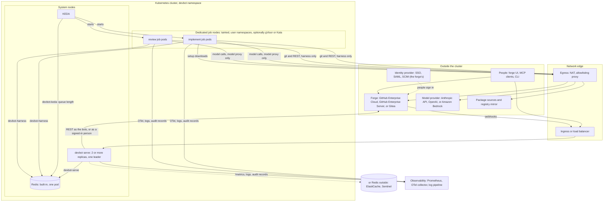
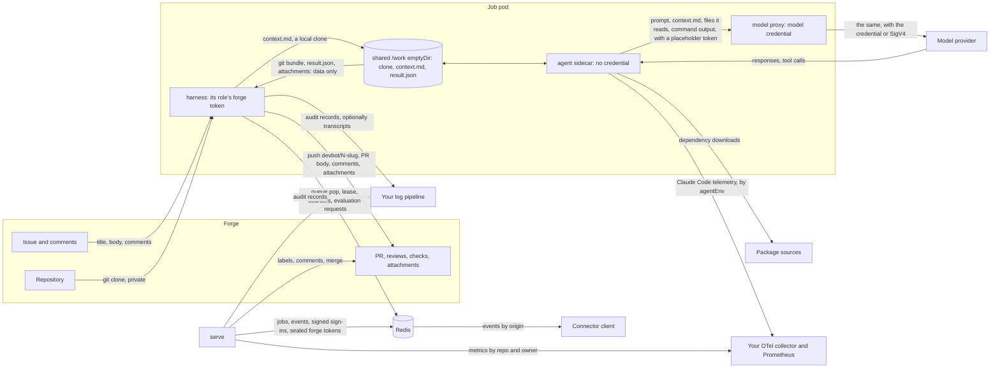
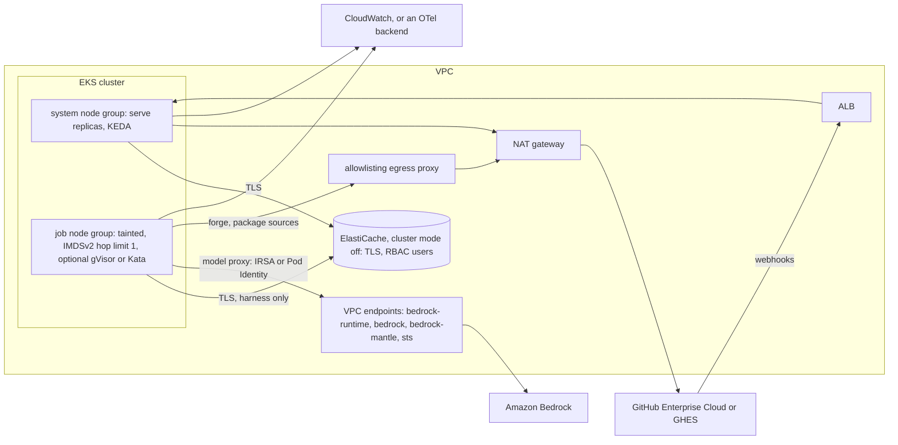
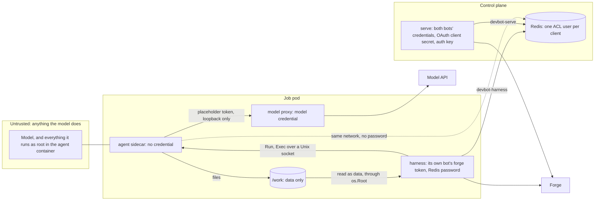

# Reference architecture

How to run devbot for an organization: where its parts go, what they talk
to, how to deploy it on EKS, GKE or your own clusters, and what to plan for
identity, security, capacity, operations and data. Every key and value it
names is documented in [operating.md](operating.md)
(deployment config and Helm values) or [devbot-yaml.md](devbot-yaml.md)
(repo policy), which this page links to rather than repeats. How devbot
works inside is in [architecture.md](architecture.md).

- [Topology](#topology)
- [Data flow](#data-flow)
- [Reference deployments](#reference-deployments): [EKS](#eks), [GKE](#gke), [generic or on-prem](#generic-or-on-prem)
- [Identity](#identity)
- [Security and threat model](#security-and-threat-model)
- [Sizing and scaling](#sizing-and-scaling)
- [Operations](#operations)
- [Data handling](#data-handling)

**Limits to plan around:**

| Limit | Where it matters |
|---|---|
| Redis Cluster (and managed Redis in cluster mode) isn't supported; one endpoint or Sentinel is | [EKS](#eks), [GKE](#gke) |
| Redis must have ACL users with passwords of their own (`devbot-serve`, `devbot-harness`, `devbot-keda`); a Redis with a single shared password won't do | [EKS](#eks), [GKE](#gke) |
| Gitea tokens can't be limited to a repo or made short-lived | [Gitea bot accounts](#gitea-bot-accounts) |
| IRSA and Pod Identity are covered by render and unit tests, not yet run on a live EKS cluster; the `codex` harness hasn't run against OpenAI's API ([Tested environments](operating.md#tested-environments)) | [EKS](#eks), [Retention](#retention) |
| The model is a hosted API, so there is no air-gapped install | [Generic or on-prem](#generic-or-on-prem) |

## Topology



| Part | Runs as | Notes |
|---|---|---|
| serve | a Deployment, `serve.replicas`, rolling updates, a PodDisruptionBudget and spread across nodes and zones from 2 replicas | every replica takes webhooks, connectors, the OAuth broker, the web UI and evaluations; the [leader](architecture.md#high-availability) also runs reconcile, delayed-job release, job pod labelling and outbound subscribers. `/metrics` is on its own port |
| job pods | KEDA ScaledJobs, one pod per queued job, as `<release>-implement` or `<release>-review` (and `-docker` ones, with `docker.mode`) | three containers: the harness (its own role's forge credential), the agent sidecar the model runs in (no credential), and the model proxy (the model credential); see [A job pod](architecture.md#a-job-pod). A Docker pod has a fourth, its [Docker daemon](operating.md#docker) |
| Redis | the chart's own (one pod, optionally persistent), or yours | queues, leases, holds, the event feed, counters, connector sign-ins; [disposable](architecture.md#principles) but for sign-ins. Each client is its own ACL user ([Redis](operating.md#redis)) |
| KEDA | your cluster's | scales each ScaledJob on its queue's length, from zero, as its own Redis user |
| forge | yours | the system of record: every task's state is on it |
| model provider | per role, `config.agents` | Anthropic's API, OpenAI's, or Bedrock ([Agent harnesses](operating.md#agent-harnesses), [Bedrock](operating.md#bedrock)) |

The forge decides the edge. GitHub.com and GitHub Enterprise Cloud deliver
webhooks from the internet, so serve's webhook path must be reachable from
there. GitHub Enterprise Server and an in-house Gitea can reach an internal
load balancer or an in-cluster address. The chart's only ingress object is an
Istio VirtualService (`virtualService.*`); anything else (an AWS ALB, GKE
Ingress, an OpenShift Route, Traefik) is an object of your own pointing at
the chart's Service, port 80. Keep `metrics_addr` off it.

## Data flow

Where code, prompts and credentials go for one task:



- **Code** leaves the forge only into a job pod's emptyDirs, and from there
  only to the model provider, as much of it as the agent reads or sends. It
  comes back to the forge as commits on a `devbot/<issue>-<slug>` branch,
  pushed by the harness once it has checked them for protected paths. Work
  that changes CI files a person may approve waits at a ref no CI runs on,
  `refs/devbot/held/<issue>`, until one does. With
  `audit.transcript` on, whatever the model read is in its transcript too,
  in your log pipeline.
- **Prompts** are devbot's own (`internal/prompts`), plus `context.md`: the
  issue, its comments (from people who can't direct devbot, fenced as
  untrusted), the repo's policy and, on a fix round, the review or CI
  output: a failed job's log tail, a check run's output and annotations
  ([What CI said](operating.md#what-ci-said)), fenced as untrusted. They go to
  the model provider and nowhere else.
- **Forge credentials** stay in serve (both bots) and the harness container
  (its own role's bot only). **Model credentials** stay in the model proxy
  container. The agent sidecar, where the model runs, holds neither, nor a
  Redis password.
- **Redis** holds no code: task references, job metadata, events (type,
  task, PR, state, origin, requester, a one-line summary, a URL), counters,
  and, in `auth.mode: oauth`, sign-ins: people's forge tokens sealed with the
  auth key serve alone holds, and grants and devbot's token hashes, each
  signed with a key derived from it.

The full list, with retention, is in [Data handling](#data-handling).

## Reference deployments

Each is a Helm values file layered over the chart, plus a few cluster
objects the chart doesn't make. Start from `values.example-github.yaml` or
`values.example-gitea.yaml` and [Installing](operating.md#installing); the
sections here only cover what differs.

Wherever it runs, the cluster needs what [Prerequisites](operating.md#prerequisites)
lists: the Kubernetes, container runtime and kernel versions for user
namespaces, KEDA, Helm, a NetworkPolicy implementation that enforces
egress, a namespace of devbot's own, model credentials and Redis. Where the
nodes can't run user-namespaced pods, set `jobs.userNamespaces: false` and
use a sandboxed runtime instead.

### Job pod placement and sandboxing

The chart has the values for it: `jobs.nodeSelector`, `jobs.tolerations` and
`jobs.affinity` to keep job pods on a tainted node pool of their own,
`jobs.runtimeClassName` for gVisor or Kata, and `jobs.userNamespaces` so the
agent's root isn't root on the node. [Security](operating.md#security) has
them in order of effect, with an example. serve, Redis and KEDA then
never share a node with code the model wrote. The chart's own Redis has
`redis.nodeSelector`, `redis.tolerations` and `redis.affinity` of its own,
like the jobs' and serve's placement options.

A sandboxed runtime suits job pods well: the agent runs as root, installs
packages and runs the repo's tests, so a kernel boundary of its own is worth
having. devbot needs nothing special from it (loopback, a Unix socket and
emptyDirs shared between the pod's containers). Try a few repos under it
before relying on it; nested containers don't work. If job pods don't start
with both a sandboxed runtime and `jobs.userNamespaces`, turn the latter
off: the sandbox's own kernel then keeps the agent's root off the node.

### EKS



**Model: Bedrock.** Give each role `config.agents.<role>.aws` with a region
and `auth: irsa` or `auth: pod_identity`, as in
[Credential modes](operating.md#credential-modes). Each role's job pods run
as its own ServiceAccount (`<release>-implement`, `<release>-review`), and
the pods tell EKS to skip the harness and agent containers, so the AWS
credential reaches the model proxy alone. One IAM role per devbot role lets
you scope each to its models, with the [IAM policy](operating.md#iam-policy)
narrowed to them.

- **IRSA:** annotate the ServiceAccounts with
  `jobs.implement.serviceAccount.annotations` and
  `jobs.review.serviceAccount.annotations` (`eks.amazonaws.com/role-arn`).
  The proxy calls STS, so give it an STS interface endpoint.
- **Pod Identity:** install the Pod Identity Agent add-on and associate each
  role with its ServiceAccount. The chart's network policy allows the agent's
  link-local endpoint itself.

Job pods reach their model API only through what
`networkPolicy.modelAPI.bedrock` lists, since AWS publishes no ranges small
enough to list: the subnets of interface endpoints for `bedrock-runtime` and
`bedrock` (`claude`), `bedrock-mantle` (`codex`), and `sts` for IRSA, in the
role's region ([Egress](operating.md#egress)). That also keeps the calls off
the internet. Or send the model proxy through the egress proxy instead.

**Redis: ElastiCache.** A Redis OSS or Valkey replication group with cluster
mode **off** (devbot's scripts change several keys at once, which cluster
mode doesn't allow), in the cluster's VPC, with a security group that admits
only the cluster's nodes. Turn on in-transit encryption and RBAC, and give
the replication group a user group with the three users devbot needs,
`devbot-serve`, `devbot-harness` and `devbot-keda`, with the access strings
the chart gives its own Redis (`devbot.redisACL` in `_helpers.tpl`) and the
`default` user switched off; check ElastiCache accepts each rule. Then:

```yaml
redis:
  enabled: false
  existingSecret: devbot-redis        # serve-password, harness-password, keda-password
config:
  redis:
    addr: master.devbot.xxxxxx.use1.cache.amazonaws.com:6379
    tls: {enabled: true}
networkPolicy:
  allow:
    - {cidr: 10.0.32.0/20, ports: [6379]}   # the cache's subnets
```

[Redis for HA](operating.md#redis-for-ha) has the rest. Multi-AZ with
automatic failover keeps queues and sign-ins through a node loss; keep
`leader_lease` above the failover's pause.

**Job nodes.** A managed node group for job pods, tainted and labelled, with
`jobs.nodeSelector` and `jobs.tolerations` pointing at it. Require IMDSv2 with
a hop limit of 1 on its launch template, so pods can't take the node's
instance role; the network policy denies link-local addresses too. User
namespaces need an AMI with containerd 2.0, and with IRSA or Pod Identity (whose
token is a tmpfs volume) Linux 6.3 or later; otherwise
set `jobs.userNamespaces: false` and use a sandboxed runtime. gVisor needs
`runsc` and its containerd shim on the nodes (a custom AMI or user data) and a
`RuntimeClass` named in `jobs.runtimeClassName`; Kata needs metal instances.
Size the nodes for `jobs.agentResources`.

**Egress.** Private subnets with a NAT gateway, and job pods' traffic to the
forge and package sources through an allowlisting proxy,
`networkPolicy.egressProxy`: see [Egress](#egress).

**Ingress.** An ALB from the AWS Load Balancer Controller, as an Ingress of
your own for the chart's Service. Internet-facing for GitHub Enterprise
Cloud's webhooks (which only need `/webhooks/<provider>`), internal for
GHES in the same network. With `auth.mode: oauth`, serve must be at the root
of its host, and the ALB's addresses belong in `trusted_proxies`
([Behind a proxy](operating.md#behind-a-proxy)).

**Observability.** CloudWatch Container Insights' Prometheus scraping, or an
ADOT collector, picks up serve's `prometheus.io/*` annotations. Ship
container logs with Fluent Bit, and the audit records to a log group of
their own ([Shipping it](operating.md#shipping-it)). Claude Code's own
telemetry goes wherever `agentEnv` points its OTEL exporter, for example the
collector's OTLP endpoint (allow it in `networkPolicy.allow`).

### GKE

- **Sandbox: GKE Sandbox.** A node pool with GKE Sandbox enabled, and
  `jobs.runtimeClassName: gvisor`. GKE taints the pool, and its `gvisor`
  RuntimeClass schedules pods that name it onto the pool. Add a label of
  your own to `jobs.nodeSelector` only if you have several sandbox pools.
  Service pods get the same placement: the admission policy allows the
  RuntimeClass's scheduling on top of `jobs.*`. If job pods don't start
  with `jobs.userNamespaces` on, turn it off.
- **Redis.** Memorystore for Redis has one AUTH string and no ACL users, so
  it can't keep job pods out of sign-ins, and Memorystore's cluster-mode
  offerings aren't supported. Use a Memorystore instance only if it lets you
  create the three users with their own passwords, in a non-cluster mode.
  Otherwise run Redis in the cluster, on the system nodes: the chart's own
  with `redis.persistence.enabled`, or a Sentinel-managed Redis of your own
  with the same users (`config.redis.sentinel.*`,
  [Redis for HA](operating.md#redis-for-ha)).
- **Workload Identity.** devbot's model providers on GKE are Anthropic's API
  and OpenAI's, with their keys in `secrets.agents`, or Bedrock with
  `aws.auth: access_keys`. devbot has no Vertex AI mode, so Workload
  Identity is for the things around it: the External Secrets Operator
  reading those keys from Secret Manager ([Secrets](#secrets-rotation-and-external-stores)),
  and your collectors writing to Cloud Monitoring and Cloud Logging. Job pods
  mount no Kubernetes API token; serve's is only for labelling job pods and
  running their service pods.
- **Network policy.** Turn on GKE Dataplane V2 (or network policy
  enforcement), or the chart's policies do nothing.
- **Egress:** Cloud NAT for private nodes, and job pods through a proxy as
  in [Egress](#egress); a `codex` role's OpenAI calls need the proxy or a
  CIDR you list in `networkPolicy.modelAPI.codex`. **Ingress:** a GKE Ingress
  or Gateway of your own, for the chart's Service.

### Generic or on-prem

- **k3s.** KEDA from its Helm chart; k3s's built-in network policy
  controller enforces `networkPolicy`; Traefik (k3s's default) as ingress,
  with an `IngressRoute` or `Ingress` of your own. Check the nodes'
  containerd and kernel for user namespaces. The chart's own Redis, with
  `redis.persistence.enabled`, is fine for one cluster: a restart keeps
  everything, and a node lost outright at most the last second's writes
  ([Redis persistence](operating.md#redis-persistence)). Redis with Sentinel
  (`config.redis.sentinel.*`) if serve should survive a Redis node.
- **OpenShift.** Untested ([Tested environments](operating.md#tested-environments));
  plan for these. serve and the job harness run as UID 65532, which the
  `restricted-v2` SCC rejects (it is outside the namespace's range): grant
  `nonroot-v2` to `<release>-serve` (`oc adm policy add-scc-to-user nonroot-v2 -z <release>-serve`). Job pods
  need more than any restricted SCC: the agent and the model proxy run as
  root in a user namespace (`hostUsers: false`), and the harness as 65532.
  Make an SCC that allows that and nothing else (no privileged, no host
  namespaces or paths, volumes `emptyDir`, `configMap`, `projected`) and bind
  it to `<release>-implement` and `<release>-review`. Use a Route for
  ingress. KEDA is the Custom Metrics Autoscaler operator.
- **Forge.** Gitea on-prem ([Gitea](operating.md#gitea)) or GitHub
  Enterprise Server ([GitHub Enterprise Server](operating.md#github-enterprise-server)).
  Both can reach serve on an internal address; Gitea needs that address in
  its `webhook.ALLOWED_HOST_LIST`, so pin it with `serve.clusterIP`.
- **Model.** Whatever your network is allowed to reach: Anthropic's API,
  OpenAI's, or Bedrock with `aws.auth: access_keys`. Air-gapped installs
  aren't possible: the model is a hosted API.

### Egress

Job pods run under a default-deny egress policy per role: DNS, Redis, the
role's model API (`networkPolicy.modelAPI`), and what you add. Under it
alone, nothing reaches the forge or a package registry, so every install
adds a way out ([Egress](operating.md#egress) has the trade-off):

| From | To | For | Allow with |
|---|---|---|---|
| harness | the forge's API and git | clone, push, comments, PRs, attachments | `networkPolicy.allow`, or the egress proxy |
| model proxy | the model provider (Anthropic's API, OpenAI's, or Bedrock and STS) | model runs | `networkPolicy.modelAPI`, or the egress proxy |
| agent | package sources: Debian mirrors, mise's tool downloads (mostly GitHub releases), language registries | setting up each repo's runtime and running its checks | the egress proxy, a [registry mirror](operating.md#a-registry-mirror), or `networkPolicy.internet` |
| agent | your OTel collector | Claude Code's telemetry, if you set it up | `networkPolicy.allow` |

For an enterprise install, the usual shape is an allowlisting proxy
(`networkPolicy.egressProxy`) that lists the forge, the model APIs and the
registries or mirror your repos use, with `internet` off. The chart sets the
proxy variables in every job container. A proxy that inspects TLS needs its
CA in the images' trust store: build your own image on devbot's and point
`image.repository` (and `image.agents`) at it.

## Identity

Three kinds of identity act on the forge ([Identities](architecture.md#identities)):
people, the implementer bot and the reviewer bot. devbot keeps no users of
its own.

### GitHub Apps

On GitHub Enterprise Cloud or Server, each bot is a GitHub App, created by
the organization that owns the repos ([GitHub](operating.md#github)).
Least privilege, from that page:

| | Implementer App | Reviewer App |
|---|---|---|
| Contents, Pull requests, Issues | read and write | read and write |
| Metadata, Checks, Commit statuses | read (Commit statuses optionally write, for [integration checks](devbot-yaml.md#integration-checks)) | read |
| Administration | optional, read (to report classic branch protection) | none |
| Actions | optional, read and write (to re-run cancelled checks and read failed jobs' logs) | optional, read (to read failed jobs' logs) |
| Workflows | none, unless devbot is to push workflow changes, approved or in a repo that opts out of protecting them ([Workflow files and rebases](operating.md#workflow-files-and-rebases)) | **none** |
| Organization and account permissions | none | none |

- **Install both on the same repos**, the whole org or a selection. The
  install is what puts a repo in reach; `repos.allow`, `repos.deny` and
  `repos.opt_in: file` bound it further.
- **One webhook**, on the implementer App only.
- **Keys** are the only long-lived credential. Each token devbot mints from
  them is for one repo and its role's permissions, and lasts an hour; a job
  pod holds its own role's App key alone. Keep the keys in your secret store
  ([below](#secrets-rotation-and-external-stores)).
- On **GitHub Enterprise Cloud** with several orgs, create the Apps in the
  org that owns the repos, or, to cover several orgs, make them installable
  by other accounts and install them in each org. On **GHES**, Apps are the
  appliance's own.

### Gitea bot accounts

Two ordinary users, one per bot, each with a token scoped
`write:repository,write:issue,read:user,read:organization`. Give both write
on devbot's repos, as collaborators or through an org team. Make the
implementer admin on the repos or their team so it can read people's
permissions, and the reviewer too so its model knows whose comments to trust
([Who can direct devbot](operating.md#who-can-direct-devbot)). Never make
them site admins: a Gitea token reaches every repo its user can, until it is
revoked, so keep each bot user to devbot's repos. Where Gitea signs people
in through SSO, the bots are local accounts that only use their tokens.

### People: SSO, SAML and SCIM

devbot never sees your identity provider. People act through the forge:

- **In the forge UI**, they sign in the way the forge requires (SAML or OIDC
  SSO on GitHub Enterprise Cloud, the appliance's SSO on GHES, Gitea's
  authentication sources). Whether they may direct devbot is their forge
  permission on the repo, at least `authorization.min_permission`, and a
  repo can narrow it with `authorized_users`.
- **Through connectors and the web UI** with `auth.mode: oauth`, they sign
  in to the forge in a browser, with the same SSO, and devbot acts with the
  token the forge issues them ([Connector auth](operating.md#connector-auth)).
  On GitHub that is a GitHub App user token, limited to what both the person
  and the App may do.
- **SCIM** deprovisioning works through the forge: a removed account or a
  lost org membership takes away the forge permissions devbot checks. When
  the forge refuses the person's stored token, or refuses to refresh it,
  devbot ends all of their sign-ins ([connectors.md](connectors.md#oauth-every-caller-is-a-forge-user)).
- With **`auth.mode: none`**, connector callers have no identity at all and
  the implementer bot acts for them, and the web UI, if on, is open to
  anyone who reaches it. Don't use it
  outside a network that decides who can reach serve.

Team membership on the forge is how you delegate: give a team write on its
repos, and its members can direct devbot there.

### OAuth client registration

For `auth.mode: oauth` there is one OAuth client on the forge per install:
by default the implementer App on GitHub, or an OAuth2 application on Gitea,
with the redirect URI `<auth.resource_url>/oauth/callback`
([The forge's OAuth app](operating.md#the-forges-oauth-app)). Connector
clients don't register on the forge: they register with devbot itself, which
is their authorization server ([connectors.md](connectors.md#signing-in)),
within `auth.rate_limits`. Headless sign-in (`devbot login`) needs
`auth.dynamic_device_grant`, which is off by default because device codes
can be phished.

## Security and threat model

### Trust boundaries



| Boundary | What enforces it |
|---|---|
| the model, and the forge token | separate containers; the harness never runs git in the shared workspace, reads shared files through `os.Root`, and takes commits back as a bundle; the agent's environment is scrubbed of credentials ([A job pod](architecture.md#a-job-pod)) |
| the model, and the model credential | the credential is in the model proxy container only; the agent gets a per-pod placeholder that works only on the pod's loopback, for the few routes of the role's one API its CLI calls ([The model credential](architecture.md#the-model-credential), [Model proxy](operating.md#model-proxy)) |
| the model, and Redis | Redis has no anonymous user, and the agent has no password; sign-in records are signed with a key only serve has ([Redis](operating.md#redis)) |
| one role, and the other | each job pod holds its own role's bot credential alone, and runs as its own ServiceAccount with no API token; serve does the evaluations that need the other bot |
| job pods, and the network | a default-deny policy per role: egress only to what it lists, and no ingress at all, since the harness dials out to its service pod and relays it on loopback ([Egress](operating.md#egress)) |
| the cluster, and Redis | besides the ACL users, a NetworkPolicy on the bundled Redis admitting only this release's serve and job pods and KEDA's operator; service pods, other releases and the rest of the cluster can't connect ([Redis](operating.md#redis)) |
| the model's output, and the forge | the harness pushes only to the task's own branch (its `devbot/` branch, or the head branch of a PR a person handed devbot, in the repo or in a fork that allows maintainers' edits), and nothing that touches a protected path (but CI files whose content a person approved), adds or retargets a symlink or changes a submodule; markers can't be forged by model text; the [merge gate](devbot-yaml.md#the-merge-gate) is deterministic code in serve |
| the implementer, and the reviewer | the reviewer's CLI ignores the checkout's agent config, `.devbot/` starts empty, and the implementer's words are untrusted ([The reviewer](architecture.md#the-reviewer)) |
| people, and devbot | the forge's permissions, `authorized_users`, markers counted only on the bots' own comments, and an issue's title and body pinned when `devbot/ready` is accepted |
| connector callers, and devbot | `auth.mode: oauth` (forge sign-in, devbot's own audience-bound tokens), or a trusted network |
| serve, and the cluster | serve's only API access is `get` and `patch` on pods in its namespace, held by an admission policy to devbot's own labels on this release's job pods; with services, also creating and deleting this release's service pods and their NetworkPolicies, held by admission policies to the shape devbot makes: no token, volumes, host namespaces, privilege, legacy AppArmor or seccomp annotations or unbounded containers, and the job pods' `nodeSelector`, tolerations and affinity, so never the control plane or a node kept apart ([Security](operating.md#security)) |
| the TUN device plugin, and the node | with `docker.mode: dind`, a DaemonSet that is root on the node for the kubelet's socket, but not privileged and with no capabilities, under the runtime's seccomp and AppArmor profiles, with only `/dev/net` (read-only) and the kubelet's device-plugin directory from the node, no API token and no network ([dind](operating.md#dind)) |
| the model, and registry credentials | `imagePullSecrets` are named only in pod specs, for the kubelet's pulls: no container mounts one or gets it as env, so neither the agent nor a service sees them; serve may name only the configured ones on a service pod ([Security](operating.md#security)) |

### What a prompt-injected agent can reach

Treat the model as hostile: an issue, a comment, a dependency or a file in
the repo can carry instructions. Inside its job pod it can:

- **Read and change the clone** in `/work`, and leave any commits, files,
  `result.json` and attachments it likes. They reach the forge only as a
  branch and a PR, checked for protected paths before the push, reviewed by
  the reviewer model and judged by the merge gate. A change to CI
  configuration is pushed only once a person has approved exactly that
  content ([Changes a person may approve](devbot-yaml.md#changes-a-person-may-approve)).
- **Use the model API** through the proxy while its job runs: the routes its
  CLI calls on that one API, which are inference (`POST /v1/messages` and its
  token count for Claude, `/v1/responses` for Codex) and the model list
  ([Model proxy](operating.md#model-proxy)). It can't take the credential out
  of the pod. Scope it anyway: a key for devbot alone, with a spend limit,
  or an IAM role allowed only the models devbot uses.
- **Send what it read to any destination the egress policy allows**: an
  allowed registry it can publish to, the model API with a key of its own,
  or anywhere with `networkPolicy.internet`. The code and the issue it was
  given are what it can leak. Keep the allowlist short.
- **Run code in CI**, by changing what CI runs that isn't protected: build
  scripts, the Makefile, package scripts, the tests. devbot's branches are in
  the repo, not a fork, so CI on them gets the repo's secrets unless you keep
  them away ([CI on devbot's branches](operating.md#ci-on-devbots-branches)).
  Once a person approves a workflow that runs on `devbot/*` with secrets,
  later rounds change what it runs without asking again.

It can't:

- Get a forge credential: not from the harness's environment, files, git
  config or hooks, and not through a symlink in the shared workspace.
  `harness_test.go` tests each.
- Get the model credential, which is in another container.
- Get a registry credential: `imagePullSecrets` are read by the kubelet
  alone, and no container in the pod mounts one.
- Use the rest of the model API with that credential: the proxy refuses, with
  a 403 that reaches no API, every other route, so the install's key (or what
  a Claude subscription's OAuth token can reach) won't list, read or create
  files, message batches, vector stores, Codex's batches or the organization's
  settings, any of which may belong to other workloads on the account.
  Bedrock's control plane is refused but for inference profiles.
- Reach Redis's data: it has no password, and even a client that could write
  under `devbot:auth:*` can't make a grant or a token serve would accept.
- Push a change to a protected path, a symlink or a submodule (the harness
  refuses before the push, or holds a change to CI files until a person
  approves it; it can't approve one itself), push anywhere but its task's branch, approve or
  merge: reviews and merges are the reviewer bot's, from a different pod and,
  for merges, serve.
- Steer the reviewer with agent config in the branch, or a `result.json` it
  committed.
- Reach serve, the Kubernetes API (no token), the node's metadata service,
  or other private services, unless you allowed them. Keep serve's public
  host off the egress proxy's list, especially with `auth.mode: none`.
- Reach another run's job pod or service pod: job pods take no ingress, and
  a service pod admits only its own run's job pod.

The **reviewer model** is exposed too: it reads the PR's code and
attachments. A PR crafted to win its approval still has to pass CI and the
merge gate, and the repo's own branch rules if you keep a person's approval
in them.

### PRs from forks

devbot carries a PR from a fork only when someone authorized on the repo
adds `devbot/ready` to it, the rule for any task: the fork's author can't
start it by labelling their own PR, or by opening it with the label on,
unless they could direct devbot on the repo anyway
([PRs from forks](forge.md#prs-from-forks)). Its description reaches the
implementer fenced as untrusted, as an issue by such an author would.

- **The fork's code is repo code.** It runs only in the job pod, where any
  repo's code is treated as hostile (above): the harness fetches it into
  its private clone, from the repo's own `refs/pull/<N>/head`, and hands
  the agent a copy, and nothing from the fork gets a credential or runs
  outside the sandbox.
- **Credentials go only to the forge.** git sends the implementer's
  credential to the fork only where the PR allows maintainers' edits: to
  check it can push there (a read at adoption, a dry-run push before each
  run) and for the push. The harness builds the fork's URL from the
  forge's configured `url` and the fork's owner and name, which are checked
  to be plain names, the way it builds the repo's own; it never uses the
  clone URL the forge's API advertises. The credential can only go to the
  configured forge, and a PR can't point it anywhere else.
  The reviewer's credential never goes to the fork at all.
- **Protected paths still stop it.** A fork PR touching one stops at
  `devbot/needs-human` before any run, and the harness won't push work
  that touches one, to the fork or to the repo, unless a person approved
  that content.
- **Where its commits land.** With maintainers' edits, and a fork that lets
  devbot's credential in, devbot pushes to the fork, and CI runs there
  under the forge's rules for fork PRs. Otherwise, devbot pushes the
  contributor's commits, with its own, to `devbot/pr-<N>`
  in the repo, and CI runs on that branch as on any of devbot's, which can
  mean with the repo's secrets: the authorized person's `devbot/ready` is
  the go-ahead for that, as a maintainer pushing the branch would be. Keep
  secrets away from `devbot/` branches
  ([CI on devbot's branches](operating.md#ci-on-devbots-branches)) where that
  matters, or turn fork adoption off (`pull_requests.forks`).

### Hardening

The chart's defaults already apply most of this: default-deny egress, user
namespaces, per-role credentials and ServiceAccounts, no API token in job
pods, non-root serve and harness with read-only root filesystems.

| Do | How |
|---|---|
| Keep egress narrow | leave `networkPolicy.enabled` on and `internet` off; an [egress proxy](#egress) with a short list |
| Isolate job pods' nodes | a dedicated, tainted pool, a sandboxed runtime, and user namespaces ([placement](#job-pod-placement-and-sandboxing)) |
| Pod security | a namespace of devbot's own, labelled `pod-security.kubernetes.io/enforce: baseline`: the agent and model proxy run as root in a user namespace, which `restricted` refuses |
| Keep connectors and the UI closed | `auth.mode: oauth`, or `anonymous_principal` empty (which closes the web UI in mode `none` too); `allowed_hosts` only for names you serve devbot at; `allowed_origins` only for origins you trust; `metrics_addr` off the public edge |
| Bound where devbot works | `repos.opt_in: file`, `repos.allow`, `repos.deny`; install the Apps on selected repos |
| Bound what a repo can spend | `repos.limits` (attempts, rounds, timeouts, models), since anyone who can push writes a repo's `.devbot.yaml` |
| Keep people's merges | `automerge: false` (the default), or `task_automerge: false` on repos whose merges deploy |
| Protected paths | CI configuration and agent config are protected by default, and a CI change waits for a person's approval (`approvable_paths: []` to stop at `needs-human` instead); add deploy manifests and infrastructure code to `protected_paths` in each repo's `.devbot.yaml` or `repos.defaults` ([Protected paths](devbot-yaml.md#protected-paths)) |
| Branch protection | require CI on the default branch; require a person's review where you want one (devbot then stops at `devbot/needs-human` for them); grant the implementer App Workflows write only where devbot is to push workflow changes, after its secrets are in environments `devbot/*` can't reach, and never the reviewer App |
| CI on `devbot/*` without secrets | keep deploy credentials in environments limited to protected branches or with required reviewers, and don't let `devbot/*` deploy ([CI on devbot's branches](operating.md#ci-on-devbots-branches)) |
| Delete merged branches | turn on the forge's setting on each repo: GitHub's **Automatically delete head branches**, Gitea's `default_delete_branch_after_merge`. devbot never changes it; its own `branch_cleanup` covers what it can't: PRs closed unmerged, cancelled tasks, failed attempts, merges it didn't apply to ([Deleting merged branches](operating.md#deleting-merged-branches)) |
| Separate model credentials per role | different keys or IAM roles for implement and review |
| Encrypt Redis traffic | `config.redis.tls` on a Redis of your own |
| Keep an audit trail | ship the audit records to a store with its own retention and access ([Logs and audit](#logs-and-audit)) |
| Rotate | [below](#secrets-rotation-and-external-stores) |

### Secrets: rotation and external stores

The chart reads existing Secrets and never templates them, except the Redis
passwords it generates when you don't name `redis.existingSecret`
([Secrets](operating.md#secrets)): `secrets.forge` (serve, and one bot's key
per job pod's harness), `secrets.agents.<harness>` (model proxies only),
`secrets.auth` (serve only), `redis.existingSecret`, `secrets.redis` and
any `imagePullSecrets` (the kubelet only).
Whatever keeps your secrets only has to produce those Kubernetes Secrets:

- **External Secrets Operator** with AWS Secrets Manager, Google Secret
  Manager or Vault: one `ExternalSecret` per Secret, with the keys named by
  `config.providers`, `config.auth` and `config.redis`. Use
  `redis.existingSecret` rather than the generated one under Argo CD or any
  `helm template` flow, which would generate new passwords each time.
- **Vault** through the Vault Secrets Operator or ESO. devbot reads its
  credentials from environment variables, so Vault Agent's file injection
  doesn't fit.

serve reads its Secrets when it starts: after a rotation, restart it
(`kubectl rollout restart deployment/<release>`), or let a reloader do it;
with 2 or more replicas that is no outage. Job pods read theirs when each
starts. The suggested "Claude token age" alert reads the Secret's creation
time, which a sync that updates in place doesn't change; alert on your
store's own rotation date instead.

| Credential | Rotate by |
|---|---|
| GitHub App private key | generate a second key on the App, update the Secret, restart serve, delete the old key on GitHub |
| Gitea bot token | create a new token, update the Secret, restart serve, delete the old one |
| Webhook secret | change it on the forge and in the Secret together; deliveries in between are rejected, and the reconcile loop catches up |
| Model credential | replace it in the Secret ([Secrets](operating.md#secrets), [Codex](operating.md#codex)); IRSA and Pod Identity have none |
| Redis passwords | change the user's password in Redis and in the Secret together, then restart serve; the bundled Redis takes its users at start, so restart it too |
| OAuth client secret | generate a new one on the forge, update `secrets.auth`, restart serve |
| Auth key | [Rotating the auth key](operating.md#rotating-the-auth-key) |

## Sizing and scaling

**Concurrency.** Each queued job is one pod, and a task has at most one job
running at a time (a lease in Redis). Concurrency is the number of tasks in
`devbot/ready` or waiting for a fix or review, capped by
`jobs.maxReplicaCount` per role (default 1000, effectively unbounded) and
by what the job nodes can schedule; pods beyond that wait in `Pending`.
Lower `jobs.maxReplicaCount` to protect model and forge quotas rather than
the cluster.

**KEDA.** `jobs.pollingInterval` (10 s) is how long a new job waits for a
pod at most, plus scheduling and image pull. Pre-pull the image on job nodes
or keep a warm node to cut cold starts. The rollout strategy is `gradual`,
so upgrades don't kill running jobs.

**Job pods.** `jobs.agentResources` (2 CPUs and 1 GiB requested, 4 CPUs and 8 GiB
limit) does the builds and tests: size it for your heaviest repo. Job pods
spread across nodes (`jobs.topologySpreadConstraints`). The harness and
model proxy are small (`jobs.harnessResources`, `jobs.modelProxyResources`).
Implement pods run up to `jobs.implement.activeDeadlineSeconds` (70
minutes), reviews up to `jobs.review.activeDeadlineSeconds` (30 minutes);
`repos.limits.timeouts` (1 hour and 25 minutes) keeps every repo's
`timeouts` below them. Nodes with ephemeral storage for clones and
toolchains matter more than CPU for most repos.

**serve.** 2 replicas for availability, more only for request load: each
takes its share of webhooks, connector calls and evaluations, while the
reconcile loop runs on the leader alone. Each has a 20m CPU and 64 MiB
request and a 256 MiB limit by default (`serve.resources`). The leader's
memory grows with the repos and open tasks each reconcile pass reads, so
watch it as you add repos and raise the limit before it is reached. The
OAuth endpoints' rate limits are per replica, so an address reaching N
replicas gets up to N times each limit.

**Redis.** Small: per task, a few keys of under a kilobyte; per sign-in, a
few more; plus the event stream, kept for `event_retention` (14 days). The
chart's own has `redis.maxmemory` (192 MB) with `noeviction`, so it refuses
writes when full rather than dropping jobs or sign-ins; give a Redis of your
own the same policy. A `cache.t4g.small` is far more than enough. Watch
`devbot_redis_used_memory_bytes` against `devbot_redis_maxmemory_bytes`
rather than guessing.

**Expected cost per task.** It depends on the repo and the task far more
than on devbot, so measure it. devbot's comment after each run lists its
token usage, and for Claude on Anthropic's API, `devbot_agent_cost_usd_total`
gives dollars. Per merged task:

```promql
sum(increase(devbot_agent_cost_usd_total[30d]))
  / sum(increase(devbot_events_total{type="task.merged"}[30d]))
```

This charges the runs of tasks that never merged to the ones that did,
which is what they cost you.

A task costs one implement run and one review at least, plus a run per check
retry, fix round and rebase; `max_attempts`, `check_retries`,
`max_review_rounds` and `max_rebase_rounds` bound it, and
`repos.limits` caps what a repo may set them to. Codex, and either harness on
Bedrock, report tokens but no cost (`devbot_agent_tokens_total`): multiply by
your price list, or use the provider's billing.

**Rate limits.**

| Against | Plan for |
|---|---|
| Model provider | One organization's rate limits (Anthropic, OpenAI) or one account's Bedrock quotas per region and model are shared by every job pod. When a run hits one, devbot parks the job and holds the whole fleet with backoff (`backoff.*`), without spending an attempt ([Usage limits](architecture.md#usage-limits)). Size `jobs.maxReplicaCount` to your tokens-per-minute limit; on Bedrock, raise the quotas or use a cross-region inference profile. The hold is fleet-wide, whichever role or credential hit the limit. |
| GitHub | Each App's installation has its own primary limit (at least 5,000 requests an hour, scaling with repos and users up to 12,500; 15,000 for an organization's installation on GitHub Enterprise Cloud), shared by the per-repo tokens minted from it, and secondary limits cap content creation (comments, PRs) per minute and hour. devbot waits them out, shares each installation's remaining quota between replicas and job pods through Redis, and below `providers[].low_quota_percent` of it defers reconcile's discovery and unrelated webhook events to the reset so the tasks keep what is left ([GitHub rate limits](operating.md#github-rate-limits)); `devbot_forge_requests_total` says which endpoints spent it. Reconcile costs a fixed number of search API queries per installation each pass, whatever the repo count, against the search limit (30 a minute per installation), and lists the installations' repos once an hour. A person's connector calls use their own limit. On GHES, the limits are the appliance admin's. |
| Gitea | No API rate limit of its own; the instance's capacity. `reconcile_interval` sets the steady load. |

### Availability

See [High availability](operating.md#high-availability) for how to set it up.

- **A serve replica down:** the others keep taking webhooks, connector calls
  and the UI. If it was the leader, another takes over within `leader_lease`
  (15 s), or at once if it shut down cleanly; the handover skips no event
  and repeats no transition. A webhook it had accepted but not handled is
  picked up by the next reconcile pass. Rollouts start a new pod before
  stopping an old one.
- **Every serve replica down:** running jobs carry on (they talk to Redis and
  the forge themselves), queued jobs still start, and nothing is lost.
  Webhooks delivered meanwhile fail, connectors and the UI are unavailable,
  and evaluations wait. When serve is back, its first reconcile pass catches
  up.
- **Redis down:** nothing new starts, running jobs fail to renew their
  leases, serve's replicas go unready, and no replica leads. Afterwards,
  even with Redis empty, one reconcile pass restores the queues. Sign-ins
  survive only a Redis that persisted them (`redis.persistence.enabled`, or a
  managed Redis with replicas); otherwise connector users sign in again.
  The chart's persistence keeps all but the last second's writes when the
  node is lost outright ([Redis persistence](operating.md#redis-persistence)).
- **Forge down:** devbot waits; jobs that can't push fail an attempt.
- **Model provider down:** runs fail with `model_error` or `rate_limited`;
  the latter backs off without spending attempts.

## Operations

### Logs and audit

devbot writes two streams, both JSON lines:

- **Operational logs** on stderr (Go's `log/slog`): requests refused,
  evaluations, reconcile passes, forge errors, permission lookups that
  failed, leadership changes.
- **Audit records** on stdout, from serve, `devbot reconcile` and each job
  pod's harness: one per action devbot takes or refuses (forge writes, git
  pushes, state transitions, refused callers, sign-ins and token issues,
  model runs with their tokens and cost), each with `"log_type":"audit"`,
  the actor, the principal it acted for, the repo, task and job. Reads
  aren't audited. With `audit.transcript`, each model run's full transcript
  is added, redacted; it holds whatever the model read, source code
  included, so give it the access controls of the code.

devbot keeps no audit store: collect the `serve` and `harness` containers'
stdout with your log agent (Fluent Bit, Vector, the OTel collector's filelog
receiver, CloudWatch, Cloud Logging) and route the `audit` lines to a store
with its own retention. [Audit logging](operating.md#audit-logging) has the
schema, the events and pipeline examples. No record or log line holds a
token, key or secret.

Beyond devbot's own records, the forge keeps the rest: every state change is
a label change and a comment by a bot, every push and merge is in the
repo's history and the forge's audit log, and every connector call in
`auth.mode: oauth` is made as the person who called. The
[event feed](connectors.md#events) (`devbot:events`, kept for
`event_retention`) records each task's transitions, and an outbound
subscriber (`subscribers`) can copy it to a store of your own.

### Metrics, dashboards and alerts

serve exports everything, including job pods' counters, on `metrics_addr`
([Observability](operating.md#observability)): queue depth, running jobs,
the leader, Redis memory, job outcomes by repo, model runs, tokens, cost and
job duration by repo and owner, webhook intake, forge rate-limit waits. The
same page lists suggested alerts, among them no leader and Redis nearly full.
Build dashboards from those; `ui.grafanaUrl` links one from every page of
the web UI.

### Cost attribution

[Cost and usage reporting](operating.md#cost-and-usage-reporting) has the
details and queries:

- **By repo and owner:** `devbot_agent_cost_usd_total`,
  `devbot_agent_tokens_total`, `devbot_agent_run_seconds_total` and
  `devbot_job_duration_seconds` carry `repo` and `owner` by default
  (`metrics.cost_labels`), and `requester` if you add it.
- **By team or cost center:** give repos static `labels` in their
  `.devbot.yaml` (or `repos.defaults.labels`), such as `team: payments`, and
  list the keys in `metrics.static_labels` to put them on the same metrics as
  `label_team`.
- **Compute:** serve labels each running job pod with its repo, task, role,
  requester and the repo's labels (`podLabels.enabled`, on by default), so
  Kubecost and OpenCost split the job nodes' cost by them.
- **Model telemetry:** `DEVBOT_OTEL_ATTRS` in `harnessEnv` adds resource
  attributes, such as `cost_center=platform`, to Claude Code's telemetry,
  which carries `devbot.role` and `devbot.repo` already.
- **Bedrock:** devbot reports no cost there; a separate AWS account or IAM
  role per install, or per role, separates the bill, and AWS Cost Explorer
  has the rest.

### Upgrades

Each release is a chart version and its image, and there is no data to
migrate, since the forge is the system of record. [Upgrading](operating.md#upgrading)
has the steps and what happens to running jobs. Running job pods finish on
their old template, and with 2 or more serve replicas and the
PodDisruptionBudget, an upgrade or a node drain is no outage. devbot ignores
config keys it doesn't know, so read the changelog and render your values
with `helm template` against the new chart before upgrading.

### Backup and disaster recovery

| What | Back up? |
|---|---|
| The forge (issues, PRs, labels, comments, repos) | Yes, as you already do: it is devbot's state. |
| Helm values | Yes, in your own repo. |
| Secrets | Yes, in your secret store. Losing the auth key only signs everyone out; losing generated Redis passwords only means new ones. |
| Audit records | In your log store, under its retention. |
| Redis | No. Losing it loses queues, leases, the event feed, counters, subscriber cursors, connector sign-ins and client registrations; one reconcile pass rebuilds the queues from the forge. Events emitted meanwhile are lost to the feed, and subscribers start again from "now". Persistence or replicas only spare people signing in again. |
| Job pods | No: everything in them is temporary. |

To recover in another cluster or region: install KEDA, recreate the
Secrets, install the chart with the same values, and repoint the forge's
webhook (or the DNS name it uses). The first reconcile pass picks every task
up where its label says it is. A task whose pod died mid-run counts it as a
failed attempt.

## Data handling

### What goes where

| Data | Goes to | Kept |
|---|---|---|
| Repository contents | the job pod (emptyDirs, deleted with the pod); the model provider, as much as the agent reads or sends | by the provider, per your agreement with it |
| Issue, comments, PR review text, CI output | `context.md` in the job pod; the model provider | as above |
| Commits, PR bodies, comments, attachments | the forge | by the forge |
| Task references, job metadata, event summaries | Redis | `event_retention` for events; queue entries and leases until their job ends |
| People's forge tokens (`auth.mode: oauth`) | Redis, sealed with AES-256-GCM | until the person's last sign-in ends |
| Audit records: actions, actors, repos, tasks, PR titles, token counts | your log pipeline, from stdout | your retention |
| Model run transcripts (`audit.transcript`, off by default) | your log pipeline: everything the model read and wrote, redacted of credentials | your retention |
| Repo, owner, requester and static labels | Prometheus; job pods' labels and annotations | your retention; the pod's life |
| Model run telemetry (optional) | your OTel collector, via `agentEnv` | your retention |
| Dependency requests | package sources, through your egress | theirs |

Credentials go to their own services only: forge tokens to the forge, model
credentials, from the model proxy, to the model provider. Claude Code also
sends some telemetry and error reports of its own on Anthropic's API (off on
Bedrock), to hosts the default egress policy doesn't allow;
`CLAUDE_CODE_DISABLE_NONESSENTIAL_TRAFFIC=1` in `agentEnv` stops it trying.

### Retention

- **Anthropic API:** retention follows your organization's terms; zero data
  retention is an arrangement with Anthropic for an API organization, and
  covers the API keys of that organization. A Claude subscription token
  (`CLAUDE_CODE_OAUTH_TOKEN`) is under that subscription's terms instead, so
  use an API key (`ANTHROPIC_API_KEY`) where retention matters.
- **OpenAI:** likewise per organization, with zero data retention by
  arrangement for API keys (`CODEX_API_KEY`, the only credential devbot's
  `codex` harness takes).
- **Amazon Bedrock:** AWS doesn't store or use prompts and completions to
  train models, and doesn't share them with the model's provider. Model
  invocation logging is off unless you turn it on, in your own account.

### Residency

- **Model calls on Bedrock** stay in the role's `aws.region` with an
  in-region model, or within a geography with a geographic inference profile
  (`us.`, `eu.`, `apac.` ...). A `global.` profile routes anywhere. Current
  Claude models on Bedrock need an inference profile, so choose the
  geographic one ([Bedrock](operating.md#bedrock)). An SCP limiting regions
  must allow every region the profile routes to. The `codex` harness's
  Mantle models take no inference-profile prefix and run in the role's
  region.
- **Anthropic's and OpenAI's APIs** process data where those providers do;
  check your agreement for regional processing options.
- **Everything else** devbot keeps is where you run it: the cluster, Redis,
  the forge and your log store. Pick their regions together.
